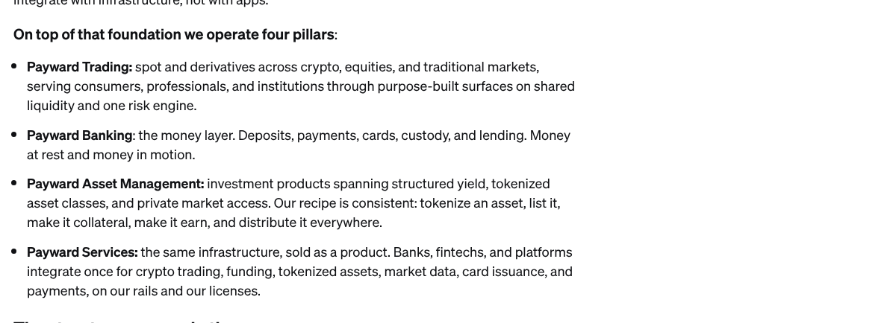
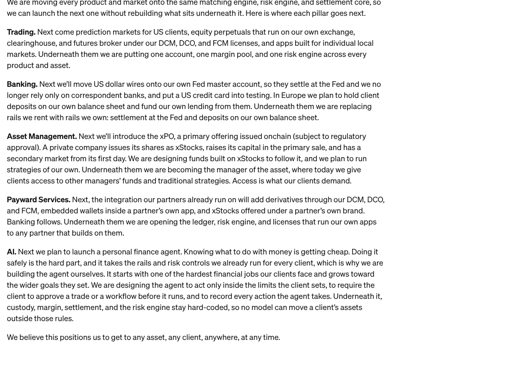
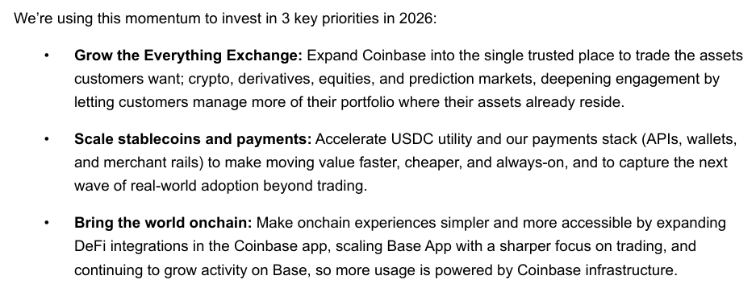
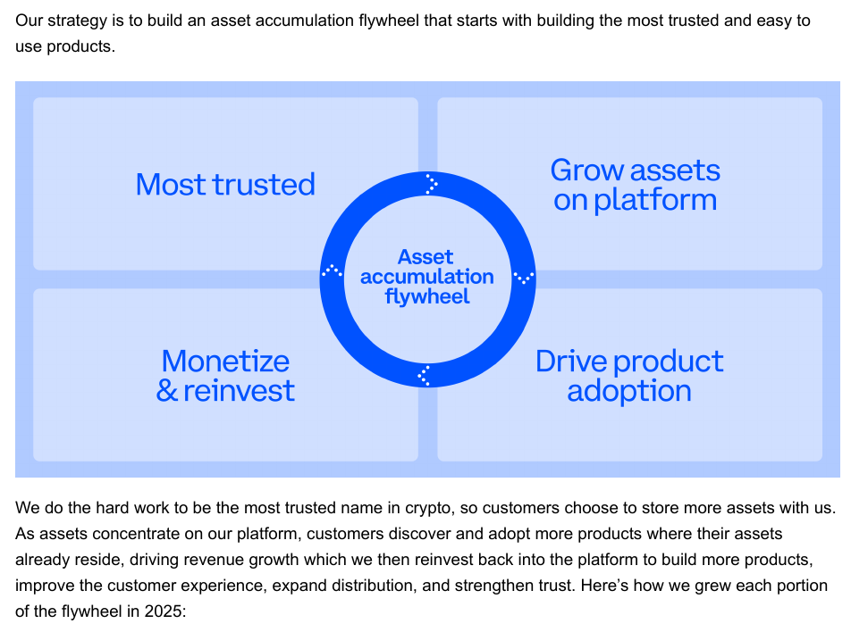
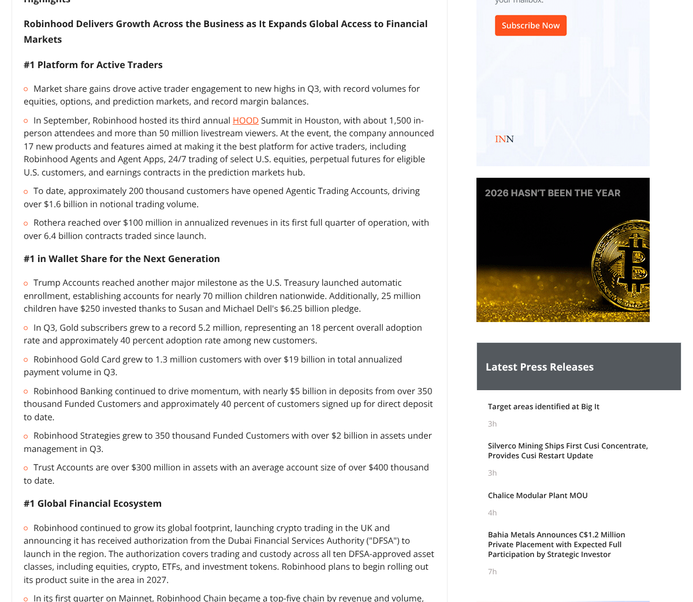
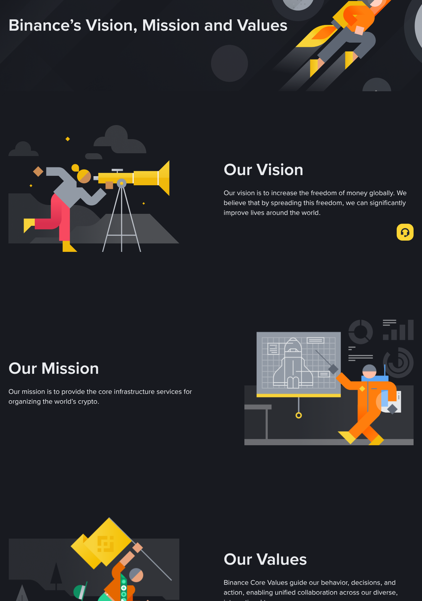
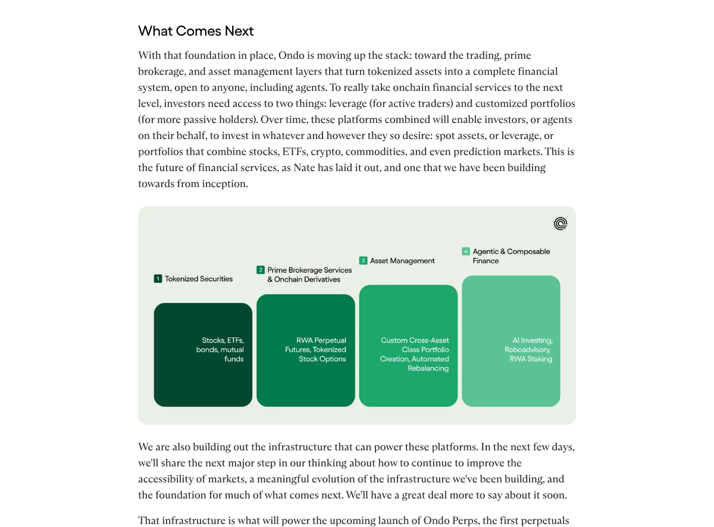
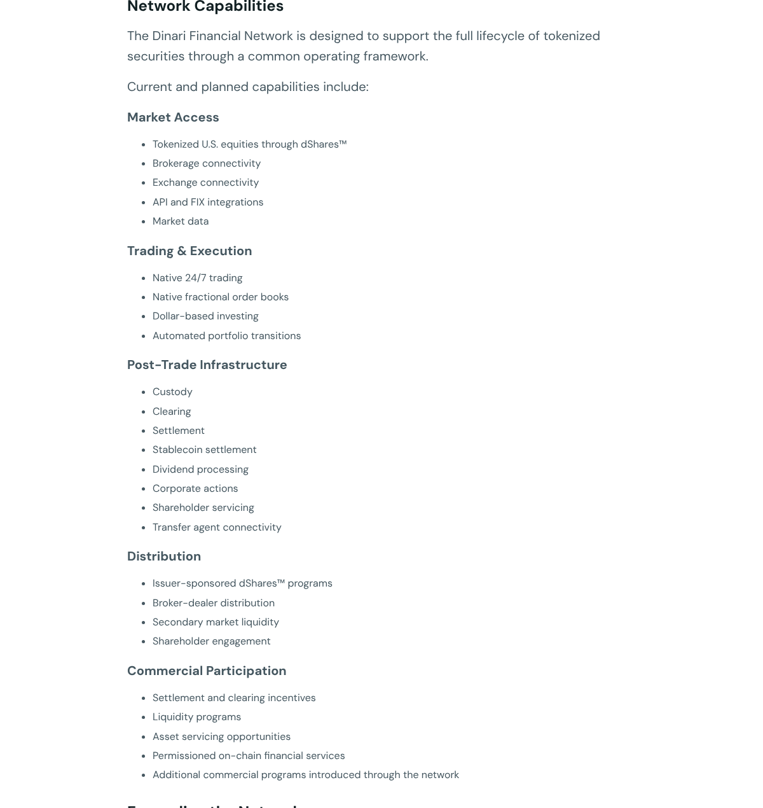
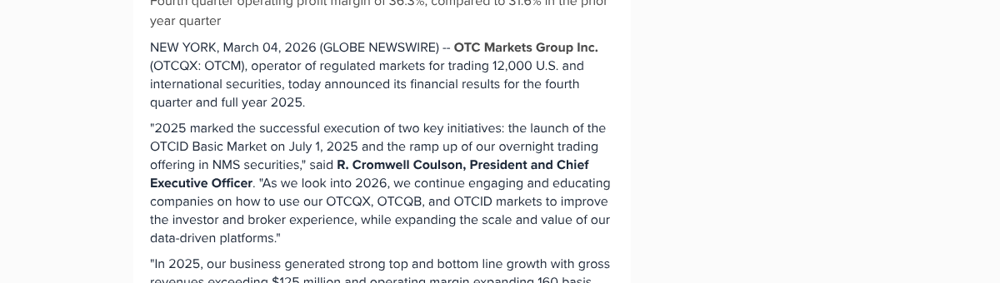

# 9곳 전략 틀 비교 (2026-11-17)

회사가 공식적으로 내건 사업 기둥, 우선순위, 비전 문장. 원문 이름 그대로, 처음 나온 시점과 바뀐 이력. 캡처는 captures/pillars/, 회사별 세부와 사실 번호는 work/PILLARS/<회사>.md.

## 한눈에

| 회사 | 공식 틀(원문) | 항목 | 처음 나온 시점과 변천 |
|---|---|---|---|
| Kraken(Payward) | pillars | Payward Trading, Payward Banking, Payward Asset Management, Payward Services, (2026-11 추가) AI | 2026-02 "superinfrastructure"(유동성, 위험 엔진, 결제, 인가가 각각 하나) → 2026-05 개인용(Direct to Consumer)과 기업용(Business to Business) 두 묶음 → 2026-08 Q2 서한에서 네 기둥 → 2026-11 Q3 서한 "This quarter we made AI the fifth" |
| Coinbase | 2026 Priorities, asset accumulation flywheel | 1 Everything Exchange, 2 Stablecoins & Payments, 3 Onchain. 플라이휠: Most trusted → Grow assets on platform → Drive product adoption → Monetize & reinvest | 2024 우선순위(매출, 쓰임, 규제 명확성) → 2025 목표(drive revenue, drive utility, scale our foundations) → 2026-02 Q4 서한에서 세 우선순위와 플라이휠. "everything exchange" 표현은 2025-07 Q2 서한이 확인된 가장 이른 사용. 2026 Q3에 1번 대상에 원자재, 외환, 3번에 에이전트 추가 |
| Robinhood | Strategic Priorities | #1 Platform for Active Traders, #1 in Wallet Share for the Next Generation, #1 Global Financial Ecosystem | 2024-02 통화의 세 초점(활성 트레이더, 지갑 점유율, 해외 확장) → 2025-02 통화에서 지금 이름 → 2026-02 보도자료 표제로 고정. 비전 문장은 "Financial SuperApp"에서 2026 Q2부터 "making everyone an owner" |
| Binance | 번호 매긴 기둥 없음. 비전과 미션 | 비전 "increase the freedom of money globally", 연말 서한의 2026 투자(security, compliance, education), 슈퍼앱 비전(2026-06) | 공동 CEO 100일 서한(이용자 중심, 2024-03) → 1년 서한(책임 있는 성장, 2024-11) → 2025-12 연말 서한 → 2026-06 "multi-asset financial super app" |
| Ondo | 미션 세 요소, 네 층 스택 | 미션 "platforms, assets, and infrastructure to bring financial markets onchain". 스택 1 Tokenized Securities, 2 Prime Brokerage Services & Onchain Derivatives, 3 Asset Management, 4 Agentic & Composable Finance | 2024-01 세 단계(현금성 토큰 → 다른 공개 증권 → 실물자산 전반) → 2025-02 미션 세 요소 → 2026-06 CEO 글의 네 층 스택(위층으로 올라감). 인프라의 실체는 Ondo Chain(2025-02)에서 Ondo Network(2026-07)로 바뀜 |
| Dinari | 홈 문장과 DFN 다섯 범주 | "Issue, distribute, and trade tokenized assets." 고객 세 갈래(발행사와 명의개서대리인, 유통 파트너, 트레이딩사와 시장조성사). DFN: Market Access, Trading & Execution, Post-Trade Infrastructure, Distribution, Commercial Participation | DFN 다섯 범주 2026-07, 홈 문장과 같은 표현의 블로그 첫 등장 2026-09 |
| Blue Ocean ATS | 공식 틀 없음, 미션 문장 | "transform US trading to Global trading", 홈 Our Vision과 Our Mission(24시간 거래), 구호 "Trade Possible" | 2021-10 개장 때부터 같은 미션 문장, 2023-01 "as the sun rises" 전략 표현, 2024-11 구호, 2025-10 24시간 7일 365일 목표(토큰화와 연결) |
| Bruce ATS | 공식 틀 없음, 미션 문장 | "Our Mission: Redefine After-Hours Trading", "always-available markets" | 미션 2025-06, "always-available" 2026-04, 주말 24시간 7일 추진 2026-09 |
| MOON ATS(OTC Markets) | 세 사업 부문 | OTC Link(MOON ATS가 속함), Market Data Licensing, Corporate Services. 2025 두 핵심 과제: OTCID 개설, 야간 상장주식 거래 확대 | 세 부문은 2016 실적 발표 표부터. 2025년 부문 수익 OTC Link 26.3, Market Data 50.4, Corporate Services 48.7백만 달러(MOON은 가장 작은 부문의 일부) |

## 읽는 법
- 틀을 공식으로 내건 곳은 미국 대형 3곳(Kraken, Coinbase, Robinhood)과 Ondo, Dinari. 세 곳 모두 2025~2026에 틀을 새로 짜거나 이름을 바꿈. 해석 : 사업을 거래 하나에서 여러 개로 넓힌 시점에 투자자에게 설명할 틀이 필요했던 것으로 보임.
- Kraken과 Coinbase는 기업용 인프라와 결제를 기둥에 올렸고, Robinhood는 같은 개인 고객의 지갑 점유율을 기둥에 둠. 축(덩치를 키운 방식)과 일치함.
- Binance는 기둥 대신 비전과 미션, 서한으로 말하고, 2026년 서한이 보안과 규제 준수를 앞에 둠. 해석 : 2023 미국 합의 뒤 신뢰 회복을 먼저 말해야 하는 위치이기 때문.
- 야간 ATS 3곳은 틀 대신 "24시간 거래" 미션 하나. MOON은 모회사 OTC Markets 안의 작은 사업.

## 주요 캡처

