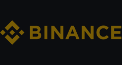
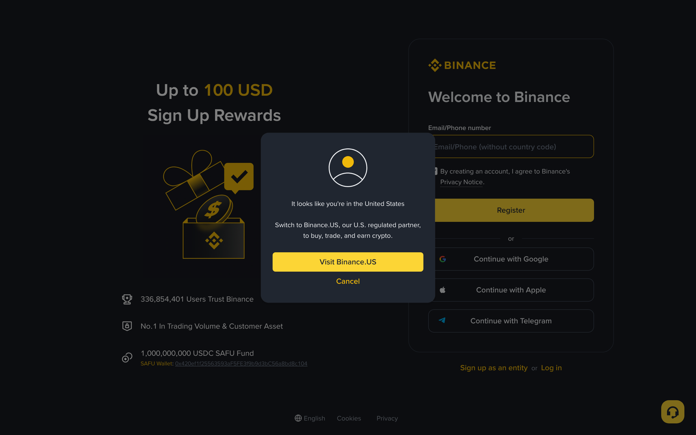
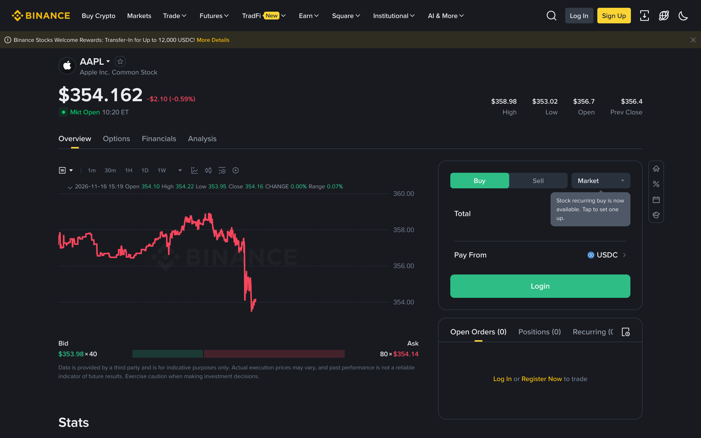
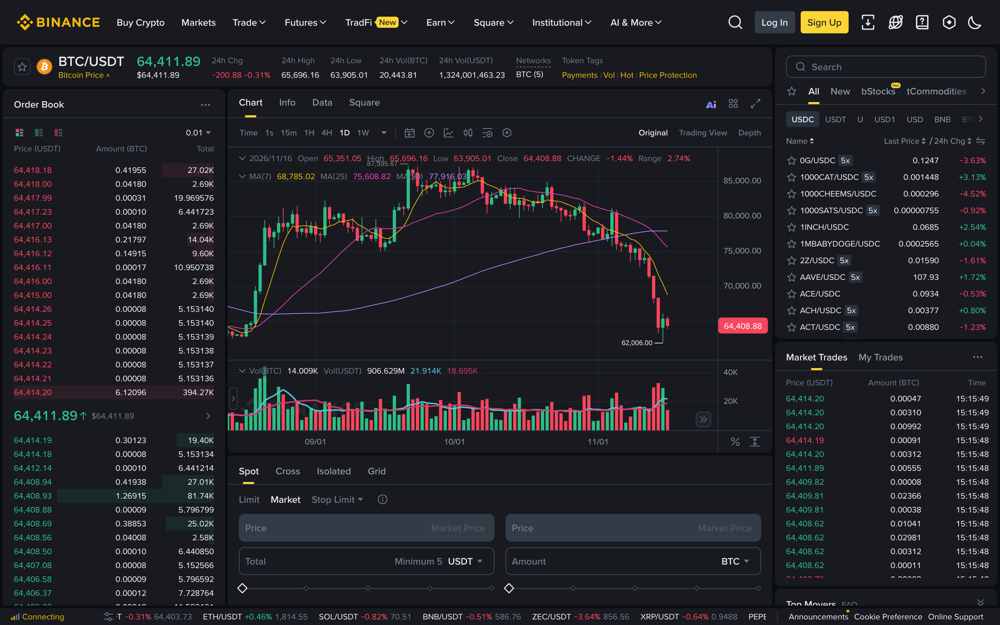
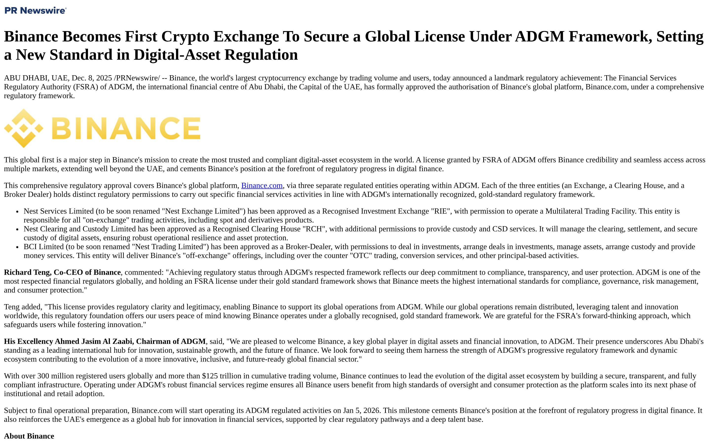
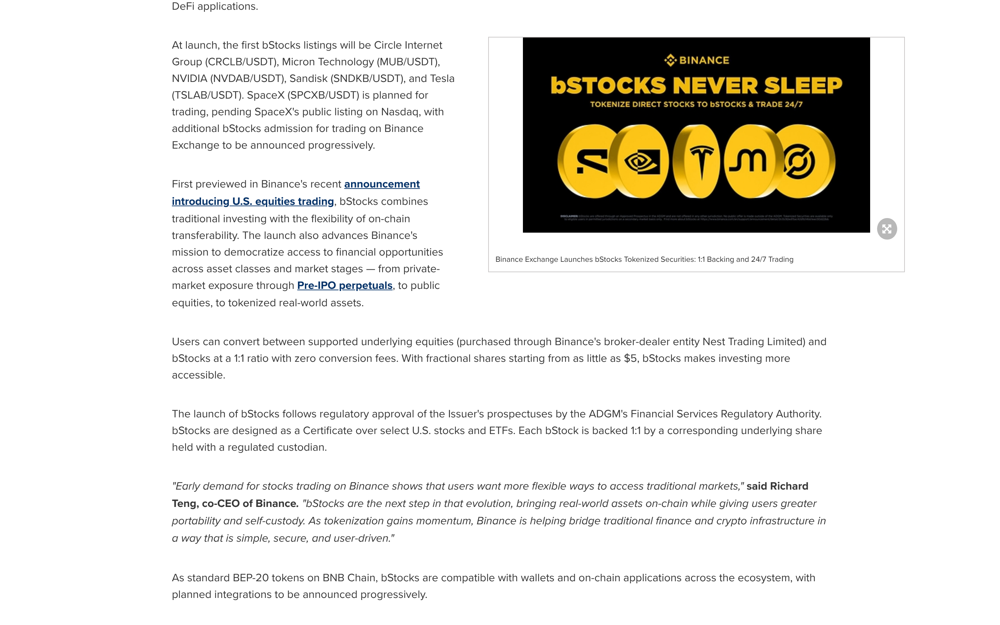
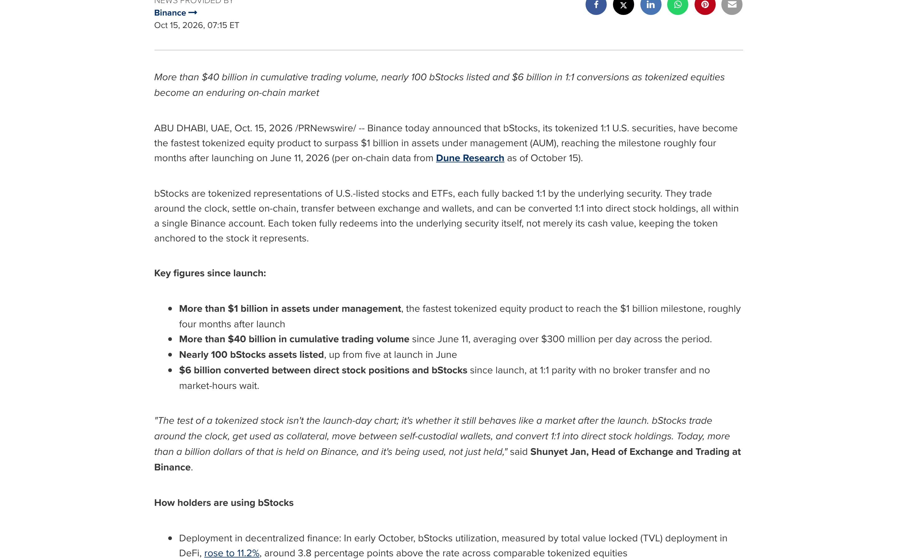

## 회사 개요와 확장 경로
● 주장 : 가상자산 거래소가 아부다비 인가로 주식 토큰을 직접 발행 [F-0064][F-0046]
● 기본정보
  ★ 법인명 : Binance 그룹(가상자산 거래소), 발행사 BTech Holdings Limited [F-0046]
  ★ 설립 : 2017-07 거래소 출시 [F-0678]
  ★ 창업자 : CZ(자오창펑), 공동 창업자 Yi He, Heina Chen [F-0678][F-0686][F-0683]
  ★ 운영 거점 : 사업은 분산, 2025-12부터 ADGM(아부다비 금융특구) 인가 기반 [F-1071]
● 지배구조
  ★ 2025-03 MGX(아부다비 투자사) 20억 달러, 소수 지분 [F-0069]
  ★ 공동 CEO : Yi He, Richard Teng [F-0686][F-0684]
  ★ Teng은 전 ADGM 금융감독청 CEO [F-0685]
  ★ 이사회 의장 : Gabriel Abed(독립이사) [F-0687]
● 설립 목적
  ★ 미션 : Binance를 크립토 세계의 인프라 제공자로 [F-0680]
● 성장 경로(한 줄기)
  ★ 2025-12 ADGM 인가 3종 → 2026-06 bStocks 5종 [F-0064][F-0053]
  ★ 2026-08 투자설명서 승인 시작 → 2026-09 선물 담보 [F-0691][F-0062]
● 화면
    

## 경영진 발언
● 발언 1 : 한 관할의 규제 기반 위에 글로벌 사업을 올린다 [F-1071]
  ★ Richard Teng(공동 CEO), ADGM 글로벌 라이선스 보도자료, 2025-12-08, https://tools.prnewswire.com/en-us/live/20813/release/20251207EN41035 [F-1071]
    ① 원문 : "This license provides regulatory clarity and legitimacy, enabling Binance to support its global operations from ADGM. While our global operations remain distributed, leveraging talent and innovation worldwide, this regulatory foundation offers our users peace of mind knowing Binance operates under a globally recognised, gold standard framework."
    ② 번역 : 이 라이선스는 규제 명확성과 정당성을 주어 Binance가 ADGM에서 글로벌 사업을 지원하게 한다. 사업은 분산돼 있지만 이 규제 기반이 이용자에게 안심을 준다.
    ③ 해석 : 큰 곳은 규제 틀 위의 글로벌 플랫폼. 그래서 거래, 청산, 중개 3개 법인으로 ADGM 인가 확보
  
● 발언 2 : 거래소 이용자의 전통 시장 접근 수요가 있다 [F-1068]
  ★ Richard Teng(공동 CEO), bStocks 출시 보도자료, 2026-06-12, https://www.prnewswire.com/apac/news-releases/binance-exchange-launches-bstocks-tokenized-securities-11-backing-and-247-trading-302798969.html [F-1068]
    ① 원문 : "Early demand for stocks trading on Binance shows that users want more flexible ways to access traditional markets. bStocks are the next step in that evolution, bringing real-world assets on-chain while giving users greater portability and self-custody."
    ② 번역 : Binance의 주식 거래에 대한 초기 수요는 이용자가 전통 시장에 더 유연하게 접근하길 원함을 보여준다. bStocks는 그 다음 단계로, 실물자산을 온체인으로 가져오며 이동성과 자기수탁을 높인다.
    ③ 해석 : 큰 곳은 거래소 이용자의 미국 주식 수요. 그래서 자체 발행 bStocks를 24시간 상장
  
● 발언 3 : 토큰 주식은 출시 뒤에도 시장으로 쓰여야 한다 [F-1069]
  ★ Shunyet Jan(거래소 및 트레이딩 총괄), bStocks AUM 보도자료, 2026-10-15, https://www.prnewswire.com/news-releases/binances-bstocks-become-the-fastest-tokenized-equity-product-to-surpass-1-billion-in-assets-under-management-302909927.html [F-1069]
    ① 원문 : "The test of a tokenized stock isn't the launch-day chart; it's whether it still behaves like a market after the launch. bStocks trade around the clock, get used as collateral, move between self-custodial wallets, and convert 1:1 into direct stock holdings."
    ② 번역 : 토큰화 주식의 시험대는 출시일 차트가 아니라 출시 후에도 시장처럼 작동하는지다. bStocks는 24시간 거래되고 담보로 쓰이며 자기수탁 지갑 사이를 오가고 1:1로 직접 주식으로 전환된다.
    ③ 해석 : 큰 곳은 담보, 전환 등 실사용. 그래서 종목을 늘리고 마진, 선물 담보로 연결
  

## A 출신과 진입(주식 토큰 사업)
● 주장 : 기존 거래소 이용자에게 그룹이 직접 만든 토큰을 얹음 [F-0046][F-0051]
● 출신 : 가상자산 거래소, 2017년 출시 [F-0678]
● 진입 방식
  ★ 2026-06 그룹 계열 BTech Holdings가 직접 발행 [F-0046]
  ★ 진출 사유 : 이용자의 전통 시장 접근 수요(Teng 발언) [F-1068]

## B 상품 구조
● 주장 : 신탁으로 보관한 기초주 1:1의 수익적 이익, 제3자 보관형 [F-0994]
● 토큰의 법적 성격(우리 분류)
  ★ ADGM 법상 증서(Certificate), ADGM 승인 투자설명서로만 공모 [F-0047]
  ★ 발행사가 기초주를 신탁 보유, 보유자는 1:1 수익적 이익 [F-0994]
  ★ 의결권, 기초 발행사 주주권 없음, 상환 시 기초주 인도 가능 [F-0994][F-0048]
  ★ 우리 분류 : 제3자 보관형(Coinbase와 같은 신탁 구조) [F-0994][F-0995]
● 발행 주체와 보관
  ★ BTech Holdings(그룹 계열 SPV)가 발행 [F-0046][F-0994]
  ★ Alpaca(미국 청산 증권사) 분리계좌에 기초주 1주씩 보관 [F-0994][F-0049]
  ★ 보유자별 권리는 CSD(중앙예탁) 원장에 기록 [F-0994]
● 투자자 권리와 공시
  ★ 2026-09 기업행위 공시 17건(TSMC, NVIDIA 등) [F-0700][F-0697][F-0728]
  ★ 발행 잔량을 주 단위로 공시(2026-09 3건) [F-0703][F-0700]
● 규모(시장 내 위치)
  ★ 2026-11-16 발행 잔액 13.6억 달러, 1위(점유율 36.62%) [F-1021]
  ★ 2~4위는 Ondo, Kraken, Securitize(9.0억, 6.8억, 2.7억 달러) [F-1022][F-1023][F-1024]
  ★ Robinhood 6위 1.5억, Coinbase 8위 0.5억 달러 [F-1025][F-1026]
  ★ 시장 전체 37.1억 달러(같은 출처, 같은 날) [F-1028]
● 수수료
  ★ 주식과 토큰 1:1 전환 수수료 0, 소수 주식 5달러부터 [F-0050]

## C 최종 투자자
● 주장 : 미국 밖 Binance 거래소 자격 이용자 [F-0054]
● 대상
  ★ 허용 지역 자격 이용자, 2차 시장 거래 [F-0054]
● 국적 및 지역 제한
  ★ 미국, 미국인 제외, 허용국 전체 목록 비공개 [F-0054]

## D 유통과 접점
● 주장 : 파트너 공급 없이 자체 거래소에서 직접 판매 [F-0051][F-0994]
● 공급 방식(누구에게 서빙하는지)
  ★ 자사 직접 판매 : Binance 거래소 USDT 현물 쌍 [F-0051]
  ★ 고객층 : 미국 밖 자격 이용자, 40개 언어 24시간 지원 [F-0054][F-0677]
● 거래 장소
  ★ 사용 블록체인 : BNB Chain(BEP-20) [F-0052]
  ★ 24시간 7일 거래, 원주 1:1 전환으로 가격 연동 [F-0051][F-0050]

## E 인가
● 주장 : 체결, 청산, 중개 인가를 ADGM 한 관할의 그룹 법인 셋이 보유 [F-0064][F-0065][F-0066]
● 보유 인가와 법인
  ★ Nest Exchange : 인정투자거래소, MTF 운영(체결) [F-0064]
  ★ Nest Clearing and Custody : 청산기관, 수탁, CSD [F-0065]
  ★ Nest Trading : 브로커딜러, 장외 거래와 1:1 전환 [F-0066][F-0050]
  ★ 그 밖 : 2022년 두바이 VARA, 2024년 아르헨티나 등록 [F-0068][F-0712]

## F 관계(해당 시)
● 주장 : 경쟁 발행사 Ondo의 토큰도 자기 시장에 상장 [F-0549]
● 인수, 투자, 제휴
  ★ Ondo Stocks(Ondo 주식 토큰) 일부를 Nest Exchange에서 거래 허용 [F-0549]

## G 한국 접점(해당 시)
● 주장 : 주식 토큰이 아니라 가상자산 거래소 인수로 한국과 연결 [F-0073]
● 한국 회사와의 관계
  ★ 2025-10 FIU, 고팍스(국내 거래소) 최대주주 변경 수리 [F-0073]
  ★ 신고는 2023-03부터 보류 [F-0073]

## 한국 시장과의 차이
● 주장 : ADGM 증서 발행으로 길이 열렸고, 한국은 해외 토큰 판매 근거가 없다 [F-0047][KR-자본시장법-119]
● 규제
  ★ 가능했던 이유 : ADGM 한 관할에서 발행, 체결, 청산 인가 [F-0047][F-0064][F-0065]
  ★ 가능했던 이유 : 미국과 미국인을 판매 대상에서 제외 [F-0054]
  ★ 한국에서 막히는 지점 : 해외 발행 토큰은 국내 권유 시 증권신고서 [KR-자본시장법-119]
  ★ 한국에서 막히는 지점 : 장외거래소 토큰 유통 근거는 2027-02 시행 [KR-자본시장법-166]
● 고객 수요
  ★ 가능했던 이유 : 거래소 이용자의 전통 시장 접근 수요 [F-1068]
  ★ 한국 차이 : 국내 투자자는 이미 증권사로 미국 주식 1,636억 달러 보관(2025말) [F-1005]
  ★ 한국 차이 : 2025-11 증권사 18곳이 미국 주식 주간거래 재개 [F-1010]

## 성과와 판단
● 성과
  ★ 2026-08~09 ADGM 승인 투자설명서 20건 [F-0692]
  ★ 2026-11 청산 편입 통지 21건, 티커 105개 [F-0704][F-0706]
● 핵심 성공요인(KSF)
  ★ 기존 거래소 이용자에게 24시간 바로 상장 [F-0051]
  ★ 원주 1:1 전환 창구로 토큰 가격을 주식에 연동 [F-0050]
● 제약과 리스크
  ★ 미국 형사 합의에 따른 준수 감독인과 정보 공유 [F-0719][F-0720]
  ★ 2025-05 SEC 민사소송은 재제기 불가로 취하 [F-0072]
  ★ 발행사 의무는 보관 기초주에 한정(제한소구) [F-0994]
● KDX 시사점(스토리라인 명제별)
  ★ 시장 인프라 Unbundling : 체결, 청산, 중개는 그룹 법인별 인가, 보관만 Alpaca 위탁 [F-0064][F-0065][F-0066][F-0994]
  ★ Borderless Investing : 거래소 계정으로 미국 주식 토큰 24시간, 미국인 제외 [F-0051][F-0054]
  ★ Coopetition : 1위 발행사이면서 2위 Ondo 토큰도 자기 시장에 상장 [F-1021][F-1022][F-0549]
  ★ 해외 확장 세 질문 : 24시간 접근, ADGM 인가 3종, 담보 활용 거래 확대(제공 가치, 제도, 경제성) [F-0051][F-0064][F-0062]
