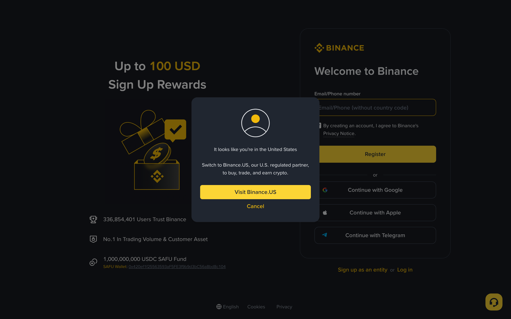
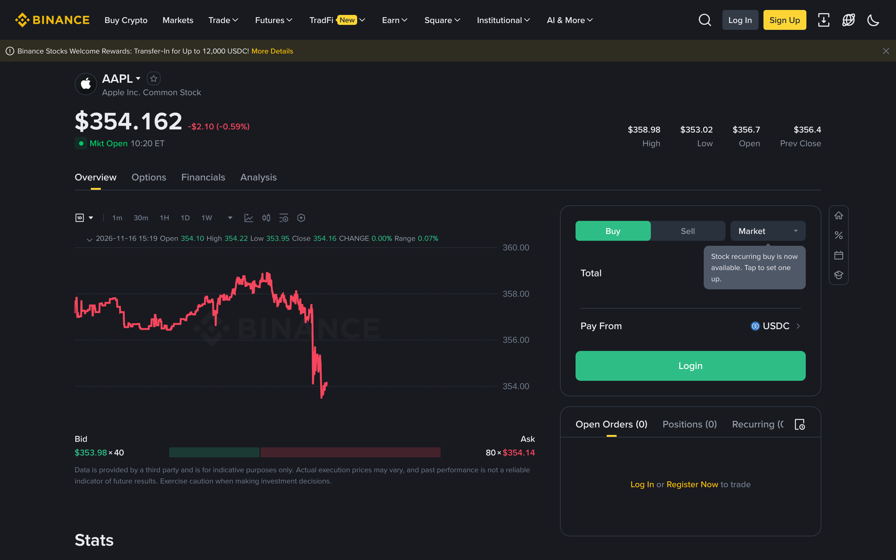
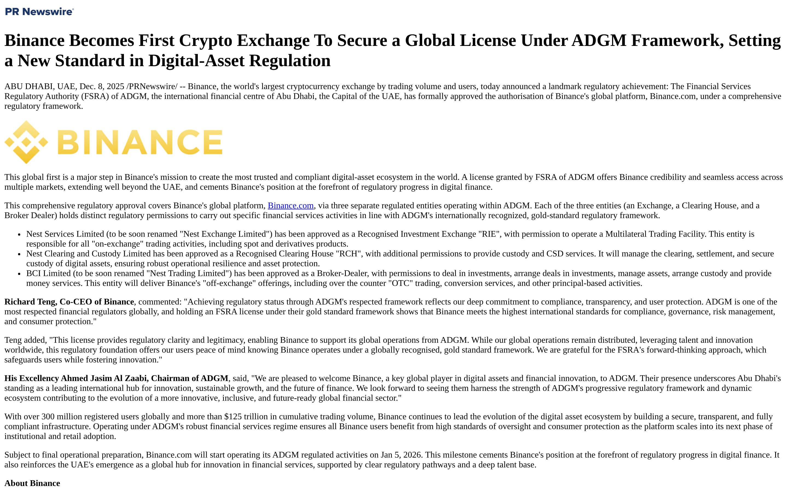
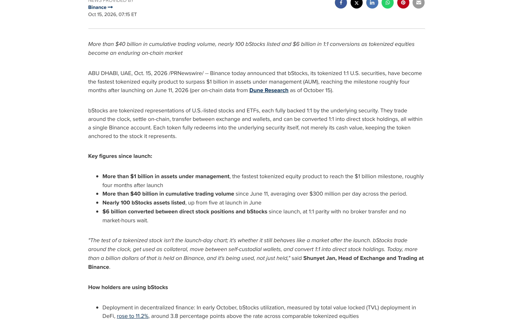
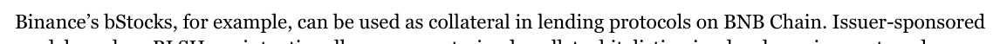

## 정체 카드
● 한 줄 정체 : 2017년 CZ가 시작한 가상자산 거래소, 미국 주식과 주식 토큰도 취급 [F-0678][F-1198]
● 대표 상품 : 미국 주식 거래 = 실제 주식 7,000종 이상(Nest Trading이 주문을 Alpaca로 보냄, 2026-06-01) [F-1198][F-1229]
● 대표 상품(토큰) : bStocks = 주식 연계 증서(계열 BTech Holdings 발행), 미국인 제외 [F-0046][F-0054]
● 꼭 알아야 할 사실
  ★ 최초, 최대 타이틀 : 가장 빨리 운용자산 10억 달러를 넘은 토큰 주식 bStocks(회사 주장) [F-0057]
  ★ 큰 인수 : 2025-10 고팍스 최대주주 지위, 한국 금융정보분석원 승인(금액 못 찾음) [F-0073]
  ★ 큰 제재 : 2023-11 미국 재무부 합의(FinCEN 34억 달러, OFAC 9.68억 달러) [F-1200]
  ★ 사면 : 창업자 CZ, 2025-10-21 사면 항목(미 법무부 사면담당관실 목록) [F-1199][F-1234]
● 숫자
  ★ 순위와 잔액 : 2026-11-16 bStocks 1위, 13.6억 달러(rwa.xyz) [F-1021]
  ★ 종목 수 : 미국 주식과 ETF 7,000종 이상, bStocks 약 100종 [F-1198][F-1229][F-0059]
  ★ 이용자 수 : 3억 2천만 명 이상(회사 주장) [F-1201]
● 흐름(주식 거래) : 이용자 → Binance 앱 → Nest Trading(ADGM 브로커) → Alpaca(청산, 보관) [F-1198][F-0066]
● 흐름(bStocks) : 이용자 → Binance 거래소 → 발행(BTech Holdings) → Alpaca(보관) [F-0051][F-0046][F-0994]

## 회사 개요와 확장 경로
● 쉽게 말하면 : 거래소가 2021년에 접은 주식 토큰을 인가 뒤 직접 발행으로 재개 [F-1124][F-0064][F-1126]
● 주장 : 2021년에 접은 주식 토큰을 인가 3종 뒤 직접 발행으로 재개 [F-1124][F-0064][F-1126]
● 기본정보
  ★ 법인명 : Binance 그룹(가상자산 거래소), 발행사 BTech Holdings Limited [F-0046]
  ★ 설립 : 2017-07 거래소 출시 [F-0678]
  ★ 창업자 : CZ(자오창펑), 공동 창업자 Yi He, Heina Chen [F-0678][F-0686][F-0683]
  ★ 운영 거점 : 사업은 분산, 2025-12부터 ADGM(아부다비 금융특구) 인가 기반 [F-1071]
● 지배구조
  ★ 2025-03 MGX(아부다비 투자사) 20억 달러, 소수 지분 [F-0069]
  ★ 공동 CEO : Yi He, Richard Teng [F-0686][F-0684]
  ★ Teng은 전 ADGM 금융감독청 CEO [F-0685]
  ★ 이사회 의장 : Gabriel Abed(독립이사) [F-0687]
● 설립 목적
  ★ 미션 : Binance를 크립토 세계의 인프라 제공자로 [F-0680]
● 성장 경로(한 줄기)
  ★ 2021-04 주식 토큰 → 2021-10 지원 종료 [F-1124]
  ★ 2025-12 ADGM 인가 3종 확보 [F-0064]
  ★ 2026-02 Ondo 토큰 Binance Alpha 상장 [F-1125]
  ★ 2026-06 bStocks 직접 발행 → 2026-09 선물 담보 [F-1126][F-0062]
● 화면
   

## 사업 범위와 넓힌 순서
● 쉽게 말하면 : 거래소 이용자 위에 실제 주식, 주식 토큰, 담보 순으로 더함 [F-1198][F-1126][F-0062]
● 주장 : 거래소로 시작해 접은 주식 토큰을 ADGM 인가 3종 뒤 재개 [F-0678][F-1124][F-0064]
● 자산(무엇을 어떤 순서로 더했나)
  ★ 2017-07 가상자산 거래소 : 직접 출시 [F-0678]
  ★ 2021-04 주식 토큰 : 직접, 2021-10 지원 종료 [F-1124]
  ★ 2026-02 Ondo 주식 토큰 : 제휴 상장 [F-1125]
  ★ 2026-06 bStocks : 계열 BTech 직접 발행 [F-1126]
● 자산 2
  ★ 2026-09 선물 담보 : bStocks로 확대 [F-0062]
  ★ 2025-11 국채 토큰 BUIDL : 기관 장외결제 담보로 수용 [F-1233]
  ★ 2026-10-28 bStocks 5종 : 증거금 담보로(차입은 불가) [F-1230][F-1160]
  ★ 2026-10~11 주식 7종 무기한선물, 최대 20배, 24시간 [F-1231][F-1232][F-1161]
● 고객(개인에서 기관으로)
  ★ 개인 이용자 : 거래소 직접, 40개 언어 지원 [F-0677]
  ★ 2026-06 bStocks 자격 이용자 : 직접 판매 [F-0054]
  ★ 기관 : 2025-11 BUIDL을 장외결제 담보로 [F-1233]
● 시장(어느 나라로)
  ★ 2022-09 두바이 : VARA 직접 [F-0068]
  ★ 2024-09 아르헨티나 : 현지 법인 등록 [F-0712]
  ★ 2025-10 한국 : 고팍스 최대주주 변경 수리 [F-0073]
  ★ 2025-12 아부다비 : ADGM 인가 3종 직접 [F-0064]
● 2021-04 주식 토큰 시도, 2021-07 중단 : 인가 없이 시작했다가 접음 [F-1124]
  ★ 왜 : 다른 제품에 집중하겠다며 구매 중단 공지(언론 인용) [F-1124]
  ★ 쓴 곳 : 2021-10-14 지원 종료, 이후 5년간 공백 [F-1124]
  ★ 해석 : 첫 시도를 접고 2025-12 인가를 받은 뒤 2026-06 재설계해 재개 [F-1124][F-0064][F-1126]
● 2025-12 ADGM 인가 3종(거래소, 청산과 보관, 브로커딜러) : 아부다비 규제 기반 확보 [F-0064][F-0065][F-0066]
  ★ 왜 : 규제 명확성과 정당성으로 ADGM에서 글로벌 사업 지원(Teng) [F-1071]
  ★ 쓴 곳 : 2026-06 미국 주식 거래를 Nest Trading(브로커딜러) 이름으로 개시 [F-1198][F-0066]
  ★ 해석 : 전통 증권 취급의 법적 바탕을 한 관할에 마련, 그 위에 토큰 발행 [F-1071][F-0064][F-1126]
● 2026-06 미국 주식 거래 개시(7,000종 이상) : 실제 주식을 거래소 안에 먼저 열었음 [F-1198]
  ★ 왜 : 접근이 쉬워질수록 금융 포용이 커진다는 믿음(회사 발표) [F-1198]
  ★ 쓴 곳 : 소수 주식 5달러부터, 이후 bStocks 1대1 전환 누적 60억 달러 [F-0050][F-0060]
  ★ 해석 : 실제 주식을 먼저 열고 토큰은 그 위에 얹는 순서 [F-1198][F-1126][F-0060]
● 2026-06 bStocks 직접 발행(계열 BTech Holdings) : 토큰을 자체 발행으로 전환 [F-1126][F-0046]
  ★ 왜 : 주식 거래 초기 수요가 더 유연한 접근을 원함을 보여줌(Teng) [F-1068]
  ★ 쓴 곳 : 2026-10 운용자산 10억 달러, 누적 거래 400억 달러(회사 발표) [F-0057][F-0058]
  ★ 쓴 곳 : 2026-09 마진과 선물 담보로 확대, 약 100종 [F-0062][F-0059]
  ★ 해석 : 이용자 기반 위에서 24시간 거래와 담보로 확장, 발행사는 계열 SPV [F-1126][F-0062][F-0994]
● 해석 : 거래소에서 시작해 인가를 얻은 뒤 실제 주식, 직접 발행 토큰, 담보로 넓힘 [F-0064][F-1198][F-0062]

## 경영진 발언
● 쉽게 말하면 : 규제 기반 위에 글로벌 사업을 올리고 전통 시장 수요를 받는다고 말함 [F-1071][F-1068]
● 발언 1 : 한 관할의 규제 기반 위에 글로벌 사업을 올린다 [F-1071]
  ★ Richard Teng(공동 CEO), ADGM 글로벌 라이선스 보도자료, 2025-12-08, https://tools.prnewswire.com/en-us/live/20813/release/20251207EN41035 [F-1071]
    ① 원문 : "This license provides regulatory clarity and legitimacy, enabling Binance to support its global operations from ADGM. While our global operations remain distributed, leveraging talent and innovation worldwide, this regulatory foundation offers our users peace of mind knowing Binance operates under a globally recognised, gold standard framework."
    ② 번역 : 이 라이선스는 규제 명확성과 정당성을 주어 Binance가 ADGM에서 글로벌 사업을 지원하게 한다. 사업은 분산돼 있지만 이 규제 기반이 이용자에게 안심을 준다.
    ③ 해석 : 큰 곳은 규제 틀 위의 글로벌 플랫폼. 그래서 거래, 청산, 중개 3개 법인으로 ADGM 인가 확보
  
● 발언 2 : 거래소 이용자의 전통 시장 접근 수요가 있다 [F-1068]
  ★ Richard Teng(공동 CEO), bStocks 출시 보도자료, 2026-06-12, https://www.prnewswire.com/apac/news-releases/binance-exchange-launches-bstocks-tokenized-securities-11-backing-and-247-trading-302798969.html [F-1068]
    ① 원문 : "Early demand for stocks trading on Binance shows that users want more flexible ways to access traditional markets. bStocks are the next step in that evolution, bringing real-world assets on-chain while giving users greater portability and self-custody."
    ② 번역 : Binance의 주식 거래에 대한 초기 수요는 이용자가 전통 시장에 더 유연하게 접근하길 원함을 보여준다. bStocks는 그 다음 단계로, 실물자산을 온체인으로 가져오며 이동성과 자기수탁을 높인다.
    ③ 해석 : 큰 곳은 거래소 이용자의 미국 주식 수요. 그래서 자체 발행 bStocks를 24시간 상장
  
● 발언 3 : 토큰 주식은 출시 뒤에도 시장으로 쓰여야 한다 [F-1069]
  ★ Shunyet Jan(거래소 및 트레이딩 총괄), bStocks AUM 보도자료, 2026-10-15, https://www.prnewswire.com/news-releases/binances-bstocks-become-the-fastest-tokenized-equity-product-to-surpass-1-billion-in-assets-under-management-302909927.html [F-1069]
    ① 원문 : "The test of a tokenized stock isn't the launch-day chart; it's whether it still behaves like a market after the launch. bStocks trade around the clock, get used as collateral, move between self-custodial wallets, and convert 1:1 into direct stock holdings."
    ② 번역 : 토큰화 주식의 시험대는 출시일 차트가 아니라 출시 후에도 시장처럼 작동하는지다. bStocks는 24시간 거래되고 담보로 쓰이며 자기수탁 지갑 사이를 오가고 1:1로 직접 주식으로 전환된다.
    ③ 해석 : 큰 곳은 담보, 전환 등 실사용. 그래서 종목을 늘리고 마진, 선물 담보로 연결
  

## A 출신과 진입(주식 토큰 사업)
● 쉽게 말하면 : 남의 토큰을 먼저 상장해 본 뒤 직접 만든 토큰을 얹음 [F-1125][F-1126]
● 주장 : 남의 토큰 상장을 거쳐 이용자에게 직접 만든 토큰을 얹음 [F-1125][F-1126][F-0051]
● 출신 : 가상자산 거래소, 2017년 출시 [F-0678]
● 진입 방식
  ★ 2026-06 그룹 계열 BTech Holdings가 직접 발행 [F-0046]
  ★ 진출 사유 : 이용자의 전통 시장 접근 수요(Teng 발언) [F-1068]

## B 상품 구조
● 쉽게 말하면 : 투자자는 발행사가 신탁으로 보유한 주식의 1대1 수익권을 가짐 [F-0994]
● 주장 : 직접 발행으로 돌아선 지 5개월 만에 잔액 1위 [F-1126][F-1021]
● 토큰의 법적 성격(우리 분류)
  ★ ADGM 법상 증서(Certificate), ADGM 승인 투자설명서로만 공모 [F-0047]
  ★ 발행사가 기초주를 신탁 보유, 보유자는 1:1 수익적 이익 [F-0994]
  ★ 의결권, 기초 발행사 주주권 없음, 상환 시 기초주 인도 가능 [F-0994][F-0048]
  ★ 우리 분류 : 제3자 보관형(Coinbase와 같은 신탁 구조) [F-0994][F-0995]
● 발행 주체와 보관
  ★ BTech Holdings(그룹 계열 SPV)가 발행 [F-0046][F-0994]
  ★ Alpaca(미국 청산 증권사) 분리계좌에 기초주 1주씩 보관 [F-0994][F-0049]
  ★ 보유자별 권리는 CSD(중앙예탁) 원장에 기록 [F-0994]
● 투자자 권리와 공시
  ★ 2026-09 기업행위 공시 17건(TSMC, NVIDIA 등) [F-0700][F-0697][F-0728]
  ★ 발행 잔량을 주 단위로 공시(2026-09 3건) [F-0703][F-0700]
● 규모(시장 내 위치)
  ★ 2026-11-16 발행 잔액 13.6억 달러, 1위(점유율 36.62%) [F-1021]
  ★ 2~4위는 Ondo, Kraken, Securitize(9.0억, 6.8억, 2.7억 달러) [F-1022][F-1023][F-1024]
  ★ Robinhood 6위 1.5억, Coinbase 8위 0.5억 달러 [F-1025][F-1026]
  ★ 시장 전체 37.1억 달러(같은 출처, 같은 날) [F-1028]
● 규모의 과거 대비(2026-01 초 기준)
  ★ 2026-01 초 rwa.xyz 표에는 없음(bStocks 2026-06 출시) [TP-005][F-1126]
● 수수료
  ★ 주식과 토큰 1:1 전환 수수료 0, 소수 주식 5달러부터 [F-0050]
● 평가
  ★ 유동성 분산 : 같은 주식이 Ondo 토큰과 bStocks로 갈림 [F-1125][F-1126]
  ★ 블록체인 위 활용 : 마진과 선물 담보로 사용 [F-0062]
  ★ 제3자 위험 : 발행 SPV BTech, 기초주 Alpaca 보관 [F-0994]
● 제3자 시각(구조)
  ★ 보관형, 발행사 동의 없음, 장부는 Binance 보유 (CoinDesk Research, Bullish 의뢰) [TP-211]
  ★ 표는 보관형으로 묶음, 투자설명서상은 신탁 수익권 [TP-211][F-0994]

## C 최종 투자자
● 쉽게 말하면 : 미국과 미국인을 뺀 거래소 자격 이용자가 대상 [F-0054]
● 주장 : 미국 밖 Binance 거래소 자격 이용자 [F-0054]
● 대상
  ★ 허용 지역 자격 이용자, 2차 시장 거래 [F-0054]
● 국적 및 지역 제한
  ★ 미국, 미국인 제외, 허용국 전체 목록 비공개 [F-0054]

## D 유통과 접점
● 쉽게 말하면 : 파트너 없이 자기 거래소에서 24시간 7일 직접 판매 [F-0051][F-0994]
● 주장 : 파트너 공급 없이 자체 거래소에서 직접 판매 [F-0051][F-0994]
● 공급 방식(누구에게 서빙하는지)
  ★ 자사 직접 판매 : Binance 거래소 USDT 현물 쌍 [F-0051]
  ★ 고객층 : 미국 밖 자격 이용자, 40개 언어 24시간 지원 [F-0054][F-0677]
● 거래 장소
  ★ 사용 블록체인 : BNB Chain(BEP-20) [F-0052]
  ★ 24시간 7일 거래, 원주 1:1 전환으로 가격 연동 [F-0051][F-0050]
● 가격과 유동성 장치
  ★ 상환과 수렴 : 원주와 1:1 전환, 수수료 없음 [F-0050][F-0060]
● 제3자 시각(유통)
  ★ bStocks를 BNB Chain 대출 담보로 쓴다고 서술 (CoinDesk Research, Bullish 의뢰) [TP-212]

## E 인가
● 쉽게 말하면 : 체결, 청산, 중개 인가를 아부다비 계열 법인 셋이 직접 확보 [F-0064][F-0065][F-0066]
● 주장 : 체결, 청산, 중개 인가를 ADGM 그룹 법인 셋이 직접 확보 [F-0064][F-0065][F-0066]
● 보유 인가와 법인
  ★ Nest Exchange : 인정투자거래소, MTF 운영, 2025-12 직접 [F-0064]
  ★ Nest Clearing and Custody : 청산, 수탁, CSD, 2025-12 직접 [F-0065]
  ★ Nest Trading : 브로커딜러, 1:1 전환, 2025-12 직접 [F-0066][F-0050]
  ★ 그 밖 : 2022년 두바이 VARA, 2024년 아르헨티나 등록 [F-0068][F-0712]
● 발행 법인
  ★ BTech Holdings : 그룹 계열, 2026-06 직접 발행 [F-1126]

## F 관계(해당 시)
● 쉽게 말하면 : 경쟁 발행사 Ondo의 토큰도 자기 시장에 상장 [F-1125][F-0549]
● 주장 : 경쟁 발행사 Ondo의 토큰도 자기 시장에 상장 [F-1125][F-0549]
● 인수, 투자, 제휴
  ★ Ondo 주식 토큰 10종 Binance Alpha 상장(2026-02-24) [F-1125]
  ★ Ondo Stocks(Ondo 주식 토큰) 일부를 Nest Exchange에서 거래 허용 [F-0549]

## G 한국 접점(해당 시)
● 쉽게 말하면 : 주식 토큰이 아니라 거래소 인수로 한국과 연결 [F-0073]
● 주장 : 주식 토큰이 아니라 가상자산 거래소 인수로 한국과 연결 [F-0073]
● 한국 회사와의 관계
  ★ 2025-10 FIU, 고팍스(국내 거래소) 최대주주 변경 수리 [F-0073]
  ★ 신고는 2023-03부터 보류 [F-0073]

## 한국 시장과의 차이
● 쉽게 말하면 : 아부다비 증서로 길이 열렸고 한국은 해외 토큰 판매 근거 없음 [F-0047][KR-자본시장법-119]
● 주장 : ADGM 증서 발행으로 길이 열렸고, 한국은 해외 토큰 판매 근거가 없다 [F-0047][KR-자본시장법-119]
● 규제
  ★ 가능했던 이유 : ADGM 한 관할에서 발행, 체결, 청산 인가 [F-0047][F-0064][F-0065]
  ★ 가능했던 이유 : 미국과 미국인을 판매 대상에서 제외 [F-0054]
  ★ 한국 차이 : 허용국 전체 목록 비공개, 한국 이용 가능 여부 불명 [F-0054]
● 고객 수요
  ★ 가능했던 이유 : 거래소 이용자의 전통 시장 접근 수요 [F-1068]
● 규제 건의 포인트 : 해외 거래소 발행 토큰의 허용국 공시 기준 [F-0054]

## 성과와 판단
● 쉽게 말하면 : 접었던 주식 토큰이 직접 발행 뒤 400억 달러 거래량, 잔액 1위 [F-0058][F-1021]
● 주장 : 접었던 주식 토큰이 직접 발행 뒤 400억 달러 거래량 [F-1124][F-1126][F-0058]
● 성과
  ★ bStocks 운용자산 10억 달러 초과(Dune Research 측정, 회사 발표) [F-0057]
  ★ 출시 후 누적 거래량 400억 달러 초과(회사 발표) [F-0058]
  ★ 상장 종목 약 100개(출시 5개), 1:1 전환 60억 달러(회사 발표) [F-0059][F-0060]
  ★ 2026-08~09 ADGM 승인 투자설명서 20건 [F-0692]
● 핵심 성공요인(KSF)
  ★ 거래소 이용자에게 상장, 초기 이용자 58.5%가 선물 등도 거래(회사 발표) [F-0051][F-0063]
  ★ 24시간 7일 거래, 7월 정규장 시간 거래 38%(회사 발표) [F-0051][F-0061]
  ★ 원주 1:1 전환 창구, 누적 전환 60억 달러(회사 발표) [F-0050][F-0060]
● 제약과 리스크
  ★ 미국 형사 합의에 따른 준수 감독인과 정보 공유 [F-0719][F-0720]
  ★ 2025-05 SEC 민사소송은 재제기 불가로 취하 [F-0072]
  ★ 발행사 의무는 보관 기초주에 한정(제한소구) [F-0994]
● 제3자 평가
  ★ 평가 1 : CoinDesk Research(Bullish 의뢰, 발행사 직접 방식에 유리하게 씀), The Future of Equity Ownership: An Issuer's Guide to Tokenized Equities, 2026-09-29(표 기준 2026-08), 10쪽 표, https://www.coindesk.com/research/the-future-of-equity-ownership-an-issuer-s-guide-to-tokenized-equities [TP-211]
    ① 원문 : 표 Binance 열 "Custodial tokenized equities", "No consent", "Claim / cert", "Binance-held", "Partial", "Not for US"
    ② 번역 : 보관형 토큰 주식, 발행사 동의 없음, 청구권 또는 증서, Binance가 보유, 권리 일부, 미국 불가.
    ③ 해석 : 표는 Binance를 Dinari와 같은 보관형으로 묶었으나 투자설명서상은 신탁 수익권이고 표 각주는 두 상품 중 좋은 쪽으로 채점했다고 밝힘. 그래서 KDX는 우리 분류를 유지하고 발행사 동의 없는 구조라는 점을 볼 것
  ★ 평가 2 : CoinDesk Research(Bullish 의뢰, 발행사 직접 방식에 유리하게 씀), The Future of Equity Ownership: An Issuer's Guide to Tokenized Equities, 2026-09-29, 15쪽, https://www.coindesk.com/research/the-future-of-equity-ownership-an-issuer-s-guide-to-tokenized-equities [TP-212]
    ① 원문 : "Binance’s bStocks, for example, can be used as collateral in lending protocols on BNB Chain."
    ② 번역 : 예를 들어 Binance의 bStocks는 BNB Chain의 대출 프로토콜에서 담보로 쓸 수 있다.
    ③ 해석 : 발행사 직접 방식은 이동이 제한된다고 대비해 쓴 대목. 그래서 KDX는 담보 활용과 이전 제한의 균형을 볼 것
  
● KDX 시사점
  ★ 확장 축 : 시장(해외), 자산(가상자산) [F-0064][F-0678]
  ★ KDX가 가져올 것 : 경쟁 발행사 토큰 상장 뒤 직접 발행으로 확장 [F-1125][F-1126]
  ★ KDX가 가져올 것 : 원주 보관 뒤 수익권 유통, 국내는 예탁원 신탁 수익증권 구조로 (기고, 법률 실무) [F-0049][TP-435]
  ★ KDX가 피할 것 : 발행사 의무가 보관 기초주에 한정되는 구조 [F-0994]
● 해외 확장 세 질문
  ★ 제공 가치 : 거래소 계정으로 미국 주식 토큰 24시간 [F-0051][F-0054]
  ★ 제도 : ADGM 인가 3종, 승인 투자설명서 [F-0064][F-0692]
  ★ 경제성 : 담보 활용 거래 확대, 누적 거래량 400억 달러 [F-0062][F-0058]
