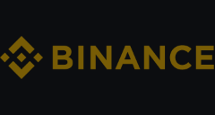
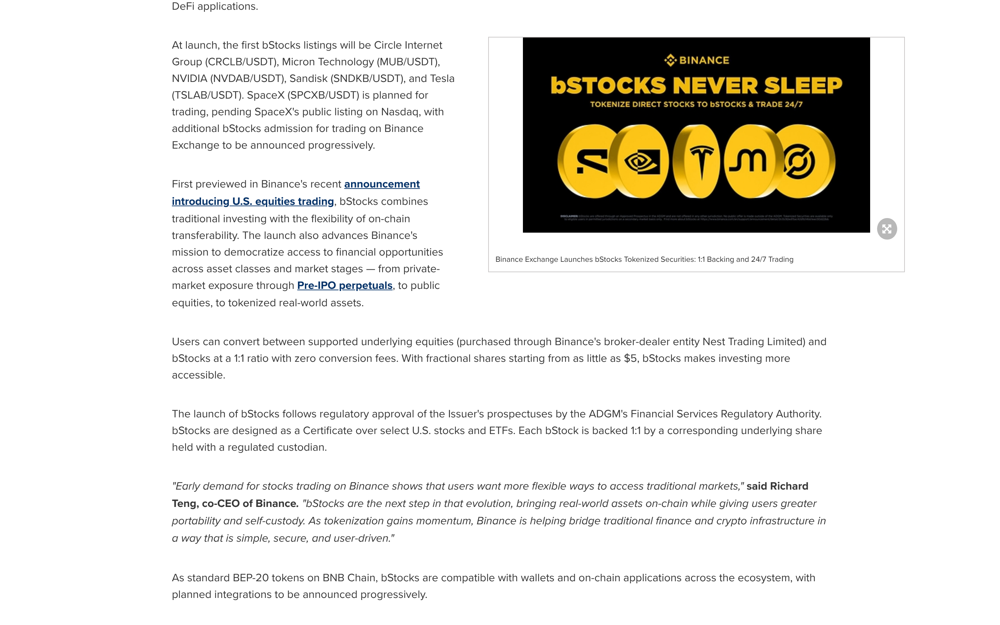

## 정체 카드
● 한 줄 정체 : 2017년 CZ(자오창펑)가 시작한 가상자산 거래소, ==2026-06부터 미국 주식 거래와 주식 토큰(bStocks)도 제공== [F-0678][F-1198][F-1126]
  ★ 유형 안 위치 : 아부다비 ADGM 금융서비스규제청(FSRA) 등록부의 활성 인정기관(거래소, 청산소) 3곳(2026-11-16 열람) → 그중 인정투자거래소 2곳의 하나(Nest Exchange)와 인정청산기관 1곳 전부(Nest Clearing and Custody) → 3곳 중 2곳이 **Binance 계열**(공식 등록부 셈), 공식 거래량 순위 없음 → 2017년 가상자산 거래소 출신 [F-1417][F-1418][F-0678]
  - 뜻 : 인정기관(Recognised Body) = FSRA가 거래소나 청산소로 인정한 시장 운영 기관. 중개, 운용 같은 일반 금융회사 인가와 다른 등급 [F-1417]
  - 다른 공식 목록 : EU MiCA 가상자산사업자 등록부(404곳)와 뉴욕주 NYDFS 가상자산 인가 목록(39곳)에 Binance 법인은 없음 [F-1413][F-1414][F-1411][F-1412]
● 대표 상품 : 미국 주식 거래 = 실제 주식 7,000종 이상(Nest Trading이 주문을 Alpaca로 보냄, 2026-06-01) [F-1198][F-1229]
● 대표 상품(토큰) : bStocks = 미국 주식 일부를 기초로 한 증권 증서(계열 BTech Holdings 발행), 미국과 미국인 제외, 가상자산 거래에는 이 제한이 없음 [F-0046][F-0054]
● 그룹 관계(누가 무엇을 하는가)
  ★ Binance 그룹 : 가상자산 거래소 운영, 사업은 여러 나라에 분산, 규제 인가는 아부다비 계열 법인이 보유 [F-1071][F-0064]
  ★ Nest Exchange(옛 Nest Services) : 거래소 인가(RIE)와 다자간 거래시설(MTF) 운영 [F-0064][F-1244]
  ★ Nest Clearing and Custody(옛 Binance (AD)) : 청산, 수탁, 권리 원장(CSD) 관리 [F-0065][F-1244]
  ★ Nest Trading(옛 BCI Limited) : 브로커딜러, 주식 주문 접수와 주식과 bStocks 1:1 전환 [F-0066][F-0050][F-1244]
  ★ BTech Holdings Limited : bStocks 발행 전용 계열사(SPV) [F-0046][F-0994]
  ★ 주주 : 아부다비 투자사 MGX가 2025-03 20억 달러로 소수 지분 취득 [F-0069][F-1388]
  ★ 최대주주 : CZ는 CEO에서 물러났으나 Binance 최대주주로 남음(Finance Magnates 보도) [F-0070]
  - 뜻 : RCH = 인정청산기관(Recognised Clearing House)
  - 뜻 : 왜 아부다비인가 = 회사는 "규제 명확성과 정당성"을 이유로 밝힘 [F-1071]. 공동 CEO Teng은 합류 전 ADGM 금융감독청 CEO였음 [F-0685]. MGX도 아부다비 투자사 [F-0069]
● 꼭 알아야 할 사실
  ★ 큰 제재 : 2023-11-21 미국 재무부 합의. FinCEN(재무부 금융범죄단속청)에 민사과징금 34억 달러와 5년 감독관, OFAC(재무부 해외자산통제국)에 9.68억 달러 [F-1200]
  - 무슨 일 : CZ의 사유는 효과적인 자금세탁방지 프로그램을 유지하지 않은 것(법무부 표기) [F-1234]
  ★ 소송과 사면 : 2025-05 SEC 민사소송 재제기 불가로 취하, 2025-10-21 창업자 CZ가 미 법무부 사면담당관실 목록에 오름(CZ는 자금세탁방지 프로그램 미유지로 4개월 징역과 5천만 달러 벌금, 2024-04-30) [F-0072][F-1199][F-1234]
● 숫자
  ★ 순위와 잔액 : 2026-11-16 rwa.xyz(토큰화 실물자산 집계 사이트, 제3자 집계) 토큰화 주식 플랫폼 표에서 bStocks 1위, 13.6억 달러, 시장 전체 37.1억 달러의 36.6%, 2위 Ondo 9.0억 달러 [F-1021][F-1028][F-1022]
● 흐름(주식 거래) : 이용자 → Binance 앱 → Nest Trading(ADGM 브로커) → Alpaca(청산, 보관) [F-1198][F-0066]
● 흐름(bStocks) : 이용자 → Binance 거래소 → 발행(BTech Holdings) → Alpaca(보관) [F-0051][F-0046][F-0994]

## 회사 개요와 확장 경로
● 주장 : 2021년에 접은 주식 토큰을 인가 3종 뒤 직접 발행으로 재개 [F-1124][F-0064][F-1126]
● 본업과 규모
  ★ 본업 : 가상자산 거래소. 개인은 거래소 직접 이용(40개 언어 24시간 지원), 기관은 2022-06 기관 전용 사업과 2025-11 BUIDL 담보 수용 [F-0677][F-1242][F-1233]
  ★ 매출과 거래대금 : 약관은 수익을 수수료, 스프레드, 금융 수익으로 설명하고 매출 숫자는 공개하지 않음. 2025년 전체 거래대금 34조 달러, 그중 현물 7.1조 달러(Binance 블로그, 2025년 결산) [F-1289][F-1387]
  ★ 주식 사업의 크기 : 미국 주식 직접 거래 7,000종 이상(2026-06 개시). bStocks는 출시 이후 누적 거래 400억 달러 초과, 일평균 3억 달러 초과, 운용자산 10억 달러 초과(모두 회사 발표, 2026-10-15) [F-1198][F-0058][F-0057]
● 설립 목적과 비전
  ★ 미션 : Binance를 내일의 크립토 세계를 위한 인프라 제공자로(회사 소개) [F-0680]
  ★ 진행 중 : bStocks 활용을 거래에서 헤지, 마진, 위험 관리로 넓힘. 2026-09 마진과 선물 담보 확대, 2026-10-28 5종 증거금 담보 추가, 2026-10-29 주식 무기한선물 개시 [F-1288][F-0062][F-1230][F-1231]
● 타깃 수요
  ★ 대상 : 거래소 이용자 중 전통 시장(미국 주식)에 더 유연하게 접근하길 원하는 사람(Teng 발언) [F-1068]
  ★ 겹침 : 초기 bStocks 이용자의 58.5%가 무기한선물이나 직접 주식도 거래, 기존 거래소 이용자가 주 수요 [F-0063]
  ★ 시간 수요 : 2026-07 거래량 중 미국 정규장 시간 비중이 bStocks는 38%, 전통 미국 주식은 89.2%라 bStocks는 장 밖 시간 수요가 큼 [F-0061]
● 수익원
  ★ 약관 기재 : 이용자가 내는 수수료, 커미션, 이자, 스프레드, 그리고 ADGM 계열이 거래소 상장 자산을 보유, 헤지, 대출하며 얻는 금융 수익 [F-1289]
  ★ 주식 거래 : 수수료 0, 소수 주식 5달러부터, 주식과 bStocks 1:1 전환 수수료 0 [F-1198][F-0050]
● 화면
   
  ★ 그림 해설 : 왼쪽은 Binance 가입 화면, 오른쪽은 이용자가 보는 bStocks 종목 화면(AAPL). 가입과 거래가 거래소 앱 한 곳에서 이뤄지고 별도 판매 창구가 없다는 점을 보여 줌 [F-0051]

## 사업 범위와 넓힌 순서
● 주장 : 거래소로 시작해 접은 주식 토큰을 ADGM 인가 3종 뒤 재개 [F-0678][F-1124][F-0064]
● 인가와 인수로 열린 것
  - 뜻 : 줄마다 그 전(못 하던 것) → 계기(인가나 인수, 시점) → 그 뒤(열린 것과 첫 상품). 새로 연 것은 못 하던 사업을 연 경우, 규제에 맞춘 것은 하던 영업을 새 제도의 인가로 옮긴 경우 [F-1440]
  ★ 미국 주식 직접 거래(새로 연 것) : 그 전 2017-07 출시한 가상자산 거래소 → 계기 2025-12 ADGM 브로커딜러 인가(Nest Trading) → 그 뒤 2026-06-01 미국 주식과 ETF 7,000종 이상, 주문은 Alpaca로 보내 집행, 청산, 보관 [F-0678][F-0066][F-1198]
  ★ 주식 토큰 재개(새로 연 것) : 그 전 2021-04 독일 CM-Equity 제휴로 냈다가 2021-07 신규 구매 중단, 2021-10 지원 종료 → 계기 2025-12 ADGM 거래소(RIE)와 청산, 수탁, CSD(RCH) 인가, 2026-06 ADGM 투자설명서 승인 → 그 뒤 2026-06-12 계열 BTech 발행 bStocks 5종 상장, 2026-10 약 100종 [F-1124][F-0064][F-0065][F-1126][F-0053][F-0059]
    - 왜 : 규제 명확성과 정당성으로 ADGM에서 글로벌 사업 지원(Teng) [F-1071]
    - 어떻게 : 자체 신청으로 직접 인가, 법인 3개를 둠(인수 아님) [F-1244]
  ★ 한국 원화 거래소(인수) : 그 전 2021 한국 철수(Decrypt 보도) → 계기 2023-02 고팍스 운영사 스트리미 지분 72.26% 인수(블록미디어 보도), 2025-10 FIU 최대주주 변경 수리(신고는 2023-03부터 보류) → 그 뒤 고팍스 최대주주. bStocks 한국 제공 근거 없음 [F-0074][F-1389][F-0073][F-0075]
  ★ 아르헨티나(등록만) : 계기 2024-09-11 현지 법인 CNV 가상자산서비스 사업자 등록(No. 76) → 그 뒤 약관은 이 등록이 라이선스나 감독이 아니라 자금세탁 통제 대상 등록이고 법정화폐 거래는 현지 파트너가 처리한다고 명시 [F-0712][F-0713][F-0714][F-0715]
● 자산(무엇을 어떤 순서로 더했나)
  ★ 2017-07 가상자산 거래소 : 직접 출시 [F-0678]
  ★ 2021-04 주식 토큰 : 직접, 2021-10 지원 종료 [F-1124]
  ★ 2026-02 Ondo 주식 토큰 : 제휴 상장 [F-1125]
  ★ 2026-06 bStocks : 계열 BTech 직접 발행 [F-1126]
● 자산 2(담보와 파생)
  ★ 2026-09 bStocks를 마진과 선물 담보로 확대 [F-0062]
  ★ 2025-11 국채 토큰 BUIDL : 기관 장외결제 담보로 수용(BUIDL = 미국 단기국채에 투자하는 토큰화 펀드) [F-1233]
  ★ 2026-10-28 bStocks 5종 : 증거금 담보로 추가, 차입은 불가 [F-1230][F-1160]
  ★ 2026-10-29와 11-12 주식 무기한선물 7종과 ETF 1종, 최대 20배, 24시간(회사 공지) [F-1231][F-1232][F-1161]
  - 24시간 거래대금(Binance TradFi 선물 화면, 2026-11-17 한 시점, 거래소 공식 통계 아님) : 개별 주식 NVDAUSDT 18.3억, SNDKUSDT 17.4억, SKHYNIXUSDT 10.5억 달러 [F-1238]
  - 뜻 : SKHYNIXUSDT = SK하이닉스 주가를 따르는 무기한선물
● 고객(개인에서 기관으로)
  ★ 개인 이용자 : 거래소 직접, 40개 언어 지원 [F-0677]
  ★ 2026-06 bStocks 자격 이용자 : 미국과 미국인을 뺀 허용 지역에 직접 판매 [F-0054]
  ★ 기관 : 2022-06 기관 전용 사업 출시, 2025-11 BUIDL 담보 수용 [F-1242][F-1233]
● 시장(어느 나라로)
  ★ 2022-09 두바이 : VARA(두바이 가상자산 규제청) 직접 라이선스 [F-0068]
  ★ 2024-09 아르헨티나 : 현지 법인이 가상자산 서비스 사업자로 등록 [F-0712]
  ★ 2025-10 한국 : 고팍스 최대주주 변경 수리 [F-0073]
  ★ 2025-12 아부다비 : ADGM 인가 3종 직접 [F-0064]
● 2021-04 주식 토큰 시도, 2021-07 중단 : 인가 없이 시작했다가 접음 [F-1124]
  ★ 해석 : 첫 시도를 접고 2025-12 인가를 받은 뒤 2026-06 재설계해 재개. 인가 없이 시작한 것이 접은 이유라는 설명은 회사가 하지 않음 [F-1124][F-0064][F-1126]

## 경영진 발언
● 말하고 이룬 것(시점 순)
  ★ 2025-12-08 Teng(공동 CEO) : ADGM 인가가 글로벌 사업의 규제 기반 [F-1071]
  - 이룬 것 : 2026-06-01 이 인가 위에서 미국 주식 7,000종 이상 거래 개시 [F-1198][F-0066]
  ★ 2026-06-12 Teng : 주식 거래 초기 수요 확인, bStocks는 다음 단계 [F-1068]
  - 이룬 것 : 2026-10-15 운용자산 10억 달러, 누적 거래 400억 달러, 약 100종 [F-0057][F-0058][F-0059]
  ★ 2026-10-15 Shunyet Jan(거래소 및 트레이딩 총괄) : 시험대는 출시 뒤에도 시장처럼 작동하는가 [F-1069]
  - 이룬 것 : 2026-09 마진, 선물 담보 확대, 1:1 전환 누적 60억 달러 [F-0062][F-0060]
● 발언 1 : 한 관할의 규제 기반 위에 글로벌 사업을 올린다 [F-1071]
  ★ Richard Teng(공동 CEO), ADGM 글로벌 라이선스 보도자료, 2025-12-08, https://tools.prnewswire.com/en-us/live/20813/release/20251207EN41035 [F-1071]
    ① 원문 : "This license provides regulatory clarity and legitimacy, enabling Binance to support its global operations from ADGM. While our global operations remain distributed, leveraging talent and innovation worldwide, this regulatory foundation offers our users peace of mind knowing Binance operates under a globally recognised, gold standard framework."
    ② 번역 : 이 라이선스는 규제 명확성과 정당성을 주어 Binance가 ADGM에서 글로벌 사업을 지원하게 한다. 사업은 분산돼 있지만 이 규제 기반이 이용자에게 안심을 준다.
    ③ 해석 : 핵심은 규제 틀 위의 글로벌 플랫폼. 그래서 거래, 청산, 중개 3개 법인으로 ADGM 인가 확보
  
● 발언 2 : 거래소 이용자의 전통 시장 접근 수요가 있다 [F-1068]
  ★ Richard Teng(공동 CEO), bStocks 출시 보도자료, 2026-06-12, https://www.prnewswire.com/apac/news-releases/binance-exchange-launches-bstocks-tokenized-securities-11-backing-and-247-trading-302798969.html [F-1068]
    ① 원문 : "Early demand for stocks trading on Binance shows that users want more flexible ways to access traditional markets. bStocks are the next step in that evolution, bringing real-world assets on-chain while giving users greater portability and self-custody."
    ② 번역 : Binance의 주식 거래에 대한 초기 수요는 이용자가 전통 시장에 더 유연하게 접근하길 원함을 보여준다. bStocks는 그 다음 단계로, 실물자산을 온체인으로 가져오며 이동성과 자기수탁을 높인다.
    ③ 해석 : 핵심은 거래소 이용자의 미국 주식 수요. 그래서 자체 발행 bStocks를 24시간 상장
  

## A 출신과 진입(주식 토큰 사업)
● 주장 : 남의 토큰 상장을 거쳐 이용자에게 직접 만든 토큰을 얹음 [F-1125][F-1126][F-0051]
● 출신 : 가상자산 거래소, 2017년 출시 [F-0678]
● 진입 방식
  ★ 2026-06 그룹 계열 BTech Holdings가 직접 발행 [F-0046]
● 진입 시점(남들과 비교)
  ★ Binance : 2021-04 첫 시도(독일 CM-Equity 제휴), 2021-07 중단, 2026-06 bStocks로 재개 [F-1124][F-1126]
  ★ 다른 회사 : Kraken xStocks 2025-06-30, Robinhood EU 토큰 2025-06, Coinbase Base 토큰 2026-08-24 [F-1040][F-0221][F-0776]
  ★ 해석 : 2021년 첫 시도는 가장 이른 축에 속하나 접어서 공백이 있었고, 현 상품은 Kraken, Robinhood보다 약 1년 늦은 후발 [F-1124][F-1040][F-1126]

## B 상품 구조
● 주장 : 직접 발행으로 돌아선 지 5개월 만에 잔액 1위, 투자자 몫은 신탁 수익권 [F-1126][F-1021][F-0994]
● 토큰의 법적 성격
  ★ ADGM 법상 증서(Certificate), ADGM 승인 투자설명서로만 공모 [F-0047]
  ★ 발행사가 기초주를 신탁 보유, 보유자는 1:1 수익적 이익 [F-0994]
  ★ 의결권, 기초 발행사 주주권 없음, 상환 시 기초주 인도 가능 [F-0994][F-0048]
  ★ 유형 : 제3자 보관형(원주를 발행사가 신탁으로 1:1 보유하고 투자자는 수익권) [F-0994][F-0995]
  - 뜻 : 제3자 보관형 = 기초 주식을 발행사나 수탁기관이 따로 보관하고 투자자는 그 주식의 수익권을 가진 유형(이 문서의 분류). 발행사 채권만 갖는 합성형과 구분 [F-0994][F-0995]
  ★ 다른 회사 유형과 비교 : Coinbase도 같은 신탁 1:1 구조, Kraken과 Ondo는 발행사에 대한 채권(원주 보유 아님), Robinhood EU판은 파생계약(가로 비교 탭 참고) [F-0995][F-0991][F-0998][F-0993]
● 발행 주체와 보관
  ★ Alpaca(미국 청산 증권사) 분리계좌에 기초주 1주씩 보관 [F-0994][F-0049]
  ★ 보유자별 권리는 CSD(중앙예탁) 원장에 기록 [F-0994]
● 투자자 권리와 공시
  ★ 2026-09 기업행위(분할, 배당 등) 공시 17건(TSMC, NVIDIA 등) [F-0700][F-0697][F-0728]
  ★ 발행 잔량(유통 중인 증서 수)을 주 단위로 공시, 2026-09 3건 [F-0703][F-0700]
● 규모(시장 내 위치)
  ★ 2026-11-16 rwa.xyz 기준 발행 잔액 13.6억 달러, 1위(점유율 36.62%) [F-1021]
● 평가
  ★ 제3자 위험 : 발행 SPV BTech, 기초주 Alpaca 보관 [F-0994]
● 제3자 시각(분류)
  ★ 주의 : 보관형, 발행사 동의 없음, 장부는 Binance 보유로 분류됨 (CoinDesk Research, Bullish 의뢰, 발행사 직접 방식에 유리하게 씀) [TP-211]

## C 최종 투자자
● 주장 : bStocks 구매 대상은 미국 밖 Binance 거래소 자격 이용자 [F-0054]
● 대상
  ★ 허용 지역 자격 이용자, 2차 시장 거래 [F-0054]
  - 뜻 : 자격 이용자 = 허용 지역에 있고 미국인이 아닌 거래소 이용자 [F-0054]
● 국적 및 지역 제한
  ★ 미국, 미국인 제외, 허용국 전체 목록 비공개 [F-0054]

## D 유통과 접점
● 주장 : 파트너 공급 없이 자체 거래소에서 직접 판매 [F-0051][F-0994]
● 공급 방식(누구에게 서빙하는지)
  ★ 자사 직접 판매 : Binance 거래소 USDT 현물 쌍 [F-0051]
● 거래 장소
  ★ 사용 블록체인 : BNB Chain(BEP-20) [F-0052]
  - 뜻 : BNB Chain = Binance 계열 블록체인, BEP-20 = 그 위에서 쓰는 토큰 규격 이름 [F-0052]
  ★ 24시간 7일 거래, 원주 1:1 전환으로 가격 연동 [F-0051][F-0050]

## E 인가
● 주장 : 체결, 청산, 중개 인가를 ADGM 그룹 법인 셋이 직접 확보 [F-0064][F-0065][F-0066]
● 보유 인가와 법인
  ★ Nest Exchange : 인정투자거래소, MTF 운영, 2025-12 직접 [F-0064][F-1244]
  ★ Nest Clearing and Custody : 청산, 수탁, CSD, 2025-12 직접 [F-0065][F-1244]
  ★ Nest Trading : 브로커딜러, 1:1 전환, 2025-12 직접 [F-0066][F-0050][F-1244]
  ★ 그 밖 : 2022년 두바이 VARA, 2024년 아르헨티나 등록 [F-0068][F-0712]
● 발행 법인
  ★ BTech Holdings : 그룹 계열, 2026-06 직접 발행 [F-1126]

## F 관계(해당 시)
● 주장 : 경쟁 발행사 Ondo의 토큰도 자기 시장에 상장 [F-1125][F-0549]
● 인수, 투자, 제휴
  ★ Ondo 주식 토큰 10종 Binance Alpha 상장(2026-02-24) [F-1125]
  ★ Ondo Stocks(Ondo 주식 토큰) 일부를 Nest Exchange에서 거래 허용 [F-0549]

## G 한국 접점(해당 시)
● 주장 : 주식 토큰이 아니라 가상자산 거래소 인수로 한국과 연결 [F-0073]
● 한국 회사와의 관계
  ★ 2025-10 FIU, 고팍스(국내 거래소) 최대주주 변경 수리 [F-0073][F-1389]
  ★ 한국 시장 배경 : 2021 철수 뒤 국내 점유는 업비트 약 72%, 빗썸 약 24%(2024 말 자료, Decrypt 보도) [F-0074]
  - 뜻 : 고팍스 = 한국 원화 가상자산 거래소. 스트리미 = 고팍스 운영 법인
● 한국 이용자 제한 표기
  ★ 캠페인 약관 제외 국가 : Binance Pay 첫 구매 캠페인(2026-03)과 Tokenstore 캠페인 약관이 참여 불가 국가에 한국(KR)을 넣음. 캠페인 약관일 뿐 bStocks 약관이 아니어서 bStocks의 한국 이용 가능 여부 근거가 아님 [F-0721][F-0722]

## 한국 시장과의 차이
● 주장 : ADGM 증서 발행으로 길이 열렸고, 한국은 해외 발행 증권도 공모 규제 대상 [F-0047][KR-자본시장법-119]
● 규제
  ★ 가능했던 이유 : ADGM 한 관할에서 발행 승인, 거래소, 청산 인가를 모두 받음 [F-0047][F-0064][F-0065]
  ★ 가능했던 이유 : 미국과 미국인을 판매 대상에서 제외해 미국 규제와 부딪치지 않음 [F-0054]
  ★ 한국 차이 : 허용국 전체 목록 비공개, 한국 이용자가 쓸 수 있는지 불명 [F-0054]
  ★ 한국 법 : 일정 금액 이상 증권 공모는 해외 발행인도 금융위원회에 증권신고서를 내 수리돼야 함 [KR-자본시장법-119]
● 규제 건의 포인트 : 해외 거래소 발행 토큰의 허용국 공시 기준 [F-0054]

## 성과와 판단
● 주장 : 접었던 주식 토큰이 직접 발행 뒤 400억 달러 거래량 [F-1124][F-1126][F-0058]
● 사업별 성과
  ★ 거래소 본업 : 이용자 3.2억 명 이상(등록 계정, 회사 주장), 2025년 거래대금 34조 달러 중 현물 7.1조 달러(회사 블로그), 매출은 공개 없음 [F-1201][F-1387]
  ★ 미국 주식 직접 거래(2026-06-01 개시) : 7,000종 이상, 소수 5달러부터 수수료 0. 주식과 bStocks 1:1 전환 누적 60억 달러 [F-1198][F-0060]
  ★ bStocks : 운용자산 10억 달러 초과(Dune Research 측정, 회사 발표), 누적 거래 400억 달러 초과, 일평균 3억 달러 초과, 종목 5종에서 약 100종 [F-0057][F-0058][F-0059]
  ★ 담보와 선물 연결 : 2026-09 마진과 선물 담보 확대, 2026-10 담보 5종 추가와 주식 무기한선물 8종 상장 [F-0062][F-1230][F-1231][F-1232]
● 핵심 성공요인(KSF)
  ★ 거래소 이용자를 그대로 토큰 수요로 : 남들은 2025-06부터 시작했고 Binance는 약 1년 늦은 2026-06 출시였으나 이용자 기반으로 따라잡음 [F-1040][F-0221][F-1126]
  - 전 : 2021-04 첫 시도(인가 없이 시작) 3개월 뒤 신규 구매 중단, 이후 5년간 공백 [F-1124]
  - 후 : 2026-06 재개 후 약 4개월 만에 운용자산 10억 달러, 잔액 1위 13.6억 달러(3위 Kraken 6.8억의 2배, 2위 Ondo 9.0억의 약 1.5배, 출시가 1년 빠른 Kraken보다 큼) [F-0057][F-1021][F-1022][F-1023]
  - 이유(근거) : 초기 bStocks 이용자의 58.5%가 이미 선물이나 직접 주식도 거래 [F-0063]
● 제약과 리스크
  ★ 2023 미국 합의로 지정된 감독인과 !!Binance 이용자 정보 공유!! [F-0719][F-0720]
  - 왜 : 2023 합의로 준수 감독인이 지정되어 이용자 개인정보를 감독인과 공유할 수 있다고 약관에 고지, 이용자는 정보 공유를 감수 [F-0720]
  ★ 2025-05 SEC 민사소송은 재제기 불가로 취하, 미국 규제 부담은 줄었으나 bStocks는 여전히 미국과 미국인 제외 [F-0072][F-0054]
  - 왜 : 가장 큰 주식 시장 고객인 미국 이용자에게는 이 상품을 팔 수 없어 시장 범위가 제한됨 [F-0054]
  ★ 발행사 의무는 보관 기초주에 한정(제한소구) [F-0994]
  - 왜 : 발행 SPV나 보관 증권사에 문제가 생기면 보유자가 받을 수 있는 것은 보관 기초주의 가치까지이고, 그 밖의 발행사 재산으로 보상받을 수 없음 [F-0994]
  ★ 의결권, 기초 발행사 주주권 없음 [F-0048]
  ★ 유동성 분산 : 같은 주식이 Ondo 토큰과 bStocks로 갈림 [F-1125][F-1126]
  - 왜 : 시장이 둘로 나뉘면 각 시장의 호가가 얇아져 큰 주문이 불리한 가격에 체결될 수 있음(해석) [F-1125][F-1126]
  ★ 장 밖 시간 거래 : 거래량의 62%가 미국 정규장 밖 시간에 일어남 [F-0061]
  - 왜 : 기초 주식 시장이 닫힌 시간에는 가격을 참고할 기준이 약해 토큰 가격이 기초주 가격에서 벌어질 수 있음(해석) [F-0061]
  ★ 이해충돌 : 약관은 ADGM 계열이 상장 자산을 보유, 헤지, 대출하며 수수료와 스프레드를 받을 수 있다고 밝힘 [F-1289]
  - 왜 : 같은 그룹이 거래소 운영자이자 거래 상대방일 수 있어 이용자 이익과 그룹 이익이 어긋날 수 있음 [F-1289]
● 제3자 평가
  ★ 평가 1 : 주의. 표는 Binance를 발행사 동의 없는 보관형으로 분류했으나 투자설명서와 다름. CoinDesk Research(Bullish 의뢰, 발행사 직접 방식에 유리하게 씀), The Future of Equity Ownership: An Issuer's Guide to Tokenized Equities, 2026-09-29(표 기준 2026-08), 10쪽 표, https://www.coindesk.com/research/the-future-of-equity-ownership-an-issuer-s-guide-to-tokenized-equities [TP-211]
    ① 원문 : 표 Binance 열 "Custodial tokenized equities", "No consent", "Claim / cert", "Binance-held", "Partial", "Not for US"
    ② 번역 : 보관형 토큰 주식, 발행사 동의 없음, 청구권 또는 증서, Binance가 보유, 권리 일부, 미국 불가.
    ③ 해석 : 표는 Binance를 Dinari와 같은 보관형으로 묶었으나 투자설명서상은 신탁 수익권이고 표 각주는 두 상품 중 좋은 쪽으로 채점했다고 밝힘. 그래서 KDX는 투자설명서 기준 분류를 유지하고 발행사 동의 없는 구조라는 점을 볼 것
● KDX 시사점
● KDX 관점 자산
  - 가져올 것 : ==실제 주식 거래를 먼저 열고 그 위에 토큰을 얹어== 1:1 전환 창구를 둠. 국내는 예탁원 신탁 수익증권 구조로 대응 가능(기고, 법률 실무) [F-1198][F-0050][TP-435]
  - 뜻 : 예탁원 신탁 수익증권 = 2025-09-23 시행령 개정으로 한국예탁결제원이 소수 단위 주식을 신탁받아 수익증권을 발행할 수 있게 된 구조, 기고는 이를 비상장주식 간접 토큰화에 쓸 수 있다고 보며 상장주식 적용은 기고 범위 밖 [TP-435]
  - 가져올 것 : 토큰을 증거금 담보로 연결해 활용처를 늘림 [F-0062][F-1230]
  - 피할 것 : 발행사 의무가 보관 기초주에 한정되고 의결권이 없는 구조(투자자가 주주로 오인할 수 있음) [F-0994][F-0048]
● KDX 관점 고객
  - 가져올 것 : 기존 이용자 기반에 먼저 제공(초기 이용자 58.5%가 선물이나 주식도 거래) [F-0063]
  - 피할 것 : 허용국 목록을 공개하지 않아 이용자가 이용 가능 여부를 모르는 상태 [F-0054]
● KDX 관점 시장 확장
  - 가져올 것 : 한 관할(ADGM)에서 거래소, 청산, 중개 인가를 모두 받고 거기서 해외 판매 [F-0064][F-0065][F-0066]
  - 가져올 것 : 한국 진입은 직접 인가가 아니라 현지 거래소 인수(고팍스)로 [F-0073]
  - 피할 것 : 최대 시장인 미국과 미국인을 제외한 채 시작해 시장 범위가 제한되는 구조 [F-0054]
● KDX 관점 거래 시설 운영
  - 가져올 것 : 거래소, 청산과 보관, 브로커를 한 그룹 안의 별도 법인으로 나누고 기업행위와 발행 잔량을 주 단위로 공시 [F-1244][F-0700][F-0703]
  - 피할 것 : 거래소 계열 법인이 상장 자산을 보유, 헤지, 대출하며 수익을 얻는 이해충돌 [F-1289]
