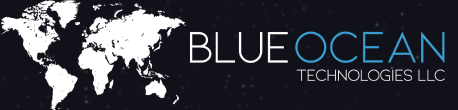
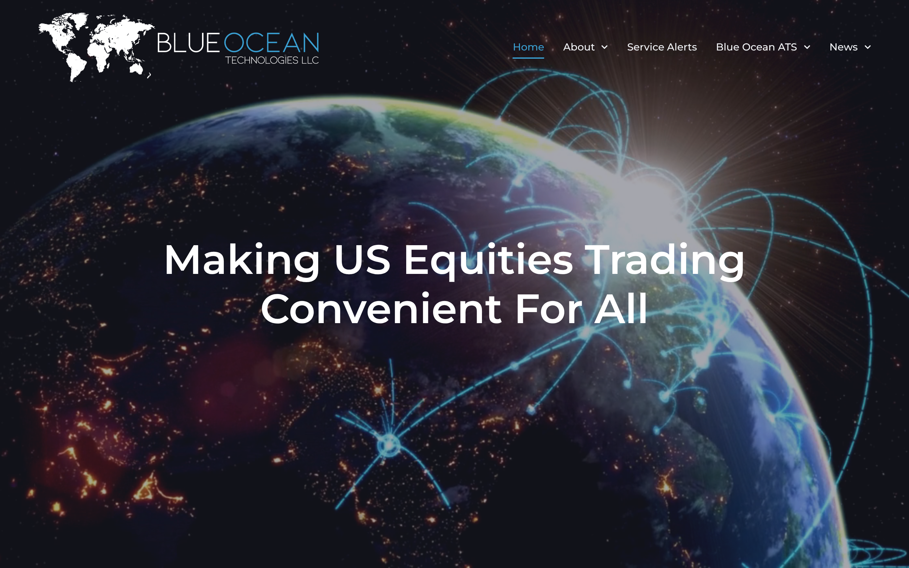
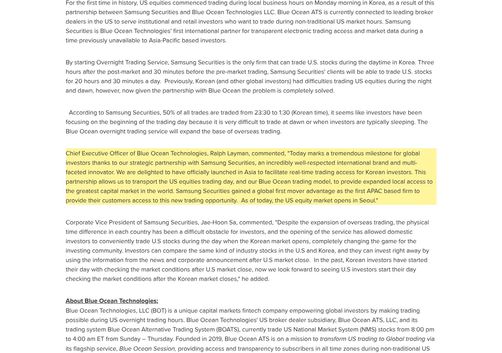
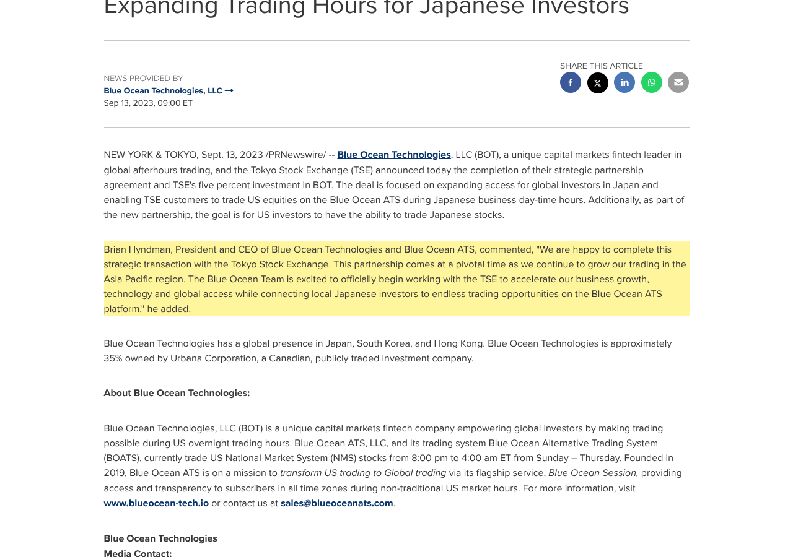
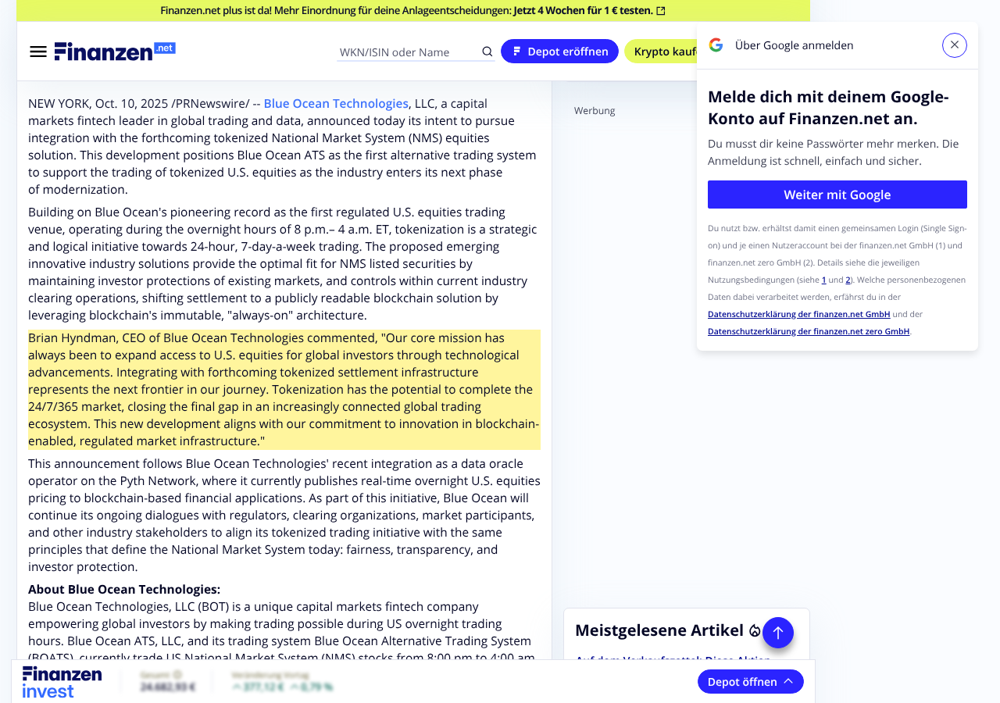

## ATS 개요
● 주장 : 2019년 먼저 연 야간 시장이 거래대금 83%를 차지 [F-0001][F-0015]
● 운영사
  ★ 법인명 : Blue Ocean ATS, LLC(미국 주식 야간 거래 시장 BOATS 운영) [F-0001]
  ★ 2019년 설립, 2020-10 브로커딜러 등록, FINRA(미국 증권업 자율규제기구) 회원 [F-0001][F-0247]
● 모회사
  ★ Blue Ocean Technologies(지주회사)가 운영사 지분 보유 [F-0247]
  ★ Urbana(캐나다 상장 투자회사)가 지주회사 약 35% 보유(2023) [F-0002]
● 취급 자산
  ★ 미국 NMS(전국시장체계) 상장 주식 [F-0001]
  ★ 2026-10 세션 1위 SOXL(3배 반도체 ETF), 1.65억 달러 [F-0016]
● 대상 고객
  ★ ATS에 가입한 글로벌 구독 브로커 [F-0001]
  ★ 2022년부터 한국 증권사 고객이 한국 낮 시간에 이용 [F-0005]
● 거래시간
  ★ 일~목 밤 8시~새벽 4시(미국 동부) [F-0001]
  ★ 한국 시간 오전 10시~오후 6시에 해당 [F-0005]
● 거래 규모
  ★ 기준 : FINRA 주간 보고 거래대금 13주 합산, 야간 3사 대비 [F-0015]
  ★ 2026 Q3 2,435.5억 달러, 야간 3사 중 83.0%로 1위 [F-0015]
  ★ 같은 Q3 Bruce(야간 ATS) 439.7억(15.0%), MOON(야간 ATS) 58.3억(2.0%) [F-0029][F-0042]
  ★ 2026 Q2 2,676.7억 달러, 점유율 83.9%에서 소폭 하락 [F-0013][F-0014]
● 차별화 요소
  ★ 3사 중 가장 먼저 개설(Bruce 2025-03, MOON 2024-11) [F-0001][F-0020][F-0036]
  ★ 2023-09 도쿄증권거래소가 지분 5% 투자, 일본 낮 시간 거래 목표 [F-0003]
● 토큰증권 취급 현황
  ★ 2025-10 토큰화 NMS 주식 거래 연동 추진 발표 [F-0017]
  ★ 2026-03 RQD*(미국 청산 회사)와 토큰 주식 청산 MOU [F-0018]
  ★ DTCC(미국 중앙 예탁결제기관) 토큰화 로드맵에 맞춤 [F-0017][F-0018]
● 화면
  

## 경영진 발언
● 주장 : 한국 낮 시간에서 아시아로, 다시 24시간 토큰 시장으로 [F-0004][F-0003][F-0017]
● 발언 1 : 미국 주식 시장을 서울 낮으로 옮긴다 [F-0004]
  ★ Ralph Layman(Blue Ocean Technologies CEO, 2022년 당시), 삼성증권 제휴 발표, 2022-02-07, https://prnewswire.com/news-releases/blue-ocean-technologies--samsung-securities-announce-strategic-partnership-offering-us-equity-trading-during-local-asia-pacific-business-hours-301476177.html [F-0004]
    ① 원문 : "This partnership allows us to transport the US equities trading day, and our Blue Ocean trading model, to provide expanded local access to the greatest capital market in the world. ... As of today, the US equity market opens in Seoul."
    ② 번역 : 이번 제휴로 미국 주식 거래일과 Blue Ocean 거래 모델을 옮겨 세계 최대 자본시장에 대한 현지 접근을 넓힌다. 오늘부터 미국 주식 시장이 서울에서 열린다.
    ③ 해석 : 큰 곳은 한국 낮 시간의 미국 주식 수요. 그래서 한국 증권사를 구독자로 연결
  
● 발언 2 : 아시아태평양 거래를 키우는 시점 [F-0003]
  ★ Brian Hyndman(사장 겸 CEO), 도쿄증권거래소 투자 완료 발표, 2023-09-13, https://prnewswire.com/news-releases/blue-ocean-technologies--tokyo-stock-exchange-close-strategic-investment-agreement-focused-on-expanding-trading-hours-for-japanese-investors-301926166.html [F-0003]
    ① 원문 : "This partnership comes at a pivotal time as we continue to grow our trading in the Asia Pacific region. ... connecting local Japanese investors to endless trading opportunities on the Blue Ocean ATS platform"
    ② 번역 : 이번 제휴는 아시아태평양 거래를 계속 키우는 중요한 시점에 이뤄졌다. 일본 현지 투자자를 Blue Ocean ATS의 거래 기회와 연결한다.
    ③ 해석 : 큰 곳은 한국 다음의 아시아 시장. 그래서 도쿄증권거래소 지분 투자를 받아 일본으로 확장
  
● 발언 3 : 토큰화가 24시간 365일 시장을 완성 [F-0017]
  ★ Brian Hyndman(CEO), 토큰화 NMS 주식 연동 발표(보도자료), 2025-10-10, https://www.finanzen.net/nachricht/aktien/blue-ocean-technologies-to-pursue-tokenized-nms-us-equities-trading-14994412 [F-0017]
    ① 원문 : "Integrating with forthcoming tokenized settlement infrastructure represents the next frontier in our journey. Tokenization has the potential to complete the 24/7/365 market, closing the final gap in an increasingly connected global trading ecosystem."
    ② 번역 : 다가올 토큰화 결제 인프라와의 연동은 우리 여정의 다음 개척지다. 토큰화는 24시간 365일 시장을 완성해 연결된 세계 거래 생태계의 마지막 빈틈을 메울 수 있다.
    ③ 해석 : 큰 곳은 주말까지 이어지는 24시간 시장. 그래서 토큰화 결제와 청산 연동 준비
  

## 국내 연결과 사고 이력
● 주장 : 한국 증권사 주문으로 컸고 사고 때 한국 거래가 함께 멈춤 [F-0004][F-0009]
● 국내 증권사 연결
  ★ 2022-02 삼성증권(한국 증권사)이 첫 해외 제휴사 [F-0004]
  ★ 2025-11 재개 조건 : 2곳 이상 ATS 계약, 거래 되돌림 체계 [F-0011]
  ★ 백업 ATS는 Bruce, MOON [F-0011]
● 사고 이력
  ★ 2024-08 사고로 국내 증권사 주간거래 일괄 중단 [F-0009]
  ★ 중단 기간 약 1년 2개월(2024-08~2025-11) [F-0009]

## 한국 시장과의 차이
● 주장 : 미국은 브로커딜러 등록으로 열었고, 한국 ATS는 전문투자자용 [F-0247][KR-자본시장법시행령-별표1-ATS]
● 규제
  ★ 가능했던 이유 : 브로커딜러 등록과 Reg ATS로 거래소 등록 면제 [F-0247][US-17CFR-240.3a1-1][US-17CFR-242.301-b1]
  ★ 한국에서 막히는 지점 : 다자간매매체결회사(한국 ATS) 인가는 전문투자자 대상만 [KR-자본시장법시행령-별표1-ATS]
  ★ 한국에서 막히는 지점 : 개인의 해외 주식 주문은 해외 중개업자 경유 [KR-금투업규정-5-31]
● 고객 수요
  ★ 가능했던 이유 : 한국 낮 시간의 미국 주식 매매 수요 [F-0005]
  ★ 한국 차이 : 국내 투자자 미국 주식 보관 1,636억 달러(2025말) [F-1005]
  ★ 한국 차이 : 2025-11 증권사 18곳이 주간거래 재개 [F-1010]

## 성과와 판단
● 주장 : 선발 효과로 1위지만 한국 주문 의존이 가장 큰 위험 [F-0015][F-0009]
● 핵심 성공요인(KSF)
  ★ 2022년 선발 진입으로 한국 증권사 주문 선점 [F-0004][F-0005]
  ★ 일요일 밤(미국 동부) 개장으로 아시아 월요일 낮과 연결 [F-0001][F-0005]
● 제약과 리스크
  ★ 2024년 한 시장 사고가 한국 고객 전체 중단으로 번짐 [F-0009]
  ★ 2026-10 최근 3주 Bruce 점유율 29.8%로 추격 [F-0031]
  ★ 종목 거래량 5% 넘으면 공정접근 의무(Reg ATS) [US-17CFR-242.301-b5]
● KDX 시사점(스토리라인 명제별)
  ★ 시장 인프라 Unbundling : 체결은 ATS, 접점은 증권사, 토큰 청산은 RQD* [F-0001][F-0004][F-0018]
  ★ Borderless Investing : 국경 대신 시간대를 넘어 한국 낮에 미국 주식 [F-0005]
  ★ Coopetition : 삼성증권과 제휴, 도쿄증권거래소를 주주로 [F-0004][F-0003]
  ★ 해외 확장 세 질문 : 아시아 낮 체결, 브로커딜러 등록, 체결 시장(제공 가치, 제도, 역할) [F-0005][F-0247][F-0001]
