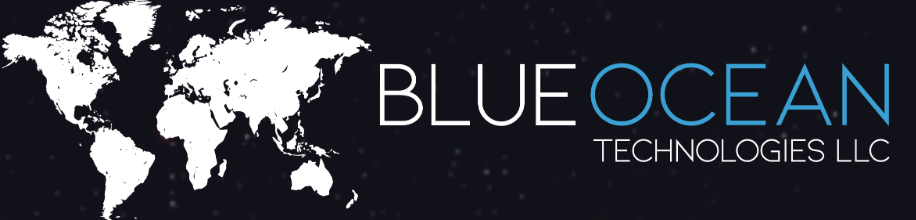
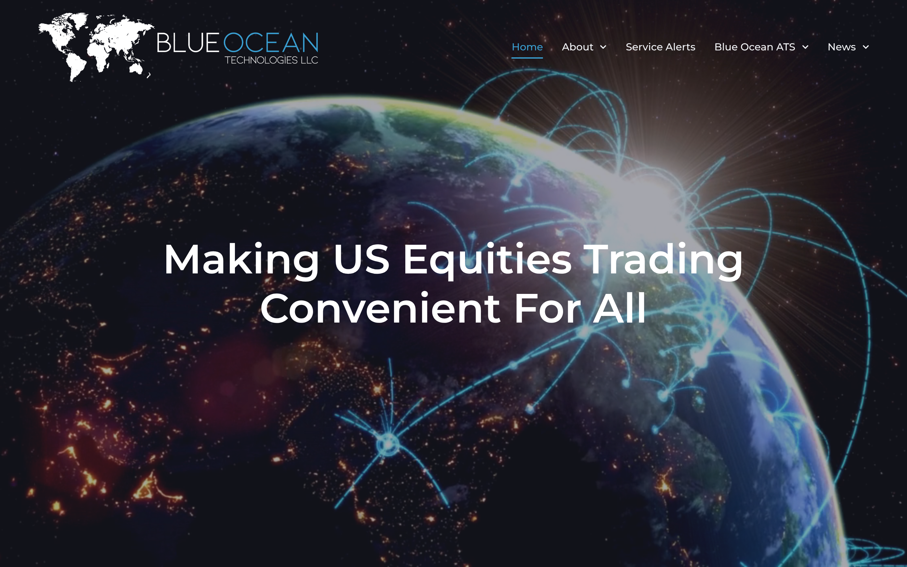
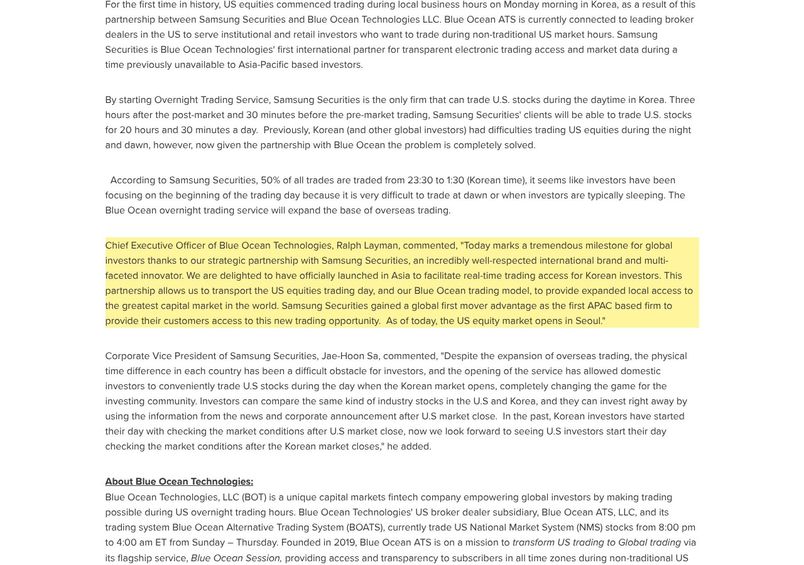
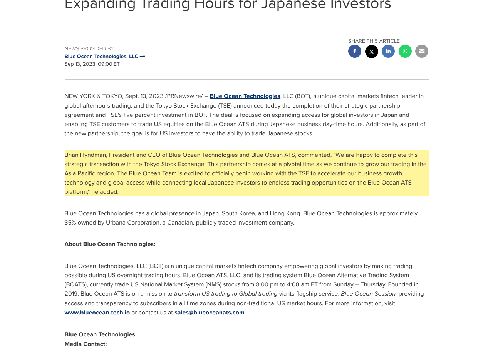

## 정체 카드
● 한 줄 정체 : 미국 주식을 미국 거래소가 닫힌 밤에 거래하는 야간 시장 Blue Ocean ATS, 한국 낮 시간에 해당 [F-0001][F-0005]
  - 뜻 : ATS(대체거래시스템) = 거래소로 등록하지 않고 브로커딜러가 운영하는 주문 체결 시장. 이 본문의 "야간 3사"는 Blue Ocean, Bruce, MOON 세 ATS
● 대표 상품 : Blue Ocean Session(BOATS) = 미국 주식 야간 시장(미국 동부 밤 8시~새벽 4시) [F-0001][F-1182]
● 꼭 알아야 할 사실
  ★ 상장하지 않음, 도쿄증권거래소(일본 거래소)가 지주회사 지분 5% 보유(2023-09) [F-0002][F-0003]
  ★ 2024-01 MEMX를 기술 파트너로 선정, 24X도 MEMX 기술 사용 [F-1177][F-1164]
  - 뜻 : MEMX = 미국 증권 거래소 운영사. Blue Ocean에는 체결 시스템을 제공하고 자체 거래소로도 야간 세션을 준비 중 [F-1177][F-1304]
  ★ 2024-08-05 체결 취소 사고, 한국 증권사 19곳에서 거래 6,300억원 취소 [F-1105]
  ★ 2026-09-01 공정접근 5% 문턱 때문에 18개 종목 중단, 2026-09-10 이후 더는 중단하지 않아도 된다고 회사가 밝힘 [F-1099][F-1102]
  - 뜻 : 공정접근 = ATS가 한 종목 거래량의 5% 이상을 직전 6개월 중 4개월 이상 차지하면 참가자 접근을 부당하게 막지 못하게 하는 미국 SEC 규칙 [US-17CFR-242.301-b5]
● 숫자
  ★ 점유율 : 야간 3사 합계 2,934억 달러 중 2,435.5억 달러, 83.0%(2026 Q3 13주, FINRA 주간 보고 거래대금 기준), 2위 Bruce 15.0%와 68.0%p 차이 [F-0015][F-0029]
  ★ 종목 수 : 약 11,000개(회사 홈페이지, 2026-11-16 열람) [F-1182]
● 흐름 : 한국 투자자 → 한국 증권사 앱 → (미국 브로커) → Blue Ocean ATS 체결(MEMX 기술) [F-0004][KR-금투업규정-5-31][F-1177]

## ATS 개요
● 쉽게 말하면 : 한국 낮 시간에 미국 주식을 살 수 있게 만든 야간 시장, 야간 3사 거래대금의 83.0% [F-0005][F-0015]
● 주장 : 한국 낮 주문을 먼저 잡아 야간 3사 거래대금 83.0%를 차지 [F-1090][F-0004][F-0015]
● 운영사
  ★ 법인명 : Blue Ocean ATS, LLC(미국 주식 야간 거래 시장 BOATS 운영) [F-0001]
  ★ 2019년 설립, 2020-10 브로커딜러 등록, FINRA 회원 [F-0001][F-0247]
  - 뜻 : 브로커딜러 = 미국 SEC에 등록해 증권을 중개, 매매하는 증권사
  - 뜻 : FINRA = 미국 브로커딜러를 감독하는 민간 자율규제기구
  ★ 2021-06 시범 운영, 2021-10 정식 개장 [F-1091][F-1090]
● 모회사
  ★ 지주회사 Blue Ocean Technologies가 운영사 Blue Ocean ATS, LLC 지분 보유 [F-0247]
  ★ Urbana(캐나다 상장 투자회사)가 지주회사 지분 약 35% 보유(2023-09) [F-0002]
● 취급 자산
  ★ 미국 NMS 상장 주식 [F-0001]
  - 뜻 : NMS(전국시장체계) = 미국 증권거래소에 상장된 주식을 하나의 시장처럼 묶는 SEC 규칙 체계
  ★ 2026-10 세션 거래대금 1위 종목 SOXL(3배 반도체 ETF), 1.65억 달러 [F-0016]
● 대상 고객
  ★ ATS에 가입한 글로벌 구독 브로커(가입 자격은 아래 "거래 시설 운영" 참조) [F-0001][F-1290]
  ★ 2022년부터 한국 증권사 고객이 한국 낮 시간에 이용 [F-0005]
  ★ 미국 증권사 Interactive Brokers가 2023-07 연결(회사 발표) [F-1178]
  ★ 2024-01 MEMX를 기술 파트너로 선정, 체결 시스템 제공 [F-1177]
● 미국 소매 증권사 연결 : Robinhood 야간 주문을 Blue Ocean이 체결 [F-1241]
● 거래시간
  ★ 일~목 밤 8시~새벽 4시(미국 동부) [F-0001]
  ★ 한국 시간 오전 10시~오후 6시에 해당 [F-0005]
● 거래 규모
  ★ 기준 : FINRA 주간 보고 거래대금 13주 합산, 야간 3사 합계 대비 [F-0015]
  ★ 2026 Q3 2,435.5억 달러, 야간 3사 중 83.0%로 1위 [F-0015]
  ★ 같은 Q3 Bruce(야간 ATS) 439.7억 달러(15.0%), MOON(야간 ATS) 58.3억 달러(2.0%) [F-0029][F-0042]
  ★ 2026 Q2 2,676.7억 달러, 점유율 83.9%에서 Q3 0.9%p 하락 [F-0013][F-0014]
● 차별화 요소
  ★ 3사 중 가장 먼저 개장(MOON 2024-11, Bruce 2025-03) [F-1090][F-0036][F-0020]
  ★ 2023-09 도쿄증권거래소가 지주회사 지분 5% 투자, 일본 낮 시간 거래 목표 [F-0003]
● 토큰증권 취급 현황
  ★ 2025-10 토큰화한 NMS 주식 거래 연동 추진 발표 [F-0017]
  ★ 2026-03 RQD(미국 청산 회사)와 토큰 주식 청산 MOU [F-0018]
  ★ DTCC(미국 중앙 예탁결제기관) 토큰화 로드맵에 맞춤 [F-0017][F-0018]
● 화면
  

## 거래 시설 운영
● 쉽게 말하면 : 직접 가입은 미국 브로커딜러만 하고, 장애에 대비한 별도 복구 사이트는 없으며, 사고 뒤 한국이 복수 ATS 연결을 요구함 [F-1290][F-1292][F-1299]
● 주장 : 직접 구독자를 미국 브로커딜러로 좁히고 가격 밴드로 막으나, 이중화 없는 단일 체결 시장이라 한국이 조건을 붙임 [F-1291][F-1293][F-1292][F-1299]
● 참가자 수와 유형
  ★ 직접 구독자 : 미국 SEC 등록 브로커딜러이면서 미국 자율규제기구 회원 1곳 이상(회사 FAQ, 2026-11-16 열람) [F-1290][F-1291]
  - 뜻 : 구독자 = ATS에 주문을 직접 보낼 자격을 얻은 가입 회원
  ★ 한국 증권사의 위치 : 직접 구독자가 아니므로 미국 브로커를 거쳐 접속 [F-1291][KR-금투업규정-5-31]
● 주주 구성과 지분
  ★ Urbana : 지주회사 Blue Ocean Technologies 지분 약 35%(2023-09-13, 회사 발표) [F-0002]
  ★ 도쿄증권거래소 : 같은 지주회사 지분 5%(2023-09-13, 투자 완료 발표) [F-0003]
● 장애 대응 체계
  ★ 복구 사이트 : 이중화한 별도 복구 사이트는 없고, 사업 지속 계획(BCP)을 연 1회 점검(회사 FAQ) [F-1292]
  - 뜻 : BCP = 장애나 재난 때 시장을 계속 돌리기 위한 대응 계획
  ★ 가격 밴드 : 거래 세션 중 20% 가격 밴드 적용(회사 FAQ) [F-1293]
  - 뜻 : 가격 밴드 = 기준 가격에서 일정 폭을 벗어난 가격의 주문 체결을 막는 안전장치
  ★ 실제 사고 : 2024-08-05 체결 취소로 한국 증권사 19곳, 약 9만 계좌, 6,300억원 취소 [F-1105]
  ★ 한국 재개 조건(금융감독원이 금융투자협회와 2025-09-24 발표, 매체 3곳 일치) : 2곳 이상 미국 브로커와 ATS에 주문 회선 연결 [F-1299]
  ★ 한국 재개 조건 : 계좌별, 시간대별, 체결번호별 롤백 시스템 도입 [F-1300]
  - 뜻 : 롤백 = 체결이 취소될 때 고객 잔고와 증거금을 원래대로 되돌리는 시스템
  ★ 한국 재개 조건 : 위험 고지 강화, 사고 시 보상체계, 장애 대응 매뉴얼, 현지 ATS와 비상연락망 [F-1301]
  ★ 해석 : 복구 사이트 없는 단일 시장의 위험을 한국 증권사가 복수 ATS 계약으로 나눠 맡는 구조 [F-1292][F-1299][F-0035]
● 공정접근 규칙 대응
  ★ 2026-09-01 일부 종목이 공정접근 5% 문턱에 닿아 18개 종목 거래 중단 [F-1099][F-1100]
  ★ 2026-09-10 회사 대변인이 더는 공정접근 문턱 때문에 중단하지 않아도 된다고 밝힘 [F-1102]
● 정규 거래소 야간 진입 일정(미국 정규 거래소가 밤 시간대 거래를 열려는 계획)
  - 뜻 : SIP(통합시세 처리 시스템) = 여러 거래소의 호가와 체결가를 하나로 모아 전 시장에 내보내는 시스템. 거래소 야간 세션은 SIP가 야간에도 운영될 수 있을 때 시작하는 조건이 붙음 [F-1172]
  ★ SIP : 2026-12-06부터 연장 시간표 적용, 야간 시작 조건의 기준일 [F-1166][F-1168]
  ★ Nasdaq : 2026-04-10 SEC 신속 승인, 주 5일 23시간 거래, 야간 세션은 SIP 가용 시 시작 [F-1171][F-1172]
  ★ Cboe EDGX : 2026-05-29 SEC 신속 승인, SIP 준비 조건 충족 전에는 야간 세션 시작 안 함 [F-1303]
  ★ NYSE Arca : 2026-05 야간 세션 추가 규칙 제출, 승인 명령이 아니라 제출 즉시 효력 [F-1174]
  ★ MEMX : 승인이 아니라 2026-08-28 규칙 제출, 즉시 효력(관보 2026-09-14), 야간 세션 시작 조건은 EDGX와 같음 [F-1304]
  ★ 24X : 야간 거래는 조건부 면제로 2027-01-24부터, SIP가 2026-12-06까지 준비되지 못할 때만 허용 [F-1165]
  ★ 규모 : MEMX가 SEC 문서에 인용한 자료로 2026-04 야간 거래는 전년 같은 달 대비 305% 증가, 전체 일 거래량의 1% 미만 [F-1305]
  ★ 해석 : Blue Ocean의 체결 시스템 공급자 MEMX와 24X의 기술 공급자가 같아, 거래소 야간 세션이 열려도 같은 기술 위에서 경쟁함 [F-1177][F-1164][F-1304]

## 경영진 발언
● 쉽게 말하면 : 경영진은 한국에서 일본으로, 다시 24시간 시장으로 넓힌다고 말함 [F-0004][F-0003][F-0017]
● 주장 : 한국 낮 시간에서 아시아로, 다시 24시간 토큰 시장으로 [F-0004][F-0003][F-0017]
● 발언 1 : 미국 주식 시장을 서울 낮으로 옮긴다 [F-0004]
  ★ Ralph Layman(Blue Ocean Technologies CEO, 2022년 당시), 삼성증권 제휴 발표, 2022-02-07, https://prnewswire.com/news-releases/blue-ocean-technologies--samsung-securities-announce-strategic-partnership-offering-us-equity-trading-during-local-asia-pacific-business-hours-301476177.html [F-0004]
    ① 원문 : "This partnership allows us to transport the US equities trading day, and our Blue Ocean trading model, to provide expanded local access to the greatest capital market in the world. ... As of today, the US equity market opens in Seoul."
    ② 번역 : 이번 제휴로 미국 주식 거래일과 Blue Ocean 거래 모델을 옮겨 세계 최대 자본시장에 대한 현지 접근을 넓힌다. 오늘부터 미국 주식 시장이 서울에서 열린다.
    ③ 해석 : 큰 곳은 한국 낮 시간의 미국 주식 수요. 그래서 한국 증권사를 구독자로 연결
  
● 발언 2 : 아시아태평양 거래를 키우는 시점 [F-0003]
  ★ Brian Hyndman(사장 겸 CEO), 도쿄증권거래소 투자 완료 발표, 2023-09-13, https://prnewswire.com/news-releases/blue-ocean-technologies--tokyo-stock-exchange-close-strategic-investment-agreement-focused-on-expanding-trading-hours-for-japanese-investors-301926166.html [F-0003]
    ① 원문 : "This partnership comes at a pivotal time as we continue to grow our trading in the Asia Pacific region. ... connecting local Japanese investors to endless trading opportunities on the Blue Ocean ATS platform"
    ② 번역 : 이번 제휴는 아시아태평양 거래를 계속 키우는 중요한 시점에 이뤄졌다. 일본 현지 투자자를 Blue Ocean ATS의 거래 기회와 연결한다.
    ③ 해석 : 큰 곳은 한국 다음의 아시아 시장. 그래서 도쿄증권거래소 지분 투자를 받아 일본으로 확장
  
● 발언 3 : 토큰화가 24시간 365일 시장을 완성 [F-0017]
  ★ Brian Hyndman(CEO), 토큰화 NMS 주식 연동 발표(보도자료), 2025-10-10, https://www.finanzen.net/nachricht/aktien/blue-ocean-technologies-to-pursue-tokenized-nms-us-equities-trading-14994412 [F-0017]
    ① 원문 : "Integrating with forthcoming tokenized settlement infrastructure represents the next frontier in our journey. Tokenization has the potential to complete the 24/7/365 market, closing the final gap in an increasingly connected global trading ecosystem."
    ② 번역 : 다가올 토큰화 결제 인프라와의 연동은 우리 여정의 다음 개척지다. 토큰화는 24시간 365일 시장을 완성해 연결된 세계 거래 생태계의 마지막 빈틈을 메울 수 있다.
    ③ 해석 : 큰 곳은 주말까지 이어지는 24시간 시장. 그래서 토큰화 결제와 청산 연동 준비
  

## 국내 연결과 사고 이력
● 쉽게 말하면 : 한국 주문이 몰린 만큼 사고 한 번에 한국 고객 전체가 멈춤 [F-1105][F-0009]
● 주장 : 한 시장에 기댄 한국 주문이 사고와 종목 중단 때마다 경쟁사로 [F-1105][F-1099][F-0031]
● 국내 증권사 연결
  ★ 2022-02 삼성증권(한국 증권사)이 첫 해외 제휴사 [F-0004]
  ★ 2025-11 재개 조건 : 2곳 이상 ATS 계약, 거래 되돌림 체계 [F-0011]
● 사고와 중단 연표
  ★ 2024-08-05 체결 일괄 취소, 한국 증권사 19곳, 6,300억원 [F-1105]
  ★ 2024-08-16 한국 주간거래 중단, 2025-11-04 재개(약 15개월) [F-1103][F-0009]
  ★ 2026-09-01 18개 종목(SOXL, KORU 등) 거래 중단 [F-1099][F-0012]
  ★ 2026-09-11 18개 종목 재개(한국 시간) [F-1102]
● 2026-09 종목 중단의 내용
  ★ 사유 : SEC 공정접근 5% 문턱, 의무가 아닌 자체 중단 [F-1100]
  ★ 한국은 그 종목을 Bruce, MOON에 호가 없이 지정가로 주문 [F-1101][F-0045]
  ★ 같은 9월 메리츠, 10월 토스가 Bruce 시세 연결 [F-0032][F-0033]
  ★ 10월 최근 3주 Bruce 점유율 29.8%로 상승 [F-0031]

## 한국 시장과의 차이
● 쉽게 말하면 : 미국은 등록하면 야간 시장을 열지만 한국은 인가가 있어야 함 [F-0247][F-1092]
● 주장 : 미국은 등록과 신고로 열고, 한국은 인가가 있어야 연다 [F-0247][F-1092]
● 규제
  ★ 가능했던 이유 : 브로커딜러 등록과 Reg ATS로 거래소 등록 면제 [F-0247][US-17CFR-240.3a1-1][US-17CFR-242.301-b1]
  - 뜻 : Reg ATS = 미국 SEC의 ATS 규정, 브로커딜러가 요건을 지키면 거래소 등록 없이 시장을 운영하게 함
  ★ 한국 차이 : 한국 ATS는 금융위원회 인가(넥스트레이드 2025-02 본인가) [F-1092]
  - 뜻 : 넥스트레이드 = 한국에서 인가받은 대체거래소(ATS)
  ★ 한국 차이 : 직접 참가자는 증권사, 개인은 증권사를 거쳐 거래 [F-1095][F-1096][F-1094]
  ★ 한국 차이 : 개인의 해외 주식 주문은 해외 중개업자 경유 [KR-금투업규정-5-31]
● 고객 수요
  ★ 가능했던 이유 : 한국 낮 시간의 미국 주식 매매 수요 [F-0005]
● 규제 건의 포인트 : 해외 체결 시장 사고 때 거래 되돌림, 고객 보호 기준 [F-1105][F-0011]

## 성과와 판단
● 쉽게 말하면 : 야간 3사 중 1위이나 한 번의 사고와 종목 중단에 약하고, 거래소의 야간 거래가 다가옴 [F-0015][F-1099][F-1175]
● 주장 : 1위 점유율도 사고 한 번, 종목 중단 한 번에 흔들릴 수 있음 [F-0015][F-1099][F-0031]
● 성과
  ★ 거래대금 점유율 : 야간 3사 합계 대비 2026 Q2 83.9%, Q3 83.0% [F-0014][F-0015]
● 핵심 성공요인(KSF)
  ★ 후발보다 3년 이상 먼저 개장해 한국 연결을 선점 [F-1090][F-0036][F-0020][F-0004]
  - 남들 : MOON 2024-11, Bruce 2025-03 개장 [F-0036][F-0020]
  - 이 회사 : 2021-10 개장, 2022-02 삼성증권을 첫 해외 제휴사로 연결 [F-1090][F-0004]
  - 결과 : 2026 Q3 야간 3사 합계 대비 83.0%로 1위 [F-0015]
  - 한계 : 전후 비교가 되는 점유율 시계열은 Q2 83.9%에서 Q3 83.0%까지만 확보 [F-0014][F-0015]
● 제약과 리스크
  ★ 2024 사고 한 번이 한국 고객 전체 중단으로 번짐 [F-1105][F-0009]
  - 잃는 쪽 : 한국 증권사 19곳의 약 9만 계좌가 6,300억원어치 거래를 취소당함 [F-1105]
  - 이어진 손실 : 한국 주간거래가 2024-08-16부터 2025-11-04까지 약 15개월 중단 [F-1103][F-0009]
  ★ 공정접근 5% 문턱 때문에 인기 종목을 스스로 멈춤 [F-1100][US-17CFR-242.301-b5]
  - 잃는 쪽 : 한국 투자자는 SOXL, KORU 등 18개 종목을 시세 없는 지정가로 Bruce, MOON에 주문해야 했음 [F-1099][F-1101]
  - 잃는 쪽 : Blue Ocean은 그 기간 주문을 경쟁사에 내줌 [F-0031][F-1101]
● 거래소 야간 거래가 오면(일정은 위 "거래 시설 운영" 참조)
  ★ 24X는 MEMX 기술 위에서 운영, Blue Ocean과 같은 기술 [F-1164][F-1177]
  ★ 해석 : 존재 이유가 유일한 야간 시장에서 한국 연결과 기술 안정성으로 바뀜 [F-1176][F-0004][F-1164]
● KDX 시사점
  ★ 자산 : 기존 미국 상장 주식을 시간대만 바꿔 거래 [F-0001][F-0005]
  - 가져올 것 : 새 상품 없이 기존 자산의 거래 시간대를 넓히는 방식 [F-0001][F-0005]
  ★ 고객 : 한국 증권사 단위로 고객 수요를 연결 [F-0004][F-0005]
  - 가져올 것 : 증권사 한 곳씩 제휴해 한국 낮 시간 수요를 모음 [F-0004]
  - 피할 것 : 한국 증권사 19곳이 한 체결 시장에 묶여 사고 때 함께 멈추는 구조 [F-1105][F-0009]
  ★ 시장 : 해외 시간대 체결은 현지 ATS, 접점은 국내 증권사 [F-0001][F-0004]
  - 피할 것 : 시세 없는 지정가 주문 [F-1101]
  ★ 거래 시설 운영 : 가입 자격을 브로커딜러로 제한하고 가격 밴드를 둠 [F-1290][F-1293]
  - 가져올 것 : 직접 가입 자격과 가격 밴드를 문서로 공개 [F-1290][F-1293]
  - 피할 것 : 별도 복구 사이트 없이 한 체결 시장에 의존 [F-1292][F-1105]
● 해외에서 이 사업이 된 조건
  ★ 제공 가치 : 한국 낮 시간의 미국 주식 체결 [F-0005]
  ★ 제도 : 미국 브로커딜러 등록과 Reg ATS로 거래소 등록 면제 [F-0247][US-17CFR-242.301-b1]
  ★ 경제성 : 야간 3사 합계 대비 거래대금 점유율 83.0%[F-0015]
