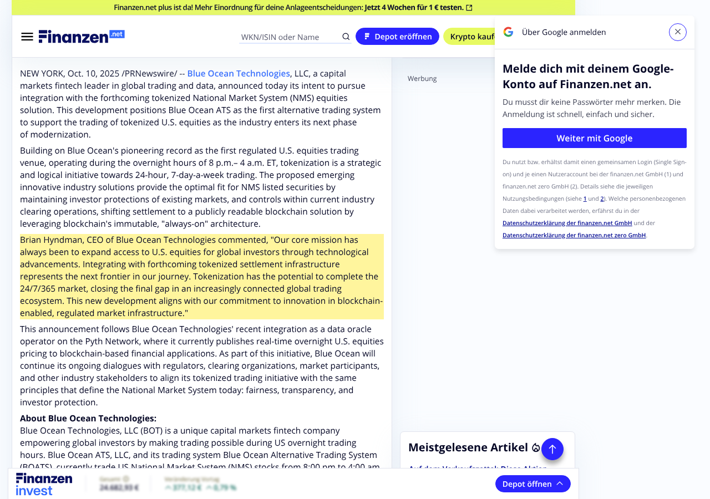

## 정체 카드
● 한 줄 정체 : 미국 거래소 거래가 없는 밤(미국 동부 밤 8시~새벽 4시)에 미국 주식을 거래하는 야간 시장 Blue Ocean ATS. 이 시간이 한국 시간 낮(오전 10시~오후 6시)이라 ==한국 증권사 고객이 주 이용자== [F-0001][F-0005]
  - 뜻 : ATS(대체거래시스템) = 거래소로 등록하지 않고 브로커딜러가 운영하는 주문 체결 시장. 이 본문의 "야간 3사"는 Blue Ocean, Bruce, MOON 세 ATS
  ★ 유형 안 위치 : 미국 SEC 상장주식 ATS 35곳(2026-11) → 그중 **야간 거래 ATS** 4곳의 하나(Blue Ocean, Bruce, IBKR Eos, MOON, 로펌 정리) → 야간 3사 거래대금의 83.0%로 1위(2026 Q3, FINRA 주간 보고 계산) → 2021-10 정식 개장, 미국 동부 밖 시간대 투자자용으로 세움 [F-1141][F-1176][F-0015][F-1090][F-1423]
  - ATS 전체 안 : 2026 Q3 13주에 NMS 주식 거래를 보고한 ATS 34곳 중 거래대금 17위, 전체 ATS 거래대금의 2.01%(FINRA 주간 보고 계산) [F-1419][F-1420]
  - 분모 주의 : 34곳 합계에는 낮 시간 기관 거래가 대부분 섞여 있어 2.01%는 야간 시장 안 비중이 아님. 야간 시장 안 비중은 위 83.0%(야간 3사 대비)이고, 야간 시장 크기는 SEC 직원 분석상 NMS 주식 거래량(주식 수)의 약 0.9% [F-1420][F-0015][F-1176]
  - 야간 3사 합계 : 같은 34곳 대비 2.43%(Blue Ocean 2.01%, Bruce 0.36%, MOON 0.05%) [F-1419][F-1420][F-1421][F-1422]
  - 뜻 : IBKR Eos = Interactive Brokers가 운영하는 야간 ATS. 이 본문의 야간 3사 비교에는 넣지 않음 [F-1176][F-1178]
● 대표 상품 : Blue Ocean Session(BOATS) = 미국 주식 야간 시장(미국 동부 밤 8시~새벽 4시) [F-0001][F-1182]
● 꼭 알아야 할 사실
  ★ 상장하지 않음. 운영사의 지주회사 Blue Ocean Technologies 지분을 Urbana(캐나다 상장 투자회사)가 약 35%, 도쿄증권거래소(일본 거래소)가 5% 보유(2023-09) [F-0002][F-0003]
  ★ 2024-01 MEMX를 기술 파트너로 선정, 야간 거래소를 준비하는 24X도 MEMX 기술 사용 [F-1177][F-1164]
  - 뜻 : MEMX = 미국 증권 거래소 운영사. Blue Ocean에는 체결 시스템을 제공하고 자체 거래소로도 야간 세션을 준비 중 [F-1177][F-1304]
  ★ 2024-08-05 체결 취소 사고, 한국 증권사 19곳에서 거래 6,300억원 취소. 그 시점 사업의 65%가 한국 물량이었음(Korea Times 보도, 단일 출처) [F-1105][F-0010]
  ★ 2026-09-01 공정접근 규칙의 5% 기준에 걸려 18개 종목 거래를 스스로 중단, 2026-09-10 회사 대변인이 더는 중단하지 않아도 된다고 밝힘(이유는 확인하지 못함) [F-1099][F-1102]
  - 뜻 : 공정접근 = ATS가 한 종목 거래량의 5% 이상을 직전 6개월 중 4개월 이상 차지하면 참가자 접근을 부당하게 막지 못하게 하는 미국 SEC 규칙. 인기 종목에서 점유가 커지면 의무가 붙으므로 회사는 해당 종목 거래를 멈춤 [US-17CFR-242.301-b5][F-1100]
● 숫자
  ★ 점유율 : 야간 3사(미국 야간 ATS 전체가 아니라 이 본문이 다루는 세 곳) 거래대금 합계 2,934억 달러 중 2,435.5억 달러로 83.0%(2026 Q3 13주, FINRA 주간 보고 거래대금 기준), 2위 Bruce 15.0%와 68.0%p 차이 [F-0015][F-0029]
  - 뜻 : FINRA 주간 보고 = FINRA가 ATS별 주간 거래대금을 공개하는 통계. 거래대금 = 체결된 주식 수에 가격을 곱한 금액 [F-0015]
  ★ 종목 수 : 거래 가능한 미국 상장 종목 약 11,000개(회사 홈페이지, 2026-11-16 열람) [F-1182]
● 흐름 : 한국 투자자 → 한국 증권사 앱 → 주문을 대신 전달하는 미국 브로커 → Blue Ocean ATS 체결(MEMX 기술) [F-0004][KR-금투업규정-5-31][F-1177]

## ATS 개요
● 쉽게 말하면 : ==한국 낮 시간에 미국 주식을 살 수 있게 만든== 야간 시장, 야간 3사 거래대금의 83.0% [F-0005][F-0015]
● 주장 : 한국 낮 주문을 먼저 잡아 야간 3사 거래대금 83.0%를 차지 [F-1090][F-0004][F-0015]
● 운영사
  ★ 법인명 : Blue Ocean ATS, LLC(미국 주식 야간 거래 시장 BOATS, Blue Ocean Alternative Trading System 운영) [F-0001]
  ★ 2019년 설립, 2020-10 브로커딜러 등록, FINRA 회원 [F-0001][F-0247]
  - 뜻 : 브로커딜러 = 미국 SEC에 등록해 증권을 중개, 매매하는 증권사
  - 뜻 : FINRA = 미국 브로커딜러를 감독하는 민간 자율규제기구
  ★ 2021-06 시범 운영, 2021-10 정식 개장 [F-1091][F-1090]
● 설립 목적과 타깃 수요
  ★ 왜 만들었나 : 2021-10-05 정식 개장 발표에서 미국 동부 시간대 밖의 투자자가 더 편한 시간에 거래하게 한다는 공동 목표와 아시아태평양 투자자로 넓히려는 비전으로 세웠다고 밝힘(회사 발표) [F-1423]
  ★ 누구의 어떤 수요 : 같은 발표에서 사장은 미국 서부와 해외 투자자의 야간 거래를, 최대주주 Urbana 회장은 밤사이 뉴스에 대응하려는 구독자와 자기 나라 낮 시간에 거래하려는 아시아태평양 투자자를 꼽음(회사 발표) [F-1424]
  - 뒤의 발언 : CEO가 아시아 시간대와 일요일 밤 주말 뉴스 수요(2022-10), 한국과 북아시아를 가장 큰 수요처로 본 발언(2025-01)은 경영진 발언 장 {bo-0201}{bo-0203}
  ★ 실제 주문을 낸 쪽 : 2022년부터 ==한국 증권사 고객이 한국 낮 시간에== 이용했고 2024-08 체결 취소 시점 사업의 65%가 한국 물량(Korea Times 보도). 미국에서는 Interactive Brokers(2023-07)와 Robinhood 24 Hour Market이 야간 주문을 보냄 {bo-0013}{bo-0111}{bo-0118}{bo-0128}
● 모회사
  ★ 지주회사 Blue Ocean Technologies가 운영사 Blue Ocean ATS, LLC 지분 보유 [F-0247]
  ★ Urbana(캐나다 상장 투자회사)가 지주회사 지분 약 35% 보유(2023-09). 나머지 지분 보유자는 비상장이라 자료에서 확인하지 못함 [F-0002]
● 취급 자산
  ★ 미국 NMS 상장 주식 [F-0001]
  - 뜻 : NMS(전국시장체계) = 미국 증권거래소에 상장된 주식을 하나의 시장처럼 묶는 SEC 규칙 체계
  ★ 2026-10 세션 거래대금 1위 종목 SOXL(반도체 지수 수익률의 3배를 따르는 ETF), 1.65억 달러 [F-0016]
● 대상 고객
  ★ ATS에 가입한 글로벌 구독 브로커(가입 자격은 아래 "거래 시설 운영" 참조) [F-0001][F-1290]
  ★ 2022년부터 한국 증권사 고객이 한국 낮 시간에 이용 [F-0005]
  ★ 미국 대형 온라인 증권사 Interactive Brokers가 2023-07 연결(회사 발표) [F-1178]
  ★ 2024-01 MEMX를 기술 파트너로 선정, 체결 시스템 제공 [F-1177]
● 미국 개인 대상 증권사 연결 : Robinhood의 24시간 거래 서비스가 Blue Ocean과 제휴해 야간 주문을 Blue Ocean으로 보내 체결(2023-12 종목 236종) [F-1241]
● 거래시간
  ★ 일~목 밤 8시~새벽 4시(미국 동부) [F-0001]
  ★ 한국 시간 오전 10시~오후 6시에 해당 [F-0005]
● 거래 규모
  ★ 기준 : FINRA 주간 보고 거래대금 13주 합산, 야간 3사 합계 대비 [F-0015]
  ★ 2026 Q3 2,435.5억 달러, 야간 3사 중 83.0%로 1위 [F-0015]
  ★ 같은 Q3 Bruce(야간 ATS) 439.7억 달러(15.0%), MOON(야간 ATS) 58.3억 달러(2.0%) [F-0029][F-0042]
  ★ 2026 Q2 2,676.7억 달러, 점유율 83.9%에서 Q3 0.9%p 하락. 점유율 하락과 함께 거래대금 자체도 Q2 대비 9.0% 감소 [F-0013][F-0014][F-0015]
  ★ 다른 기준의 점유율(Korea Times 2026-03-02 보도, Blue Ocean 사이트 게재) : 야간 시장의 약 90%를 Blue Ocean, 약 10%를 Bruce와 MOON이 나눔. 기간과 집계 방식이 적혀 있지 않아 위 FINRA 13주 합산 83.0%와 같은 줄에서 비교하지 않음 [F-1395]
● 차별화 요소
  ★ 3사 중 가장 먼저 개장(2021-10, 뒤이어 MOON 2024-11, Bruce 2025-03) [F-1090][F-0036][F-0020]
  ★ 2023-09 도쿄증권거래소가 지주회사 지분 5% 투자, 일본 낮 시간 거래 목표 [F-0003]
● 토큰증권 취급 현황
  ★ 2025-10 토큰화한 NMS 주식(블록체인 토큰 형태의 상장 주식) 거래와의 연동 추진 발표 [F-0017]
  ★ 2026-03 주말에도 토큰화 증권을 거래하는 구상 밝힘. NMS 주식 거래 방식 자체는 그대로 유지(Traders Magazine 인터뷰, 단일 출처) [F-0019]
  ★ 2026-03 RQD(미국 청산 회사)와 토큰 주식 청산 MOU(업무협약, 법적 구속력 있는 계약이 아닌 협력 문서) [F-0018]
  ★ DTCC(미국 중앙 예탁결제기관)가 추진하는 토큰화 일정에 맞춰 준비 [F-0017][F-0018]
● 화면
  

## 거래 시설 운영
● 쉽게 말하면 : 직접 가입은 미국 브로커딜러만 하고, 장애에 대비한 !!별도 복구 사이트는 없으며!!, 사고 뒤 한국이 복수 ATS 연결을 요구함 [F-1290][F-1292][F-1299]
● 주장 : 가입 자격과 가격 밴드로 안전장치는 두었으나 장애 때 넘어갈 별도 복구 사이트가 없는 단일 체결 시장이어서, 사고 뒤 한국이 복수 ATS 연결을 재개 조건으로 붙임 [F-1291][F-1293][F-1292][F-1299]
● 참가자 수와 유형
  ★ 직접 구독자 : 미국 SEC 등록 브로커딜러이면서 미국 자율규제기구 회원 1곳 이상(회사 FAQ, 2026-11-16 열람) [F-1290][F-1291]
  - 뜻 : 구독자 = ATS에 주문을 직접 보낼 자격을 얻은 가입 회원
  ★ 한국 증권사의 위치 : 직접 구독자가 아니므로 미국 브로커를 거쳐 접속 [F-1291][KR-금투업규정-5-31]
  ★ 참가 브로커 : 2024-11 업계 행사 보도로 55곳(일본, 한국, 싱가포르, 미국, FlexTrade 게시글, 단일 출처) [F-1183]
  - 다른 시점 값 : 2026-03-02 Korea Times 보도(Blue Ocean 사이트 게재)는 30개국 140곳 이상의 증권사가 쓰고 그 절반이 아시아라고 씀. 시점과 출처가 달라 둘 다 두고 하나로 고르지 않음. 회사 FAQ에서는 수를 확인하지 못함 [F-1395][F-1183]
  ★ 요금(Form ATS-N 첨부서, 2026년 개정) : 접속비와 포트비 없음. 1달러 이상 종목은 기존 호가를 가져가는 체결에 주당 0~0.002달러(협상), 1달러 미만 종목은 거래대금의 최대 0.3% [F-1394]
  - 뜻 : Form ATS-N = NMS 주식을 거래하는 ATS가 SEC에 내는 운영 신고서. 요금과 참가 조건이 여기에 공시됨
  ★ 수수료 : Interactive Brokers가 공시한 이용 요율로 1달러 이상 종목은 기존 호가를 가져가는 주문에 주당 0.002달러 부과, 새 호가를 내는 주문에는 주당 0.0006달러 리베이트(단일 출처, 회사 매출은 공개되지 않음) [F-1294]
  - 리베이트(새 호가를 내 체결된 쪽에 돌려주는 돈) : 2026년 개정 ATS-N은 주당 0~0.0060달러 범위에서 협상. Interactive Brokers 요율표의 주당 0.0006달러는 개정 전 ATS-N의 고정 리베이트와 같은 값이며, 개정본에서 이 옛 요율표는 삭제 표시됨(ATS-N 첨부서 캡처 captures/chrome/BlueOcean_ATSN_fees_2026.png) [F-1394][F-1294]
● 주주 구성과 지분
  ★ 확인된 주주 : Urbana 약 35%, 도쿄증권거래소 5%로 합계 약 40%이며 나머지 약 60%의 보유자는 자료에서 확인하지 못함(위 모회사 항목 참조) [F-0002][F-0003]
  ★ 도쿄증권거래소 투자 목적 : 일본 투자자가 일본 낮 시간에 Blue Ocean ATS를 쓰게 하려는 것(2023-09-13, 투자 완료 발표, 아래 발언 2) [F-0003]
● 장애 대응 체계
  ★ 복구 사이트 : 이중화한 별도 복구 사이트는 없고, 사업 지속 계획(BCP)을 연 1회 점검(회사 FAQ) [F-1292]
  - 뜻 : BCP = 장애나 재난 때 시장을 계속 돌리기 위한 대응 계획
  ★ 가격 밴드 : 거래 세션 중 20% 가격 밴드 적용(회사 FAQ) [F-1293]
  - 뜻 : 가격 밴드 = 기준 가격에서 일정 폭을 벗어난 가격의 주문 체결을 막는 안전장치
  ★ 실제 사고 : 2024-08-05 체결 취소로 한국 증권사 19곳, 약 9만 계좌, 6,300억원 취소. 회사 설명은 거래량 급증이 원인이고 새벽 1:45~3:06 사이 체결이 취소됨(Markets Media 보도, 단일 출처) [F-1105][F-0007][F-0006]
  ★ 한국 재개 조건(금융감독원이 금융투자협회와 2025-09-24 발표, 매체 3곳 일치) : 2곳 이상 미국 브로커와 ATS에 주문 회선 연결 [F-1299]
  ★ 한국 재개 조건 : 계좌별, 시간대별, 체결번호별 롤백 시스템 도입 [F-1300]
  - 뜻 : 롤백 = 체결이 취소될 때 고객 잔고와 증거금을 원래대로 되돌리는 시스템
  ★ 한국 재개 조건 : 위험 고지 강화, 사고 시 보상체계, 장애 대응 매뉴얼, 현지 ATS와 비상연락망 [F-1301]
  ★ 사고 뒤 회사가 내놓은 방안(2025-02 CEO 인터뷰, Korea Times 보도) : 한국 증권사에 월 최대 25만 달러의 금전 보상을 포함한 방안 제시, 2025-01-22 서울 사무소 개설 [F-1297][F-1296]
  ★ 해석 : 복구 사이트 없는 단일 시장의 위험을 한국 증권사가 복수 ATS 계약으로 나눠 맡는 구조. 사고 뒤 회사는 새 기술의 용량이 하룻밤 350억 메시지(이전 3,500만)라며 체결 취소 재발이 없을 것이라 말함(2025-02, 회사 주장) [F-1292][F-1299][F-0035][F-1295]
● 공정접근 규칙 대응
  ★ 2026-09-01 일부 종목이 공정접근 5% 기준에 가까워 18개 종목 거래 중단 [F-1099][F-1100]
  ★ 2026-09-10 회사 대변인이 더는 공정접근 문턱 때문에 중단하지 않아도 된다고 밝힘 [F-1102]
● 정규 거래소 야간 진입 일정(미국 정규 거래소가 밤 시간대 거래를 열려는 계획)
  - 뜻 : SIP(통합시세 처리 시스템) = 여러 거래소의 호가와 체결가를 하나로 모아 전 시장에 내보내는 시스템. 거래소 야간 세션은 SIP가 야간에도 운영될 수 있을 때 시작하는 조건이 붙음 [F-1172]
  - 뜻 : 신속 승인 = SEC가 통상 절차보다 앞당겨 내린 승인. 제출 즉시 효력 = 승인 명령 없이 규칙을 제출하는 것만으로 효력이 생기는 방식. 조건부 면제 = SEC가 정해진 조건 아래에서만 규정 적용을 면제해 준 것. 거래소 야간 세션 = 정규 거래소가 같은 시간대에 여는 야간 거래 시간 [F-1171][F-1174][F-1165]
  ★ SIP : 2026-12-06부터 연장 시간표 적용, 야간 시작 조건의 기준일 [F-1166][F-1168]
  ★ Nasdaq : 2026-04-10 SEC 신속 승인, 주 5일 23시간 거래, 야간 세션은 SIP 가용 시 시작 [F-1171][F-1172]
  ★ Cboe EDGX : 2026-05-29 SEC 신속 승인, SIP 준비 조건 충족 전에는 야간 세션 시작 안 함 [F-1303]
  ★ NYSE Arca : 2026-05 야간 세션 추가 규칙 제출, 승인 명령이 아니라 제출 즉시 효력 [F-1174]
  ★ MEMX : 승인이 아니라 2026-08-28 규칙 제출, 즉시 효력(관보 2026-09-14), 야간 세션 시작 조건은 EDGX와 같음 [F-1304]
  ★ 24X : 야간 거래는 조건부 면제로 2027-01-24부터, SIP가 2026-12-06까지 준비되지 못할 때만 허용 [F-1165]
  ★ 규모 : MEMX가 SEC 문서에 인용한 자료로 2026-04 미국 야간 시간대 거래는 전년 같은 달 대비 305% 증가했으나 미국 전체 일 거래량의 1% 미만 [F-1305]
  ★ 해석 : Blue Ocean의 체결 시스템 공급자 MEMX와 24X의 기술 공급자가 같아, 거래소 야간 세션이 열려도 같은 기술 위에서 경쟁함 [F-1177][F-1164][F-1304]

## 경영진 발언
● 쉽게 말하면 : 경영진은 ==한국에서 일본으로, 다시 24시간 시장으로== 넓힌다고 말함 [F-0004][F-0003][F-0017]
● 주장 : 한국 낮 시간 연결에서 시작해 일본과 아시아로, 이어 주말까지 닫힌 틈이 없는 24시간 토큰 시장으로 넓히겠다고 말하고 일부를 이룸 [F-0004][F-0003][F-0017]
● 말하고 이룬 것(시점 순)
  ★ 2022-02-07 Layman(당시 CEO) : 미국 주식 시장이 서울에서 열린다 → 같은 날 삼성증권 제휴, 2022년부터 한국 증권사 고객이 한국 낮에 이용 [F-0004][F-0005]
  ★ 2022-10-11 Hyndman(사장 겸 CEO) : 아시아 시간대에 맞춰 일요일 밤 8시 개장 구조로 수요를 받는다 → 일~목 밤 8시 개장으로 운영 중(단일 출처) [F-1072][F-0001]
  ★ 2023-09-13 Hyndman : 아시아태평양 거래를 키우는 시점 → 도쿄증권거래소 5% 투자 [F-0003]
  ★ 2025-01-30 Hyndman : 한국과 북아시아가 가장 큰 수요처라 현지에서 영업을 직접 관리 → 서울 사무소 개설(2025-01-22, 전 LSEG Korea 대표 영입, 단일 출처) [F-1073][F-1296]
● 말하고 진행 중인 것
  ★ 2025-10-10 Hyndman : 토큰화가 24시간 365일 시장을 완성 → 2026-03 RQD와 토큰 주식 청산 MOU, 실제 거래는 시작 전 [F-0017][F-0018]
  ★ 2025-12-22 Hyndman : 토큰화는 12~24개월 안에 열릴 새 경로이고 기존 NMS 거래와 병행(단일 출처) [F-1075]
  ★ 한국 비중 : 2024-08에는 사업의 65%가 한국(Korea Times 보도), 2026-03 Korea Times 보도는 한국이 하룻밤 거래량의 약 35%. 같은 매체의 CEO 발언 보도라 시점 순으로 두되 기준 문구(사업 대비, 거래량 대비)가 다름(단일 출처) [F-0010][F-1395]
  - 같은 달 다른 매체 : 아주경제 인용 CEO 인터뷰 제목(Blue Ocean 홈페이지 뉴스 목록, 2026-03-20)도 한국이 글로벌 거래량의 35% [F-1298]
● 발언 1 : 미국 주식 시장을 서울 낮으로 옮긴다 [F-0004]
  ★ Ralph Layman(Blue Ocean Technologies CEO, 2022년 당시), 삼성증권 제휴 발표, 2022-02-07, https://prnewswire.com/news-releases/blue-ocean-technologies--samsung-securities-announce-strategic-partnership-offering-us-equity-trading-during-local-asia-pacific-business-hours-301476177.html [F-0004]
    ① 원문 : "This partnership allows us to transport the US equities trading day, and our Blue Ocean trading model, to provide expanded local access to the greatest capital market in the world. ... As of today, the US equity market opens in Seoul."
    ② 번역 : 이번 제휴로 미국 주식 거래일과 Blue Ocean 거래 모델을 옮겨 세계 최대 자본시장에 대한 현지 접근을 넓힌다. 오늘부터 미국 주식 시장이 서울에서 열린다.
    ③ 해석 : 방향은 한국 낮 시간의 미국 주식 수요, 실행은 한국 증권사를 구독자로 연결
  
● 발언 2 : 아시아태평양 거래를 키우는 시점 [F-0003]
  ★ Brian Hyndman(사장 겸 CEO), 도쿄증권거래소 투자 완료 발표, 2023-09-13, https://prnewswire.com/news-releases/blue-ocean-technologies--tokyo-stock-exchange-close-strategic-investment-agreement-focused-on-expanding-trading-hours-for-japanese-investors-301926166.html [F-0003]
    ① 원문 : "This partnership comes at a pivotal time as we continue to grow our trading in the Asia Pacific region. ... connecting local Japanese investors to endless trading opportunities on the Blue Ocean ATS platform"
    ② 번역 : 이번 제휴는 아시아태평양 거래를 계속 키우는 중요한 시점에 이뤄졌다. 일본 현지 투자자를 Blue Ocean ATS의 거래 기회와 연결한다.
    ③ 해석 : 방향은 한국 다음의 아시아 시장, 실행은 도쿄증권거래소 지분 투자를 받아 일본으로 확장
  
● 발언 3 : 토큰화가 24시간 365일 시장을 완성 [F-0017]
  ★ Brian Hyndman(CEO), 토큰화 NMS 주식 연동 발표(보도자료), 2025-10-10, https://www.finanzen.net/nachricht/aktien/blue-ocean-technologies-to-pursue-tokenized-nms-us-equities-trading-14994412 [F-0017]
    ① 원문 : "Integrating with forthcoming tokenized settlement infrastructure represents the next frontier in our journey. Tokenization has the potential to complete the 24/7/365 market, closing the final gap in an increasingly connected global trading ecosystem."
    ② 번역 : 다가올 토큰화 결제 인프라와의 연동은 우리 여정의 다음 개척지다. 토큰화는 24시간 365일 시장을 완성해 연결된 세계 거래 생태계의 마지막 빈틈을 메울 수 있다.
    ③ 해석 : 방향은 주말까지 이어지는 24시간 시장, 실행은 토큰화 결제와 청산 연동 준비
  

## 국내 연결과 사고 이력
● 쉽게 말하면 : 한국 주문이 몰린 만큼 사고 한 번에 !!한국 고객 전체가 멈춤!! [F-1105][F-0009]
● 주장 : 한 시장에 기댄 한국 주문이 사고와 종목 중단 때마다 경쟁사로 [F-1105][F-1099][F-0031]
● 국내 증권사 연결
  ★ 2022-02 삼성증권(한국 증권사)이 첫 해외 제휴사 [F-0004]
  ★ 2025-11-04 한국 증권사 18곳 주간거래 재개(조건은 위 거래 시설 운영의 한국 재개 조건 참조) [F-0011][F-1010]
  - 뜻 : 주간거래 = 한국 증권사가 한국 낮 시간(미국 야간)에 제공하는 미국 주식 거래 서비스. 한국 증권사는 주문을 이 ATS로 보냄 [F-0005][F-1103]
● 사고와 중단 연표
  ★ 2024-08-05 체결 일괄 취소, 한국 증권사 19곳, 6,300억원 [F-1105]
  ★ 2024-08-16 한국 주간거래 중단, 2025-11-04 재개(약 15개월) [F-1103][F-0009]
  ★ 2026-09-01 18개 종목(SOXL, KORU 등) 거래 중단 [F-1099][F-0012]
  ★ 2026-09-11 18개 종목 재개(한국 시간) [F-1102]
● 2026-09 종목 중단의 내용
  ★ 사유 : SEC 공정접근 5% 문턱, 의무가 아닌 자체 중단 [F-1100]
  ★ 한국은 그 종목을 Bruce, MOON에 호가 없이 지정가로 주문 [F-1101][F-0045]
  - 뜻 : 호가 = 사려는, 팔려는 희망 가격 목록. 한국 앱은 Bruce, MOON 호가를 볼 수 없어 사는 가격을 직접 정해 내는 지정가 주문만 가능했음 [F-1101]
  ★ 같은 9월 메리츠, 10월 토스가 Bruce 시세 연결 [F-0032][F-0033]
  ★ 10월 최근 3주 Bruce 점유율 29.8%로 상승 [F-0031]

## 한국 시장과의 차이
● 쉽게 말하면 : 미국은 증권사 등록과 규정 준수만으로 야간 시장을 열 수 있으나 ==한국은 정부 인가가 있어야 함== [F-0247][F-1092]
● 주장 : 같은 야간 시장이라도 미국은 거래소 등록 면제 요건만 지키면 열리는 반면, 한국 ATS는 금융위원회 인가(넥스트레이드 2025-02 본인가)를 받아야 하는 차이 [F-0247][F-1092][US-17CFR-242.301-b1]
● 규제
  ★ 가능했던 이유 : 브로커딜러 등록과 Reg ATS로 거래소 등록 면제 [F-0247][US-17CFR-240.3a1-1][US-17CFR-242.301-b1]
  - 뜻 : Reg ATS = 미국 SEC의 ATS 규정, 브로커딜러가 요건을 지키면 거래소 등록 없이 시장을 운영하게 함
  ★ 한국 차이 : 한국 ATS는 금융위원회 인가(넥스트레이드 2025-02 본인가) [F-1092]
  - 뜻 : 넥스트레이드 = 한국에서 인가받은 대체거래소(ATS)
  ★ 한국 차이 : 직접 참가자는 증권사, 개인은 증권사를 거쳐 거래 [F-1095][F-1096][F-1094]
  ★ 한국 차이 : 개인의 해외 주식 주문은 해외 중개업자 경유 [KR-금투업규정-5-31]
● 고객 수요
  ★ 가능했던 이유 : 한국 낮 시간의 미국 주식 매매 수요 [F-0005]
● 규제 건의 포인트 : 해외 체결 시장 사고 때 거래 되돌림, 고객 보호 기준 [F-1105][F-0011]

## 성과와 판단
● 쉽게 말하면 : 야간 3사 중 1위이나 한 번의 사고와 종목 중단에 약하고, ==거래소의 야간 거래가 다가옴== [F-0015][F-1099][F-1175]
● 주장 : 1위 점유율도 사고 한 번, 종목 중단 한 번에 흔들릴 수 있음 [F-0015][F-1099][F-0031]
● 성과
  ★ 거래대금 점유율 : 야간 3사 합계 대비 2026 Q2 83.9%, Q3 83.0% [F-0014][F-0015]
● 핵심 성공요인(KSF)
  ★ 후발보다 3년 이상 먼저 개장해 한국 연결을 선점(한국 증권사가 처음 연결한 야간 시장) [F-1090][F-0036][F-0020][F-0004]
  - 남들 : MOON 2024-11, Bruce 2025-03 개장 [F-0036][F-0020]
  - 이 회사 : 2021-10 개장, 2022-02 삼성증권을 첫 해외 제휴사로 연결 [F-1090][F-0004]
  - 결과 : 2026 Q3 야간 3사 합계 대비 83.0%로 1위 [F-0015]
  - 한계 : 전후 비교가 되는 점유율 시계열은 Q2 83.9%에서 Q3 83.0%까지만 확보 [F-0014][F-0015]
● 제약과 리스크
  ★ 2024 사고 한 번이 한국 고객 전체 중단으로 번짐 [F-1105][F-0009]
  - 잃는 쪽 : 한국 증권사 19곳의 약 9만 계좌가 6,300억원어치 거래를 취소당함 [F-1105]
  - 이어진 손실 : 한국 주간거래가 2024-08-16부터 2025-11-04까지 약 15개월 중단 [F-1103][F-0009]
  ★ 공정접근 5% 문턱 때문에 인기 종목을 스스로 멈춤 [F-1100][US-17CFR-242.301-b5]
  - 잃는 쪽 : 한국 투자자는 SOXL, KORU 등 18개 종목을 시세 없는 지정가로 Bruce, MOON에 주문해야 했음 [F-1099][F-1101]
  - 잃는 쪽 : Blue Ocean은 그 기간 주문을 경쟁사에 내줌 [F-0031][F-1101]
● 거래소 야간 거래가 오면(일정은 위 "거래 시설 운영" 참조)
  ★ 24X는 MEMX 기술 위에서 운영, Blue Ocean과 같은 기술 [F-1164][F-1177]
  ★ 해석 : 거래소의 야간 세션이 열리면 Blue Ocean만 밤에 거래할 수 있다는 강점이 줄고, 한국 증권사 연결과 체결 시스템 안정성이 경쟁 기준이 됨 [F-1176][F-0004][F-1164]
● KDX 시사점
  ★ 자산 : 기존 미국 상장 주식을 시간대만 바꿔 거래 [F-0001][F-0005]
  - 가져올 것 : 새 상품 없이 ==기존 자산의 거래 시간대를 넓히는 방식== [F-0001][F-0005]
  - 이유 : 새 자산 상장이나 토큰 발행 없이 기존 상장 주식을 그대로 쓰므로 상품 설명과 투자자 보호 부담이 늘지 않고, 수요가 있는 시간대만 새로 채움(해석) [F-0001][F-0005]
  ★ 고객 : 한국 증권사 단위로 고객 수요를 연결 [F-0004][F-0005]
  - 가져올 것 : 증권사 한 곳씩 제휴해 한국 낮 시간 수요를 모음 [F-0004]
  - 이유 : 개인 고객 접점을 가진 증권사를 거치면 가입, 계좌 개설 없이 물량이 들어옴(해석). 삼성증권 제휴(2022-02)를 시작으로 2024-08에는 한국 증권사 19곳이 연결되어 사업의 65%가 한국 물량 [F-0004][F-1105][F-0010]
  - 피할 것 : 한국 증권사 19곳이 한 체결 시장에 묶여 사고 때 함께 멈추는 구조 [F-1105][F-0009]
  - 이유 : 한 시장의 사고가 모든 연결 증권사의 고객에게 동시에 번져 6,300억원 거래 취소와 15개월 서비스 중단으로 이어짐 [F-1105][F-0009]
  ★ 시장 : 해외 시간대 체결은 현지 ATS, 접점은 국내 증권사 [F-0001][F-0004]
  - 피할 것 : 시세 없는 지정가 주문 [F-1101]
  - 이유 : 호가를 보지 못하고 가격을 정해 내는 주문은 투자자가 불리한 가격에 체결될 위험을 직접 짐(해석) [F-1101]
  ★ 거래 시설 운영 : 가입 자격을 브로커딜러로 제한하고 가격 밴드를 둠 [F-1290][F-1293]
  - 가져올 것 : 직접 가입 자격과 가격 밴드를 문서로 공개 [F-1290][F-1293]
  - 이유 : 누가 참여하고 어떤 가격 이상 주문을 막는지 미리 알려 두면 사고 때 책임 범위와 대응 기준이 분명해짐(해석) [F-1290][F-1293]
  - 피할 것 : 별도 복구 사이트 없이 한 체결 시장에 의존 [F-1292][F-1105]
  - 이유 : 장애가 나면 거래를 옮길 곳이 없어 시장 전체가 멈춤. 한국 당국이 재개 조건으로 복수 ATS 연결을 요구한 이유로 보임(해석) [F-1292][F-1299]
● 해외에서 이 사업이 된 조건
  ★ 제공 가치 : 한국 낮 시간의 미국 주식 체결 [F-0005]
  ★ 제도 : 미국 브로커딜러 등록과 Reg ATS로 거래소 등록 면제 [F-0247][US-17CFR-242.301-b1]
  ★ 경제성 : 주문 유형별 수수료와 리베이트로 수익을 내는 구조(Form ATS-N 요금, 1달러 이상 종목 주당 최대 0.002달러)이며, 거래대금 점유율 83.0%가 수입 규모의 근거이나 회사 매출은 공개되지 않음 [F-0015][F-1394][F-1294]
