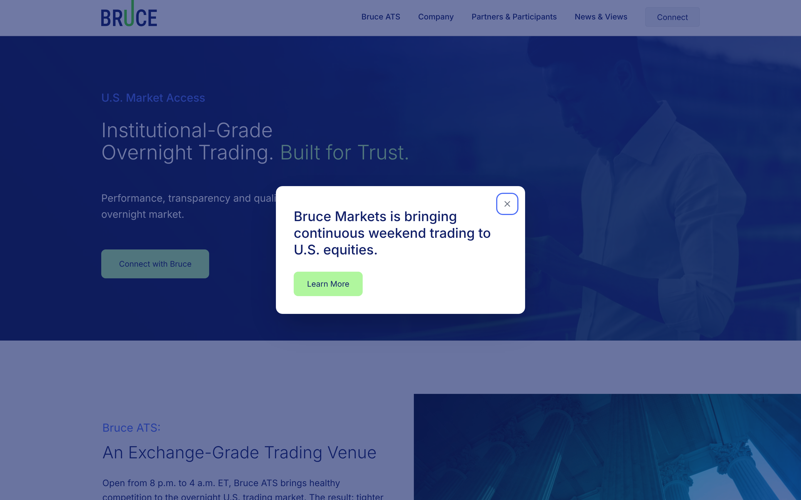
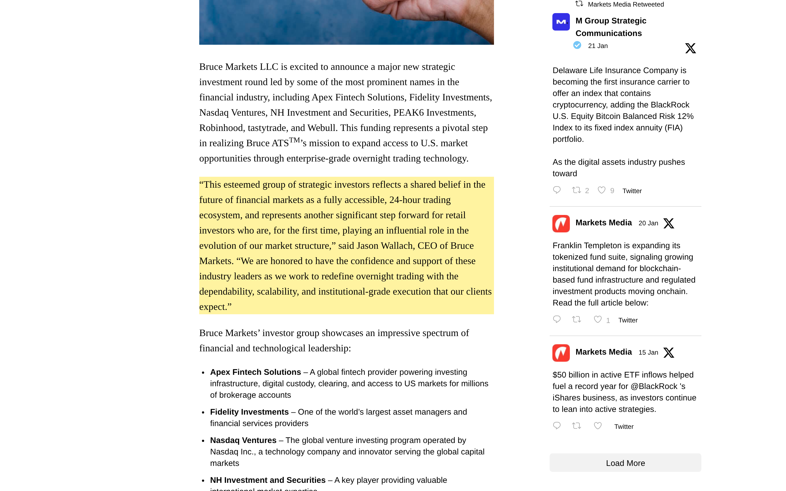

## 정체 카드
● 한 줄 정체 : 미국 거래소 거래가 없는 밤(미국 동부 밤 8시~새벽 4시)에 미국 주식을 거래하는 야간 시장 Bruce ATS. 3사 중 2025-03에 가장 늦게 시작했고 Nasdaq의 거래 기술을 씀 [F-0020]
  - 뜻 : ATS(대체거래시스템) = 거래소로 등록하지 않고 브로커딜러가 운영하는 주문 체결 시장. 이 본문의 "야간 3사"는 Blue Ocean, Bruce, MOON 세 ATS
● 대표 상품 : Bruce ATS = 미국 주식 야간 시장(미국 동부 밤 8시~새벽 4시, Nasdaq 기술) [F-0020][F-0024]
● 꼭 알아야 할 사실
  ★ 상장하지 않음. 모회사 Bruce Markets Holdings의 최대주주는 PEAK6(미국 금융 투자회사, Finance Magnates 보도, 단일 출처) [F-0021][F-0022]
  ★ 2025-06 전략 투자 라운드에 Robinhood, Nasdaq Ventures 등 8곳 참여(금액 미공개), 개인 대상 증권사와 앱(Robinhood, Webull 등)을 포함 [F-1397][F-0023][F-0034]
  ★ 2026-09 주말까지 이어 거래하는 24시간 연속 거래 계획 발표, SEC 검토 대상이라 출시일 미정 [F-0025][F-1077]
● 숫자
  ★ 점유율 : 야간 3사(Blue Ocean, Bruce, MOON, 미국 야간 ATS 전체가 아니라 이 본문이 다루는 세 곳) 거래대금 합계 대비, FINRA 주간 보고 13주 기준 Q2 12.3%, Q3 15.0% [F-0028][F-0029]
  - 뜻 : FINRA 주간 보고 = FINRA가 ATS별 주간 거래대금을 공개하는 통계 [F-0029]
  ★ 최근 3주(2026-10-12~30) 29.8%. 기간이 분기와 달라 같은 줄에서 비교하지 않음 [F-0031]
  ★ 1위와의 차이 : 같은 2026 Q3 기준 Blue Ocean 83.0%와 68.0%p 차이 [F-0029][F-0015]
  ★ Bruce 자사 발표 2026-09 점유율 20.77%(직전 값 14.13%에서 상승, 야간 거래대금 기준, 산정 방식은 자료에 없음) [F-0030]
● 흐름(미국판) : 미국 투자자 → 미국 증권사 앱 → Bruce ATS 체결 → 청산(Apex Clearing, 미국 청산 회사) [F-0023][F-0025]
● 흐름(한국판) : 한국 투자자 → 한국 증권사 앱(시세 연결) → (미국 브로커) → Bruce ATS 지정가 주문 [F-0032][F-0033][F-1101][KR-금투업규정-5-31]

## ATS 개요
● 쉽게 말하면 : 후발 야간 시장, 증권사와 앱 등을 투자자로 끌어들인 뒤 점유율이 커짐 [F-0020][F-1397]
● 주장 : 후발인데도 증권사와 앱 등 8곳을 투자자로 묶은 뒤 점유율이 Q2 12.3%에서 Q3 15.0%, 2026-10 최근 3주 29.8%로 커짐(투자와 점유율 상승의 인과는 해석) [F-0020][F-1397][F-0028][F-0029][F-0031]
● 운영사
  ★ 법인명 : Bruce Markets LLC(미국 주식 야간 거래 시장 Bruce ATS 운영) [F-0248]
  ★ 2020-11 브로커딜러 등록, FINRA 회원 [F-0248]
  - 뜻 : 브로커딜러 = 미국 SEC에 등록해 증권을 중개, 매매하는 증권사
  - 뜻 : FINRA = 미국 브로커딜러를 감독하는 민간 자율규제기구
  ★ 2025-03 야간 ATS 개시 [F-0020]
● 모회사
  ★ Bruce Markets Holdings가 운영사 Bruce Markets LLC 지분 보유 [F-0021][F-0248]
  ★ 등록부 기타 상호 : PEAK6 Trading, All Time ATS(최대주주 PEAK6와 같은 이름이 포함됨) [F-0248][F-0022]
● 취급 자산
  ★ 미국 NMS 상장 주식 [F-0020]
  - 뜻 : NMS(전국시장체계) = 미국 증권거래소에 상장된 주식을 하나의 시장처럼 묶는 SEC 규칙 체계
● 대상 고객
  ★ 미국 브로커딜러와 해외 브로커 [F-0020]
● 거래시간
  ★ 일~목 밤 8시~새벽 4시(미국 동부) [F-0024]
● 호가 방식
  ★ Nasdaq(미국 거래소 운영사)의 거래 기술로 체결 [F-0020]
  ★ 브로커는 표준 FIX(주문 전송 규격)로 접속 [F-0020]
● 거래 규모
  ★ 기준 : FINRA 주간 보고 거래대금 13주 합산, 야간 3사 합계 대비 [F-0029]
  ★ 2026 Q3 439.7억 달러, 3사 중 15.0%(Q2 12.3%) [F-0029][F-0028]
  ★ 같은 Q3 Blue Ocean(선발 야간 ATS) 83.0%, MOON(야간 ATS) 2.0% [F-0015][F-0042]
● 차별화 요소
  ★ 2025-06 투자사에 Robinhood(미국 주식 앱), Webull(투자 앱) 등 개인 대상 증권사 포함(아래 주주 구성) [F-1397][F-0023]
  ★ 2026-09 주말 포함 연속 거래 계획, SEC 검토 대상 [F-0025]
● 토큰증권 취급 현황
  ★ 주말 거래도 기존 주식 청산 구조, Apex Clearing(미국 청산 회사) [F-0025]
● 화면
   

## 거래 시설 운영
● 쉽게 말하면 : 체결 기술과 시세 전송은 Nasdaq 시설을 빌려 쓰고, 증권사와 앱 등 8곳이 투자자로 참여하며, 한국 증권사가 복수 ATS를 요구받은 덕에 백업 시장 자리를 얻음 [F-1302][F-0023][F-0035]
● 주장 : 직접 시스템을 만들지 않고 Nasdaq의 기술과 시세 배포망을 빌려 빠르게 열었고, 그 대신 기술 공급자가 경쟁자이기도 한 의존 구조를 가짐 [F-0020][F-1302][F-0023][F-1171]
● 요금(Form ATS-N, 2026-01-30 제출본)
  ★ 1달러 이상 종목은 기존 호가를 가져가는 체결에 주당 0~0.002달러, 1달러 미만 종목은 거래대금의 최대 0.3%. 초기 참여사와 대량 거래사는 할인 [F-1396]
  - 뜻 : Form ATS-N = NMS 주식을 거래하는 ATS가 SEC에 내는 운영 신고서. 요금과 참가 조건이 여기에 공시됨
  - 비교 : 같은 기준(1달러 이상 종목, 가져가는 체결)에서 Blue Ocean도 주당 0~0.002달러(Form ATS-N), MOON은 주당 0.0016달러(2026-11-01 시행 요금표). 세 곳 모두 매출은 따로 공개하지 않음 [F-1394][F-1398]
● 시세 제공(수익원 중 확인된 부분)
  ★ 2025-04-15 Nasdaq 배포 연결을 통해 브로커와 트레이더가 Bruce ATS 시세(Last Sale 최근 체결가, Best Bid and Offer 최우선 호가, Depth of Book 호가 잔량)에 접근 [F-1302]
● 참가자 유형
  ★ 접속 대상 : 미국 브로커딜러와 해외 브로커(표준 FIX 접속) [F-0020]
  ★ 한국 증권사 : 메리츠증권(2026-09), 토스증권(2026-10)은 시세 피드(가격 정보 전송)에만 연결, 주문 연결은 아님 [F-0032][F-0033]
● 주주 구성과 지분
  ★ 모회사 Bruce Markets Holdings(비상장) [F-0021]
  ★ 2025-06 투자 라운드 참여 8곳 : Apex Fintech, Fidelity, Nasdaq Ventures, NH투자증권, PEAK6, Robinhood, tastytrade, Webull(금액, 지분율 미공개) [F-1397][F-0023][F-0034]
  - 회사 성격 : 개인 고객 계좌를 두는 증권사와 앱은 Fidelity, NH투자증권, Robinhood, Webull, tastytrade 5곳. Apex Fintech는 청산 회사 계열(Bruce 주말 거래의 청산과 보관은 Apex Clearing), Nasdaq Ventures는 Nasdaq의 투자 부문, PEAK6는 Bruce의 최대주주인 금융 투자회사 [F-1397][F-0025][F-0022]
  - 주문 연결 : 8곳 중 어느 곳이 실제로 Bruce에 주문을 보내는지는 자료에서 확인하지 못해 모두 투자 참여사로만 씀 [F-1397][F-0023]
  - 뜻 : Nasdaq Ventures = 미국 거래소 운영사 Nasdaq의 투자 부문. Nasdaq는 Bruce의 기술 공급자이자 투자자이면서 야간 거래소 경쟁자 [F-0034][F-1171][F-0020]
● 장애 대응 체계
  ★ 한국 재개 조건(금융감독원이 금융투자협회와 2025-09-24 발표, 매체 3곳 일치) : 2곳 이상 미국 브로커와 ATS에 주문 회선 연결 [F-1299]
  ★ 한국 재개 조건 : 위험 고지 강화, 사고 시 보상체계, 장애 대응 매뉴얼, 현지 ATS와 비상연락망 [F-1301]
  ★ 해석 : 이 조건이 한국 증권사가 Blue Ocean 외에 Bruce와 MOON을 백업으로 계약한 배경 [F-1299][F-0035]
● 정규 거래소 야간 진입 일정(미국 정규 거래소가 밤 시간대 거래를 열려는 계획)
  - 뜻 : SIP(통합시세 처리 시스템) = 여러 거래소의 호가와 체결가를 하나로 모아 전 시장에 내보내는 시스템. 거래소 야간 세션은 SIP가 야간에도 운영될 수 있을 때 시작하는 조건이 붙음 [F-1172]
  - 뜻 : 신속 승인 = SEC가 통상 절차보다 앞당겨 내린 승인. 제출 즉시 효력 = 승인 명령 없이 규칙을 제출하는 것만으로 효력이 생기는 방식. 조건부 면제 = SEC가 정해진 조건 아래에서만 규정 적용을 면제해 준 것. 거래소 야간 세션 = 정규 거래소가 같은 시간대에 여는 야간 거래 시간 [F-1171][F-1174][F-1165]
  ★ SIP : 2026-12-06부터 연장 시간표 적용, 야간 시작 조건의 기준일 [F-1166][F-1168]
  ★ Nasdaq : 2026-04-10 SEC 신속 승인, 주 5일 23시간 거래, 야간 세션은 SIP 가용 시 시작 [F-1171][F-1172]
  ★ Cboe EDGX : 2026-05-29 SEC 신속 승인, SIP 준비 조건 충족 전에는 야간 세션 시작 안 함 [F-1303]
  ★ NYSE Arca : 2026-05 야간 세션 추가 규칙 제출, 승인 명령이 아니라 제출 즉시 효력 [F-1174]
  ★ MEMX : 승인이 아니라 2026-08-28 규칙 제출, 즉시 효력(관보 2026-09-14), 야간 세션 시작 조건은 EDGX와 같음 [F-1304]
  ★ 24X : 야간 거래는 조건부 면제로 2027-01-24부터, SIP가 2026-12-06까지 준비되지 못할 때만 허용 [F-1165]
  ★ 규모 : MEMX가 SEC 문서에 인용한 자료로 2026-04 야간 거래는 전년 같은 달 대비 305% 증가, 전체 일 거래량의 1% 미만 [F-1305]
  ★ 해석 : Bruce는 Nasdaq에 기술과 시세 배포를 기대는데, Nasdaq가 자체 야간 거래소도 열 예정이라 협력과 경쟁이 겹침 [F-1302][F-0034][F-1171]

## 경영진 발언
● 쉽게 말하면 : 경영진은 개인투자자의 24시간 수요를 보고 주말과 한국으로 넓힌다고 말함 [F-0023][F-0025][F-0033]
● 주장 : 개인투자자의 24시간 수요를 보고 증권사와 앱의 투자 유치, 한국 시세 연결, 주말 거래 순으로 넓히겠다고 말하며 앞의 둘은 이룸 [F-0023][F-0025][F-0033]
● 말하고 이룬 것(시점 순)
  ★ 2025-06-27 Wallach(CEO) : 개인투자자가 24시간 시장을 이끈다 → 같은 날 Robinhood, Webull 등 8곳이 참여하는 투자 라운드 발표(단일 출처 포함) [F-0023][F-1079][F-1397]
  ★ 2026-10-01 Wallach : 한국 투자자는 야간 시장의 핵심 세력이라 시세 피드부터 연결 → 2026-09 메리츠증권, 2026-10 토스증권 연결 [F-0033][F-0032][F-1078]
● 말하고 진행 중인 것
  ★ 2026-09-30 Wallach : 뉴스는 월요일 개장을 기다리지 않는다 → 주말 포함 24/7 거래를 Nasdaq 기술로 추진, SEC 검토 중이며 출시일 미정, 토큰화 언급은 없음 [F-0025][F-1077]
● 발언 1 : 개인투자자가 24시간 시장을 이끈다 [F-0023]
  ★ Jason Wallach(CEO), 전략 투자 유치 발표, 2025-06-27, https://www.marketsmedia.com/overnight-trading-platform-bruce-ats-raises-funds [F-0023]
    ① 원문 : "This esteemed group of strategic investors reflects a shared belief in the future of financial markets as a fully accessible, 24-hour trading ecosystem, and represents another significant step forward for retail investors who are, for the first time, playing an influential role in the evolution of our market structure."
    ② 번역 : 이 전략 투자자들은 금융시장의 미래가 누구나 접근하는 24시간 거래 생태계라는 믿음을 공유하며, 처음으로 시장구조 변화에 영향력을 갖게 된 개인투자자에게도 중요한 진전이다.
    ③ 해석 : 방향은 개인투자자의 24시간 거래, 실행은 개인 대상 증권사와 앱을 주주로 묶음
  
● 발언 2 : 뉴스는 월요일 개장을 기다리지 않는다 [F-0025]
  ★ Jason Wallach(CEO), 주말 거래 계획 발표, 2026-09-30, https://www.financemagnates.com/institutional-forex/bruce-markets-plans-weekend-trading-to-bring-us-equities-closer-to-247-access/ [F-0025]
    ① 원문 : "Market-moving news does not wait for Monday's open, and soon, neither will investors. Together with our partners, we are breaking down the limitations of traditional market structure and redefining how the world trades."
    ② 번역 : 시장을 움직이는 뉴스는 월요일 개장을 기다리지 않고, 곧 투자자도 기다리지 않을 것이다. 파트너와 함께 전통 시장구조의 한계를 허물고 세계의 거래 방식을 다시 정의한다.
    ③ 해석 : 방향은 주말 뉴스에 반응하는 수요, 실행은 Nasdaq 기술로 주말 연속 거래 추진
  
● 발언 3 : 한국 투자자는 야간 시장의 핵심 세력 [F-0033]
  ★ Jason Wallach(CEO), 토스증권 시세 연결 발표, 2026-10-01, https://www.prnewswire.com/apac/news-releases/leading-korean-brokerage-connects-to-bruce-markets-us-equities-data-feed-reducing-risks-of-blind-trading-302894812.html [F-1108]
    ① 원문 : "Korean investors are a critical force in the U.S. overnight market. They shouldn't face needless data blackouts from a single ATS outage, especially when other venues have available liquidity."
    ② 번역 : 한국 투자자는 미국 야간 시장의 핵심 세력이다. 다른 시장에 유동성이 있는데도 한 ATS의 장애로 시세가 끊겨서는 안 된다.
    ③ 해석 : 방향은 한국 투자자의 야간 주문, 실행은 한국 증권사에 시세 피드부터 연결
  

## 국내 연결과 사고 이력
● 쉽게 말하면 : 선발 시장이 멈추자 한국 증권사가 대안으로 Bruce에 시세를 연결함 [F-1099][F-0032][F-0033]
● 주장 : Blue Ocean의 사고와 종목 중단이 Bruce의 한국 연결을 키움 [F-0035][F-1101][F-0031]
● 국내 증권사 연결
  ★ 2025-06 NH투자증권(한국 증권사)이 투자자로 참여 [F-0034]
  ★ 2025-11 한국 증권사가 Blue Ocean 외 백업 ATS로 계약 [F-0035]
  - 뜻 : 백업 ATS = 주 시장(Blue Ocean)이 멈출 때 주문을 돌리도록 미리 계약해 둔 예비 시장 [F-0035]
  ★ 2026-09 메리츠증권(한국 증권사)에 시세 피드 연결, 주문 연결 아님 [F-0032]
  ★ 2026-10 토스증권(토스 앱 증권 서비스)에 시세 피드 연결 [F-0033]
● 2026-09 종목 중단과 한 줄기
  ★ 09-01 Blue Ocean 18종목 중단, 한국 주문이 Bruce로 [F-1099][F-1101]
  ★ 한국 앱엔 이 시장의 시세(호가)가 없어 가격을 직접 정하는 지정가 주문만 가능했고, 이후 메리츠, 토스가 시세를 연결(시점 순서이며 인과는 해석) [F-1101][F-0032][F-0033]
  ★ 10월 최근 3주(10-12~30) 점유율 29.8%(Q3 15.0%) [F-0031][F-0029]

## 한국 시장과의 차이
● 쉽게 말하면 : 미국은 증권사 등록과 신고만으로 후발 야간 시장이 생길 수 있으나 한국은 정부 인가가 필요함 [F-0248][F-1092]
● 주장 : Bruce는 2020-11 등록한 증권사가 2025-03 Form ATS-N 신고를 거쳐 야간 시장을 연 사례이고, 한국 ATS는 금융위원회 인가가 필요해 같은 방식으로는 열 수 없음 [F-0248][F-0020][US-17CFR-242.304][F-1092]
● 규제
  ★ 가능했던 이유 : 브로커딜러 등록과 Reg ATS로 거래소 등록 면제 [F-0248][US-17CFR-240.3a1-1][US-17CFR-242.301-b1]
  - 뜻 : Reg ATS = 미국 SEC의 ATS 규정, 브로커딜러가 요건을 지키면 거래소 등록 없이 시장을 운영하게 함
  ★ 가능했던 이유 : NMS 주식 ATS는 Form ATS-N 효력으로 운영 [US-17CFR-242.304]
  - 뜻 : Form ATS-N = NMS 주식을 거래하는 ATS가 SEC에 내는 운영 신고서, 효력이 생겨야 운영 가능
  ★ 한국 차이 : 한국 ATS는 금융위 인가, 직접 참가자는 증권사 [F-1092][F-1095][F-1096]
  ★ 한국 차이 : 개인의 해외 주식 주문은 해외 중개업자 경유 [KR-금투업규정-5-31]
● 고객 수요
  ★ 가능했던 이유 : 미국 개인 대상 증권사, 앱의 24시간 주문 [F-0023]
● 규제 건의 포인트 : 국내 앱이 연결한 해외 ATS 시세를 함께 보이는 기준 [F-1101][F-0033]

## 성과와 판단
● 쉽게 말하면 : 증권사와 앱이 투자에 참여한 뒤 점유율이 빠르게 늘었고(인과는 해석), 거래소 야간 거래가 변수임 [F-1397][F-0031][F-1171]
● 주장 : 선발 시장이 멈출 때마다 증권사와 앱을 투자자로 둔 후발이 주문을 가져감 [F-1397][F-1099][F-0031]
● 성과
  ★ 거래대금 점유율 : 야간 3사 합계 대비 Q2 12.3%, Q3 15.0%, 2026-10 최근 3주 29.8% [F-0028][F-0029][F-0031]
  ★ 2026 Q2 체결대금 490.3억 달러(회사 발표). FINRA 주간 보고 기반 Q3 439.7억 달러와는 집계 기준이 달라 이어 붙여 증감으로 읽지 않음 [F-1106][F-0029]
● 핵심 성공요인(KSF)
  ★ 후발 개장에도 증권사와 앱을 투자자로 묶어 점유율을 키움(KSF 후보) [F-1397][F-0020][F-0029]
  - 주의 : 투자사 8곳이 실제로 Bruce에 주문을 보내는지는 확인하지 못해, 투자와 점유율 상승의 연결은 해석 [F-1397][F-0029]
  - 남들 : Blue Ocean 2021-10 개장, MOON 2024-11 개장 [F-1090][F-0036]
  - 이 회사 : 2025-03 개장, 2025-06 Robinhood, Webull 등 8곳 투자 유치(금액 비공개) [F-0020][F-1397]
  - 결과 : 점유율 Q2 12.3%에서 Q3 15.0%로 상승 [F-0028][F-0029]
  ★ 선발 시장 중단 때 한국 시세 연결로 점유율 상승 [F-1099][F-0032][F-0033][F-0031]
  - 전과 후 : Q3 15.0%에서 2026-10 최근 3주 29.8%로, 연결 시점 9~10월과 같은 시기이며 인과는 해석. 분기와 3주는 기간 길이가 달라 일시적 상승일 수 있음 [F-0029][F-0031][F-0032][F-0033]
● 제약과 리스크
  ★ 한국 연결은 시세 피드와 백업 계약 단계 [F-0032][F-0035]
  - 잃는 쪽 : 한국 투자자는 주문 연결이 없어 Bruce 시세를 보고도 직접 주문하지 못함 [F-0032]
  ★ 주말 거래는 SEC 검토 대상, 출시 시점 유동적 [F-0025]
  - 해석 : 출시가 늦어지면 투자에 참여한 증권사와 앱이 주말 수요를 받는 시점도 늦어지고, 그 사이 다른 시장이 먼저 열 수 있음 [F-0025][F-0023]
● 거래소 야간 거래가 오면(일정은 위 "거래 시설 운영" 참조)
  ★ Nasdaq는 Bruce 기술 공급자이자 야간 거래소 경쟁자 [F-1171][F-0020]
  ★ 해석 : 거래소의 야간 세션이 열리면 야간에 거래할 수 있다는 점은 차별점이 못 되고, 주말 거래와 증권사, 앱 투자자 구조가 경쟁 기준이 됨(해석) [F-0025][F-0023][F-1171]
● KDX 시사점
  ★ 자산 : 새 자산 없이 기존 NMS 주식의 시간대를 넓힘 [F-0020][F-0025]
  - 가져올 것 : 주말까지 기존 청산 구조로 잇는 방식 [F-0025]
  - 이유 : 토큰화 없이 기존 주식 청산 회사(Apex Clearing)를 그대로 써서 주말 거래를 추진하므로 새 기술 도입 위험 없이 시간만 넓힘(해석) [F-0025]
  ★ 고객 : 개인 대상 증권사와 앱을 투자자로 묶음 [F-1397][F-0034]
  - 가져올 것 : 주문을 낼 수 있는 증권사와 앱을 지분 관계로 묶어 물량 확보를 노리는 방식 [F-1397][F-0034]
  - 이유 : 증권사와 앱이 주주이면 시장이 성공할수록 자기 이익이 되어 물량을 보낼 이유가 생김(해석). 8곳 참여 뒤 점유율이 Q2 12.3%에서 Q3 15.0%로 상승했으나 8곳 중 실제 주문을 보내는 곳은 확인하지 못함 [F-1397][F-0034][F-0028][F-0029]
  ★ 시장 : 한국에는 시세 피드부터 연결 [F-0032][F-0033]
  - 피할 것 : 시세 없이 주문만 받는 연결 [F-1101]
  - 이유 : 투자자가 가격을 보지 못하면 불리한 가격에 체결될 위험이 있어, 한국 증권사가 시세 피드부터 연결한 사례(해석) [F-1101][F-0032][F-0033]
  ★ 거래 시설 운영 : 기술과 시세 배포를 거래소 운영사에 의존 [F-0020][F-1302]
  - 가져올 것 : 기존 배포망을 빌려 시세를 파는 방식 [F-1302]
  - 이유 : 시세를 전송할 시설을 직접 만들지 않고 Nasdaq 배포망에 연결하는 것만으로 브로커와 트레이더에게 시세를 제공(2025-04-15) [F-1302]
  - 피할 것 : 기술 공급자가 경쟁자가 되는 구조에 대한 대비 없는 의존 [F-0034][F-1171]
  - 이유 : Nasdaq가 기술 공급자이자 투자자이면서 자체 야간 거래소(2026-04-10 SEC 신속 승인)를 열면, 공급 조건 변경이나 고객 이탈에 대응할 수단이 없음(해석) [F-0034][F-1171]
● 해외에서 이 사업이 된 조건
  ★ 제공 가치 : 선발 시장 장애 때 대체 체결과 시세 [F-0033]
  ★ 제도 : 미국 브로커딜러 등록, Form ATS-N [F-0248][US-17CFR-242.304]
  ★ 경제성 : 시세 배포 수익과 거래 수수료가 수입원으로 보이나 매출 수치는 공개되지 않음. 공개된 것은 요율(1달러 이상 종목 주당 최대 0.002달러)과 야간 3사 합계 대비 점유율(2026-10 최근 3주 29.8%) [F-1302][F-1396][F-0031]
