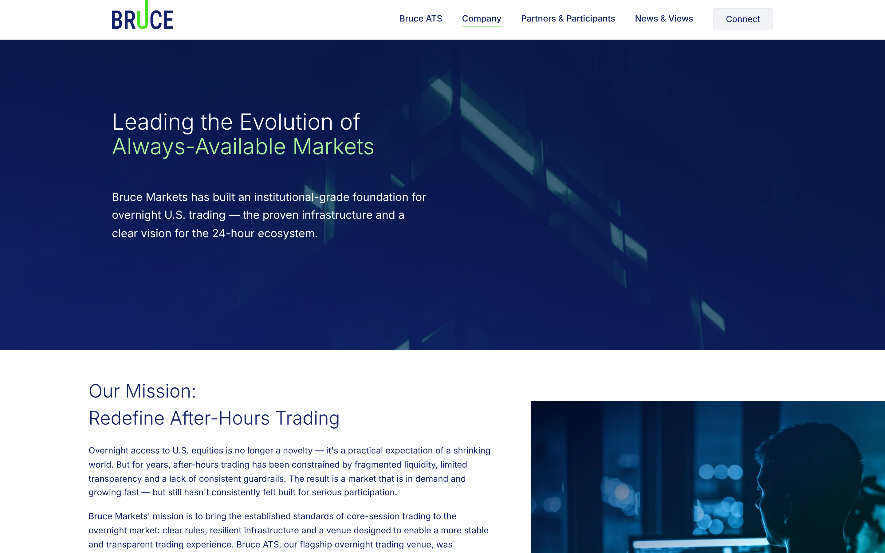
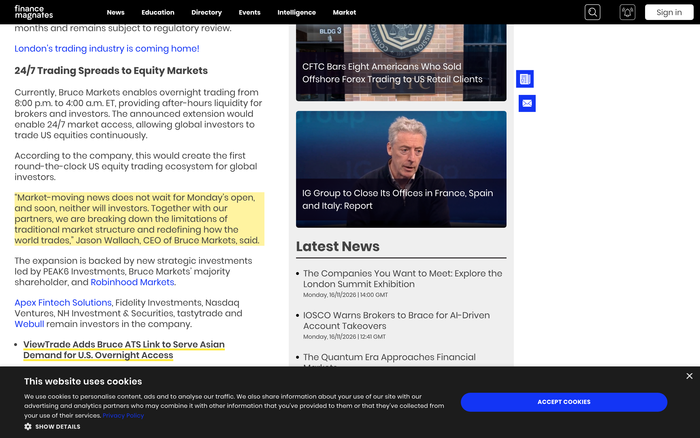
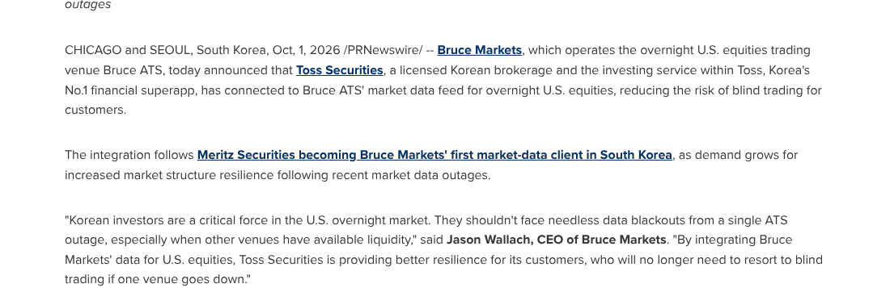

## 정체 카드
● 한 줄 정체 : 미국 거래소 거래가 없는 밤(미국 동부 밤 8시~새벽 4시)에 미국 주식을 거래하는 야간 시장 Bruce ATS. ==3사 중 2025-03에 가장 늦게 시작==했고 Nasdaq의 거래 기술을 씀 [F-0020]
  - 뜻 : 야간 3사 = Blue Ocean, Bruce, MOON 세 야간 ATS
  ★ 유형 안 위치 : 미국 SEC 상장주식 ATS 35곳(2026-11) → 그중 **야간 거래 ATS** 4곳의 하나(로펌 정리) → 야간 3사 거래대금의 15.0%로 2위(2026 Q3, FINRA 주간 보고 계산), 2026-10 최근 3주는 29.8% → PEAK6 계열이 2024-12 예고, 2025-03 개시 [F-1141][F-1176][F-0029][F-0031][F-1425][F-0020]
  - ATS 전체 안 : 2026 Q3 13주에 NMS 주식 거래를 보고한 ATS 34곳 중 거래대금 25위, 전체 ATS 거래대금의 0.36%. 낮 시간 기관 거래가 섞인 분모라 야간 시장 안 비중은 위 15.0% [F-1419][F-1421][F-0029]
● 대표 상품 : Bruce ATS = 미국 주식 야간 시장(미국 동부 밤 8시~새벽 4시, Nasdaq 기술) [F-0020][F-0024]
● 꼭 알아야 할 사실
  ★ 상장하지 않음. 모회사 Bruce Markets Holdings의 최대주주는 PEAK6(미국 금융 투자회사, Finance Magnates 보도, 단일 출처) [F-0021][F-0022]
● 숫자
  ★ 점유율 : 야간 3사 거래대금 합계 대비, FINRA 주간 보고 13주 기준 Q2 12.3%, Q3 15.0%(1위 Blue Ocean 83.0%와 68.0%p 차이) [F-0028][F-0029][F-0015]
  ★ 최근 3주(2026-10-12~30) 29.8%. 기간이 분기와 달라 같은 줄에서 비교하지 않음 [F-0031]
● 흐름(미국판) : 미국 투자자 → 미국 증권사 앱 → Bruce ATS 체결 → 청산(Apex Clearing, 미국 청산 회사) [F-0023][F-0025]
● 흐름(한국판) : 한국 투자자 → 한국 증권사 앱(시세 연결) → (미국 브로커) → Bruce ATS 지정가 주문 [F-0032][F-0033][F-1101][KR-금투업규정-5-31]

## ATS 개요
● 주장 : 후발인데도 증권사와 앱 등 8곳을 투자자로 묶은 뒤 점유율이 Q2 12.3%에서 Q3 15.0%, 2026-10 최근 3주 29.8%로 커짐(투자와 점유율 상승의 인과는 해석) [F-0020][F-1397][F-0028][F-0029][F-0031]
● 운영사
  ★ 법인명 : Bruce Markets LLC(미국 주식 야간 거래 시장 Bruce ATS 운영) [F-0248]
● 인가와 인수로 열린 것
  ★ 미국 주식 야간 시장(새로 연 것) : 그 전 Bruce Markets는 2020-11 등록 브로커딜러(등록부 옛 상호 PEAK6 Trading, All Time ATS)였고 ATS 운영은 규제 승인 전 → 계기 FINRA, SEC 승인과 Form ATS-N → 그 뒤 2025-03 미국 NMS 주식 야간 거래 개시, 일~목 밤 8시~새벽 4시(미국 동부) [F-0248][F-0020][F-0024][US-17CFR-242.304]
  ★ 한국 낮 시간 주문(인가가 아닌 계약) : 그 전 한국 주간거래는 Blue Ocean 경유였고 2024-08-16 일괄 중단 → 계기 금융감독원이 2025-09-24 재개 조건으로 2곳 이상 미국 브로커와 ATS 연결을 요구, 2025-11 한국 증권사가 Bruce를 백업 ATS로 계약 → 그 뒤 2026-09 Blue Ocean 18종목 중단 때 한국 지정가 주문 유입, 같은 9월 메리츠, 10월 토스가 시세 피드 연결(주문 연결 아님) [F-1103][F-1299][F-0035][F-1101][F-0032][F-0033]
  ★ 주말 거래(아직 열리지 않음) : 2026-09 주말까지 이어 거래하는 24시간 연속 거래 계획 발표, SEC 검토 대상이라 출시일 미정 [F-0025][F-1077]
● 설립 목적과 타깃 수요
  ★ 왜 만들었나 : 2024-12-10 출범 예고에서 업계 경력자와 초기 이용 증권사가 더 나은 야간 거래 수단이 필요하다고 본 데서 나왔다고 밝힘. Nasdaq 기술로 만들고 Apex Fintech Solutions 고객은 첫날부터 접속(PEAK6 발표) [F-1425]
  ★ 누구의 어떤 수요 : 같은 발표가 꼽은 수요는 셋. 뭄바이, 베이징, 서울 같은 동아시아와 남아시아 도시의 아침 시간 미국 시장 접근, 비전통 시간대를 원하는 신규 투자자, 24시간 7일 거래에 익숙한 가상자산 투자자가 전통 증권으로 옮겨 오는 수요(PEAK6 발표) [F-1426]
  ★ 실제 주문을 낸 쪽 : 미국 증권사 앱 이용자 주문이 Bruce에서 체결되고, 2026-09 Blue Ocean 18종목 거래 멈춤 때 ==한국 증권사가 지정가 주문을 Bruce로 돌림==. 한국의 메리츠, 토스는 시세만 연결했고 투자사 8곳 중 실제로 주문을 보내는 곳은 확인하지 못함 {br-0105}{br-0080}{br-0053}{br-0054}
● 대상 고객
  ★ 미국 브로커딜러와 해외 브로커 [F-0020]
● 거래 규모
  ★ 2026 Q3 439.7억 달러, 3사 중 15.0%(Q2 12.3%) [F-0029][F-0028]
● 차별화 요소
  ★ 2025-06 투자사에 Robinhood(미국 주식 앱), Webull(투자 앱) 등 개인 대상 증권사 포함(아래 주주 구성) [F-1397][F-0023]
● 화면
   

## 거래 시설 운영
● 주장 : 직접 시스템을 만들지 않고 Nasdaq의 기술과 시세 배포망을 빌려 빠르게 열었고, 그 대신 기술 공급자가 경쟁자이기도 한 의존 구조를 가짐 [F-0020][F-1302][F-0023][F-1171]
● 요금(Form ATS-N, 2026-01-30 제출본)
  ★ 1달러 이상 종목은 기존 호가를 가져가는 체결에 주당 0~0.002달러, 1달러 미만 종목은 거래대금의 최대 0.3%. 초기 참여사와 대량 거래사는 할인 [F-1396]
● 시세 제공(수익원 중 확인된 부분)
  ★ 2025-04-15 Nasdaq 배포 연결을 통해 브로커와 트레이더가 Bruce ATS 시세(Last Sale 최근 체결가, Best Bid and Offer 최우선 호가, Depth of Book 호가 잔량)에 접근 [F-1302]
● 주주 구성과 지분
  ★ 2025-06 투자 라운드 참여 8곳 : Apex Fintech, Fidelity, Nasdaq Ventures, NH투자증권, PEAK6, Robinhood, tastytrade, Webull(금액, 지분율 미공개) [F-1397][F-0023][F-0034]
  - 회사 성격 : 개인 고객 계좌를 두는 증권사와 앱은 Fidelity, NH투자증권, Robinhood, Webull, tastytrade 5곳. Apex Fintech는 청산 회사 계열(Bruce 주말 거래의 청산과 보관은 Apex Clearing), Nasdaq Ventures는 Nasdaq의 투자 부문, PEAK6는 Bruce의 최대주주인 금융 투자회사 [F-1397][F-0025][F-0022]
● 정규 거래소 야간 진입 일정(미국 정규 거래소가 밤 시간대 거래를 열려는 계획)
  - 뜻 : SIP(통합시세 처리 시스템) = 여러 거래소의 호가와 체결가를 모아 전 시장에 내보내는 시스템. 거래소 야간 세션은 SIP가 야간에도 운영될 때 시작하는 조건이 붙음 [F-1172]
  ★ SIP : 2026-12-06부터 연장 시간표 적용, 야간 시작 조건의 기준일 [F-1166][F-1168]
  ★ Nasdaq : 2026-04-10 SEC 신속 승인, 주 5일 23시간 거래, 야간 세션은 SIP 가용 시 시작 [F-1171][F-1172]

## 경영진 발언
● 주장 : 개인투자자의 24시간 수요를 보고 증권사와 앱의 투자 유치, 한국 시세 연결, 주말 거래 순으로 넓히겠다고 말하며 앞의 둘은 이룸 [F-0023][F-0025][F-0033]
● 말하고 이룬 것(시점 순)
  ★ 2025-06-27 Wallach(CEO) : 개인투자자가 24시간 시장을 이끈다 → 같은 날 Robinhood, Webull 등 8곳이 참여하는 투자 라운드 발표(단일 출처 포함) [F-0023][F-1079][F-1397]
  ★ 2026-10-01 Wallach : 한국 투자자는 야간 시장의 핵심 세력이라 시세 피드부터 연결 → 2026-09 메리츠증권, 2026-10 토스증권 연결 [F-0033][F-0032][F-1078]
● 말하고 진행 중인 것
  ★ 2026-09-30 Wallach : 뉴스는 월요일 개장을 기다리지 않는다 → 주말 포함 24/7 거래를 Nasdaq 기술로 추진, SEC 검토 중이며 출시일 미정, 토큰화 언급은 없음 [F-0025][F-1077]
● 발언 1 : 개인투자자가 24시간 시장을 이끈다 [F-0023]
  ★ Jason Wallach(CEO), 전략 투자 유치 발표, 2025-06-27, https://www.marketsmedia.com/overnight-trading-platform-bruce-ats-raises-funds [F-0023]
    ① 원문 : "This esteemed group of strategic investors reflects a shared belief in the future of financial markets as a fully accessible, 24-hour trading ecosystem, and represents another significant step forward for retail investors who are, for the first time, playing an influential role in the evolution of our market structure."
    ② 번역 : 이 전략 투자자들은 금융시장의 미래가 누구나 접근하는 24시간 거래 생태계라는 믿음을 공유하며, 처음으로 시장구조 변화에 영향력을 갖게 된 개인투자자에게도 중요한 진전이다.
  
● 발언 2 : 뉴스는 월요일 개장을 기다리지 않는다 [F-0025]
  ★ Jason Wallach(CEO), 주말 거래 계획 발표, 2026-09-30, https://www.financemagnates.com/institutional-forex/bruce-markets-plans-weekend-trading-to-bring-us-equities-closer-to-247-access/ [F-0025]
    ① 원문 : "Market-moving news does not wait for Monday's open, and soon, neither will investors. Together with our partners, we are breaking down the limitations of traditional market structure and redefining how the world trades."
    ② 번역 : 시장을 움직이는 뉴스는 월요일 개장을 기다리지 않고, 곧 투자자도 기다리지 않을 것이다. 파트너와 함께 전통 시장구조의 한계를 허물고 세계의 거래 방식을 다시 정의한다.
  
● 발언 3 : 한국 투자자는 야간 시장의 핵심 세력 [F-0033]
  ★ Jason Wallach(CEO), 토스증권 시세 연결 발표, 2026-10-01, https://www.prnewswire.com/apac/news-releases/leading-korean-brokerage-connects-to-bruce-markets-us-equities-data-feed-reducing-risks-of-blind-trading-302894812.html [F-1108]
    ① 원문 : "Korean investors are a critical force in the U.S. overnight market. They shouldn't face needless data blackouts from a single ATS outage, especially when other venues have available liquidity."
    ② 번역 : 한국 투자자는 미국 야간 시장의 핵심 세력이다. 다른 시장에 유동성이 있는데도 한 ATS의 장애로 시세가 끊겨서는 안 된다.
  

## 국내 연결과 사고 이력
● 주장 : Blue Ocean의 사고와 종목 중단이 Bruce의 한국 연결을 키움 [F-0035][F-1101][F-0031]
● 국내 증권사 연결
  - 뜻 : 백업 ATS = 주 시장(Blue Ocean)이 멈출 때 주문을 돌리도록 미리 계약해 둔 예비 시장 [F-0035]
  ★ 2026-09 메리츠증권(한국 증권사)에 시세 피드 연결, 주문 연결 아님 [F-0032]
  ★ 2026-10 토스증권(토스 앱 증권 서비스)에 시세 피드 연결 [F-0033]
● 2026-09 종목 중단과 한 줄기
  ★ 09-01 Blue Ocean 18종목 중단, 한국 주문이 Bruce로 [F-1099][F-1101]

## 한국 시장과의 차이
● 주장 : Bruce는 2020-11 등록한 증권사가 2025-03 Form ATS-N 신고를 거쳐 야간 시장을 연 사례이고, 한국 ATS는 금융위원회 인가가 필요해 같은 방식으로는 열 수 없음 [F-0248][F-0020][US-17CFR-242.304][F-1092]
● 규제
  ★ 가능했던 이유 : 브로커딜러 등록과 Reg ATS로 거래소 등록 면제 [F-0248][US-17CFR-240.3a1-1][US-17CFR-242.301-b1]
  - 뜻 : Reg ATS = 미국 SEC의 ATS 규정, 브로커딜러가 요건을 지키면 거래소 등록 없이 시장을 운영하게 함
  ★ 한국 차이 : 한국 ATS는 금융위 인가, 직접 참가자는 증권사 [F-1092][F-1095][F-1096]
  ★ 한국 차이 : 개인의 해외 주식 주문은 해외 중개업자 경유 [KR-금투업규정-5-31]
● 규제 건의 포인트 : 국내 앱이 연결한 해외 ATS 시세를 함께 보이는 기준 [F-1101][F-0033]

## 성과와 판단
● 주장 : 선발 시장이 멈출 때마다 증권사와 앱을 투자자로 둔 후발이 주문을 가져감 [F-1397][F-1099][F-0031]
● 핵심 성공요인(KSF)
  ★ 후발 개장에도 증권사와 앱을 투자자로 묶어 점유율을 키움(KSF 후보) [F-1397][F-0020][F-0029]
  - 주의 : 투자사 8곳이 실제로 Bruce에 주문을 보내는지는 확인하지 못해, 투자와 점유율 상승의 연결은 해석 [F-1397][F-0029]
  - 남들 : Blue Ocean 2021-10 개장, MOON 2024-11 개장 [F-1090][F-0036]
  - 이 회사 : 2025-03 개장, 2025-06 Robinhood, Webull 등 8곳 투자 유치(금액 비공개) [F-0020][F-1397]
  - 결과 : 점유율 Q2 12.3%에서 Q3 15.0%로 상승 [F-0028][F-0029]
  ★ 선발 시장 중단 때 한국 시세 연결로 점유율 상승 [F-1099][F-0032][F-0033][F-0031]
  - 전과 후 : Q3 15.0%에서 2026-10 최근 3주 29.8%로, 연결 시점 9~10월과 같은 시기이며 인과는 해석. 분기와 3주는 기간 길이가 달라 일시적 상승일 수 있음 [F-0029][F-0031][F-0032][F-0033]
● 제약과 리스크
  ★ 한국 연결은 시세 피드와 백업 계약 단계 [F-0032][F-0035]
  - 잃는 쪽 : 한국 투자자는 주문 연결이 없어 Bruce 시세를 보고도 !!직접 주문하지 못함!! [F-0032]
● 거래소 야간 거래가 오면(일정은 위 "거래 시설 운영" 참조)
  ★ 해석 : 거래소의 야간 세션이 열리면 야간에 거래할 수 있다는 점은 차별점이 못 되고, 주말 거래와 증권사, 앱 투자자 구조가 경쟁 기준이 됨 [F-0025][F-0023][F-1171]
● KDX 시사점
  ★ 자산 : 새 자산 없이 기존 NMS 주식의 시간대를 넓힘 [F-0020][F-0025]
  - 가져올 것 : 주말까지 기존 청산 구조로 잇는 방식 [F-0025]
  ★ 고객 : 개인 대상 증권사와 앱을 투자자로 묶음 [F-1397][F-0034]
  - 가져올 것 : 주문을 낼 수 있는 ==증권사와 앱을 지분 관계로 묶어== 물량 확보를 노리는 방식 [F-1397][F-0034]
  - 이유 : 증권사와 앱이 주주이면 시장이 성공할수록 자기 이익이 되어 물량을 보낼 이유가 생김(해석). 다만 8곳 중 실제 주문을 보내는 곳은 확인하지 못함 [F-1397][F-0034]
  ★ 시장 : 한국에는 시세 피드부터 연결 [F-0032][F-0033]
  - 피할 것 : 시세 없이 주문만 받는 연결 [F-1101]
  ★ 거래 시설 운영 : 기술과 시세 배포를 거래소 운영사에 의존 [F-0020][F-1302]
  - 가져올 것 : 기존 배포망을 빌려 시세를 파는 방식 [F-1302]
  - 피할 것 : 기술 공급자가 경쟁자가 되는 구조에 대한 대비 없는 의존 [F-0034][F-1171]
