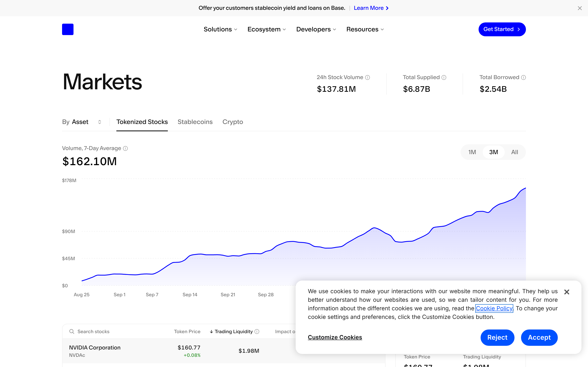
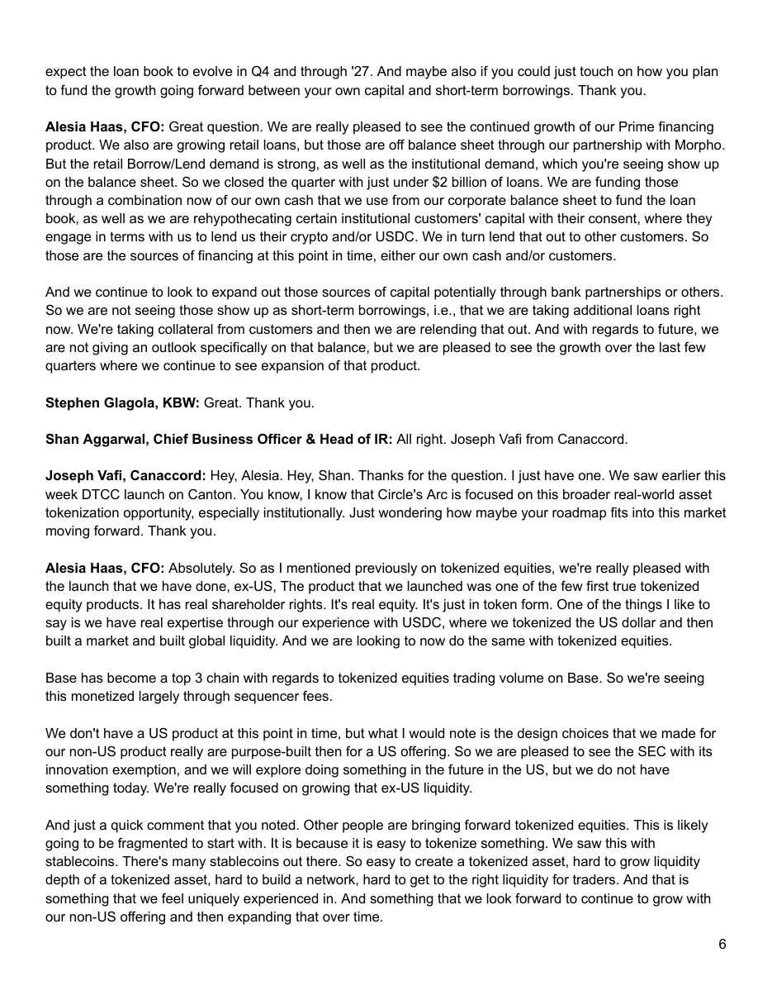
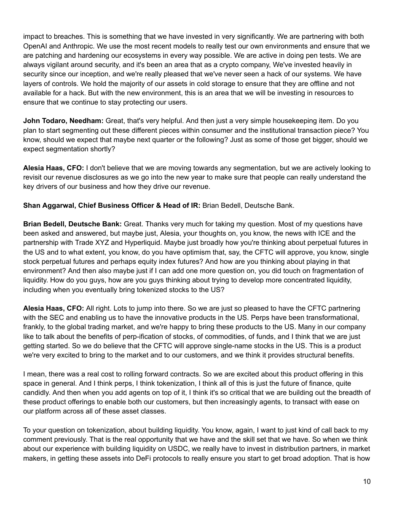
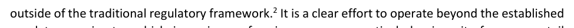
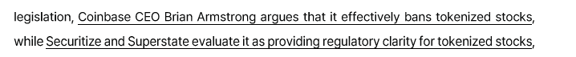

## 회사 개요와 확장 경로
● 주장 : 미국 자격을 사 모은 뒤 주식 토큰은 미국 밖 전용으로 발행 [F-1120][F-1122][F-0749]
● 기본정보
  ★ 법인명 : Coinbase Global(미국 가상자산 거래소), Nasdaq 상장 [F-0078]
  ★ 대표 : Brian Armstrong(CEO) [F-1056]
  ★ 발행 법인 : Coinbase Onchain SPV Ltd(아부다비 ADGM, 발행 전용) [F-0076][F-0077]
● 지배구조
  ★ SPV는 OMHL을 거쳐 Coinbase Global 100% 소유 [F-0078]
● 설립 목적
  ★ 2026 우선순위 : 주식 포함 모든 자산을 한 곳에서 거래 [F-0899]
  ★ 2026 우선순위 : 스테이블코인과 결제, 온체인 [F-0916]
● 성장 경로(한 줄기)
  ★ 2018-09 USDC(Circle과 공동) 출시 [F-0790]
  ★ 증권사 법인 확보 → 2022 FairX 인수로 거래소(DCM) [F-1120][F-1122]
  ★ 2026-02 앱 주식 거래 → 2026-06 발행 SPV 설립 [F-0100][F-0076]
  ★ 2026-08 Base 주식 토큰 → 2026-09 청산소(DCO) 등록 [F-0776][F-1123]
● 화면
    

## 경영진 발언
● 발언 1 : 지금 투자하는 곳은 미국 밖 상품 [F-1058]
  ★ Alesia Haas(CFO), 실적 콜(2026 Q3, 애널리스트 질의), 2026-10-29, 녹취(../inputs/manual/B03_coinbase_Q3_26_analyst_call_transcript.pdf) [F-1058]
    ① 원문 : "We're really focused right now on our non-US offering. We are pleased to see that we have really exciting early traction with about $3 billion in volume since launch. This is the area that we're investing in, this non-US product."
    ② 번역 : 지금은 미국 밖 상품에 집중한다. 출시 이후 거래대금 약 30억 달러로 초기 반응이 좋고, 투자하는 곳도 이 미국 밖 상품이다.
    ③ 해석 : 큰 곳은 미국 밖 주식 토큰. 그래서 미국 상품 없이 미국 밖 상품에 먼저 투자
  
● 발언 2 : 만들기는 쉽고 유동성 키우기가 어렵다 [F-1059]
  ★ Alesia Haas(CFO), 실적 콜(2026 Q3, 애널리스트 질의), 2026-10-29, 녹취(../inputs/manual/B03_coinbase_Q3_26_analyst_call_transcript.pdf) [F-1059]
    ① 원문 : "It has real shareholder rights. It's real equity. It's just in token form. [...] easy to create a tokenized asset, hard to grow liquidity depth of a tokenized asset, hard to build a network, hard to get to the right liquidity for traders."
    ② 번역 : 실제 주주 권리가 있는 진짜 주식이고 형태만 토큰이다. 토큰 자산은 만들기 쉽지만 유동성 깊이와 네트워크를 키우기는 어렵다.
    ③ 해석 : 큰 곳은 주식 토큰의 유동성. 그래서 USDC 방식대로 시장조성자, DeFi 편입에 투자
  
● 서류 대조(발언 2) : 말은 진짜 주식, 서류는 수익권 [F-1059][F-0079]
  ★ 서류 : 투자설명서는 SPV 보관 기초주의 비례 수익권, 직접 투자 아님 [F-0079][F-0081]
● 발언 3 : 토큰화도 미국과 미국 밖 유동성을 묶겠다 [F-1060]
  ★ Alesia Haas(CFO), 실적 콜(2026 Q3, 애널리스트 질의), 2026-10-29, 녹취(../inputs/manual/B03_coinbase_Q3_26_analyst_call_transcript.pdf) [F-1060]
    ① 원문 : "I think perps, I think tokenization, I think all of this is just the future of finance, quite candidly. [...] We uniquely now have global liquidity on derivatives. [...] we would hope over time we can do that with tokenized stocks as well. That requires more regulatory approvals, but what we have built for tokenized stock is suited for the US innovation exemption."
    ② 번역 : 무기한선물과 토큰화 모두 금융의 미래다. 파생상품에는 미국과 미국 밖을 잇는 유동성이 있고, 주식 토큰도 그렇게 하고 싶다. 추가 승인이 필요하지만 만든 상품은 미국 혁신 면제에 맞는다.
    ③ 해석 : 큰 곳은 미국과 미국 밖 통합 유동성. 그래서 미국 승인을 전제로 확장 가능한 설계
  
● 발언 4 : 합성이 아닌 진짜 증권이 이긴다 [F-1061]
  ★ Brian Armstrong(공동 창업자 겸 CEO), 실적 AMA(2026 Q3), 2026-10-29, 녹취(../inputs/manual/B03_coinbase_Q3_26_AMA_transcript.pdf) [F-1061]
    ① 원문 : "these tokenized equities that we put out, they're real deal securities. You can get the upside from dividends. We're implementing voting rights, things like that. [...] as the largest custodian in crypto, the most trusted brand in crypto, this is actually something that we're uniquely good at and have a right to win."
    ② 번역 : 우리가 낸 주식 토큰은 진짜 증권이다. 배당 이익을 받고 의결권도 구현 중이다. 크립토 최대 수탁기관이자 가장 신뢰받는 브랜드로서 잘할 수 있는 영역이다.
    ③ 해석 : 큰 곳은 실물 권리형 주식 토큰. 그래서 배당, 의결권, 상환과 수탁 신뢰로 차별화
  
● 서류 대조(발언 4) : 의결권은 직접 아닌 지시 반영, 배당은 재투자 [F-1061][F-0086]
  ★ 서류 : 의결권 직접 없음, 현금 배당 없이 재투자 [F-0086][F-0753]

## A 출신과 진입(주식 토큰 사업)
● 주장 : 거래소 고객 기반 위에 자체 블록체인으로 직접 발행해 진입 [F-0902][F-0777]
● 출신 : 가상자산 거래소, 2026 Q3 거래대금 점유율 10.7% [F-0902]
● 진입 방식
  ★ Base(자체 블록체인) 표준 B20으로 직접 발행 [F-0777][F-0799]
  ★ 진출 사유 : 주식을 온체인에서 프로그래밍, 조합 가능하게 [F-0794]

## B 상품 구조
● 주장 : 말은 진짜 주식이나 투자자 몫은 SPV 보관분의 수익권 [F-0995][F-0079]
● 토큰의 법적 성격(우리 분류)
  ★ 투자자 : SPV가 Alpaca에 맡긴 기초주의 비례 수익권 [F-0995]
  ★ ADGM 증서(Certificate over Shares), 기초주 직접 투자 아님 [F-0079]
  ★ 토큰 : 운영상 증표, 법적 소유는 CSD 장부 기준 [F-0080]
  ★ 우리 분류 : 제3자 보관형(SPV는 bare trustee, 제한소구) [F-0995]
● 발행 주체와 보관
  ★ 발행 : SPV(Coinbase Onchain SPV), 토큰 발행과 장부는 OML(Onchain Marketplace) [F-0076][F-0082]
  ★ 보관 : 기초주는 SPV 명의 분리 계좌, 파산 격리 [F-0081][F-0742]
● 투자자 권리
  ★ 배당 : 현금 대신 재투자, 배수(1.00 시작) 상승으로 반영 [F-0753][F-0801]
  ★ 의결권 : 직접 없음, 보유자 지시를 SPV가 반영 노력 [F-0086]
● 규모(시장 내 위치)
  ★ 2026-11-16 발행 잔액 4,690만 달러, 8위(점유율 1.26%) [F-1026]
  ★ 1~3위는 Binance, Ondo, Kraken(13.6억, 9.0억, 6.8억 달러) [F-1021][F-1022][F-1023]
  ★ Robinhood 6위 1.49억, Dinari 11위 1,520만 달러 [F-1025][F-1027]
  ★ 종목 수 2026-11-16 10종(NVDAc, AAPLc 등) [F-0093]
● 규모의 과거 대비(2026-01 초 기준)
  ★ 2026-01 초 rwa.xyz 표에는 없음(2026-08 출시) [TP-005][F-0776]
● 수수료
  ★ 창설 0.01%, 상환 0.05%, 분배금 5.0% [F-0087]
  ★ 주된 수익화는 Base 시퀀서 수수료(CFO 발언) [F-0895][F-0770]

## C 최종 투자자
● 주장 : 미국 밖 지갑 보유 개인이 사고팔고, 창설은 기관만 [F-0785][F-0740]
● 대상
  ★ 2차 시장 : 인터넷과 지갑이 있는 미국 밖 적격 개인 [F-0785][F-0749]
  ★ 2차 보유, 거래는 KYC 없이 허가 없이 가능 [F-0757]
  ★ 1차 창설, 상환 : KYC 거친 승인 참여자(기관)만 [F-0740][F-0808]
● 국적 및 지역 제한
  ★ 미국인 제외(Regulation S), ADGM 밖 배포 불가 [F-0084][F-0739]
  ★ 미국 제재 명단, 제재 관할 거주자 이용 불가 [F-0772]

## D 유통과 접점
● 주장 : 판매 창구 없이 DeFi에 풀어 유통을 외부 프로토콜에 맡김 [F-0088][F-0092]
● 공급 방식(누구에게 서빙하는지)
  ★ 승인 참여자(기관 시장조성사) : 주식 매입 후 토큰 창설 [F-0780]
  ★ Aerodrome(Base 탈중앙 거래소) : 지갑 보유 개인의 매매 [F-0092][F-0786]
  ★ Aave, Morpho(대출 프로토콜) : 주식 토큰 담보 대출 이용자 [F-0092][F-0782]
  ★ Virtuals, Treasures(에이전트 서비스) : AI 에이전트 매매 [F-0783]
● 거래 장소
  ★ 중앙 거래소 상장 없이 블록체인 위 DeFi에서만 유통 [F-0088]
  ★ 주말, 미국 공휴일 포함 24시간 거래 [F-0747]
  ★ 사용 블록체인 : Base(Ethereum 위 롤업) [F-0766]

## E 인가
● 주장 : 미국은 인수와 직접 등록으로 쌓고, 토큰 발행은 ADGM 법인 [F-1120][F-1123][F-0082]
● 미국 자격(확보 방식과 시점)
  ★ 미국 증권사 : Coinbase Capital Markets(CRD 10722), 기존 법인 확보 [F-1120]
  ★ 이전 상호 Keystone Capital(등록 1982-08-13), 인수 시점 미확인 [F-1120]
  ★ 미국 거래소(DCM) : 2022 FairX 인수로 확보 [F-1122]
  ★ 미국 청산소(DCO) : 2026-09-28 직접 등록 [F-1123]
● 아부다비 인가와 법인
  ★ Onchain Marketplace : FSRA 투자 거래 주선, CSD 수탁 [F-0082]
  ★ 증서 : FSRA가 증권으로 간주, 2026-08-04 투자설명서 승인 [F-0079]
  ★ Coinbase : FSRA FSP(아부다비 토큰화 거점) [F-0095]
● 인가 없는 구간을 메우는 방법
  ★ 기초주 매매 중개는 Alpaca(SEC 등록 증권사, FINRA, SIPC)에 위탁 [F-0081]
● 미국 밖 구조의 대가
  ★ 미국 상품 없음, SEC 혁신 면제 뒤 검토(CFO) [F-0898]
  ★ KYC 통과 보유자(Vested Holder)만 상환, 의결권 [F-0085]

## F 관계(해당 시)
● 주장 : 자금은 그룹 안에서, 가격 데이터는 외부에서 [F-0089][F-0758]
● 인수, 투자, 제휴
  ★ Coinbase Custody International : SPV에 300만 달러 대출 한도 [F-0089]
  ★ Chainlink : 총수익 가격 피드, 주말은 마지막 종가 [F-0758][F-0810]

## 한국 시장과의 차이
● 주장 : 미국 밖은 ADGM 증서로 열렸고, 한국은 증권 해당 여부부터 [F-0079][KR-자본시장법-4①본문]
● 규제
  ★ 가능했던 이유 : ADGM 증서 승인, 미국 밖은 Regulation S [F-0079][F-0739][US-17CFR-230.903-a]
  ★ 한국 차이 : 외국인 발행도 국내법상 증권, 증서 수익권도 해당 [KR-자본시장법-4①본문][F-0079]
● 고객 수요
  ★ 가능했던 이유 : 미국 시장 접근이 제한된 미국 밖 사용자 [F-0796][F-0785]
● 규제 건의 포인트 : 수익권 증서형 토큰의 증권 해당 기준 사전 안내 [F-0079][KR-자본시장법-4①본문]

## 성과와 판단
● 주장 : 서류보다 말이 앞서 있고 발행 잔액은 8위에 머묾 [F-1059][F-0079][F-1026]
● 성과
  ★ 2026-11-16 발행 잔액 4,690만 달러, 8위(점유율 1.26%) [F-1026]
  ★ 2026-09말 누적 거래대금 10억 달러 이상(회사 발표, 주주서한) [F-0892]
  ★ 같은 상품 출시 이후 약 30억 달러(회사 발표, CFO 발언, 기준 차이) [F-0894]
  ★ 2026 Q3 암호자산 거래대금 점유율 10.7%(회사 발표) [F-0902]
● 핵심 성공요인(KSF)
  ★ 자체 블록체인 DeFi 유통, 출시 이후 거래대금 약 30억 달러(회사 발표) [F-0092][F-0894]
  ★ 발행과 장부를 그룹 안에서, 잔액 4,690만 달러 8위 [F-0082][F-1026]
  ★ USDC로 유동성을 키운 경험(CFO), 거래대금 점유율 10.7%(회사 발표) [F-1059][F-0902]
● 제약과 리스크
  ★ SPV, 토큰화 법인, Coinbase가 같은 그룹, 이해상충 공시 [F-0090]
  ★ 법적 요건용 동결과 압류 기능 보유 [F-0807]
  ★ 기업행위 중 창설, 상환 중단, 전송은 계속 [F-0762]
  ★ 그룹 2026 Q3 총수익 12.2억 달러, 전년 대비 35% 감소(회사 발표) [F-0910]
● 제약과 리스크(제3자 지적)
  ★ SEC 승인 추진 보도가 규제 밖 영업 시도의 예로 인용됨 (WFE, 거래소 이해 대변) [TP-222]
  
● 제3자 평가
  ★ 평가 1 : 포필러스(Securitize 후원 보고서, 평가자에 Securitize 포함), 2026: The Year of Tokenized Stocks, 2026-02-23, 87쪽, https://4pillars.io/en/reports/2026-the-year-of-tokenized-stocks [TP-221]
    ① 원문 : "Coinbase CEO Brian Armstrong argues that it effectively bans tokenized stocks, while Securitize and Superstate evaluate it as providing regulatory clarity for tokenized stocks"
    ② 번역 : Coinbase 대표는 그 법안이 주식 토큰을 사실상 금지한다고 주장하는 반면 Securitize와 Superstate는 규제 명확성을 준다고 평가한다.
    ③ 해석 : 같은 법안을 두고 발행 방식별로 평가가 갈림(법안명은 87쪽에 적히지 않음). 그래서 KDX는 미국 제도 변화가 방식마다 유불리가 다름을 볼 것
  
● KDX 시사점
  ★ 받치는 명제 : 시장 인프라 Unbundling [F-0076][F-0082][F-0081]
  ★ KDX가 가져올 것 : 발행 SPV, 장부 법인, 보관사를 나눈 구조 [F-0076][F-0082][F-0081]
  ★ KDX가 가져올 것 : 원주 수익권 증서를 국내 신탁 수익증권 유통에 대응 (기고, 법률 실무) [F-0079][TP-435]
  ★ KDX가 피할 것 : 같은 그룹 겸영의 이해상충, 8위에 그친 유동성 [F-0090][F-1026]
● 해외 확장 세 질문
  ★ 제공 가치 : 지갑만으로 미국 밖 개인이 24시간 미국 주식 [F-0785][F-0747]
  ★ 제도 : ADGM 인가와 증서 투자설명서 승인 [F-0082][F-0079]
  ★ 경제성 : Base 시퀀서 수수료(CFO 발언) [F-0895][F-0770]
