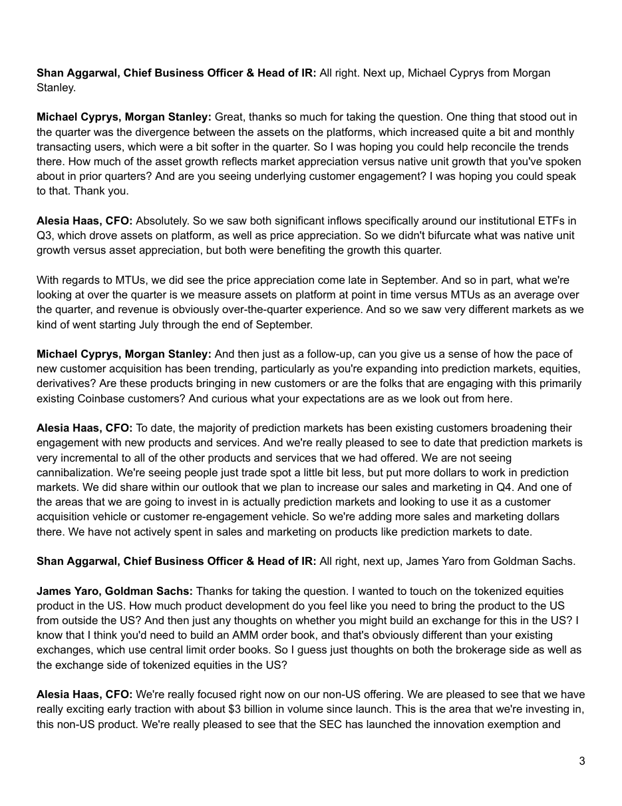

## 정체 카드
● 한 줄 정체 : 암호자산 거래, 파생, 주식 앱, 스테이블코인을 ==한 곳에 묶는 중인== 미국 Nasdaq 상장 거래소 그룹 [F-0078][F-0899]
  ★ 유형 안 위치 : 뉴욕주 금융서비스국(NYDFS) 가상자산 인가 목록 39곳(2026-11-16 열람) → BitLicense 26곳의 하나(Coinbase, Inc., 2017-01)와 제한목적 신탁 인가 13곳의 하나(Coinbase Custody Trust Company, 2018-10)를 **한 그룹이 함께 보유** → 암호자산 거래대금 점유율 10.7%(2026 Q3, 회사 발표), 공식 순위 없음 → 2012년 시작한 가상자산 회사 출신 [F-1411][F-1412][F-0902][F-1223]
  - 뜻 : 제한목적 신탁 인가 = 가상자산 보관처럼 정해진 업무만 하는 신탁회사 인가 [F-1411]
  - 다른 공식 목록 : EU MiCA 가상자산사업자 404곳에 Coinbase Luxembourg(2025-06-20)가 있으나 거래 플랫폼 운영 코드는 없음. 버뮤다 BMA 디지털자산사업 48곳에 Coinbase 2곳(Coinbase Bermuda Limited는 거래소 운영 허용) [F-1413][F-1414][F-1415][F-1416]
  - 10.7%의 기준 : 회사가 제3자 데이터와 자체 경쟁사 집합으로 낸 분기 점유율이라 공식 순위가 아님. 전년 같은 분기 5.6% [F-0902]
● 대표 상품 : Coinbase Tokenized Stocks = Base 블록체인 위의 미국 주식 수익권 토큰, !!미국 밖 적격 관할 개인만!! [F-0777][F-0079][F-0749]
  - 뜻 : Base = Coinbase가 만든 Ethereum 위의 블록체인(롤업, 거래를 모아 처리해 비용을 낮춤). 시퀀서 = Base 거래를 받아 순서대로 기록하는 서버로 Coinbase가 운영 [F-0766][F-0768]
● 그룹 관계(누가 누구를 갖고 무슨 일을 하나)
  ★ 주식 토큰 발행 라인 : Coinbase Global → Onchain Marketplace Holdings(OMHL, ADGM, 비상장) 100% → Coinbase Onchain SPV Ltd 100%(2026-06-17 설립, 토큰 발행 전용) [F-0078][F-0076][F-0077]
  ★ Onchain Marketplace Ltd(OML) : SPV와 같은 그룹 계열, 토큰 발행과 소각, 법적 소유 장부(CSD)를 SPV로부터 위탁받아 운영 [F-0082][F-0090]
  ★ Alpaca : 그룹 밖 제휴 증권사(SEC 등록, FINRA와 SIPC 회원), 기초주 보관과 매매 중개 [F-0081]
  ★ 미국 인가 법인 : Coinbase Capital Markets(옛 Keystone Capital, 1982 등록 증권사 인수), Coinbase Derivatives(선물 거래소, FairX 인수), Coinbase Financial Markets(선물 중개, 2023-08-15 등록), Coinbase Clearing(청산소, 2026-09-28 등록) [F-1120][F-1122][F-1228][F-1123]
  - 뜻 : OMHL = SPV의 모회사 역할을 하는 지주 법인
  - 뜻 : DCM = 미국 CFTC가 지정한 선물 거래소, DCO = CFTC에 등록한 청산소, FCM = 선물 중개업자
  - 뜻 : CSD = 누가 무엇을 가졌는지 적는 중앙예탁 원장
● 꼭 알아야 할 사실
  ★ 상장 : 2021-04-14 Nasdaq 직상장 예정(발표), 등록서류는 04-01 SEC 효력 [F-1226]
  ★ 큰 인수 : 2022 FairX(선물 거래소 확보), 2025-08 Deribit(옵션 거래소, 통합은 2026-10 완료). FairX 금액과 이유 문장은 1차 확인 자료 없음 [F-1122][F-0903]
  - 뜻 : FairX = 미국 CFTC 지정 선물 거래소(DCM)를 운영하던 회사, Deribit = 가상자산 옵션 거래소 [F-1122][F-0903]
  ★ 큰 사고와 제재 : SEC가 제기한 민사 집행 소송을 2025-02-27 양측 합의서로 취하(SEC 발표, 본안 판단 아님) [F-1227][F-0107]
  - 무슨 일 : SEC가 2023-06-06 제기한 소송, SEC는 본안 판단이 아니라 규제 접근 개편을 이유로 밝힘 [F-0107]
● 숫자
  ★ 순위와 잔액 : 2026-11-16 rwa.xyz(토큰화 실물자산 집계 사이트) 토큰화 주식 플랫폼 표 8위, 4,690만 달러, 시장 전체 37.1억 달러의 1.26%, 1위 Binance 13.6억 달러의 약 3% [F-1026][F-1028][F-1021]
  ★ 종목 수 : 주식 토큰 2026-11-16 10종 [F-0093]
● 흐름 : 이용자(미국 밖 개인) → 지갑, Aerodrome(DeFi) → 발행 SPV(Coinbase Onchain) → 보관 Alpaca [F-0785][F-0092][F-0076][F-0081]
  - 뜻 : DeFi = 은행이나 거래소 없이 블록체인 위 프로그램으로 돌아가는 금융. Aerodrome = Base 위의 탈중앙 거래소

## 회사 개요와 확장 경로
● 주장 : 미국 인가를 사 모은 뒤 주식 토큰은 미국 밖 전용으로 발행 [F-1120][F-1122][F-0749]
● 본업과 규모(2026 Q3, 회사 서한)
  ★ 총매출 : 12.2억 달러(1,215.6백만), 전년 같은 분기 대비 35% 감소, 직전 분기와 비슷 [F-1260][F-0910]
  ★ 거래대금 : 총 1조 2,138억 달러 = 현물 1,345억 + 파생 9,859억 + 스테이블코인 935억. 파생 9,859억은 암호자산 파생 9,630억에 암호자산 외 파생을 더한 값 [F-1263][F-0901]
  ★ 주식 토큰의 크기 : Base 위 출시(2026-08-24) 이후 누적 거래대금이 주주서한은 10억 달러 이상(2026-09-30 기준, Token Terminal 집계), CFO 발언은 약 30억 달러(2026-10-29, 미국 밖 고객). 두 수치가 서로 다르며 하나로 고르지 않음 [F-0892][F-0894][F-0776]
● 설립 목적과 비전
  ★ 미션 : 세계의 경제적 자유를 늘리는 것 [F-1225]
  ★ 2026 우선순위 1 : 모든 자산을 한 곳에서 거래(Everything Exchange), 고객이 원하는 자산을 거래하는 단일한 신뢰 장소 [F-0899][F-1271]
  ★ 2026 우선순위 2와 3 : 스테이블코인과 결제, 온체인(금융 서비스를 블록체인으로 옮김) [F-0916]
● IR에서 말하는 앞으로의 그림(시점이 있는 것)
  ★ 2026 Q4 : Coinbase Pro 재출시, 현물, 선물, 무기한선물, 옵션, 주식을 한 포트폴리오로 [F-0900][F-1268]
  - 뜻 : Coinbase Pro = 여러 상품을 한 계좌에서 거래하게 하는 통합 거래 서비스 [F-0900][F-1268]
● 타깃 수요
  ★ 주식 토큰 : 미국 시장 접근이 제한된 미국 밖 사용자 [F-0796][F-0785]
● 수익원
  ★ 본업 : 거래 수수료, 스테이블코인(3.07억), 스테이킹 보상(0.86억), 이자와 금융(0.69억), 구독(Coinbase One) [F-1261][F-1262]
  ★ 주식 토큰 : Base 시퀀서 수수료가 가장 직접적인 수익화 수단(CFO) [F-0895][F-0770]
  ★ 주식 토큰 수수료(SPV) : 창설 0.01%, 상환 0.05%, 분배금 5.0%. 배당을 재투자할 때 Coinbase 수수료도 차감 [F-0087][F-0803]
  - 뜻 : 창설 = 승인 참여자가 새 토큰을 만드는 것, 분배금 5.0% = 발행사가 받은 배당 등 분배금 총액에서 떼는 수수료율 [F-0087]
  ★ 한계 : 주식 토큰 단독 매출은 공개되지 않음. SPV는 이익 창출을 기대하지 않는다고 서술 [F-0089]
● 화면
    
  ★ 그림 해설 : 가입, 종목 목록, 주문 순서의 Coinbase 앱 화면. 주식 토큰은 이 앱이 아니라 지갑과 Base 위 DeFi에서 거래되므로 이 화면은 Coinbase의 일반 가입과 거래 흐름을 보여 줌 [F-0092]

## 사업 범위와 넓힌 순서
● 주장 : 자산을 인수와 제휴로 넓힌 뒤 주식 토큰은 미국 밖부터 [F-1122][F-0790][F-0749]
● 인가와 인수로 열린 것
  - 뜻 : 줄마다 그 전(못 하던 것) → 계기(인가나 인수, 시점) → 그 뒤(열린 것과 첫 상품). 새로 연 것은 못 하던 사업을 연 경우, 규제에 맞춘 것은 하던 영업을 새 제도의 인가로 옮긴 경우 [F-1440]
  ★ 미국 선물 거래소(새로 연 것) : 계기 2022 FairX 인수로 CFTC 지정 선물 거래소(DCM, 지정 2020-11-23)를 Coinbase Derivatives로 확보 → 그 뒤 2023-08-15 선물 중개(FCM) 직접 등록, 미국 선물과 현물 교차증거금, 24시간 미국 무기한형 선물(2025 4분기 주주서한) [F-1122][F-1228][F-0099]
  ★ 미국 청산소(새로 연 것) : 계기 2026-09-28 Coinbase Clearing이 CFTC 청산소(DCO)로 직접 등록(인수 아님) → 그 뒤 선물 거래소(DCM), 중개(FCM), 청산소(DCO)를 그룹 안에 모두 보유 [F-1123][F-1122][F-1228]
  ★ 예측시장 자체 계약(새로 연 것) : 그 전 2025-12-17 출시 때 주문을 모두 외부 거래소 Kalshi로 연결(회사 블로그) → 계기 CFTC 승인 → 그 뒤 자체 예측시장 계약 상장, 연환산 순수익 2억 달러 초과 [F-1376][F-0907]
  ★ 옵션과 미국 밖 기관 고객(새로 연 것) : 계기 2025-08 Deribit 인수(발표 약 29억 달러) → 그 뒤 2026-10 국제 거래소 INTX와 통합, Deribit을 미국과 미국 밖 고객 모두에게 제공, 옵션은 기관에 제공 중이고 소매는 준비 중 [F-1378][F-0903][F-0904][F-0905]
    - 왜 : 가상자산 옵션 1위 거래소를 더해 현물, 선물, 무기한선물, 옵션을 한 플랫폼에, 시장 국면을 덜 타는 옵션 수익, 해외 확장(2025-05-08 Coinbase 블로그) [F-1378]
  ★ 미국 밖 주식 토큰(새로 연 것) : 그 전 미국은 SEC 승인 전이라 주식 토큰 상품 없음 → 계기 2026-08 아부다비 FSRA 금융서비스 허가(FSP), 토큰화 법인 OML 인가, 2026-08-04 증서 투자설명서 승인 → 그 뒤 2026-08-24 Base에서 Coinbase Tokenized Stocks, 미국 밖 적격 관할 개인 대상 [F-0898][F-0095][F-0082][F-0079][F-0776][F-0749]
  ★ EU 가상자산(규제에 맞춘 것) : 그 전 EEA에서 이미 가상자산 영업 → 계기 2025-06-20 룩셈부르크 MiCA 가상자산서비스 인가 → 그 뒤 EEA 사업을 MiCA 인가로 이전(주주서한), 인가 서비스에 거래 플랫폼 운영은 없음 [F-0102][F-0254][F-1414]
    - 제도 : MiCA는 2024-12-30 발효, 국가별 등록으로 영업하던 사업자는 2026-07-01부터 MiCA 인가가 없으면 EU 영업 중단(벨기에 감독청 FSMA) [F-1440]
  ★ 기관 보관(새로 연 것) : 계기 2018-07 Coinbase Custody 정식 영업(Bitcoin Magazine 보도), 2018-10 뉴욕주 제한목적 신탁 인가(Coinbase Custody Trust Company) → 그 뒤 2026 Q3 플랫폼 보관자산이 전체 암호자산 시가총액의 12.5%(회사 발표) [F-1377][F-1412][F-1222]
● 자산(무엇을 어떤 순서로 더했나)
  ★ 2018-09 스테이블코인 : USDC, Circle과 공동 출시(제휴) [F-0790]
  ★ 2022 파생 거래소 : FairX 인수(DCM) [F-1122]
  ★ 2025-08 옵션 : Deribit 인수 [F-0903]
  ★ 2026 예측시장 : 자체 계약 상장, 직접 [F-0907]
● 자산 2(주식과 청산)
  ★ 2026-02 앱 주식, ETF 거래 : 직접 출시, 초기 3,000종목 [F-0100]
  ★ 2026-08 Coinbase Tokenized Stocks : Base 직접 발행(발행 법인은 Coinbase Onchain SPV) [F-0777][F-0076]
  ★ 2023-08 선물 중개 : Coinbase Financial Markets FCM 직접 등록 [F-1228]
  ★ 2026-09 청산소 : Coinbase Clearing 직접 등록(DCO) [F-1123]
● 고객(개인에서 기관으로)
  ★ 개인 : 2026 Q3 현물 거래대금 234억 달러(회사 발표) [F-0915]
  ★ 기관 : 2026 Q3 현물 거래대금 1,111억 달러(회사 발표) [F-0915]
  ★ Deribit 옵션 : 기관 제공 중, 소매 준비(CFO 발언) [F-0905]
  ★ 주식 토큰 창설과 상환 : 기관 승인 참여자만 [F-0740]
● 시장(어느 나라로)
  ★ 2025-08 Deribit : 미국 밖 고객 기반 확보(인수) [F-0904]
  ★ 2026-08 아부다비 : FSRA 인가, 발행 법인 직접 설립 [F-0095][F-0082]
  ★ 2026-08 주식 토큰 : 미국 밖 적격 관할 개인에게만 [F-0749]
● 2026-02 앱 주식과 ETF 거래 : 한 앱에서 모든 자산을 거래 [F-0100][F-0899]
  - 뒤 : 2026-02 Yahoo Finance 제휴로 미국 전체 이용자에 개방, 8,000종목 이상, 주 5일 24시간, 1달러부터 소수점 거래(Fnnews 보도) [F-0101]

## 경영진 발언
● 말하고 이룬 것(Armstrong 중심, 시점 순)
  ★ 2026-02-12 서한 : 2026 우선순위 1은 Everything Exchange, 고객이 원하는 자산을 거래하는 단일한 신뢰 장소 [F-1271]
  - 이룬 것 : 2026-02 앱 주식 거래, 2026 예측시장 자체 계약 상장(연환산 순수익 2억 달러 초과), 2026-09 청산소 등록 [F-0100][F-0907][F-1123]
  ★ 2026-10-29 Armstrong : 토큰화 주식은 진짜 증권, 배당과 의결권을 구현 중 [F-0897][F-1061]
  - 이룬 것 : 2026-08 Base 출시, 배당은 현금이 아닌 재투자 배수로 반영 [F-0776][F-0753]
  - 진행 중 : 의결권은 직접이 아니라 보유자 지시를 SPV가 반영 [F-0086]
● 말하고 진행 중인 것(시점 순)
  ★ 2026-10-29 Haas(CFO) : 지금은 미국 밖 상품에 투자, 미국 상품 없음, 추가 승인 필요, 만든 상품은 SEC 혁신 면제에 맞게 설계 [F-1058][F-1267][F-1060]
● 발언 1 : 지금 투자하는 곳은 미국 밖 상품 [F-1058]
  ★ Alesia Haas(CFO), 실적 콜(2026 Q3, 애널리스트 질의), 2026-10-29, 녹취(../inputs/manual/B03_coinbase_Q3_26_analyst_call_transcript.pdf) [F-1058]
    ① 원문 : "We're really focused right now on our non-US offering. We are pleased to see that we have really exciting early traction with about $3 billion in volume since launch. This is the area that we're investing in, this non-US product."
    ② 번역 : 지금은 미국 밖 상품에 집중한다. 출시 이후 거래대금 약 30억 달러로 초기 반응이 좋고, 투자하는 곳도 이 미국 밖 상품이다.
    ③ 해석 : 핵심은 미국 밖 주식 토큰. 그래서 미국 상품 없이 미국 밖 상품에 먼저 투자
  
● 발언 2 : 만들기는 쉽고 유동성 키우기가 어렵다 [F-1059]
  ★ Alesia Haas(CFO), 실적 콜(2026 Q3, 애널리스트 질의), 2026-10-29, 녹취(../inputs/manual/B03_coinbase_Q3_26_analyst_call_transcript.pdf) [F-1059]
    ① 원문 : "It has real shareholder rights. It's real equity. It's just in token form. [...] easy to create a tokenized asset, hard to grow liquidity depth of a tokenized asset, hard to build a network, hard to get to the right liquidity for traders."
    ② 번역 : 실제 주주 권리가 있는 진짜 주식이고 형태만 토큰이다. 토큰 자산은 만들기 쉽지만 유동성 깊이와 네트워크를 키우기는 어렵다.
    ③ 해석 : 핵심은 주식 토큰의 유동성. 그래서 시장조성자와 DeFi 편입에 힘을 둠
  
● 서류 대조(발언 2) : 말은 진짜 주식, 서류는 수익권 [F-1059][F-0079]
  ★ 서류 : 투자설명서는 SPV 보관 기초주의 비례 수익권, 직접 투자 아님 [F-0079][F-0081]
● 발언 3 : 합성이 아닌 진짜 증권이 이긴다 [F-1061]
  ★ Brian Armstrong(공동 창업자 겸 CEO), 실적 AMA(2026 Q3), 2026-10-29, 녹취(../inputs/manual/B03_coinbase_Q3_26_AMA_transcript.pdf) [F-1061]
    ① 원문 : "these tokenized equities that we put out, they're real deal securities. You can get the upside from dividends. We're implementing voting rights, things like that. [...] as the largest custodian in crypto, the most trusted brand in crypto, this is actually something that we're uniquely good at and have a right to win."
    ② 번역 : 우리가 낸 주식 토큰은 진짜 증권이다. 배당 이익을 받고 의결권도 구현 중이다. 크립토 최대 수탁기관이자 가장 신뢰받는 브랜드로서 잘할 수 있는 영역이다.
    ③ 해석 : 핵심은 실물 권리형 주식 토큰. 그래서 배당, 의결권, 상환과 수탁 신뢰로 차별화
  
● 서류 대조(발언 3) : 의결권은 직접 아닌 지시 반영, 배당은 재투자 [F-1061][F-0086]
  ★ 서류 : 의결권 직접 없음, 현금 배당 없이 재투자 [F-0086][F-0753]

## A 출신과 진입(주식 토큰 사업)
● 주장 : 거래소 고객 기반 위에 자체 블록체인으로 직접 발행해 진입 [F-0902][F-0777]
● 출신 : 가상자산 거래소, 2026 Q3 거래대금 점유율 10.7% [F-0902]
● 진입 방식
  ★ Coinbase Tokenized Stocks : Base 표준 B20으로 직접 발행(자체 블록체인) [F-0777][F-0799]
  ★ 진출 사유 : 주식을 온체인에서 프로그래밍, 조합 가능하게 [F-0794]
● 진입 시점(남들과 비교)
  ★ 해석 : 후발(약 14개월 차). 앱 주식 거래(2026-02)를 먼저 열고 토큰은 미국 밖부터 발행 [F-1040][F-0776][F-0100]

## B 상품 구조
● 주장 : 말은 진짜 주식이나 투자자 몫은 SPV 보관분의 수익권 [F-0995][F-0079]
● 토큰의 법적 성격
  ★ 투자자 : SPV가 Alpaca에 맡긴 기초주의 비례 수익권 [F-0995]
  ★ ADGM 증서(Certificate over Shares), 기초주 직접 투자 아님 [F-0079]
  ★ 유형 : 제3자 보관형(원주를 SPV가 신탁으로 1:1 보유, 제한소구) [F-0995]
  - 뜻 : 제3자 보관형 = 기초 주식을 발행사나 수탁기관이 따로 보관하고 투자자는 그 주식의 수익권을 가진 유형. 제한소구 = 발행사가 갚을 책임이 보관 주식의 가치까지로 제한됨 [F-0995]
● 발행 주체와 보관
  ★ 발행 : SPV(Coinbase Onchain SPV), 토큰 발행과 장부는 OML(Onchain Marketplace) [F-0076][F-0082]
  ★ 보관 : 기초주는 SPV 명의 분리 계좌, 파산 격리 [F-0081][F-0742]
● 투자자 권리
  ★ 배당 : 현금 대신 재투자, 배수(1.00 시작) 상승으로 반영 [F-0753][F-0801]
  ★ 의결권 : 직접 없음, 보유자 지시를 SPV가 반영 노력 [F-0086]
● 규모(시장 내 위치)
  ★ 2026-11-16 rwa.xyz 기준 발행 잔액 4,690만 달러, 8위(점유율 1.26%) [F-1026]
● 평가
  ★ 유동성 분산 : Base 한 체인 발행, 거래는 DeFi 여러 곳 [F-0766][F-0092]

## C 최종 투자자
● 주장 : 미국 밖 지갑 보유 개인이 사고팔고, 창설은 기관만 [F-0785][F-0740]
● 대상
  ★ 2차 시장(이미 나온 토큰을 지갑끼리 사고파는 단계) : 인터넷과 지갑이 있는 미국 밖 적격 개인 [F-0785][F-0749]
  ★ 2차 보유, 거래는 KYC 없이 허가 없이 가능 [F-0757]
  ★ 1차 창설, 상환 : KYC 거친 승인 참여자(기관)만 [F-0740][F-0808]
● 국적 및 지역 제한
  ★ 미국인 제외(Regulation S), 모든 시장에서 이용 가능하지는 않음 [F-0084][F-0739]

## D 유통과 접점
● 주장 : 판매 창구 없이 DeFi에 풀어 유통을 외부 프로토콜에 맡김 [F-0088][F-0092]
● 공급 방식(누구에게 서빙하는지)
  ★ 승인 참여자(기관 시장조성사) : 주식 매입 후 토큰 창설 [F-0780]
  ★ Aerodrome(Base 탈중앙 거래소) : 지갑 보유 개인의 매매 [F-0092][F-0786]
  ★ Aave, Morpho(대출 프로토콜) : 주식 토큰 담보 대출 이용자 [F-0092][F-0782]
● 가격과 유동성 장치
  ★ 가격 기준 : 기초주식 가격에 배수 곱, Chainlink 피드 [F-0761][F-0758]
● 거래 장소
  ★ 주말, 미국 공휴일 포함 24시간 거래 [F-0747]
  - 뜻 : Chainlink 피드 = 외부 가격 정보를 블록체인에 전달하는 서비스. 총수익 가격 = 배당 재투자를 반영한 가격 [F-0758]

## E 인가
● 주장 : 미국은 인수와 직접 등록으로 쌓고, 토큰 발행은 ADGM 법인 [F-1120][F-1123][F-0082]
● 미국 인가(확보 방식과 시점)
  ★ 미국 거래소, 중개, 청산소와 EU MiCA 인가 : 계기와 열린 것은 사업 범위 장 {cb-0431}
● 아부다비 인가와 법인
  ★ Onchain Marketplace : FSRA 투자 거래 주선, CSD 수탁 [F-0082]
  ★ 증서 : FSRA가 증권으로 간주, 2026-08-04 투자설명서 승인 [F-0079]
  - 뜻 : FSP = Financial Services Permission, ADGM 금융감독청이 주는 금융서비스 허가 [F-0095]
● 미국 밖 구조의 대가
  ★ KYC 통과 보유자(Vested Holder)만 상환, 의결권 [F-0085]
  - 뜻 : Vested Holder = 신원 확인(KYC)과 제재 심사를 마쳐 상환과 의결권 지시 같은 권리를 행사할 수 있는 보유자 [F-0085]

## F 관계(해당 시)
● 주장 : 자금은 그룹 안에서, 가격 데이터는 외부에서 [F-0089][F-0758]
● 인수, 투자, 제휴
  ★ Chainlink : 총수익 가격 피드, 주말은 마지막 종가 [F-0758][F-0810]

## 한국 시장과의 차이
● 주장 : 미국 밖은 ADGM 증서로 열렸고, 한국은 증권 해당 여부부터 [F-0079][KR-자본시장법-4①본문]
● 규제
  ★ 가능했던 이유 : ADGM 증서 승인, 미국 밖은 Regulation S [F-0079][F-0739][US-17CFR-230.903-a]
  ★ 한국 차이 : 외국인 발행도 국내법상 증권, 증서 수익권도 해당 [KR-자본시장법-4①본문][F-0079]
  ★ 한국 차이 : 2차 시장 거래가 KYC 없이 가능한 구조는 국내 실명 확인 체계와 맞지 않을 수 있음(해석) [F-0757]
● 한국 접점 : 한국 법규제 거래소는 정식 운영하지 않았고, 코인원 지분 투자 논의 보도가 있음(확정 아님) [F-0114][F-0115]
  ★ 2026-01 서울경제 보도 : 코인원 최대주주 지분(53.4%) 매각 추진 속에 Coinbase가 지분 투자를 논의하러 방한한다고 함, Coinbase는 논평을 거부, 확정된 사실이 아님(코인텔레그래프 보도 인용) [F-0114]
● 규제 건의 포인트 : 수익권 증서형 토큰의 증권 해당 기준 사전 안내 [F-0079][KR-자본시장법-4①본문]

## 성과와 판단
● 주장 : 경영진은 진짜 주식이라 말하나 서류상 권리는 수익권이고, 발행 잔액은 8위에 머묾 [F-1059][F-0079][F-1026]
● 사업별 성과
  ★ 현물과 파생 거래 : 2026 Q3 점유율 10.7%(전년 5.6%), 현물 거래대금 전년 같은 분기 2,943억에서 1,345억 달러, 거래수익 5.90억 달러(소비자 4.5억, 기관 0.92억) [F-0902][F-0915][F-1261]
  ★ 파생과 옵션 : 암호자산 파생 거래대금 9,630억 달러(전년 3분기 8,438억, 직전 분기 10,270억), 2026-10 Deribit 통합 완료 [F-0901][F-0903]
  ★ 예측시장 : 연환산 순수익 2억 달러 초과, 출시 이후 분기 복리 82% 성장, CFTC 승인으로 자체 계약 상장 [F-0907]
  ★ 스테이블코인 : Coinbase 상품 안 평균 USDC 220억 달러로 사상 최고(USDC 시가총액의 약 30%), 스테이블코인 수익 3.07억 달러 [F-0914][F-1262]
  ★ 주식 토큰 : 누적 거래대금 10억 달러 이상(서한) 또는 약 30억 달러(CFO), Base는 토큰화 주식 거래대금 상위 3개 체인(CFO) [F-0892][F-0894][F-1266]
● 핵심 성공요인(KSF)
  ★ 후발이지만 자체 체인(Base)으로 거래대금을 단기간에 키움 : 남들은 2025-06 시작, Coinbase는 약 14개월 늦은 2026-08-24 출시 [F-1040][F-0221][F-0776]
  - 전 : 출시 이전 Base 위 토큰화 주식 거래대금 없음 [F-0776]
  - 후 : 출시 약 2개월 뒤 누적 10억에서 30억 달러, CFO는 Base가 토큰화 주식 거래대금 상위 3개 체인이라고 발언 [F-0892][F-0894][F-1266]
  - 이유 : 자체 체인(Base)에서 DeFi 거래와 담보 대출이 바로 연동됨 [F-0092][F-0782]
  - 한계 : 같은 시점 발행 잔액은 4,690만 달러로 8위, 거래는 많으나 보유는 작음 [F-1026]
  ★ Deribit 인수로 해외 기관 고객과 옵션을 확보 : Deribit은 인수 당시 가장 큰 가상자산 옵션 플랫폼(Armstrong) [F-0904]
  - 전 : 인수 직전 2025 Q3 암호자산 거래대금 점유율 5.6%, 암호자산 파생 거래대금 8,438억 달러 [F-0902][F-0901]
  - 후 : 2026 Q3 점유율 10.7%로 4분기 연속 상승, 파생 거래대금 9,630억 달러 [F-0902][F-0901]
  - 한계 : 점유율 상승 모두가 인수 효과인지 회사가 분리해 밝히지 않음(현물 점유율도 함께 올랐다고 서한이 설명) [F-0902]
● 제약과 리스크
  ★ SPV, 토큰화 법인, Coinbase가 같은 그룹, !!이해상충 공시!! [F-0090]
  - 왜 : 발행, 장부, 시장 서비스가 한 그룹이라 문제가 생겨도 견제할 독립 주체가 없고, 투자자가 단일 운영자에 의존 [F-0090]
  ★ SPV 운영비를 그룹 대출 한도에 의존 [F-0089]
  - 왜 : SPV는 이익 창출을 기대하지 않고 300만 달러 대출 한도로 운영비를 충당, 그룹이 지원을 줄이면 발행 구조가 유지되기 어려움(해석) [F-0089]
  ★ 법적 요건용 동결과 압류 기능 보유 [F-0807]
  - 왜 : 법적 요구가 있으면 보유자의 토큰이 동결되거나 압류될 수 있어 지갑에 있어도 완전한 개인 보관이 아님 [F-0807]
  ★ 기업행위 중 창설, 상환 중단, 전송은 계속 [F-0762]
  - 왜 : 분할, 배당 처리 중에는 새로 만들거나 주식으로 바꿀 수 없는데 전송은 계속되어, 그 동안 가격이 기초주와 벌어져도 바로잡을 장치가 멈춤(해석) [F-0762][F-0808]
  ★ 말은 진짜 주식, 서류는 수익권 [F-1059][F-0079]
  - 왜 : 투자자가 주주권을 기대하나 서류상 권리는 보관 주식의 수익권이고 의결권과 현금 배당이 직접 주어지지 않음 [F-0079][F-0086]
  ★ 미국 상품 없음 [F-0898]
  - 왜 : 회사의 최대 시장인 미국 고객이 이 상품을 쓸 수 없고, 미국 쪽은 SEC 혁신 면제와 추가 승인이 있어야 열림 [F-0898][F-1267]
  ★ 거래수익 의존 : 총수익 12.2억 달러, 전년 대비 35% 감소, 거래수익이 약 절반 [F-0910][F-1260]
  - 왜 : 시장 거래가 줄면 본업 수익이 줄어, 주식 토큰처럼 아직 매출이 작은 사업에 계속 투자할 여력이 줄 수 있음(해석) [F-0910]
  ★ 보관을 외부 Alpaca에 위탁 [F-0081]
  - 왜 : 기초주가 외부 증권사에 있어 보관 증권사 문제가 생기면 수익권 가치에 영향이 갈 수 있음. 서류는 파산 격리 구조로 설명 [F-0081][F-0742]
● 제약과 리스크(제3자 지적)
  ★ 주의 : 기존 거래소 이익단체 WFE(세계거래소연맹)는 SEC 승인을 구하는 시도를 전통 규제 틀 밖 영업의 예로 인용함(WFE, 거래소 이해 대변) [TP-222]
● KDX 시사점
● KDX 관점 자산
  - 가져올 것 : ==한 계좌 안에서 자산군을 넓혀 가는 순서==(앱 주식, 토큰, 파생) [F-0899][F-0100]
  - 가져올 것 : 원주 수익권 증서를 국내 신탁 수익증권 유통에 대응 (기고, 법률 실무) [F-0079][TP-435]
  - 뜻 : 국내 신탁 수익증권 = 2025-09-23 시행령 개정으로 한국예탁결제원이 소수 단위 주식을 신탁받아 수익증권을 발행할 수 있게 된 구조, 기고는 이를 비상장주식 간접 토큰화에 쓸 수 있다고 봄 [TP-435]
  - 피할 것 : 진짜 주식이라 말하면서 의결권과 배당이 직접 주어지지 않는 설명 차이 [F-1059][F-0086]
● KDX 관점 고객
  - 가져올 것 : 개인과 기관을 한 그룹에서 모두 받음(현물 소비자 234억, 기관 1,111억 달러), 토큰 창설과 상환은 기관만 [F-0915][F-0740]
  - 피할 것 : 2차 시장 거래를 KYC 없이 허용하는 구조(국내 실명 확인과 충돌 가능, 해석) [F-0757]
● KDX 관점 시장 확장
  - 가져올 것 : 해외 고객 기반을 인수(Deribit)로 확보하고 기존 사업과 합침 [F-0904]
  - 가져올 것 : 미국 밖에서 먼저 상품을 내고 본국은 승인 뒤 검토 [F-0898]
  - 피할 것 : 본국 고객을 뺀 채 해외 전용으로 내 유동성을 키우기 어려운 구조(CFO도 유동성 확대가 어렵다고 발언) [F-0749][F-1059]
● KDX 관점 거래 시설 운영
  - 가져올 것 : 거래소(DCM), 중개(FCM), 청산소(DCO)를 별도 법인으로 갖고 발행 SPV, 장부 법인, 보관사를 나눈 구조 [F-1122][F-1228][F-1123][F-0076][F-0082][F-0081]
  - 피할 것 : 같은 그룹 겸영의 이해상충, 8위에 그친 유동성 [F-0090][F-1026]
