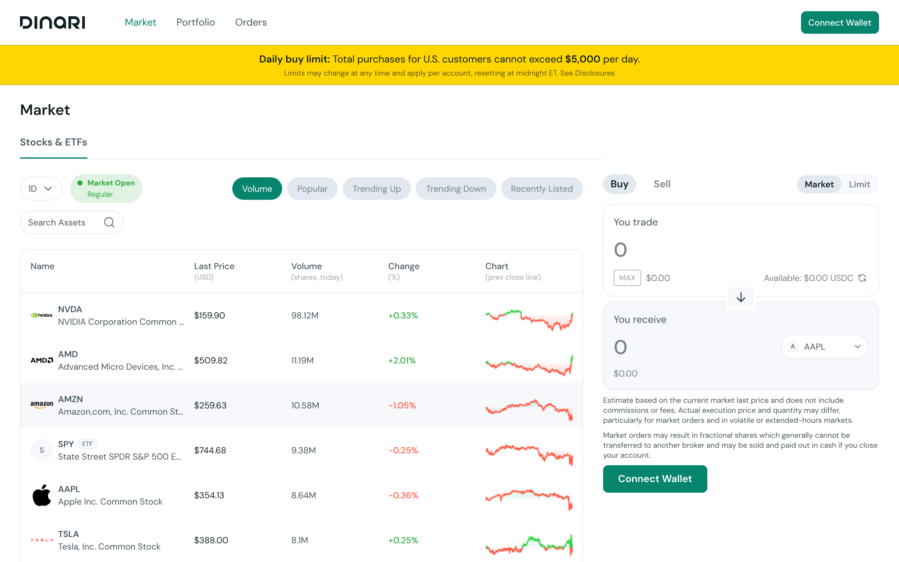
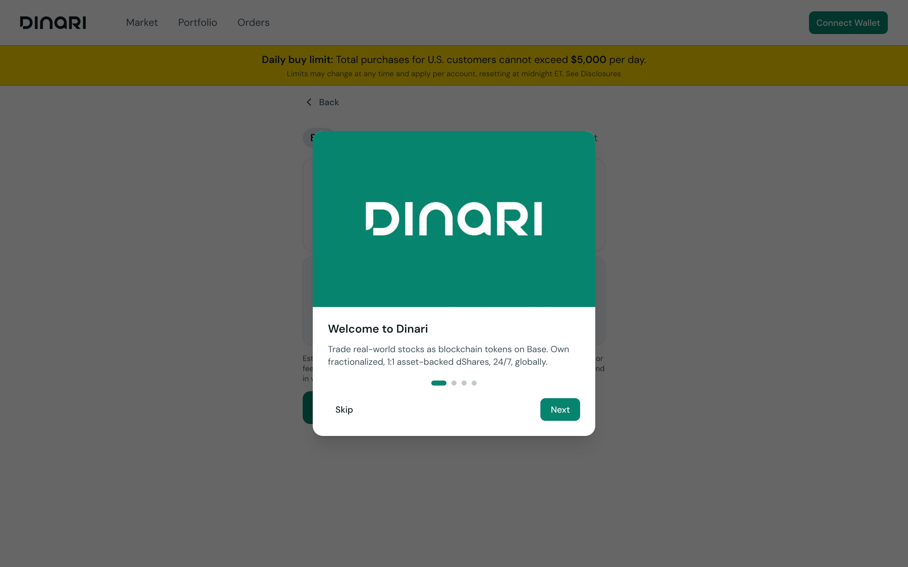
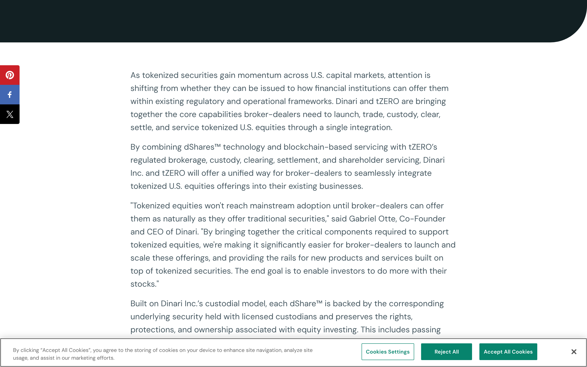
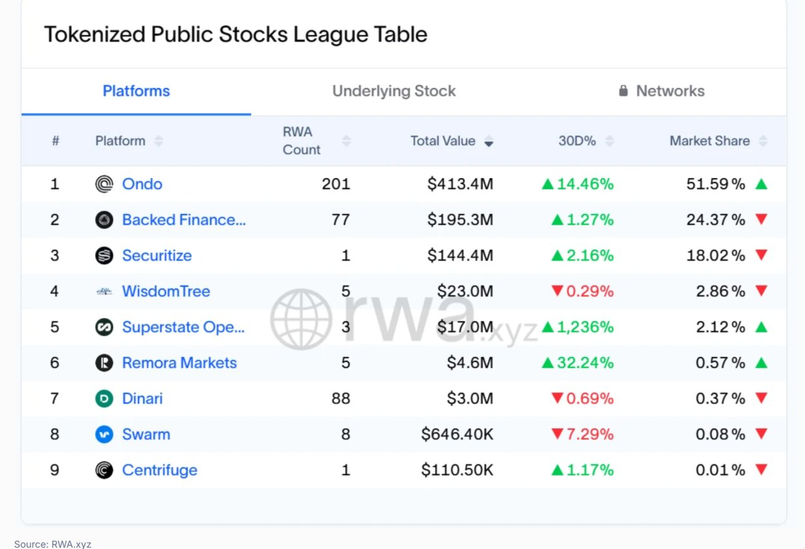
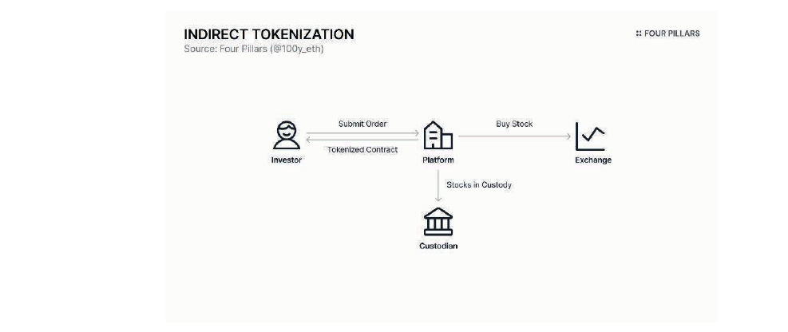

## 정체 카드
● 한 줄 정체 : 미국 주식, ETF와 1:1로 짝지은 토큰(미국판은 계좌 속 주식의 기록, 미국 밖판은 Dinari에 대한 청구권)을 증권사와 앱에 공급하는 회사 [F-0302][F-0116][F-0996][F-0997]
● 대표 상품 : dShares(Dinari의 주식 토큰 상품명, 미국판과 미국 밖판) = 실제 주식 1주에 토큰 1개를 짝지은 토큰 [F-0302][F-0996][F-0997]
  - 뜻 : 미국판 = 미국 거주자가 Dinari Securities 증권 계좌에 실제 주식을 소유하고, 토큰은 그 보유 내역을 블록체인에 따로 적어 둔 사본 기록(두 기록이 다르면 계좌 기록이 우선) [F-0996][F-0312]
  - 뜻 : 미국 밖판 = 미국 밖 투자자가 주식이 아니라, 기초 주식의 가치만큼 Dinari에 지급을 청구할 수 있는 권리를 보유 [F-0997]
  - 뜻 : 원주 = 토큰이 가리키는 실제 주식 원본. 미국판은 Alpaca가 Dinari 명의 계좌에 실제 주식을 보관, 미국 밖판은 기초 주식을 Dinari 명의 계좌(버뮤다 분리계정회사)에 보유하나 투자자는 소유권이 없음. 다른 회사 유형과의 비교는 화면의 가로 비교 탭 [F-0303][F-0997]
  ★ USD+ = Dinari가 발행하는 달러 연동 스테이블코인으로 단기 미국 국채와 현금으로 100% 담보하고 이자를 얹어 주는 수익형 토큰(2024년 말 출시) [F-0327][F-0278]
  ★ 화이트라벨 위젯과 API = 파트너 사이트에 파트너 자기 브랜드로 끼워 넣는 주문 화면(위젯)과 프로그램 연결 통로(API) [F-1202][F-1203][F-1204]
  ★ DFN(Dinari Financial Network) = 2025-08 출시한 Dinari의 자체 블록체인(Avalanche 기술 기반 L1) [F-0282]
  - 뜻 : L1 = 독자적으로 거래를 검증, 기록하는 기본 블록체인. Avalanche = 그 기술 기반이 되는 공개 블록체인 [F-0282]
● 꼭 알아야 할 사실
  ★ 타이틀 : 미국 주식, ETF 토큰 724종을 미국 투자자와 사업자(증권사 등) 모두에게 제공하는 첫 플랫폼이라고 주장(회사 주장) [F-1206][F-0291]
  ★ 인가 : 2025-06-20 Dinari Securities가 미국 증권사(브로커딜러)로 등록, FINRA(증권사 자율규제기구) 회원 [F-0116]
  ★ 투자 : 2025-05 시리즈 A(창업 초기의 첫 본격 투자 라운드) 1,270만 달러를 Hack VC 등이 주도해 유치, 누적 2,265만 달러 [F-0279][F-0128]
  ★ 제재 : 확인된 제재 없음. FINRA BrokerCheck(증권사 등록 조회 서비스)에 징계와 고객 분쟁 공시가 0건 [F-0119]
● 숫자
  ★ 주식 토큰 순위와 잔액 : 2026-11-16 rwa.xyz 토큰화 주식 플랫폼 표에서 발행 잔액 11위, 1,520만 달러로 시장 37.1억 달러의 0.41%. 1위 Binance 13.6억 달러의 약 1/90 [F-1027][F-1021][F-1028]
  ★ 공개 규모 : 회사 전체의 매출, 고객 수는 공개되지 않아 발행 잔액과 종목 수로만 규모 확인 [F-1027][F-0339]
  ★ 파트너 사례 연구(회사 게시, 기간과 집계 기준이 파트너마다 달라 합산하지 않음) : Cadana 고객 거래대금 127만 달러 이상(주문 1,426건), Meru 440만 달러 이상(고객 4,814명, 44개국), Fasset 144만 달러 이상(주문 18,959건), Offramp 29.3만 달러 이상(19개국) [F-0347][F-0350][F-0349][F-0351]
  ★ 종목 수 : 724종 이상(S&P 500 전체 포함) [F-0339]
● 흐름(미국판) : 미국 이용자 → Dinari Securities(증권사) → Alpaca(청산, 보관) [F-0319][F-0302][F-0315]
  - 뜻 : Alpaca = 미국 청산 증권사. 주문 집행, 청산과 결제, 증권과 현금 보관을 맡고 Dinari Securities는 계좌 개설, 신원 확인, 주문 접수를 맡음. 청산, 결제 = 체결된 거래에서 주식과 대금을 실제로 주고받아 확정하는 절차 [F-0315]
  - 뜻 : FINRA, SIPC = 미국 증권사 자율규제기구, 증권사 파산 때 고객 계좌를 일정 한도로 보호하는 제도. Dinari Securities는 두 곳 회원 [F-0266]
● 흐름(미국 밖판) : 이용자 → 파트너 앱(또는 위젯) → 발행 Dinari(Dinari, Inc.) → 보관 Alpaca [F-0332][F-0313][F-0303]
  - 뜻 : 파트너 앱 = Dinari와 API를 연결해 자기 고객에게 dShares를 파는 외부 서비스(예: 급여 플랫폼 Cadana) [F-1085]

## 회사 개요와 확장 경로
● 쉽게 말하면 : 미국 밖 파트너 판매로 시작해 증권사 등록으로 미국까지 [F-0273][F-0116]
● 주장 : 직접 판매 앱을 키우기보다 파트너 앱 공급으로 미국 밖에서 먼저 열고 증권사 등록으로 미국까지 넓혔으나, 발행 잔액은 아직 11위(0.41%) [F-0273][F-0116][F-0291][F-1027]
● 기본정보
  ★ 법인명 : Dinari, Inc.(기술 회사), Dinari Securities, LLC(미국 증권사) [F-0266]
  ★ 설립 : 2021년, 공동 창업자 3명 [F-1053][F-1054]
  ★ 창업자 : Otte(CEO), Rampenthal(CLO, 법무 책임자), Timothy(CTO, 기술 책임자) [F-1054]
  ★ 소재지 : 미국 뉴욕 [F-0260]
  ★ 이용 국가 : 2025-05 기준 주식, ETF 100종 이상을 60개국 이상에서 제공한다고 회사가 밝힘(투자사 500 Global 게시도 같은 국가 수) [F-0281][F-0130]
● 지배구조(누가 무엇을 맡나)
  ★ Dinari, Inc. : 토큰을 만들고 파트너에 공급하는 기술 회사, 브로커딜러 아님. 명의개서대리인(주주 명부 관리 인가) 등록을 회사가 공식 발표 [F-0266][F-1055]
  ★ Dinari Securities, LLC : 미국에서 브로커리지(증권 중개)를 하는 유일한 법인, FINRA와 SIPC 회원 [F-0266][F-0116]
  ★ 두 법인 관계 : Dinari, Inc.가 개발한 dShares 기술을 Dinari Securities에 라이선스하고, 증권사 업무는 별도 법인이 맡도록 분리. 지분 비율은 회사 자료에서 확인하지 못함 [F-0266][F-0263]
  ★ 투자자 : 2023 시드 1,000만 달러(500 Global 등 참여), 2025-05 시리즈 A 1,270만 달러(Hack VC 주도), 누적 2,265만 달러 [F-0275][F-0127][F-0279][F-0128]
  ★ 상장 : 비상장 스타트업. 투자 유치 사실만 있고 상장 사실은 확인되지 않음 [F-0128]
  ★ 인프라 의존 : 청산, 결제, 보관은 Alpaca에 위탁 [F-0315]
● 본업과 규모
  ★ 본업 : 실제 주식과 1:1 연동한 토큰(dShares)을 증권사, 파트너 앱에 공급하고 수수료를 받음. 주식 토큰이 곧 본업 [F-0302][F-0336]
  ★ 공개된 규모 : 2026-11-16 발행 잔액 1,520만 달러, 점유율 0.41%, 11위(1위 Binance 13.6억 달러) [F-1027][F-1021]
  ★ 규모 변화 : 2026-01 초 300만 달러(7위, 점유율 0.37%) → 2026-11-16 1,520만 달러(11위, 0.41%), 5.1배이나 점유율은 거의 그대로 [TP-004][F-1027]
  ★ 종목 : 2023-12 20종에서 2026-11 724종 이상(S&P 500 전체 포함) [F-0275][F-0339]
  ★ 자금 : 누적 투자 2,265만 달러 [F-0128]
  ★ 해석 : 회사가 매출, 고객 수를 공개하지 않아 사업 크기는 발행 잔액과 종목 수로만 판단 가능. 같은 날 1위 Binance의 약 1/90 수준 [F-1027][F-1021]
● 설립 목적과 비전
  ★ 미션 : 누구나 어디서든 미국 주식시장에 즉시, 규정을 지켜, 불필요한 마찰 없이 접근 [F-1114]
  ★ 문제의식 : 미국 밖 투자자는 복잡한 가입, 높은 비용, 분절된 인프라에 막힘 [F-0280]
  ★ 설립 이유(회사 주장) : 증권 계좌 보유율은 1% 미만이나 블록체인 지갑 보유율은 5%에서 10%에 이를 수 있어, 지갑으로 미국 주식에 접근하게 하면 더 많은 사람에게 닿는다고 봄 [F-0274]
  ★ 해석 : 증권 계좌가 없는 미국 밖 이용자를 지갑으로 연결하는 사업에서 출발해 증권사, 거래소를 잇는 인프라로 넓힘 [F-0280][F-0273][F-0287]
● 앞으로의 그림(회사가 밝힌 계획)
  ★ 2026-07 Dinari Financial Network(DFN)를 증권사, 거래소, 발행사, 수탁사, 명의개서대리인을 표준 운영 모델로 잇는 틀로 재정의 [F-0287]
  ★ 2026 Q1부터 Flow Traders(시장조성사)와 dShares 24시간 거래 제공 계획, 확인되는 2026-11 24시간 세션은 9종목(SPY, QQQ, AAPL 등) [F-1036][F-0343]
  - 뜻 : 시장조성사 = 사려는 호가와 팔려는 호가를 계속 내서 거래가 이뤄지게 하는 업자. 2025-12 발표에서 Dinari 네트워크로 200개 이상 토큰화 미국 주식에 접근한다고 안내(단일 출처) [F-0138]
  ★ 2026-11 Broadridge(주주 의결권 행사를 중개하는 미국 회사) 연동으로 적격 dShares 보유자가 기초증권 의결권 행사 [F-0300]
  ★ 한국 주식 : 카카오페이증권과 PoC, 연내 공동 TF 구성 예정, 상용화는 미정 [F-0131][F-0133]
  - 뜻 : PoC = 개념검증(실제로 구현 가능한지 시험하는 단계). TF = 특정 과제를 위해 구성하는 임시 공동 조직 [F-0131]
● 타깃 수요
  ★ 증권 계좌 없이 미국 주식을 사려는 미국 밖 개인(급여, 프리랜서 소득 이용자 등 파트너 앱 이용자) [F-0280][F-1085][F-1087]
  ★ 토큰 주식을 자기 서비스에 넣으려는 기업, 핀테크, 증권사 [F-0277][F-0288]
  ★ 미국의 적격 투자자와 사업자(2026-08 미국판) [F-1131]
  - 뜻 : 적격 투자자 = 일정 소득이나 자산 기준을 넘어 규제상 고위험 상품 투자가 허용된 투자자. 이 본문에서 미국판 대상이 개인 일반인지 적격 투자자인지는 아래 C 대분류 참조 [F-1131]
● 수익원
  ★ 파트너 API 접근료 월 2,000달러부터, 네트워크 수수료 주문당 0.20달러, USDT 환전 3bp, OTC 스프레드 통상 10bp까지. 거래 수수료는 받지 않음 [F-0336]
  - 뜻 : bp(베이시스포인트) = 0.01%. 3bp = 0.03%, 10bp = 0.10%. OTC = 거래소 밖에서 대량으로 하는 장외 거래, 스프레드 = 사는 가격과 파는 가격의 차이 [F-0336]
  ★ 증권사에 API 라이선스 제공(2026-08 미국판, Circle 제휴) [F-1131]
  ★ 주의 : 개인이 직접 쓸 때(미국 밖판, 2026-02 기준) 항목별 수수료 0.2달러에서 50달러, 주문당 0.25%에서 0.50%, 배당금의 5%를 회사가 수취(포필러스, Securitize 후원 보고서) [TP-118]
● 성장 경로(한 줄기)
  ★ 2021 설립 → 2023-08 미국 밖 판매 [F-1053][F-0273]
  ★ 2024-02 API 공급 [F-0277]
  ★ 2025-06 미국 증권사 등록 → 2026-08 미국 판매 724종 [F-0116][F-0291]
  ★ 2026-07 증권사 공급(tZERO) → 2026-09 한국 주식(카카오페이) [F-0288][F-0131]
● 화면
    
  ★ 그림 해설 : 가입 화면, 724종 종목 목록, 주문 화면. 미국 거주 개인이 직접 쓰는 미국판 화면이며 미국 밖 이용자는 파트너 앱에서 같은 상품을 만남 [F-0339][F-0319][F-0332]

## 사업 범위와 넓힌 순서
● 쉽게 말하면 : 직접 판매보다 파트너와 증권사에 공급하며 넓힘 [F-0277][F-0288]
● 주장 : 고객 접점은 파트너와 증권사에 맡기고, 회사는 토큰, 증권사 등록, 명의개서, 자체 블록체인 같은 인프라를 직접 갖추는 순서로 확장 [F-0273][F-0116][F-1131][F-0282]
● 자산(무엇을 어떤 순서로 더했나)
  - 뜻 : 줄 끝의 직접 = 회사가 스스로 출시, 등록, 구축, 위탁 = 청산과 보관을 다른 회사에 맡김, 제휴 = 다른 회사와 협력 [F-0273][F-0315][F-0288]
  ★ 2023-08 dShares(미국 밖판) : 직접 발행 [F-0273]
  ★ USD+ 국채 담보 달러 토큰 : 직접 발행 [F-0327]
  ★ 2025-06 증권사 : Dinari Securities 직접 등록 [F-0116]
  ★ 명의개서대리인 : Dinari, Inc. 직접 보유(회사 발표) [F-1055]
● 자산 보충(인프라)
  ★ 2025-08 Dinari Financial Network : 직접 구축 [F-0282]
  ★ 청산, 결제 : Alpaca 위탁 [F-0315]
  ★ 2026-07 증권사 업무(중개)와 수탁(자산 보관) : tZERO와 제휴해 제공 [F-0288]
● 고객(파트너에서 증권사로)
  ★ 2023-08 미국 밖 투자자 : 파트너 앱 경유 [F-0273][F-0332]
  ★ 2024-02 기업, 핀테크 : B2B API 직접 [F-0277]
  ★ 2026-07 증권사 : tZERO 제휴로 공급 [F-0288]
  ★ 2026-08 미국 적격 투자자, 사업자 : 직접 [F-1131]
● 시장(어느 나라로)
  ★ 2023-08 미국 밖 : dShares 직접 출시 [F-0273]
  ★ 2025-06 미국 : 증권사 직접 등록 [F-0116]
  ★ 2026-08 미국 판매 : 724종 직접 [F-1131]
  ★ 2026-09 한국 : 카카오페이증권 협약(제휴) [F-0131]
● 2023-08 dShares(미국 밖판) 출시 : 증권 계좌 없는 미국 밖 투자자부터 [F-0273][F-0280]
  ★ 어떻게 : 2023-10 핵심 토큰 발행 프로그램을 Arbitrum(이더리움 위에서 수수료가 낮은 공개 블록체인)에 출시 [F-0276]
  ★ 왜 : 미국 밖 투자자의 복잡한 가입, 높은 비용, 분절된 인프라 [F-0280]
  ★ 쓴 곳 : 종목 2023-12 20종에서 2026-11 724종 이상 [F-0275][F-0339]
  ★ 해석 : 증권 계좌 없는 미국 밖 이용자를 겨냥해 해외 시장에서 먼저 시작한 단계 [F-0280][F-0273]
● 2024-02 B2B API와 위젯 : 직접 소매 앱 대신 파트너 공급 [F-0277][F-1204]
  ★ 왜 : 기업과 핀테크가 자기 서비스에 토큰 미국 주식과 ETF를 넣게 함 [F-0277]
  ★ 쓴 곳 : Cadana 등 파트너 앱이 API로 자기 고객에게 제공 [F-1085]
  ★ 쓴 곳 : 회사 사이트가 화이트라벨 위젯과 REST API, SDK를 안내 [F-1202][F-1203]
  ★ 해석 : 파트너 공급으로 고객 접점을 넓히고 API 월 2,000달러부터 수익화 [F-1204][F-0336]
● 2025-06 증권사 등록에서 2026-08 미국판 출시까지 : 직접 인가로 미국 판매 [F-0116][F-1131]
  ★ 왜 : 미국 적격 투자자가 자기 보관 지갑에서 USDC로 거래하게 함 [F-1131]
  ★ 쓴 곳 : 724종 출시, 미국 내 증권사에 API 제공(Circle 제휴) [F-1131]
  ★ 쓴 곳 : 투자자와 사업자 모두에게 주는 첫 플랫폼(회사 주장) [F-1206]
  ★ 해석 : 미국 판매를 증권사 직접 등록으로 열고 청산, 결제는 Alpaca에 위탁 [F-0116][F-1131][F-0315]
● 2026-07 tZERO 제휴 : 증권사 채널을 제휴로 확보 [F-0288][F-0289]
  ★ 왜 : 토큰 주식은 증권사가 전통 증권처럼 내놓아야 대중화 [F-0289]
  ★ 쓴 곳 : tZERO가 브로커리지, 수탁, 청산, 결제를 맡음 [F-0288]
  ★ 쓴 곳 : 2026-07 DFN을 증권사, 거래소 잇는 표준 틀로 재정의 [F-0287]
  ★ 해석 : 다른 증권사에 공급할 때 필요한 중개, 수탁, 청산, 결제 기능을 tZERO와의 제휴로 채워 증권사 고객으로 넓힘 [F-0288][F-0289]
● 해석 : 파트너 API로 시작해 증권사 직접 등록으로 미국을 열고, 증권사 채널과 한국 주식까지 넓혀 옴 [F-0277][F-0116][F-0288][F-0131]

## 경영진 발언
● 쉽게 말하면 : 24시간 글로벌 주식, 증권사 유통, 한국 주식 수요를 차례로 말했고 앞의 둘은 일부 이룸 [F-1035][F-0289][F-0299]
● 말하고 이룬 것(시점 순)
  ★ 2025-08-14 Otte(공동 창업자 겸 CEO) : 주식의 미래는 국경 없이 언제나 열려 있다 → 같은 날 Dinari Financial Network 출시, 2026-11 24시간 세션 9종목 [F-1035][F-0282][F-0343]
  ★ 2025-12-09 Otte : Flow Traders(시장조성사)와 함께 2026년 1분기부터 24시간 거래 제공 → 1분기 시작 여부는 확인하지 못했고 2026-11-16 24시간 세션 종목은 9개 [F-1036][F-0343]
  ★ 2026-07-08 Otte : 증권사가 토큰 주식을 자연스럽게 내놓아야 대중화 → 같은 날 tZERO 제휴, 2026-08 미국 내 증권사에 API 제공(Circle 제휴) [F-0289][F-0288][F-1131]
● 말하고 진행 중인 것
  ★ 2026-09-30 Otte : 한국 주식의 해외 접근이 비어 있다 → 카카오페이증권과 PoC, 연내 공동 TF 구성, 상용화 미정 [F-0299][F-0133]
  ★ 2026-11-05 Otte : 권리가 보존되는 토큰 주식(의결권 포함) → Broadridge 의결권 인프라 연동 [F-1038][F-0300]
● 발언 1 : 주식은 국경 없이 24시간 거래된다 [F-1035]
  ★ Gabe Otte(CEO), Dinari Financial Network 출시 발표, 2025-08-14, https://dinari.com/blog/dinari-launches-the-dinari-financial-network-a [F-1035]
    ① 원문 : "The future of equities is global, programmable, and always available."
    ② 번역 : 주식의 미래는 국경이 없고, 프로그래밍 가능하며, 언제나 열려 있다.
    ③ 해석 : 방향은 24시간 글로벌 주식 시장, 실행은 자체 블록체인으로 주문과 결제 기반 구축
  
● 발언 2 : 증권사 채널이 커야 대중화된다 [F-0289]
  ★ Gabriel Otte(공동 창업자 겸 CEO), tZERO 제휴 발표, 2026-07-08, https://dinari.com/blog/dinari-and-tzero-partner [F-0289]
    ① 원문 : "Tokenized equities won't reach mainstream adoption until broker-dealers can offer them as naturally as they offer traditional securities."
    ② 번역 : 토큰 주식은 증권사가 전통 증권처럼 자연스럽게 내놓을 수 있어야 대중화된다.
    ③ 해석 : 방향은 증권사 유통, 실행은 발행, 보관, 청산을 묶어 증권사에 공급
  
● 발언 3 : 한국 주식의 해외 접근이 비어 있다 [F-0299]
  ★ Gabe Otte(CEO), 카카오페이증권 제휴 발표, 2026-09-30, https://dinari.com/blog/kakaopay-securities-and-dinari-partner-to-expand-global-access-to- [F-0299]
    ① 원문 : "Korea is home to some of the world's most important public companies, yet access to Korean equities remains limited for many investors outside the country."
    ② 번역 : 한국에는 세계적 상장사가 많지만, 한국 밖 투자자의 한국 주식 접근은 여전히 제한적이다.
    ③ 해석 : 방향은 한국 주식의 해외 수요, 실행은 국내 증권사와 원주 조달, 토큰화 모델 검증
  

## A 출신과 진입(주식 토큰 사업)
● 쉽게 말하면 : 다른 회사가 발행한 토큰을 파는 것이 아니라 Dinari가 직접 만든 토큰으로 미국 밖에서 시작 [F-0276][F-0280]
● 주장 : 처음부터 발행 프로그램과 판매 파트너를 함께 갖추고 증권 계좌 없는 미국 밖 투자자를 겨냥해 진입 [F-0276][F-0280][F-0273]
● 출신 : 토큰화 전문 회사, 2021년 설립 [F-1053]
● 진입 방식
  ★ 2023년 Arbitrum에 자체 발행 프로토콜 출시 [F-0276]
  ★ 진출 사유 : 증권 계좌 없는 미국 밖 투자자 접근 [F-0280]

## B 상품 구조
● 쉽게 말하면 : 미국판은 계좌 속 주식, 미국 밖판은 Dinari 청구권 [F-0996][F-0997]
● 주장 : 같은 dShares 이름이라도 미국판은 투자자가 주식을 소유하고, 미국 밖판은 소유권 없이 Dinari에 대한 채권만 가져 투자자 지위가 다름 [F-0996][F-0997][F-0312]
● 토큰의 법적 성격(우리 분류)
  ★ 미국판 : 보유자가 계좌 속 주식 소유, 토큰은 2차 기록 [F-0996]
  ★ 미국 밖판 : 기초주 권리 없이 Dinari에 가치 청구권 [F-0997]
  ★ 우리 분류 : 미국판 제3자 보관형, 미국 밖판 연계증권 [F-0996][F-0997]
  - 뜻 : 제3자 보관형 = 증권사(Alpaca)가 실제 주식을 보관하고 토큰은 그 보유를 기록. 연계증권 = 기초 주식 가격에 연동해 가치가 정해지는 발행사 채무 [F-0996][F-0997]
● 발행 주체와 보관
  ★ 미국판은 Dinari Securities(증권사 법인)가 계좌를 열어 주식을 보유시키고, 미국 밖판은 Dinari, Inc.가 토큰을 발행 [F-0302][F-0313]
  ★ 기초 주식은 Alpaca(미국 청산 증권사)가 투자자 명의가 아닌 Dinari 명의 계좌에 보관 [F-0303]
● 투자자 권리
  ★ 배당 자동 반영, 2026-11 의결권 행사 연동 [F-0346][F-0300]
● 규모(시장 내 위치)
  ★ 2026-11-16 rwa.xyz 토큰화 주식 플랫폼 표에서 발행 잔액 1,520만 달러, 11위(시장 37.1억 달러의 0.41%) [F-1027][F-1028]
  ★ 1~3위는 Binance, Ondo, Kraken(13.6억, 9.0억, 6.8억 달러) [F-1021][F-1022][F-1023]
  ★ 종목 수 2023-12 20종에서 2026-11 724종 이상 [F-0275][F-0339]
● 규모 과거 대비
  ★ 2026-01 초 300만 달러 7위(0.37%) → 11-16 1,520만 11위(0.41%) [TP-004][F-1027]
  ★ 잔액 5.1배 [TP-004][F-1027]
  
  ★ 그림 해설 : 2026-01 초 rwa.xyz 토큰화 주식 플랫폼 순위표(잔액과 점유율). 이 회사는 7위 줄, 잔액 300만 달러, 점유율 0.37% [TP-004]
● 수수료
  ★ 파트너 API 월 2,000달러부터, 주문당 0.20달러 [F-0336]
● 제3자 시각
  ★ 중립 : 운영 모델이 Robinhood EU판과 거의 같다는 서술은 미국 밖판 기준(포필러스, Securitize 후원, 2026-02, 미국판 이전) [TP-117]
  
  ★ 그림 해설 : 간접 방식 = 발행 법인이 토큰을 내고 보관 증권사가 기초 주식을 따로 보유하는 구조의 흐름도. 이 회사 : 미국 밖판만 해당(Dinari, Inc. 발행, Alpaca 보관). 미국판은 계좌 속 주식이라 이 도식과 다름 [TP-117][F-0997][F-0996]

● 평가
  ★ 유동성 분산 : dShares를 7개 블록체인에서 쓸 수 있어 체인별로 거래가 나뉠 수 있으나, 체인 간 주문과 정산 연결은 Dinari의 자체 체인 DFN이 맡는다고 회사가 설명 [F-0344][F-0282]
  ★ 블록체인 위 활용 : 배당은 USD+(국채 담보 달러 토큰)로 지급하고, 이용 제한 지역의 지갑으로 토큰을 옮기려 하면 토큰 코드가 차단 [F-0308][F-0270]
  ★ 의존 위험(외부 업체와 회사 권한) : 청산, 보관을 Alpaca에 맡겼고, dShares는 SIPC(증권사 파산 때 고객 계좌를 일정 한도로 보호하는 제도) 보호 밖이며, 회사가 토큰을 동결할 권한을 가짐 [F-0315][F-0292][F-0320]

## C 최종 투자자
● 쉽게 말하면 : 미국 개인은 직접, 미국 밖 개인은 파트너 앱으로 [F-0332][F-0319]
● 주장 : 이용 경로가 둘로 갈려, 미국 밖은 파트너 앱 이용자가 고객이고 미국은 Dinari Securities 계좌 보유자와 2026-08 이후 적격 투자자, 사업자가 고객 [F-0332][F-0319][F-1131]
● 대상
  ★ 미국 개인(만 18세 이상, 미국 거주, 개인 비사업용 단독 계좌) [F-0319]
  ★ 2026-08 미국판 출시는 자격 있는 미국 투자자와 사업자(증권사 등)가 대상이라고 발표해 위 개인 자격과 표현이 다름. 두 서술이 같은 상품의 다른 이용 경로인지는 확인하지 못함 [F-1131][F-0319]
  ★ 미국 밖은 파트너 앱 이용자(아래 D) [F-0332]
● 국적 및 지역 제한
  ★ 미국 밖판은 미국인 이용 불가, 이용 제한 국가 목록(캐나다 외 31개국)에 한국은 없으나 한국 개인이 실제로 쓸 수 있는지는 확인하지 못함 [F-0313][F-0341]

## D 유통과 접점
● 쉽게 말하면 : Dinari 자체 화면보다 파트너 앱이 자기 고객에게 토큰을 파는 방식에 의존(파트너에 대량 공급하는 도매 방식) [F-0332][F-0335]
● 주장 : 이용자 접점을 파트너 앱 5곳(급여, 투자, 국경 간 금융, 금융 계정, 앱 내 주식 제공)에 맡기며, 사례 연구상 파트너별 거래대금은 수십만에서 수백만 달러 규모 [F-0332][F-0335][F-0347][F-0350][F-0351]
● 공급 방식(누구에게 서빙하는지)
  ★ Cadana(급여 플랫폼) : 100개국 이상 직원, 계약자. 사례 연구상 고객 거래대금 127만 달러 이상, 주문 1,426건, 종목 141개(2026-06-15 기준) [F-1085][F-0347]
  ★ Eldora(투자 앱) : 동남아 개인 투자자 [F-1086]
  ★ Meru(국경간 금융 앱) : 중남미 프리랜서, 원격근무자. 사례 연구상 고객 거래대금 440만 달러 이상, 고객 4,814명, 44개국, 248종(2026-07-15 기준) [F-1087][F-0350]
  ★ Offramp(금융 계정) : 스테이블코인 잔고 이용자. 사례 연구상 거래대금 29.3만 달러 이상, 19개국, 107종(2026-07-16까지) [F-1088][F-0351]
  ★ Fasset(앱 내 미국 주식, ETF 제공) : 사례 연구상 거래대금 144만 달러 이상, 주문 18,959건, 종목 57개(2026-07-15 기준) [F-0349]
● 거래 장소
  ★ 사용 블록체인 : Ethereum, Arbitrum, Avalanche, Base 등 7개 [F-0344]
  ★ 24시간 거래 : 2025-12 Flow Traders(시장조성사)와 제휴 [F-1036]
● 가격과 유동성 장치
  ★ 가격 기준 : 기초 주식 주문을 Alpaca로 보내 최선집행(고객에게 가장 유리한 조건으로 체결할 의무, FINRA 규정) [F-0318]
  ★ 유동성 공급 : 미국 정규장 밖 시간에는 Flow Traders(시장조성사)가 호가를 냄 [F-1036]
  ★ 상환과 수렴 : 보유자가 토큰을 소각하면 Dinari가 직접 환매해 현금화하고, 토큰의 발행과 소각은 기초 주식 주문이 증권 계좌에서 체결 완료된 뒤에만 일어남 [F-0306][F-0326]
● 제3자 시각
  ★ 주의 : 토큰은 Dinari 등록 이용자끼리만 이전 가능(포필러스, Securitize 후원, 2026-02 기준) [TP-120]
  
  ★ 그림 해설 : 간접 방식 4개 플랫폼의 수수료, 거래 방식 비교표. 이 회사 : Dinari 열(미국 밖판 설명, 미국판 이전) [TP-120][F-0997]

## E 인가
● 쉽게 말하면 : 증권사와 명의개서는 직접 등록, 청산과 보관은 위탁 [F-1055][F-0116][F-0315]
● 주장 : 미국 증권사와 명의개서대리인은 직접 등록해 갖추고, 청산과 보관 업무는 Alpaca에 위탁해 미국 인가 범위를 좁혀 운영 [F-1055][F-0116][F-0315]
● 보유 인가와 법인(확보 방식과 시점)
  ★ 미국 증권사 : Dinari Securities, 2025-06-20 직접 등록 [F-0116]
  ★ 증권사는 FINRA 회원, 미국 53개 주와 영토에 등록 [F-0116][F-0120]
  ★ 명의개서대리인 TA-1 : Dinari, Inc/TA가 2022-04 접수, 2022-05 SEC 수리 [F-1237][F-1055]
  - 뜻 : TA-1 = SEC에 내는 명의개서대리인 등록 신청서. 수리 = SEC가 신청서를 접수 처리함 [F-1237]
● 제3자 시각
  ★ 주의 : CoinDesk Research(Bullish 의뢰) 표는 Dinari를 미국판과 밖판 구분 없이 보관형 한 열로 묶어 우리 분류(미국판 보관형, 밖판 연계증권)와 다름 [TP-119][F-0996][F-0997]
● 인가 없는 구간을 메우는 방법
  ★ 청산, 결제, 보관은 Alpaca에 위탁 [F-0315]
● 미국 등록의 대가
  ★ 미국판 거래시간 새벽 4시~밤 8시(ET, 미국 동부시간), 주말 불가 [F-0322]
  ★ 미국판 하루 매수 한도 5,000달러 [F-0314]
  ★ 토큰은 계좌 기록의 2차 기록, 계좌 기록이 우선 [F-0312]

## F 관계(해당 시)
● 쉽게 말하면 : 기존 인프라사와 손잡고 증권사 시장으로 [F-0288][F-1038]
● 주장 : 증권사 채널은 tZERO, 의결권 처리는 Broadridge처럼 이미 시장에 있는 회사의 기능을 빌려 증권사 시장에 진입 [F-0288][F-1038]
● 인수, 투자, 제휴
  ★ 2026-07 tZERO와 증권사용 운영 틀 제휴 [F-0288]
  ★ 2026-11 Broadridge와 의결권 인프라 연동 [F-1038]

## G 한국 접점(해당 시)
● 쉽게 말하면 : 한국 주식을 해외로 내보내는 협력 [F-0131][F-0132]
● 주장 : 카카오페이증권과 PoC(개념검증) 단계이며 상용화 여부는 PoC 결과, 감독당국 방향, 소비자 보호 원칙을 본 뒤 정한다고 밝힘 [F-0131][F-0133]
● 한국 회사와의 협약
  ★ 2026-09 카카오페이증권과 한국 주식 해외 유통 협약 [F-0131]
  ★ 카카오페이증권은 전날 Ondo와도 같은 취지의 MOU를 맺어 복수의 토큰화 회사와 병행 협력(한국 언론 교차 확인) [F-0136]
● 한국 주식 취급
  ★ 원주를 해외투자자 통합계좌(해외 투자자 여럿의 한국 주식을 증권사 한 계좌에 모아 보유하는 방식)로 조달하고, 원주와 토큰 1:1 발행, 상환 구조가 구현 가능한지 검증 [F-0132]

## 한국 시장과의 차이
● 쉽게 말하면 : 미국판은 미국 거주자 전용이라 한국 개인은 이용 불가 [F-0319][F-0313]
● 주장 : 미국판은 미국 거주자 전용이라 한국 개인에게는 열리지 않음 [F-0319][F-0313]
● 규제
  ★ 가능했던 이유 : 미국 밖은 Regulation S(미국인이 아닌 사람에게 미국 밖에서 파는 증권은 미국 공모 등록 불요), 미국은 증권사 등록 [F-0313][F-0116][US-17CFR-230.903-a]
  ★ 한국 차이 : 미국판은 미국 거주 개인만, 한국 개인은 이용 불가 [F-0319]
● 고객 수요
  ★ 가능했던 이유 : 증권 계좌 없는 미국 밖 투자자 수요 [F-0280]
● 규제 건의 포인트 : 증권사 계좌의 주식 기록을 정본으로 두고 블록체인 토큰을 그 사본 기록으로 쓰는 방식을 한국에서 인정할지 기준 정리 [F-0996][F-0312]

## 성과와 판단
● 쉽게 말하면 : 종목은 724종으로 늘었으나 잔액은 11위, 파트너와 증권사 채널을 늘리는 중 [F-0339][F-1027]
● 주장 : 파트너 API와 증권사 직접 등록으로 공급 경로를 넓혔으나 규모는 아직 작음 [F-0332][F-0116][F-1027]
● 사업별 성과
  ★ 주식 토큰(dShares) : 2026-11-16 발행 잔액 1,520만 달러(11위, 점유율 0.41%). 2026-01 초 300만 달러(7위)에서 5.1배 [F-1027][TP-004]
  ★ 종목 : 2023-12 20종에서 2026-11 724종 이상 [F-0275][F-0339]
  ★ 증권사 사업 : 2025-06-20 Dinari Securities FINRA 회원 승인, 53개 주 등록, 징계와 고객 분쟁 공시 0건 [F-0116][F-0120][F-0119]
  ★ 파트너 공급 : Cadana(급여), Eldora(투자 앱), Meru(국경간 금융), Offramp(금융 계정), Fasset(앱 내 주식 제공)이 API로 자기 고객에게 제공(사례 연구, 거래대금은 위 규모 항목 참조) [F-1085][F-1086][F-1087][F-1088][F-0349]
  ★ 미국판 : 2026-08-04 724종을 적격 미국 투자자와 사업자에게 출시(회사 주장 최초) [F-1131][F-0291]
  ★ 한국 : 2026-09-29 카카오페이증권과 MOU, 상용화는 미정 [F-0131][F-0133]
● 핵심 성공요인(KSF)
  ★ 가장 먼저 시작한 파트너 판매 : Dinari는 2023-08 미국 밖 판매를 시작했고 Kraken, Robinhood는 2025-06, Ondo는 2025-09에 출시. 약 2년 먼저 시작해 종목 20종(2023-12)에서 724종 이상(2026-11), 사례 연구에 나온 파트너 5곳 확보 [F-0273][F-1040][F-0221][F-0197][F-0275][F-0339][F-1085][F-0349]
    - 한계 : 먼저 시작했어도 잔액 점유율은 2026-01 초 0.37%에서 2026-11-16 0.41%로 거의 같고 순위는 7위에서 11위로 하락 [TP-004][F-1027]
    - 해석 : 파트너 API는 파트너가 고객을 데려와야 커지는 구조라, 선점이 잔액으로 곧바로 이어지지는 않았음 [F-0332][F-1027]
  ★ 증권사 직접 등록 : 2025-06-20 등록으로 Ondo의 Oasis Pro 인수(2025-10)보다 약 4개월 먼저 미국 증권사 자격을 갖춤. 2026-08 미국판 724종 출시, Ondo 미국 보관형은 2026-07 IVV, MU 2종으로 가동 시작 [F-0116][F-1216][F-1131][F-1128]
    - 결과 : 미국 투자자와 사업자 모두에게 파는 종목 폭에서 앞섬. 미국판 잔액 숫자는 공개되지 않음 [F-1131][F-1128]
● 제약과 리스크
  ★ dShares는 SIPC 보호 대상이 아님 [F-0292]
    - 왜 : dShares는 Dinari Securities가 직접 보유하지 않아 증권사 파산 때 고객 계좌를 일정 한도로 보호하는 제도의 적용을 받지 못함. 투자자가 손실을 직접 부담 [F-0292]
  ★ 회사가 토큰 동결, 소각, 재발행 권한 보유 [F-0320]
    - 왜 : 규정 준수와 오류 시정 목적이나 회사 판단으로 토큰이 막히거나 되돌려질 수 있어 투자자가 자기 토큰을 완전히 통제하지 못함 [F-0320]
  ★ 청산, 보관을 Alpaca 한 곳에 위탁 [F-0315]
    - 왜 : Alpaca에 장애가 생기거나 계약이 끝나면 주문 집행, 결제, 보관이 함께 막힘(해석) [F-0315][F-0303]
  ★ 미국판 한도와 시간 : 하루 매수 한도 5,000달러, 거래시간 새벽 4시~밤 8시(ET), 주말 불가 [F-0314][F-0322]
    - 왜 : 24시간 거래라는 토큰의 장점이 미국판에서는 증권사 규정으로 제한되고 큰 금액 투자자는 매수 한도에 막힘 [F-0314][F-0322]
  ★ 한국 MOU 상용화 미정 [F-0133]
    - 왜 : PoC와 감독당국 방향 검토 뒤에 상용화를 판단하므로 한국 쪽 성과는 당분간 숫자로 나오지 않음 [F-0133]
● 제3자 평가
  ★ 평가 1(주의, 미국 밖판 설명이라 미국판에 옮기면 안 됨) : 포필러스(Securitize 후원), 주식 토큰화 보고서, 2026-02-23, 39쪽, https://4pillars.io/en/reports/2026-the-year-of-tokenized-stocks [TP-117]
    ① 원문 : "The operating model is almost identical to Robinhood’s Stock Tokens."
    ② 번역 : 운영 모델은 Robinhood의 Stock Tokens와 거의 같다.
    ③ 해석 : 2026-02 기준 미국 밖 dShares 설명으로 미국판(2026-08) 이전. 미국판은 계좌 속 주식 구조라 이 평가를 미국판에 옮기면 안 됨
  
  ★ 평가 2(주의, 개인 직접 이용 기준 수수료) : 포필러스(Securitize 후원), 주식 토큰화 보고서, 2026-02-23, 39쪽, https://4pillars.io/en/reports/2026-the-year-of-tokenized-stocks [TP-118]
    ① 원문 : "dShares carry a relatively high number of fees."
    ② 번역 : dShares는 수수료 항목이 비교적 많다.
    ③ 해석 : 개인 직접 이용 기준 수수료. 우리 본문의 파트너 API 요금(F-0336)과 대상이 다르므로 섞어 읽지 않음
  
  ★ 평가 3(주의, 분류가 우리와 다름) : CoinDesk Research(Bullish 의뢰), 발행사 안내서 비교표, 2026-09-29(2026-08 기준), 10쪽, https://www.coindesk.com/research/the-future-of-equity-ownership-an-issuer-s-guide-to-tokenized-equities [TP-119]
    ① 원문 : 표 칸 "Custodial tokenized equities", "Econ only", "Dinari-held", "SEC TA + FINRA BD"(Dinari 열)
    ② 번역 : 보관형, 경제적 권리만, 장부는 Dinari가 보유, SEC 명의개서대리인과 FINRA 증권사.
    ③ 해석 : 발행사 직접 방식을 미는 의뢰사 표. 미국판과 미국 밖판을 한 열로 묶어 우리 분류(미국판 보관형, 밖판 연계증권)와 다름. 표 원문은 칸 글자라 캡처 없음
● KDX 시사점
  ★ 자산 : 토큰을 계좌 기록의 2차 기록으로 둠 [F-0996][F-0312]
    - 가져올 것 : 주식은 계좌에 두고 토큰은 그 기록을 반영하며, 두 기록이 다르면 계좌 기록이 우선 [F-0312]
    - 이유 : 투자자의 법적 소유권은 전통 계좌에 그대로 두고 토큰은 이전, 표시 수단으로만 써서 기존 증권 규제와 충돌을 줄임(해석) [F-0312][F-0996]
    - 피할 것 : 회사가 토큰을 동결, 소각, 재발행할 수 있는 권한을 상품 설계에 넣는 구조(투자자 통제권 약화) [F-0320]
    - 이유 : 오류 시정에는 필요하지만 투자자는 자기 토큰이 회사 판단으로 막히거나 되돌려질 수 있어, 권한을 쓰는 조건과 절차를 공개하지 않으면 신뢰를 잃음(해석) [F-0320]
  ★ 고객 : 파트너와 증권사 경유 공급 [F-0277][F-0288]
    - 가져올 것 : 파트너가 증권사 등록 없이 단일 API로 토큰 주식을 제공하고 Dinari가 브로커리지, 결제, 수탁, 규정 준수를 처리하는 B2B 모델 [F-0332][F-0335]
    - 이유 : 고객을 가진 앱이 인가 부담 없이 상품을 붙일 수 있어 판매 채널이 빠르게 늘고, 인가 책임은 등록된 회사에 모임(해석) [F-0332][F-0335]
    - 피할 것 : 증권사 채널 없이 직접 화면만으로 고객을 모으는 방식. CEO도 증권사 유통이 있어야 대중화된다고 봄 [F-0289]
    - 이유 : 파트너 API는 파트너가 고객을 데려와야 커지고, 사례 연구상 파트너별 거래대금도 수십만에서 수백만 달러대에 머묾 [F-0347][F-0350][F-0351]
  ★ 시장 : 증권 계좌 없는 미국 밖 개인과 한국 주식의 해외 유통 [F-0280][F-0131]
    - 가져올 것 : 한국 상장주를 외국인 통합계좌로 조달해 1:1 발행하는 구조를 PoC로 검증 [F-0132]
    - 이유 : 원주를 실제로 보유한 채 토큰을 발행하면 토큰과 원주의 1:1 대응을 검증할 수 있어 투자자 보호 논의가 쉬움(해석) [F-0132]
    - 피할 것 : 미국판은 미국 거주 개인만 이용 가능해 한국 개인에게 열리지 않으므로 같은 상품을 한국 개인에게 그대로 소개 [F-0319][F-0341]
    - 이유 : 미국판은 한국 개인에게 열려 있지 않아, 같은 이름의 상품을 소개하면 이용 가능하다는 오해를 줌 [F-0319][F-0341]
  ★ 거래 시설 운영 : 증권사와 명의개서 직접 등록, 청산과 보관 위탁 [F-1055][F-0116][F-0315]
    - 가져올 것 : 기록과 중개는 직접, 청산과 보관은 위탁하는 역할 분담 [F-0315]
    - 이유 : 인가 부담이 큰 청산, 보관을 이미 갖춘 회사에 맡겨 적은 인력으로 증권사 업무를 시작할 수 있음(해석) [F-0315]
    - 피할 것 : 청산, 보관 한 곳 의존. 위탁처 변경 시 사업이 멈추지 않게 대안 설계 필요(해석) [F-0315]
    - 이유 : 위탁처 한 곳에 장애가 나면 주문, 결제, 보관이 동시에 멈추고 투자자는 대안 경로가 없음 [F-0315][F-0303]
  ★ 확장 축 : 고객(기관), 시장(해외) [F-0277][F-0288][F-0273]
● 해외에서 이 사업이 된 조건(제공 가치, 제도, 경제성)
  ★ 제공 가치 : 한국 주식의 해외 접근 [F-0299]
  ★ 제도 : 원주를 해외투자자 통합계좌로 조달, 1:1 발행 검증 [F-0132]
  ★ 경제성 : 파트너 API 월 2,000달러부터, 주문당 0.20달러 [F-0336]
