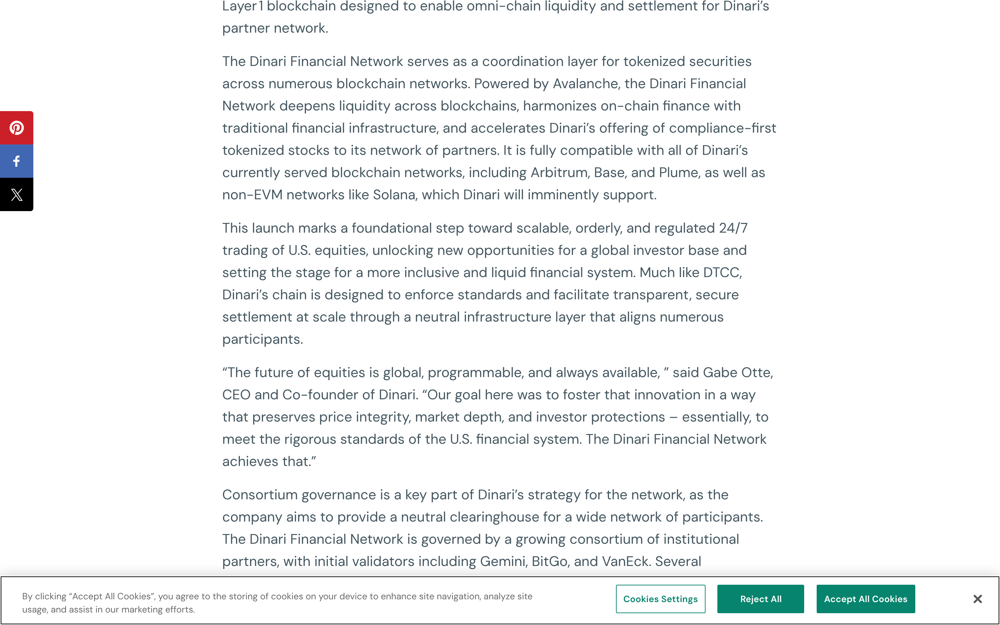
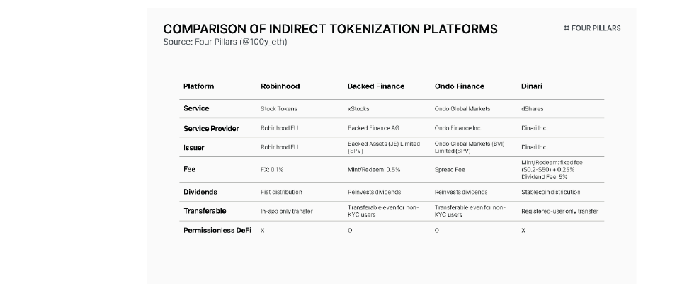

## 정체 카드
● 한 줄 정체 : 미국 주식, ETF와 1:1로 짝지은 토큰(미국판은 계좌 속 주식의 기록, 미국 밖판은 Dinari에 대한 청구권)을 ==증권사와 앱에 공급하는 회사== [F-0302][F-0116][F-0996][F-0997]
  ★ 유형 안 위치 : 미국 SEC 등록 명의개서대리인(은행이 아닌 곳) 273곳 → 그 유형의 하나(Dinari, Inc/TA 등록 신청서 2022-05 SEC 수리)이면서 증권사 Dinari Securities(FINRA 회원)도 둔 **주식 토큰 발행 겸 기록 회사** → 공식 순위 없음 → 2021년 설립 [F-1145][F-1237][F-0116][F-1053]
● 대표 상품 : dShares(Dinari의 주식 토큰 상품명, 미국판과 미국 밖판) = 실제 주식 1주에 토큰 1개를 짝지은 토큰 [F-0302][F-0996][F-0997]
  - 뜻 : 미국판 = 미국 거주자가 Dinari Securities 증권 계좌에 실제 주식을 소유하고, 토큰은 그 보유 내역을 블록체인에 따로 적어 둔 사본 기록(두 기록이 다르면 계좌 기록이 우선) [F-0996][F-0312]
  - 뜻 : 미국 밖판 = 미국 밖 투자자가 주식이 아니라, 기초 주식의 가치만큼 Dinari에 지급을 청구할 수 있는 권리를 보유 [F-0997]
● 꼭 알아야 할 사실
  ★ 제재 : 확인된 제재 없음. FINRA BrokerCheck(증권사 등록 조회 서비스)에 징계와 고객 분쟁 공시가 0건 [F-0119]
● 숫자
  ★ 주식 토큰 순위와 잔액 : 2026-11-16 rwa.xyz 토큰화 주식 플랫폼 표에서 발행 잔액 11위, 1,520만 달러로 시장 37.1억 달러의 0.41%. 1위 Binance 13.6억 달러의 약 1/90 [F-1027][F-1021][F-1028]
  ★ 공개 규모 : 회사 전체의 매출, 고객 수는 비공개라 발행 잔액과 종목 수로만 규모 확인 [F-1027][F-0339]
  ★ 종목 수 : 724종 이상(S&P 500 전체 포함) [F-0339]
● 흐름(미국판) : 미국 이용자 → Dinari Securities(증권사) → Alpaca(청산, 보관) [F-0319][F-0302][F-0315]
  - 뜻 : Alpaca = 미국 청산 증권사. 주문 집행, 청산과 결제, 증권과 현금 보관을 맡고 Dinari Securities는 계좌 개설, 신원 확인, 주문 접수를 맡음 [F-0315]
● 흐름(미국 밖판) : 이용자 → 파트너 앱(또는 위젯) → 발행 Dinari(Dinari, Inc.) → 보관 Alpaca [F-0332][F-0313][F-0303]

## 회사 개요와 확장 경로
● 주장 : 직접 판매 앱을 키우기보다 파트너 앱 공급으로 미국 밖에서 먼저 열고 증권사 등록으로 미국까지 넓혔으나, 발행 잔액은 아직 11위(0.41%) [F-0273][F-0116][F-0291][F-1027]
● 기본정보
  ★ 이용 국가 : 2025-05 기준 주식, ETF 100종 이상을 60개국 이상에서 제공한다고 회사가 밝힘(투자사 500 Global 게시도 같은 국가 수) [F-0281][F-0130]
● 지배구조(누가 무엇을 맡나)
  ★ Dinari, Inc. : 토큰을 만들고 파트너에 공급하는 기술 회사, 브로커딜러 아님. 명의개서대리인(주주 명부 관리 인가) 등록을 회사가 공식 발표 [F-0266][F-1055]
  ★ Dinari Securities, LLC : 미국에서 브로커리지(증권 중개)를 하는 유일한 법인, FINRA와 SIPC 회원 [F-0266][F-0116]
  ★ 투자자 : 2023 시드 1,000만 달러(500 Global 등 참여), 2025-05 시리즈 A 1,270만 달러(Hack VC 주도), 누적 2,265만 달러 [F-0275][F-0127][F-0279][F-0128][F-1393]
  ★ 상장 : 비상장 스타트업 [F-0128]
● 본업과 규모
  ★ 본업 : 실제 주식과 1:1 연동한 토큰(dShares)을 증권사, 파트너 앱에 공급하고 수수료를 받음. 주식 토큰이 곧 본업 [F-0302][F-0336]
  ★ 규모 변화 : 2026-01 초 300만 달러(7위, 점유율 0.37%) → 2026-11-16 1,520만 달러(11위, 0.41%), 5.1배이나 점유율은 거의 그대로 [TP-004][F-1027]
● 설립 목적과 비전
  ★ 문제의식 : 미국 밖 투자자는 복잡한 가입, 높은 비용, 분절된 인프라에 막힘 [F-0280]
  ★ 설립 이유(회사 주장) : 증권 계좌 보유율은 1% 미만이나 블록체인 지갑 보유율은 5%에서 10%에 이를 수 있어, 지갑으로 미국 주식에 접근하게 하면 더 많은 사람에게 닿는다고 봄 [F-0274]
● 앞으로의 그림(회사가 밝힌 계획)
  ★ 2026-07 Dinari Financial Network(DFN)를 증권사, 거래소, 발행사, 수탁사, 명의개서대리인을 표준 운영 모델로 잇는 틀로 재정의 [F-0287]
● 타깃 수요
  ★ 증권 계좌 없이 미국 주식을 사려는 미국 밖 개인(급여, 프리랜서 소득 이용자 등 파트너 앱 이용자) [F-0280][F-1085][F-1087]
  ★ 토큰 주식을 자기 서비스에 넣으려는 기업, 핀테크, 증권사 [F-0277][F-0288]
● 수익원
  ★ 파트너 API 접근료 월 2,000달러부터, 네트워크 수수료 주문당 0.20달러, USDT 환전 3bp, OTC 스프레드 통상 10bp까지. 거래 수수료는 받지 않음 [F-0336]
  - 뜻 : bp(베이시스포인트) = 0.01%. OTC = 거래소 밖에서 대량으로 하는 장외 거래, 스프레드 = 사는 가격과 파는 가격의 차이 [F-0336]
  ★ 주의 : 개인이 직접 쓸 때(미국 밖판, 2026-02 기준) 항목별 수수료 0.2달러에서 50달러, 주문당 0.25%에서 0.50%, 배당금의 5%를 회사가 수취(포필러스, Securitize 후원 보고서) [TP-118]
● 화면
    
  ★ 그림 해설 : 가입 화면, 724종 종목 목록, 주문 화면. 미국 거주 개인이 직접 쓰는 미국판 화면이며 미국 밖 이용자는 파트너 앱에서 같은 상품을 만남 [F-0339][F-0319][F-0332]

## 사업 범위와 넓힌 순서
● 주장 : 고객 접점은 파트너와 증권사에 맡기고, 회사는 토큰, 증권사 등록, 명의개서, 자체 블록체인 같은 인프라를 직접 갖추는 순서로 확장 [F-0273][F-0116][F-1131][F-0282]
● 자산(무엇을 어떤 순서로 더했나)
  - 뜻 : 줄 끝의 직접 = 회사가 스스로 출시, 등록, 구축, 위탁 = 청산과 보관을 다른 회사에 맡김, 제휴 = 다른 회사와 협력 [F-0273][F-0315][F-0288]
  ★ 2023-08 dShares(미국 밖판) : 직접 발행 [F-0273]
  ★ USD+ 국채 담보 달러 토큰 : 직접 발행 [F-0327]
  ★ 2025-06 증권사 : Dinari Securities 직접 등록 [F-0116]
  ★ 명의개서대리인 : Dinari, Inc. 직접 보유(회사 발표) [F-1055]
● 자산 보충(인프라)
  ★ 2025-08 Dinari Financial Network : 직접 구축 [F-0282]
  ★ 청산, 결제 : Alpaca 위탁 [F-0315]
  ★ 2026-07 증권사 업무(중개)와 수탁(자산 보관) : tZERO와 제휴해 제공 [F-0288]
● 고객(파트너에서 증권사로)
  ★ 2023-08 미국 밖 투자자 : 파트너 앱 경유 [F-0273][F-0332]
  ★ 2024-02 기업, 핀테크 : B2B API 직접 [F-0277]
  ★ 2026-07 증권사 : tZERO 제휴로 공급 [F-0288]
  ★ 2026-08 미국 적격 투자자, 사업자 : 직접 [F-1131]
● 시장(어느 나라로)
  ★ 2023-08 미국 밖 : dShares 직접 출시 [F-0273]
  ★ 2025-06 미국 : 증권사 직접 등록 [F-0116]
  ★ 2026-08 미국 판매 : 724종 직접 [F-1131]
  ★ 2026-09 한국 : 카카오페이증권 협약(제휴) [F-0131]
● 2024-02 B2B API와 위젯 : 직접 소매 앱 대신 파트너 공급 [F-0277][F-1204]
● 2026-07 tZERO 제휴 : 증권사 채널을 제휴로 확보 [F-0288][F-0289]
  - 뜻 : tZERO = 미국 토큰증권 회사. NYSE 운영사 ICE가 2022년 상당한 소수 지분 주주가 되었고, tZERO는 NYSE 토큰증권 플랫폼의 명의개서와 증권사 기능 설계 파트너(Finance Magnates 보도) [F-1402]
  ★ 왜 : 토큰 주식은 증권사가 전통 증권처럼 내놓아야 대중화 [F-0289]

## 경영진 발언
● 말하고 이룬 것(시점 순)
  ★ 2025-08-14 Otte(공동 창업자 겸 CEO) : 주식의 미래는 국경 없이 언제나 열려 있다 → 같은 날 Dinari Financial Network 출시, 2026-11 24시간 세션 9종목 [F-1035][F-0282][F-0343]
  ★ 2025-12-09 Otte : Flow Traders(시장조성사)와 함께 2026년 1분기부터 24시간 거래 제공 → 2026-11-16 24시간 세션 종목은 9개 [F-1036][F-0343]
  ★ 2026-07-08 Otte : 증권사가 토큰 주식을 자연스럽게 내놓아야 대중화 → 같은 날 tZERO 제휴, 2026-08 미국 내 증권사에 API 제공(Circle 제휴) [F-0289][F-0288][F-1131]
● 말하고 진행 중인 것
  ★ 2026-09-30 Otte : 한국 주식의 해외 접근이 비어 있다 → 카카오페이증권과 PoC, 연내 공동 TF 구성, 상용화 미정 [F-0299][F-0133]
  ★ 2026-11-05 Otte : 권리가 보존되는 토큰 주식(의결권 포함) → Broadridge 의결권 인프라 연동 [F-1038][F-0300]
● 발언 1 : 주식은 국경 없이 24시간 거래된다 [F-1035]
  ★ Gabe Otte(CEO), Dinari Financial Network 출시 발표, 2025-08-14, https://dinari.com/blog/dinari-launches-the-dinari-financial-network-a [F-1035]
    ① 원문 : "The future of equities is global, programmable, and always available."
    ② 번역 : 주식의 미래는 국경이 없고, 프로그래밍 가능하며, 언제나 열려 있다.
  
● 발언 2 : 증권사 채널이 커야 대중화된다 [F-0289]
  ★ Gabriel Otte(공동 창업자 겸 CEO), tZERO 제휴 발표, 2026-07-08, https://dinari.com/blog/dinari-and-tzero-partner [F-0289]
    ① 원문 : "Tokenized equities won't reach mainstream adoption until broker-dealers can offer them as naturally as they offer traditional securities."
    ② 번역 : 토큰 주식은 증권사가 전통 증권처럼 자연스럽게 내놓을 수 있어야 대중화된다.
  
● 발언 3 : 한국 주식의 해외 접근이 비어 있다 [F-0299]
  ★ Gabe Otte(CEO), 카카오페이증권 제휴 발표, 2026-09-30, https://dinari.com/blog/kakaopay-securities-and-dinari-partner-to-expand-global-access-to- [F-0299]
    ① 원문 : "Korea is home to some of the world's most important public companies, yet access to Korean equities remains limited for many investors outside the country."
    ② 번역 : 한국에는 세계적 상장사가 많지만, 한국 밖 투자자의 한국 주식 접근은 여전히 제한적이다.
  

## A 출신과 진입(주식 토큰 사업)
● 주장 : 처음부터 발행 프로그램과 판매 파트너를 함께 갖추고 증권 계좌 없는 미국 밖 투자자를 겨냥해 진입 [F-0276][F-0280][F-0273]
● 출신 : 토큰화 전문 회사, 2021년 설립 [F-1053]
● 진입 방식
  ★ 2023년 Arbitrum에 자체 발행 프로토콜 출시 [F-0276]

## B 상품 구조
● 주장 : 같은 dShares 이름이라도 미국판은 투자자가 주식을 소유하고, 미국 밖판은 소유권 없이 Dinari에 대한 채권만 가져 투자자 지위가 다름 [F-0996][F-0997][F-0312]
● 토큰의 법적 성격(우리 분류)
  ★ 우리 분류 : 미국판 제3자 보관형, 미국 밖판 연계증권 [F-0996][F-0997]
● 발행 주체와 보관
  ★ 미국판은 Dinari Securities(증권사 법인)가 계좌를 열어 주식을 보유시키고, 미국 밖판은 Dinari, Inc.가 토큰을 발행 [F-0302][F-0313]
  ★ 기초 주식은 Alpaca(미국 청산 증권사)가 투자자 명의가 아닌 Dinari 명의 계좌에 보관 [F-0303]
● 투자자 권리
  ★ 배당 자동 반영, 2026-11 의결권 행사 연동 [F-0346][F-0300]
● 평가
  ★ 유동성 분산 : dShares를 7개 블록체인에서 쓸 수 있어 체인별로 거래가 나뉠 수 있으나, 체인 간 주문과 정산 연결은 Dinari의 자체 체인 DFN이 맡는다고 회사가 설명 [F-0344][F-0282]
  ★ 블록체인 위 활용 : 배당은 USD+(국채 담보 달러 토큰)로 지급하고, 이용 제한 지역의 지갑으로 토큰을 옮기려 하면 토큰 코드가 차단 [F-0308][F-0270]

## C 최종 투자자
● 주장 : 이용 경로가 둘로 갈려, 미국 밖은 파트너 앱 이용자가 고객이고 미국은 Dinari Securities 계좌 보유자와 2026-08 이후 적격 투자자, 사업자가 고객 [F-0332][F-0319][F-1131]
● 대상
  ★ 미국 개인(만 18세 이상, 미국 거주, 개인 비사업용 단독 계좌) [F-0319]
  ★ 2026-08 미국판 출시 발표는 대상을 자격 있는 미국 투자자와 사업자(증권사 등)로 써 위 개인 자격과 표현이 다름. [F-1131][F-0319]
● 국적 및 지역 제한
  ★ 미국 밖판은 미국인 이용 불가, 이용 제한 국가 목록(캐나다 외 31개국)에 한국은 없으나 한국 개인이 실제로 쓸 수 있는지는 확인하지 못함 [F-0313][F-0341]

## D 유통과 접점
● 주장 : 이용자 접점을 파트너 앱 5곳(급여, 투자, 국경 간 금융, 금융 계정, 앱 내 주식 제공)에 맡기며, 사례 연구상 파트너별 거래대금은 수십만에서 수백만 달러 규모 [F-0332][F-0335][F-0347][F-0350][F-0351]
● 공급 방식(누구에게 서빙하는지)
  ★ 파트너 5곳(사례 연구, 기간과 집계 기준이 달라 합산하지 않음) : Cadana(급여 플랫폼, 100개국 이상 직원) 고객 거래대금 127만 달러 이상, Meru(중남미 프리랜서용 국경간 금융 앱) 440만 달러 이상, Fasset(앱 내 미국 주식 제공) 144만 달러 이상, Offramp(스테이블코인 잔고 계정) 29.3만 달러 이상, Eldora(동남아 투자 앱) [F-1085][F-0347][F-1087][F-0350][F-0349][F-1088][F-0351][F-1086]
● 거래 장소
  ★ 사용 블록체인 : Ethereum, Arbitrum, Avalanche, Base 등 7개 [F-0344]
● 가격과 유동성 장치
  ★ 가격 기준 : 기초 주식 주문을 Alpaca로 보내 최선집행(고객에게 가장 유리한 조건으로 체결할 의무, FINRA 규정) [F-0318]
  ★ 유동성 공급 : 미국 정규장 밖 시간에는 Flow Traders(시장조성사)가 호가를 냄 [F-1036]
  ★ 상환과 수렴 : 보유자가 토큰을 소각하면 Dinari가 직접 환매해 현금화하고, 토큰의 발행과 소각은 기초 주식 주문이 증권 계좌에서 체결 완료된 뒤에만 일어남 [F-0306][F-0326]
● 제3자 시각
  ★ 주의 : 토큰은 Dinari 등록 이용자끼리만 이전 가능(포필러스, Securitize 후원, 2026-02 기준) [TP-120]
  
  ★ 그림 해설 : 간접 방식 4개 플랫폼의 수수료, 거래 방식 비교표. 이 회사 : Dinari 열(미국 밖판 설명, 미국판 이전) [TP-120][F-0997]

## E 인가
● 주장 : 미국 증권사와 명의개서대리인은 직접 등록해 갖추고, 청산과 보관 업무는 Alpaca에 위탁해 미국 인가 범위를 좁혀 운영 [F-1055][F-0116][F-0315]
● 보유 인가와 법인(확보 방식과 시점)
  ★ 명의개서대리인 TA-1 : Dinari, Inc/TA가 2022-04 접수, 2022-05 SEC 수리 [F-1237][F-1055]
  - 뜻 : TA-1 = SEC에 내는 명의개서대리인 등록 신청서. 수리 = SEC가 신청서를 접수 처리함 [F-1237]
● 인가와 인수로 열린 것
  ★ 미국 밖 판매(인가가 계기가 아님) : 미국 인가 없이 Regulation S(미국 밖에서 미국인 아닌 사람에게 파는 증권은 미국 공모 등록 불요)로 2023-08 dShares 미국 밖판 출시, 미국인은 이용 불가 [F-0273][F-0313][US-17CFR-230.903-a]
  ★ 미국 개인과 사업자 판매(새로 연 것) : 그 전 dShares는 미국 밖판뿐이라 미국인 이용 불가 → 계기 2022-05 명의개서대리인 등록 신청서 SEC 수리, 2025-06-20 Dinari Securities 증권사 등록(FINRA 회원, 53개 주와 영토) → 그 뒤 2026-08-04 미국판 724종 출시, 미국 내 증권사에 API 제공. 투자자는 계좌 속 주식을 소유하고 토큰은 2차 기록 [F-0313][F-1237][F-0116][F-0120][F-1131][F-0996]
  ★ 파트너 앱 판매(파트너는 인가 불요) : Dinari가 브로커리지, 결제, 수탁, 규정 준수를 맡아 파트너 앱은 증권사 등록 없이 dShares를 판매 [F-0332][F-0335]
  ★ 청산과 보관(인가 없이 위탁) : 주문 집행, 청산, 결제, 보관은 Alpaca가 맡아 Dinari는 청산 인가 없이 운영 [F-0315]

## F 관계(해당 시)
● 주장 : 증권사 채널은 tZERO, 의결권 처리는 Broadridge처럼 이미 시장에 있는 회사의 기능을 빌려 증권사 시장에 진입 [F-0288][F-1038]
● 인수, 투자, 제휴
  ★ 2026-07 tZERO와 증권사용 운영 틀 제휴 [F-0288]
  ★ 2026-11 Broadridge와 의결권 인프라 연동 [F-1038]

## G 한국 접점(해당 시)
● 주장 : 카카오페이증권과 PoC(개념검증) 단계이며 상용화 여부는 PoC 결과, 감독당국 방향, 소비자 보호 원칙을 본 뒤 정한다고 밝힘 [F-0131][F-0133]
● 한국 회사와의 협약
  ★ 2026-09 카카오페이증권과 한국 주식 해외 유통 협약 [F-0131]
  ★ 카카오페이증권은 전날 Ondo와도 같은 취지의 MOU를 맺어 복수의 토큰화 회사와 병행 협력(한국 언론 교차 확인) [F-0136]
● 한국 주식 취급
  ★ 원주를 해외투자자 통합계좌(해외 투자자 여럿의 한국 주식을 증권사 한 계좌에 모아 보유하는 방식)로 조달하고, 원주와 토큰 1:1 발행, 상환 구조가 구현 가능한지 검증 [F-0132]

## 한국 시장과의 차이
● 주장 : 미국판은 미국 거주자 전용이라 한국 개인에게는 열리지 않음 [F-0319][F-0313]
● 규제
  ★ 가능했던 이유 : 미국 밖은 Regulation S(미국인이 아닌 사람에게 미국 밖에서 파는 증권은 미국 공모 등록 불요), 미국은 증권사 등록 [F-0313][F-0116][US-17CFR-230.903-a]
  ★ 한국 차이 : 미국판은 미국 거주 개인만, 한국 개인은 이용 불가 [F-0319]
● 규제 건의 포인트 : 증권사 계좌의 주식 기록을 정본으로 두고 블록체인 토큰을 그 사본 기록으로 쓰는 방식을 한국에서 인정할지 기준 정리 [F-0996][F-0312]

## 성과와 판단
● 주장 : 파트너 API와 증권사 직접 등록으로 공급 경로를 넓혔으나 규모는 아직 작음 [F-0332][F-0116][F-1027]
● 핵심 성공요인(KSF)
  ★ 가장 먼저 시작한 파트너 판매 : Dinari는 2023-08 미국 밖 판매를 시작했고 Kraken, Robinhood는 2025-06, Ondo는 2025-09에 출시. 약 2년 먼저 시작해 종목 20종(2023-12)에서 724종 이상(2026-11), 사례 연구에 나온 파트너 5곳 확보 [F-0273][F-1040][F-0221][F-0197][F-0275][F-0339][F-1085][F-0349]
    - 한계 : 먼저 시작했어도 잔액 점유율은 2026-01 초 0.37%에서 2026-11-16 0.41%로 거의 같고 순위는 7위에서 11위로 하락 [TP-004][F-1027]
    - 해석 : 파트너 API는 파트너가 고객을 데려와야 커지는 구조라, 선점이 잔액으로 곧바로 이어지지는 않았음 [F-0332][F-1027]
  ★ 증권사 직접 등록 : 2025-06-20 등록으로 Ondo의 Oasis Pro 인수(2025-10)보다 약 4개월 먼저 미국 증권사 자격을 갖춤. 2026-08 미국판 724종 출시, Ondo 미국 보관형은 2026-07 IVV, MU 2종으로 가동 시작 [F-0116][F-1216][F-1131][F-1128]
    - 결과 : 미국 투자자와 사업자 모두에게 파는 종목 폭에서 앞섬. 미국판 잔액 숫자는 공개되지 않음 [F-1131][F-1128]
● 제약과 리스크
  ★ dShares는 !!SIPC 보호 대상이 아님!! [F-0292]
    - 왜 : dShares는 Dinari Securities가 직접 보유하지 않아 증권사 파산 때 고객 계좌를 일정 한도로 보호하는 제도의 적용을 받지 못함. 투자자가 손실을 직접 부담 [F-0292]
  ★ 회사가 토큰 동결, 소각, 재발행 권한 보유 [F-0320]
    - 왜 : 규정 준수와 오류 시정 목적이나 회사 판단으로 토큰이 막히거나 되돌려질 수 있어 투자자가 자기 토큰을 완전히 통제하지 못함 [F-0320]
  ★ 청산, 보관을 Alpaca 한 곳에 위탁 [F-0315]
    - 왜 : Alpaca에 장애가 생기거나 계약이 끝나면 주문 집행, 결제, 보관이 함께 막힘(해석) [F-0315][F-0303]
  ★ 미국판 한도와 시간 : 하루 매수 한도 5,000달러, 거래시간 새벽 4시~밤 8시(ET), 주말 불가 [F-0314][F-0322]
    - 왜 : 24시간 거래라는 토큰의 장점이 미국판에서는 증권사 규정으로 제한되고 큰 금액 투자자는 매수 한도에 막힘(해석) [F-0314][F-0322]
  ★ 한국 MOU 상용화 미정 [F-0133]
● 제3자 평가
  ★ 평가 1(주의, 미국 밖판 설명이라 미국판에 옮기면 안 됨) : 포필러스(Securitize 후원), 주식 토큰화 보고서, 2026-02-23, 39쪽, https://4pillars.io/en/reports/2026-the-year-of-tokenized-stocks [TP-117]
    ① 원문 : "The operating model is almost identical to Robinhood’s Stock Tokens."
    ② 번역 : 운영 모델은 Robinhood의 Stock Tokens와 거의 같다.
  
  ★ 평가 3(주의, 분류가 우리와 다름) : CoinDesk Research(Bullish 의뢰), 발행사 안내서 비교표, 2026-09-29(2026-08 기준), 10쪽, https://www.coindesk.com/research/the-future-of-equity-ownership-an-issuer-s-guide-to-tokenized-equities [TP-119]
    ① 원문 : 표 칸 "Custodial tokenized equities", "Econ only", "Dinari-held", "SEC TA + FINRA BD"(Dinari 열)
    ② 번역 : 보관형, 경제적 권리만, 장부는 Dinari가 보유, SEC 명의개서대리인과 FINRA 증권사.
● KDX 시사점
  ★ 자산 : 토큰을 계좌 기록의 2차 기록으로 둠 [F-0996][F-0312]
    - 가져올 것 : 주식은 계좌에 두고 토큰은 그 기록을 반영하며, ==두 기록이 다르면 계좌 기록이 우선== [F-0312]
  ★ 고객 : 파트너와 증권사 경유 공급 [F-0277][F-0288]
    - 가져올 것 : 파트너가 증권사 등록 없이 단일 API로 토큰 주식을 제공하고 Dinari가 브로커리지, 결제, 수탁, 규정 준수를 처리하는 B2B 모델 [F-0332][F-0335]
    - 피할 것 : 증권사 채널 없이 직접 화면만으로 고객을 모으는 방식. CEO도 증권사 유통이 있어야 대중화된다고 봄 [F-0289]
    - 이유 : 파트너 API는 파트너가 고객을 데려와야 커지고, 사례 연구상 파트너별 거래대금도 수십만에서 수백만 달러대에 머묾(해석) [F-0347][F-0350][F-0351]
  ★ 시장 : 증권 계좌 없는 미국 밖 개인과 한국 주식의 해외 유통 [F-0280][F-0131]
    - 가져올 것 : 한국 상장주를 외국인 통합계좌로 조달해 1:1 발행하는 구조를 PoC로 검증 [F-0132]
    - 피할 것 : 미국판은 미국 거주 개인만 이용 가능해 한국 개인에게 열리지 않으므로 같은 상품을 한국 개인에게 그대로 소개 [F-0319][F-0341]
  ★ 거래 시설 운영 : 증권사와 명의개서 직접 등록, 청산과 보관 위탁 [F-1055][F-0116][F-0315]
    - 가져올 것 : 기록과 중개는 직접, 청산과 보관은 위탁하는 역할 분담 [F-0315]
