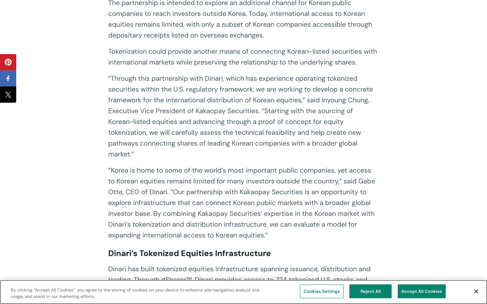
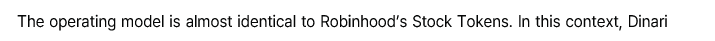
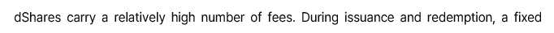

## 회사 개요와 확장 경로
● 주장 : 미국 밖 파트너 판매로 시작해 증권사 등록으로 미국까지 연 경로 [F-0273][F-0116][F-0291]
● 기본정보
  ★ 법인명 : Dinari, Inc.(기술 회사), Dinari Securities, LLC(미국 증권사) [F-0266]
  ★ 설립 : 2021년, 공동 창업자 3명 [F-1053][F-1054]
  ★ 창업자 : Otte(CEO), Rampenthal(CLO), Timothy(CTO) [F-1054]
  ★ 소재지 : 미국 뉴욕 [F-0260]
● 지배구조
  ★ 2023년 시드 1,000만 달러, 500 Global 등 [F-0275][F-0127]
  ★ 2025년 시리즈 A 1,270만 달러, Hack VC 주도 [F-0279]
● 설립 목적
  ★ 미션 : 누구나 어디서든 미국 주식에 즉시, 규정 지켜 접근 [F-1114]
  ★ 미국 밖 투자자의 복잡한 가입, 높은 비용 해소 [F-0280]
● 성장 경로(한 줄기)
  ★ 2021 설립 → 2023-08 미국 밖 판매 [F-1053][F-0273]
  ★ 2024-02 API 공급 [F-0277]
  ★ 2025-06 미국 증권사 등록 → 2026-08 미국 판매 724종 [F-0116][F-0291]
  ★ 2026-07 증권사 공급(tZERO) → 2026-09 한국 주식(카카오페이) [F-0288][F-0131]
● 화면
    

## 경영진 발언
● 발언 1 : 증권사 채널이 커야 대중화된다 [F-0289]
  ★ Gabriel Otte(공동 창업자 겸 CEO), tZERO 제휴 발표, 2026-07-08, https://dinari.com/blog/dinari-and-tzero-partner [F-0289]
    ① 원문 : "Tokenized equities won't reach mainstream adoption until broker-dealers can offer them as naturally as they offer traditional securities."
    ② 번역 : 토큰 주식은 증권사가 전통 증권처럼 자연스럽게 내놓을 수 있어야 대중화된다.
    ③ 해석 : 큰 곳은 증권사 유통. 그래서 발행, 보관, 청산을 묶어 증권사에 공급
  
● 발언 2 : 주식은 국경 없이 24시간 거래된다 [F-1035]
  ★ Gabe Otte(CEO), Dinari Financial Network 출시 발표, 2025-08-14, https://dinari.com/blog/dinari-launches-the-dinari-financial-network-a [F-1035]
    ① 원문 : "The future of equities is global, programmable, and always available."
    ② 번역 : 주식의 미래는 국경이 없고, 프로그래밍 가능하며, 언제나 열려 있다.
    ③ 해석 : 큰 곳은 24시간 글로벌 주식 시장. 그래서 자체 블록체인으로 주문과 결제 기반 구축
  
● 발언 3 : 한국 주식의 해외 접근이 비어 있다 [F-0299]
  ★ Gabe Otte(CEO), 카카오페이증권 제휴 발표, 2026-09-30, https://dinari.com/blog/kakaopay-securities-and-dinari-partner-to-expand-global-access-to- [F-0299]
    ① 원문 : "Korea is home to some of the world's most important public companies, yet access to Korean equities remains limited for many investors outside the country."
    ② 번역 : 한국에는 세계적 상장사가 많지만, 한국 밖 투자자의 한국 주식 접근은 여전히 제한적이다.
    ③ 해석 : 큰 곳은 한국 주식의 해외 수요. 그래서 국내 증권사와 원주 조달, 토큰화 모델 검증
  

## A 출신과 진입(주식 토큰 사업)
● 주장 : 남의 상품이 아니라 직접 만든 토큰으로 진입 [F-0276]
● 출신 : 토큰화 전문 회사, 2021년 설립 [F-1053]
● 진입 방식
  ★ 2023년 Arbitrum에 자체 발행 프로토콜 출시 [F-0276]
  ★ 진출 사유 : 증권 계좌 없는 미국 밖 투자자 접근 [F-0280]

## B 상품 구조
● 주장 : 미국판은 계좌 속 주식, 미국 밖판은 Dinari에 대한 청구권 [F-0996][F-0997]
● 토큰의 법적 성격(우리 분류)
  ★ 미국판 : 보유자가 계좌 속 주식 소유, 토큰은 2차 기록 [F-0996]
  ★ 미국 밖판 : 기초주 권리 없이 Dinari에 가치 청구권 [F-0997]
  ★ 우리 분류 : 미국판 제3자 보관형, 미국 밖판 연계증권 [F-0996][F-0997]
● 발행 주체와 보관
  ★ 미국판 증권사 법인, 미국 밖판 Dinari, Inc. [F-0302][F-0313]
  ★ Alpaca(미국 청산 증권사)가 Dinari 명의 계좌에 보관 [F-0303]
● 투자자 권리
  ★ 배당 자동 반영, 2026-11 의결권 행사 연동 [F-0346][F-0300]
● 규모(시장 내 위치)
  ★ 2026-11-16 발행 잔액 1,520만 달러, 11위(점유율 0.41%) [F-1027]
  ★ 1~3위는 Binance, Ondo, Kraken(13.6억, 9.0억, 6.8억 달러) [F-1021][F-1022][F-1023]
  ★ 종목 수 2023-12 20종에서 2026-11 724종 이상 [F-0275][F-0339]
● 규모 과거 대비
  ★ 2026-01 초 300만 달러 7위(0.37%) → 11-16 1,520만 11위(0.41%) [TP-004][F-1027]
  ★ 잔액 5.1배 [TP-004][F-1027]
  
● 수수료
  ★ 파트너 API 월 2,000달러부터, 주문당 0.20달러 [F-0336]
● 제3자 시각
  ★ 운영 모델이 Robinhood EU판과 거의 같음(포필러스, Securitize 후원, 2026-02 기준, 미국판 이전) [TP-117]
  ★ 개인 수수료 네트워크 0.2~50달러, 주문 0.25~0.50%(포필러스, Securitize 후원, 미국 밖판) [TP-118]
  ★ 배당의 5% 수취(포필러스, Securitize 후원, 미국 밖판) [TP-118]
  

## C 최종 투자자
● 주장 : 미국 밖 개인은 파트너 앱으로, 미국 개인은 직접 [F-0332][F-0319]
● 대상
  ★ 미국 개인(만 18세 이상, 미국 거주) [F-0319]
  ★ 미국 밖은 파트너 앱 이용자(아래 D) [F-0332]
● 국적 및 지역 제한
  ★ 미국 밖판은 미국인 불가, 미지원 31개국, 한국은 목록에 없음 [F-0313][F-0341]

## D 유통과 접점
● 주장 : 직접 화면보다 파트너 앱에 도매로 공급 [F-0332][F-0335]
● 공급 방식(누구에게 서빙하는지)
  ★ Cadana(급여 플랫폼) : 100개국 이상 직원, 계약자 [F-1085]
  ★ Eldora(투자 앱) : 동남아 개인 투자자 [F-1086]
  ★ Meru(국경간 금융 앱) : 중남미 프리랜서, 원격근무자 [F-1087]
  ★ Offramp(금융 계정) : 스테이블코인 잔고 이용자 [F-1088]
● 거래 장소
  ★ 사용 블록체인 : Ethereum, Arbitrum, Avalanche, Base 등 7개 [F-0344]
  ★ 24시간 거래 : 2025-12 Flow Traders(시장조성사)와 제휴 [F-1036]
● 제3자 시각
  ★ 토큰은 Dinari 등록 이용자끼리만 이전(포필러스, Securitize 후원, 2026-02 기준) [TP-120]
  ★ 배당은 USD+ 스테이블코인으로 지급(포필러스, Securitize 후원) [TP-120]
  

## E 인가
● 주장 : 증권사와 명의개서는 직접 등록, 청산과 보관은 위탁 [F-1055][F-0116][F-0315]
● 보유 인가와 법인(확보 방식과 시점)
  ★ 미국 증권사 : Dinari Securities, 2025-06-20 직접 등록 [F-0116]
  ★ 증권사는 FINRA 회원, 53개 주 등록 [F-0116][F-0120]
  ★ 명의개서대리인 : Dinari, Inc. 직접 보유(회사 발표) [F-1055]
● 제3자 시각
  ★ 표에 SEC 명의개서대리인, FINRA 증권사로 적힘(CoinDesk Research, Bullish 의뢰, 2026-08 기준) [TP-119]
  ★ 표는 Dinari를 보관형으로 묶어 우리 분류와 다름(CoinDesk Research) [TP-119]
● 인가 없는 구간을 메우는 방법
  ★ 청산, 결제, 보관은 Alpaca에 위탁 [F-0315]
● 미국 등록의 대가
  ★ 거래시간 새벽 4시~밤 8시(ET), 주말 불가 [F-0322]
  ★ 하루 매수 한도 5,000달러 [F-0314]
  ★ 토큰은 계좌 기록의 2차 기록, 계좌 기록이 우선 [F-0312]

## F 관계(해당 시)
● 주장 : 기존 인프라사와 손잡아 증권사 시장으로 [F-0288][F-1038]
● 인수, 투자, 제휴
  ★ 2026-07 tZERO와 증권사용 운영 틀 제휴 [F-0288]
  ★ 2026-11 Broadridge와 의결권 인프라 연동 [F-1038]

## G 한국 접점(해당 시)
● 주장 : 한국 주식을 해외로 내보내는 쪽에서 국내 증권사와 협력 [F-0131]
● 한국 회사와의 협약
  ★ 2026-09 카카오페이증권과 한국 주식 해외 유통 협약 [F-0131]
● 한국 주식 취급
  ★ 원주를 해외투자자 통합계좌로 조달, 1:1 발행 검증 [F-0132]

## 한국 시장과의 차이
● 주장 : 미국판은 미국 거주자 전용이라 한국 개인에게는 열리지 않음 [F-0319][F-0313]
● 규제
  ★ 가능했던 이유 : 미국 밖은 Regulation S, 미국은 증권사 등록 [F-0313][F-0116][US-17CFR-230.903-a]
  ★ 한국 차이 : 미국판은 미국 거주 개인만, 한국 개인은 이용 불가 [F-0319]
● 고객 수요
  ★ 가능했던 이유 : 증권 계좌 없는 미국 밖 투자자 수요 [F-0280]
● 규제 건의 포인트 : 계좌 속 주식을 토큰으로 기록하는 2차 기록 인정 [F-0996][F-0312]

## 성과와 판단
● 성과
  ★ 2026-11-16 잔액 1,520만 달러, 점유율 0.41%로 11위 [F-1027]
  ★ 종목 수 2023-12 20종에서 2026-11 724종 이상 [F-0275][F-0339]
● 핵심 성공요인(KSF)
  ★ 파트너가 등록 없이 붙는 API 공급, 종목 20종에서 724종 이상 [F-0332][F-0275][F-0339]
  ★ 증권사 직접 등록으로 미국 판매, 잔액 1,520만 달러 11위 [F-0116][F-1027]
● 제약과 리스크
  ★ dShares는 SIPC(미국 증권사 파산 보호) 대상 아님 [F-0292]
  ★ 회사가 토큰 동결, 소각, 재발행 권한 보유 [F-0320]
● 제3자 평가
  ★ 평가 1 : 포필러스(Securitize 후원), 주식 토큰화 보고서, 2026-02-23, 39쪽, https://4pillars.io/en/reports/2026-the-year-of-tokenized-stocks [TP-117]
    ① 원문 : "The operating model is almost identical to Robinhood’s Stock Tokens."
    ② 번역 : 운영 모델은 Robinhood의 Stock Tokens와 거의 같다.
    ③ 해석 : 2026-02 기준 미국 밖 dShares 설명으로 미국판(2026-08) 이전. 미국판은 계좌 속 주식 구조라 이 평가를 미국판에 옮기면 안 됨
  
  ★ 평가 2 : 포필러스(Securitize 후원), 주식 토큰화 보고서, 2026-02-23, 39쪽, https://4pillars.io/en/reports/2026-the-year-of-tokenized-stocks [TP-118]
    ① 원문 : "dShares carry a relatively high number of fees."
    ② 번역 : dShares는 수수료 항목이 비교적 많다.
    ③ 해석 : 개인 직접 이용 기준 수수료. 우리 본문의 파트너 API 요금(F-0336)과 대상이 다르므로 섞어 읽지 않음
  
  ★ 평가 3 : CoinDesk Research(Bullish 의뢰), 발행사 안내서 비교표, 2026-09-29(2026-08 기준), 10쪽, https://www.coindesk.com/research/the-future-of-equity-ownership-an-issuer-s-guide-to-tokenized-equities [TP-119]
    ① 원문 : 표 칸 "Custodial tokenized equities", "Econ only", "Dinari-held", "SEC TA + FINRA BD"(Dinari 열)
    ② 번역 : 보관형, 경제적 권리만, 장부는 Dinari가 보유, SEC 명의개서대리인과 FINRA 증권사.
    ③ 해석 : 발행사 직접 방식을 미는 의뢰사 표. 미국판과 미국 밖판을 한 열로 묶어 우리 분류(미국판 보관형, 밖판 연계증권)와 다름. 표 원문은 칸 글자라 캡처 없음
● KDX 시사점 1
  ★ 받치는 명제 : 시장 인프라 Unbundling [F-1055][F-0116][F-0315]
  ★ KDX가 가져올 것 : 기록, 중개는 직접, 청산, 보관은 위탁 [F-1055][F-0116][F-0315]
  ★ KDX가 피할 것 : 회사가 동결, 소각 권한을 쥔 토큰 구조 [F-0320]
● KDX 시사점 2
  ★ 받치는 명제 : Coopetition [F-0288][F-0131]
  ★ KDX가 가져올 것 : 기존 사업자(tZERO, 카카오페이증권)와 협력 [F-0288][F-0131]
  ★ KDX가 피할 것 : 증권사 채널 없이 직접 화면만 키우는 길 [F-0289]
● 해외 확장 세 질문
  ★ 제공 가치 : 한국 주식의 해외 접근 [F-0299]
  ★ 제도 : 원주를 해외투자자 통합계좌로 조달, 1:1 발행 검증 [F-0132]
  ★ 경제성 : 파트너 API 월 2,000달러부터, 주문당 0.20달러 [F-0336]
