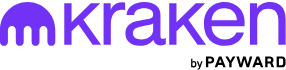
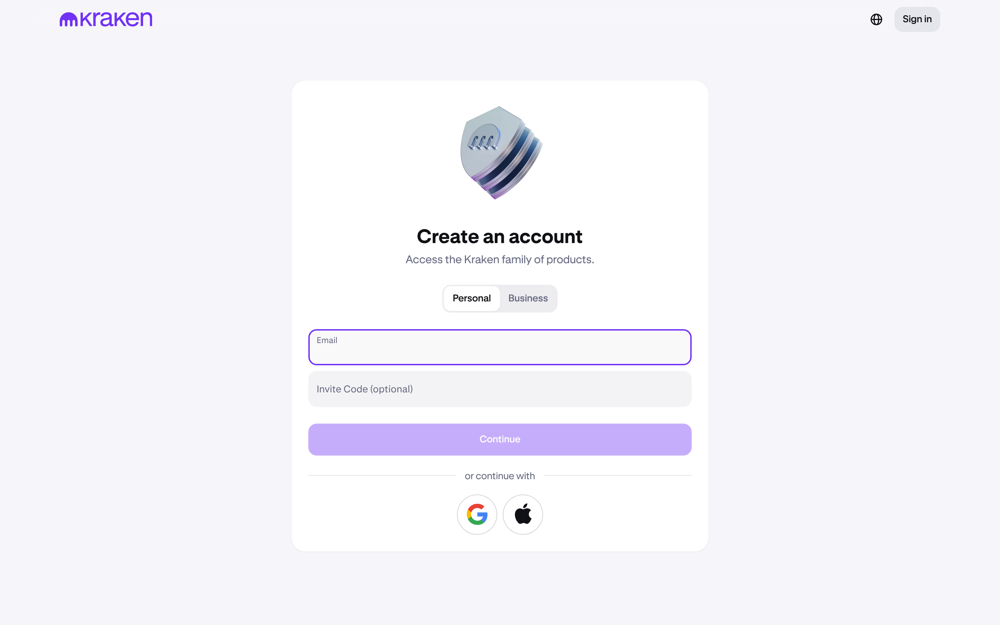
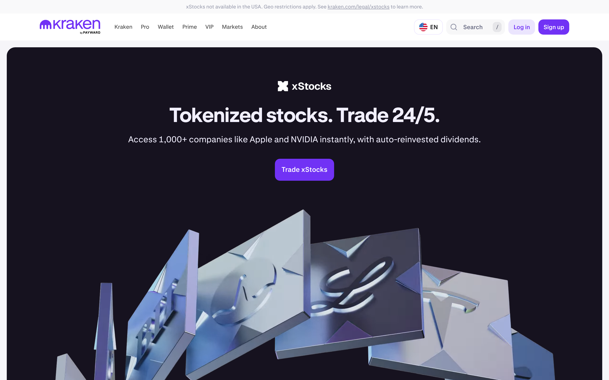
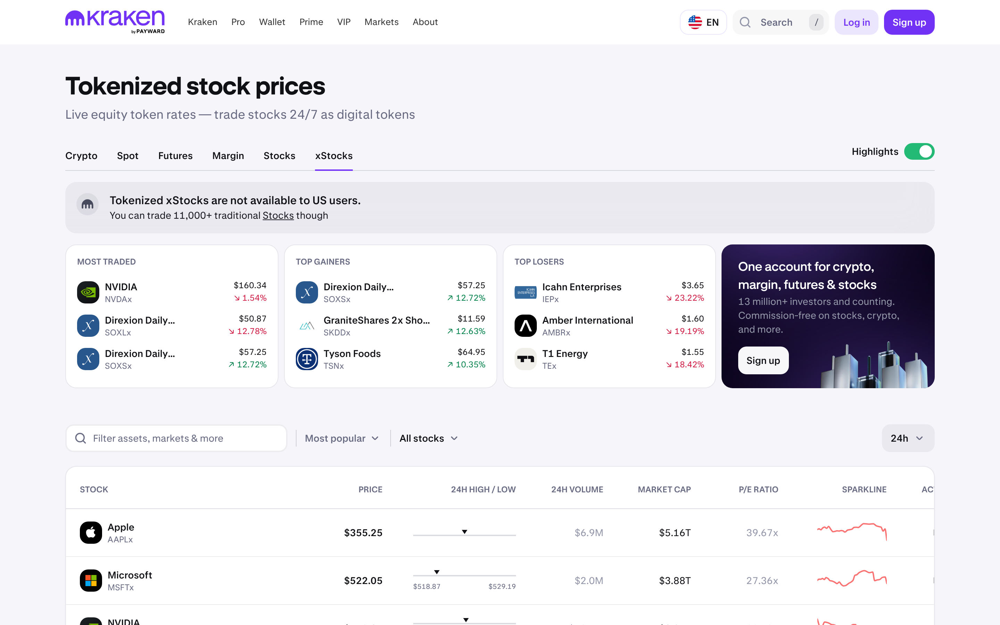
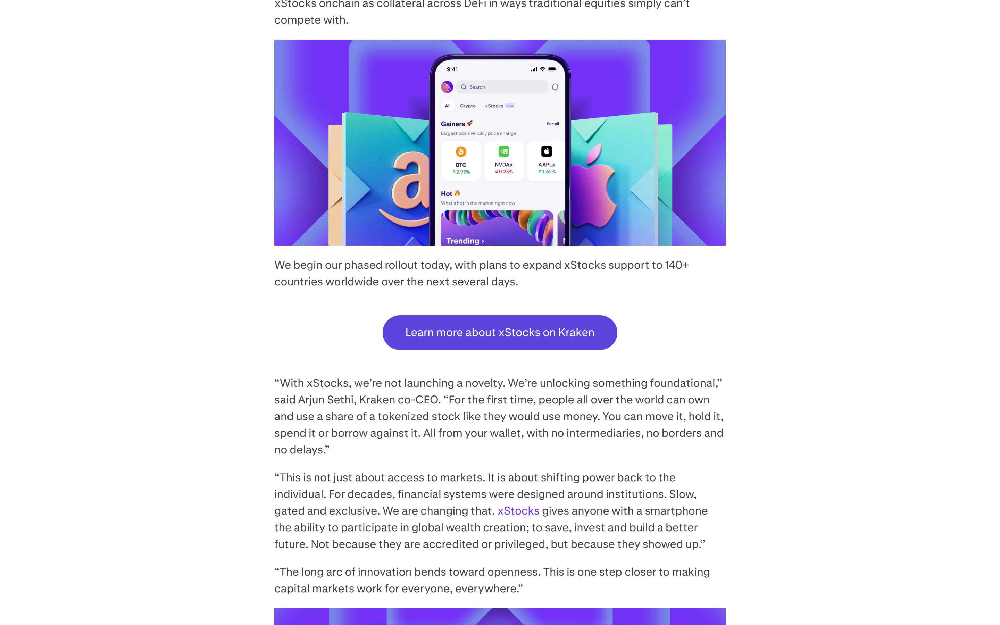
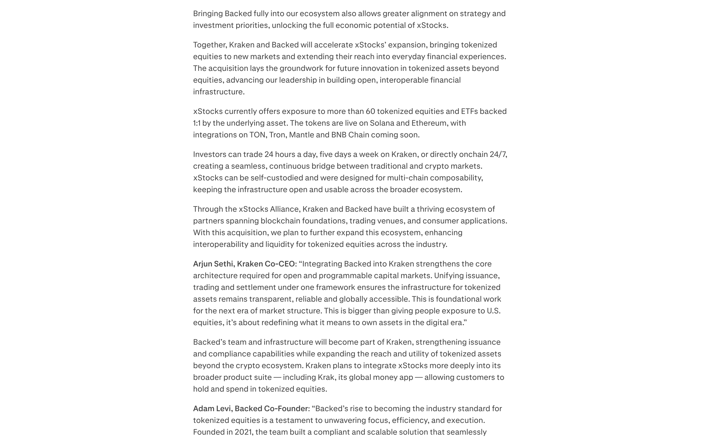
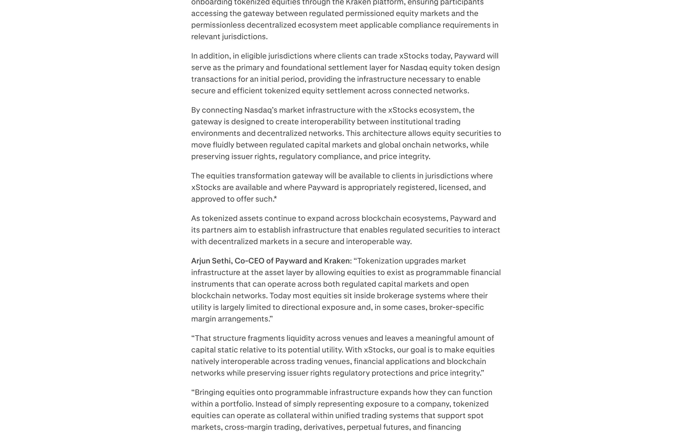
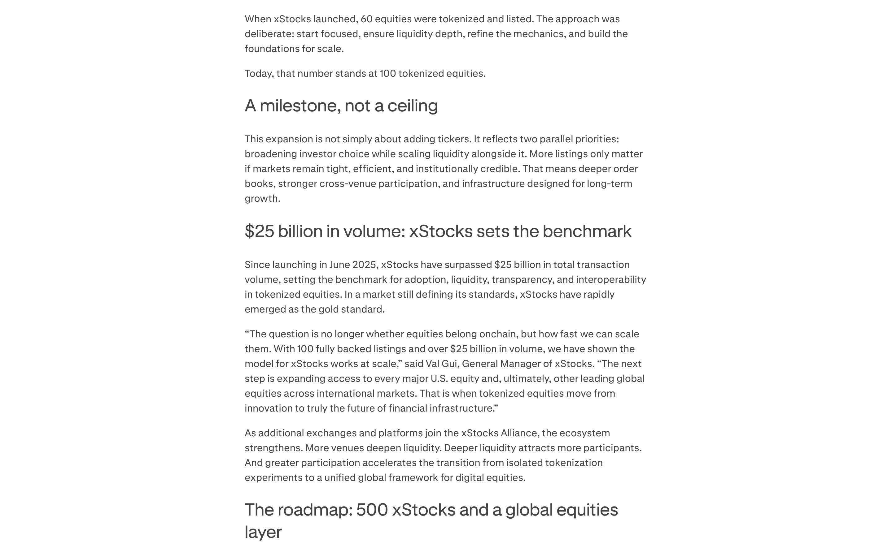

## 회사 개요와 확장 경로
● 주장 : 가상자산 거래소가 발행사를 사들여 주식 토큰 공급망을 직접 확보 [F-0389][F-0139][F-0939]
● 기본정보
  ★ 법인명 : Payward, Inc.(Kraken 거래소 모회사) [F-0359]
  ★ 소재지 : 미국 와이오밍주 Cheyenne [F-0360]
  ★ 핵심 상품 : xStocks(미국 주식, ETF 토큰), Kraken 앱 판매 [F-0389]
● 지배구조
  ★ Payward가 Kraken, NinjaTrader(미국 선물 중개사), xStocks 보유 [F-0176]
  ★ Payward 지분 25% 넘게 가진 개인 주주 없음 [F-0938]
  ★ 발행사 지분은 Payward 그룹이 100% 보유 [F-0938]
● 성장 경로(한 줄기)
  ★ 2025-05 NinjaTrader 인수 → 2025-06 미국 밖 출시 [F-0177][F-1040]
  ★ 2025-12 Backed(스위스 토큰화 회사) 인수 합의 → 2026-01 지분 100% [F-0139][F-0939]
  ★ 2026-07 홍콩, 영국, 유럽, 한국 확장 계획 발표 [F-0170]
  ★ 2026-11 영국, EU 상장주 200종 이상 배포 [F-0174]
● 화면
    

## 경영진 발언
● 발언 1 : 주식을 지갑에서 돈처럼 쓴다 [F-1040]
  ★ Arjun Sethi(Kraken 공동 CEO), Kraken 블로그 xStocks 출시 발표, 2025-06-30, https://blog.kraken.com/product/xstocks/tokenized-equities-now-available [F-1040]
    ① 원문 : "For the first time, people all over the world can own and use a share of a tokenized stock like they would use money."
    ② 번역 : 세계 어디서나 처음으로 토큰화 주식 한 주를 돈처럼 보유하고 쓸 수 있다.
    ③ 해석 : 큰 곳은 지갑 속 주식의 쓰임. 그래서 xStocks로 보유, 이동, 담보 사용 지원
  
● 발언 2 : 발행, 거래, 결제를 한 틀로 묶는다 [F-1043]
  ★ Arjun Sethi(Kraken 공동 CEO), Backed 인수 발표, 2025-12-02, https://blog.kraken.com/news/backed-acquisition [F-1043]
    ① 원문 : "Unifying issuance, trading and settlement under one framework ensures the infrastructure for tokenized assets remains transparent, reliable and globally accessible."
    ② 번역 : 발행, 거래, 결제를 한 틀로 묶으면 토큰화 자산 인프라가 투명하고 믿을 만하며 전 세계에서 접근 가능해진다.
    ③ 해석 : 큰 곳은 발행부터 결제까지의 수직 통합. 그래서 xStocks 발행사 Backed 인수
  
● 발언 3 : 규제 시장과 블록체인을 잇는다 [F-1044]
  ★ Arjun Sethi(Payward, Kraken 공동 CEO), Nasdaq(미국 증권거래소) 제휴 발표, 2026-03-09, https://blog.kraken.com/news/payward-partners-with-nasdaq [F-1044]
    ① 원문 : "With xStocks, our goal is to make equities natively interoperable across trading venues, financial applications and blockchain networks while preserving issuer rights regulatory protections and price integrity."
    ② 번역 : xStocks로 주식을 거래소, 금융 앱, 블록체인 사이에서 기본적으로 상호운용되게 하되 발행자 권리, 규제 보호, 가격 무결성을 지키는 것이 목표다.
    ③ 해석 : 큰 곳은 허가형 시장과 블록체인의 연결. 그래서 Nasdaq과 연결 통로 개발
  
● 발언 4 : 다음은 해외 주요 주식이다 [F-1045]
  ★ Val Gui(xStocks 총괄), Kraken 블로그 xStocks 100종 돌파, 2026-03-18, https://blog.kraken.com/product/xstocks/celebrating-100-xstocks [F-1045]
    ① 원문 : "The next step is expanding access to every major U.S. equity and, ultimately, other leading global equities across international markets."
    ② 번역 : 다음 단계는 모든 주요 미국 주식으로, 궁극적으로 해외 시장의 주요 주식으로 접근을 넓히는 것이다.
    ③ 해석 : 큰 곳은 미국 밖 상장주. 그래서 종목 수 확대와 각국 상장주 토큰화
  

## A 출신과 진입(주식 토큰 사업)
● 주장 : 남이 발행한 토큰을 앱에서 팔다가 발행사째 인수 [F-0390][F-0139]
● 출신 : 가상자산 거래소, Kraken 앱 안에서 주식 토큰 매매 [F-0389]
● 진입 방식
  ★ 발행은 Backed 법인, 판매는 Kraken 앱이 분담 [F-0390][F-0389]
  ★ 진출 사유 : 24시간 거래, 전 세계 2차 시장, 지갑 직접 보유 [F-0983]
  ★ Backed의 원장, 특허 등 지식재산 일체를 Payward로 이전 [F-0923]

## B 상품 구조
● 주장 : 투자자는 주식이 아니라 저지 발행사에 대한 상환 채권 보유 [F-0991]
● 토큰의 법적 성격(우리 분류)
  ★ 법적 보유 : 저지 발행사에 대한 상환금 채권 [F-0991]
  ★ 기초주식, 담보 자체에 대한 권리 없음 [F-0991]
  ★ 형식 : 스위스법 원장기반증권, 만기 없는 트래커 증서 [F-0945][F-0944]
  ★ 우리 분류 : 1:1 담보부 연계증권(발행사 채무형) [F-0991][F-0944]
● 발행 주체와 보관
  ★ 발행 : Backed 저지 법인, 2024년 설립 [F-0935]
  ★ 토큰 수만큼 기초주식을 담보로 1:1 보유 의무 [F-0955]
  ★ 보관 : InCore Bank(스위스 은행), Alpaca(미국 중개사), GTN Europe(영국 중개사) [F-0964]
  ★ 담보대리인이 투자자 직접 대리인으로 질권 보유 [F-0963]
● 투자자 권리
  ★ 배당은 현금 대신 토큰 수량 증가로 재투자 [F-0398]
  ★ 의결권 등 주주 권리 없음 [F-0399]
  ★ 상환은 현금, 가상자산 정산, 주식 인도 불가 [F-0950]
● 규모(시장 내 위치)
  ★ 2026-11-16 발행 잔액 6.8억 달러, 3위(점유율 18.26%) [F-1023]
  ★ 1, 2위는 Binance(가상자산 거래소), Ondo(토큰화 자산 회사)(13.6억, 9.0억 달러) [F-1021][F-1022]
  ★ 4위 Securitize(토큰화 플랫폼) 2.7억, 6위 Robinhood(주식 거래 앱) 1.5억 달러 [F-1024][F-1025]
  ★ 시장 전체 37.1억 달러 중 1~3위가 79% [F-1028][F-1021][F-1022][F-1023]
● 수수료
  ★ Kraken 앱 1달러부터, USDG, USD 매수 시 거래 수수료 없음 [F-0404]
  ★ 발행, 상환 수수료 상한 5%, 운용보수 연 5% 이내 [F-0977]
  ★ 운용보수는 토큰 수량 차감으로 반영 [F-0978]

## C 최종 투자자
● 주장 : 앱에서는 미국 밖 개인, 발행사 직접 청약은 전문투자자만 [F-0392][F-0975]
● 대상
  ★ Kraken 앱 : 선택된 국가의 미국 밖 개인 [F-0392]
  ★ 발행사 직접 청약 : 적격 전문투자자만 [F-0975]
  ★ 일반 투자자 : 승인 참가자(AP, 판매 중개 법인) 경유 [F-0975]
● 국적 및 지역 제한
  ★ 미국, 캐나다, 영국, 호주 이용 불가 [F-0393]
  ★ EU는 29개국 감독당국에 투자설명서 통지 [F-0976]
  ★ 스위스는 FinSA상 전문투자자에게만 제공 [F-0973]

## D 유통과 접점
● 주장 : 자체 앱 직접 판매에 외부 거래소, 지갑, API 파트너 유통을 더함 [F-0919][F-1083][F-0450]
● 공급 방식(누구에게 서빙하는지)
  ★ Kraken 앱 : 버뮤다, 키프로스 계열 법인이 AP로 개인에 판매 [F-0919][F-0920]
  ★ Bybit(가상자산 거래소), Jupiter(Solana 거래 앱) 파트너 [F-1083]
  ★ API 파트너 : 거래 앱에 xStocks 연결, 수수료 최대 50% 배분 [F-0450][F-0451]
  ★ GTN(해외주식 중개 인프라) : 인가 취득 후 자사 기관 고객에 제공 [F-1084]
● 거래 장소
  ★ 10개 이상 블록체인 발행, 외부 지갑 출금 가능 [F-0397][F-0402]
  ★ 거래시간 : EEA 평일 24시간, 그 밖 다수 지역 24/7 [F-0400][F-0401]
  ★ 발행사는 거래소, MTF 상장 신청 없음, 2차 시장 재매도 [F-0981]

## E 인가
● 주장 : 발행사는 감독 인가 없이, 판매는 규제 계열사로 한정 [F-0990][F-0919]
● 보유 인가와 법인
  ★ 버뮤다 PDSL : BMA 디지털자산 사업 인가, xStocks 판매 [F-0919]
  ★ 키프로스 법인 : MiFID II 투자회사 인가, EU 판매 [F-0156][F-0920]
  ★ 아일랜드 법인 : MiCA 가상자산사업자 인가 [F-0250][F-0251]
● 인가 없는 구간을 메우는 방법
  ★ 저지 JFSC가 AP, 브로커를 규제 금융회사로 한정 요구 [F-0990]
  ★ EU 공모는 리히텐슈타인 FMA 승인 투자설명서 [F-0918]
● 미국 미등록의 대가
  ★ 미국 증권법 미등록, 1차, 2차 시장 모두 미국인 판매 금지 [F-0971]
  ★ 미국 고객은 Kraken Securities(미국 증권사)로 실물 주식 거래 [F-0424][F-0422]
  ★ Kraken Securities는 미국에서만 등록 [F-0373][F-0242]

## F 관계(해당 시)
● 주장 : 기존 거래소, 중개 인프라와 손잡아 토큰을 제도권 시장에 연결 [F-0175][F-0173][F-0160]
● 인수, 투자, 제휴
  ★ 독일거래소 : 2026-02부터 360X(DLT 시범제도 거래장)에서 거래 [F-0175]
  ★ Nasdaq : 토큰 주식 연결 통로, Payward가 KYC와 결제 담당 [F-0160]
  ★ LSE(런던증권거래소) : 2026-09 런던 상위 100종 토큰화 합의 [F-0173]
  ★ GTN : 원주 집행, 보관, 원장 기록 담당 [F-0169][F-0172]

## G 한국 접점(해당 시)
● 주장 : 한국 상장자산은 GTN 제휴의 확장 대상 [F-0170]
● 한국 주식 취급
  ★ 홍콩 다음 확장 대상에 한국 상장자산 포함(규제 승인 조건) [F-0170]

## 한국 시장과의 차이
● 주장 : 해외는 역외 발행 구조로 열렸고, 한국은 권유 시 공모 규제 [F-0971][KR-자본시장법-119]
● 규제
  ★ 가능했던 이유 : 미국 밖 판매는 미국 등록 없는 역외 구조 [F-0971][US-17CFR-230.901]
  ★ 가능했던 이유 : EU는 투자설명서 승인 후 29개국 공모 [F-0918][F-0976]
  ★ 한국에서 막히는 지점 : 해외 발행 토큰은 국내 권유 시 증권신고서 [KR-자본시장법-119]
  ★ 한국에서 막히는 지점 : 장외거래소 토큰 유통 근거는 2027-02 시행 [KR-자본시장법-166]
● 고객 수요
  ★ 가능했던 이유 : 미국 밖 개인의 주말 포함 미국 주식 매매 [F-0392][F-0401]
  ★ 한국 차이 : 국내 투자자는 이미 증권사로 미국 주식 1,636억 달러 보관(2025말) [F-1005]
  ★ 한국 차이 : 2025-11 증권사 18곳이 미국 주식 주간거래 재개 [F-1010]

## 성과와 판단
● 성과
  ★ 상품 수 2025-12 60개 이상에서 2026-05 172개 [F-0144][F-0984]
● 핵심 성공요인(KSF)
  ★ 발행사 소유로 발행부터 판매까지 한 그룹 안에 [F-0938][F-0969]
  ★ 미국 밖 개인 대상이라 미국 등록 없이 24시간 판매 [F-0971][F-0401]
● 제약과 리스크
  ★ 발행사 존속이 Payward 지원에 의존, 채무 보증 없음 [F-0924][F-0986]
  ★ 발행사가 투자자 동의 없이 채무자 교체 가능 [F-0989]
  ★ 발행사가 30영업일 통지로 상품 해지 가능 [F-0949]
● KDX 시사점(스토리라인 명제별)
  ★ 시장 인프라 Unbundling : 발행은 자회사, 원주 보관은 은행, 증권사에 위탁 [F-0938][F-0964]
  ★ Borderless Investing : 증권 계좌 없이 지갑으로 미국 주식 보유 [F-0392][F-0402]
  ★ Coopetition : 독일거래소, LSE, Nasdaq과 토큰 거래 협력 [F-0175][F-0173][F-0160]
  ★ 해외 확장 세 질문 : 24시간 접근, 현지 공모 승인, 운용보수(제공 가치, 제도, 경제성) [F-0401][F-0918][F-0979]
