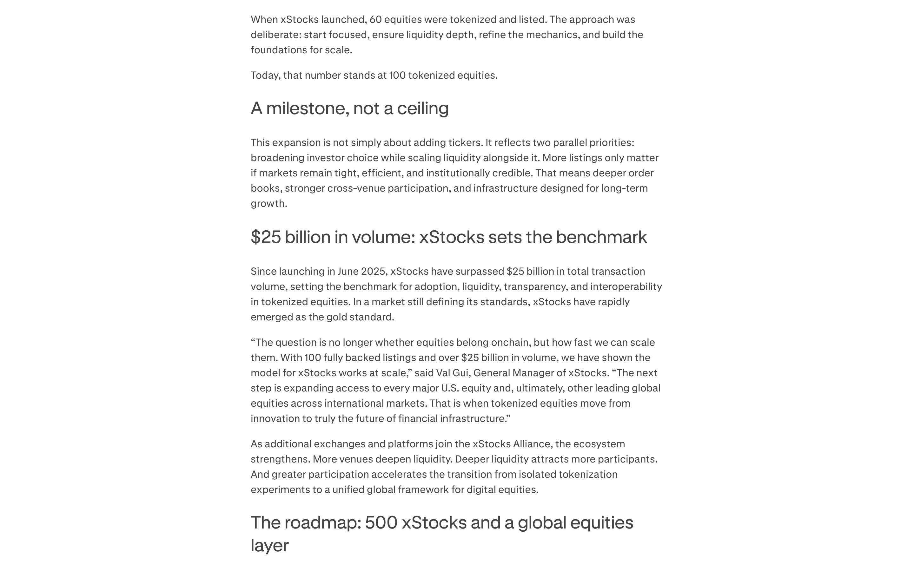
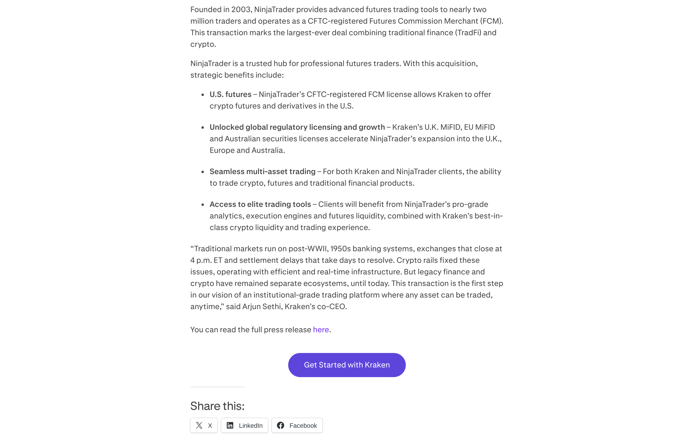
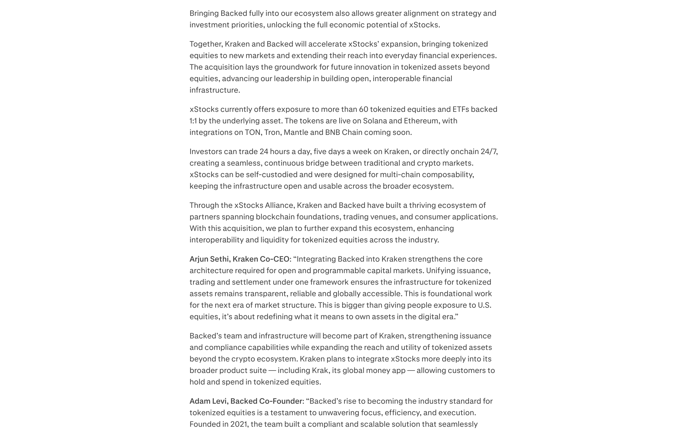

## 정체 카드
● 한 줄 정체 : 가상자산 거래소에서 ==선물, 주식 토큰, 은행까지 넓히는== 회사 [F-1109][F-0176]
  ★ 이름 구분 : Kraken은 거래소와 앱의 이름, 법인과 모회사는 Payward, Inc., 회사 숫자는 대부분 Payward 단위 [F-0176][F-0359][F-0180]
  ★ 유형 안 위치 : EU MiCA 가상자산사업자(CASP) 404곳(ESMA 임시 등록부, 2026-11-11 파일) → 그중 **가상자산 거래 플랫폼 운영** 서비스가 든 22곳의 하나(아일랜드 Payward Global Solutions) → 업계 현물 거래량의 6.5%(2026-09, 회사 발표), 공식 순위 없음 → 2011년 가상자산 거래소 출신 [F-1413][F-1414][F-1247][F-1109]
    - 뜻 : MiCA = EU의 가상자산시장 규정 [F-1413]
    - 뜻 : 거래 플랫폼 운영 = 여러 이용자의 가상자산 매매 주문을 한 시장에서 맞붙여 체결하는 서비스(거래소 업무). Coinbase, Robinhood의 EU 법인도 CASP이지만 이 서비스 코드는 없음 [F-1414]
    - 6.5%의 기준 : 회사가 업계 현물 거래량 대비로 낸 값(2025-09 3.3%)이라 감독기관 순위가 아님 [F-1247]
● 대표 상품 : xStocks = 미국 주식 1대1 담보 토큰, 미국인 판매 불가 [F-0390][F-0395][F-0971]
  - 뜻 : xStocks = 미국 상장 주식이나 ETF 한 주에 대응하는 블록체인 토큰. 기초 주식을 발행사가 1:1로 담보로 보유하지만 투자자가 갖는 것은 주식이 아니라 발행사에 대한 상환 청구권
● 꼭 알아야 할 사실
  ★ 발행사 소재지 : xStocks 발행사 Backed Assets (JE) Limited는 2024-01-19 저지에서 설립된 법인, 2026-01부터 Payward 그룹 100% 소유 [F-0935][F-0939]
    - 뜻 : 저지(Jersey) = 영국 해협의 영국 왕실 속령. 영국 본토 법이 아니라 자체 법과 금융감독청(JFSC)을 가진 역외 금융지역
  ★ 상장 : 비상장, 2025-11-19 SEC에 상장 서류 비공개 제출(회사 블로그) [F-1188]
    - 주주로 확인되는 곳 : Citadel Securities 전략 투자 2억 달러(2025-11), Nasdaq Ventures 1억 달러 투자 합의(2026-09), 독일거래소그룹 지분 1.5% 2억 달러(2026-04, 토큰포스트 보도) [F-1187][F-1119][F-1357]
  ★ 큰 인수 : NinjaTrader 15억, Small Exchange, Bitnomial, Backed, Reap(인수별 왜, 어떻게, 쓴 곳은 사업 범위 장 {kr-0255}) [F-1346][F-1116][F-1345][F-0939][F-1355]
    - 합계 : 공개된 인수 금액만 더해 최소 27.5억 달러(토큰포스트 보도), NinjaTrader 15억, Small Exchange 1억, Bitnomial 최대 5.5억, Reap 최대 6억 달러, Backed 금액은 비공개 [F-1355][F-0939]
  ★ 계획 : Payward 계열이 미국 개별 주식 10종의 무기한선물(만기 없는 선물)을 2026-09 감독기관에 서류 제출, 아직 출시 아님 [F-1189]
● 큰 사고와 제재 : 2023-02 SEC 스테이킹 합의 [CASE-003]
  ★ 무슨 일 : 2023-02-09 Kraken 법인 2곳이 SEC와 합의, 스테이킹 프로그램(광고 수익률 최대 연 21%)이 미등록 증권 공모인지가 쟁점 [CASE-003]
    - 뜻 : 스테이킹 = 보유한 가상자산을 네트워크 운영에 맡기고 보상을 받는 서비스
    - 결과 : 인정도 부인도 하지 않고 스테이킹 서비스 중단과 미등록 스테이킹 영구 금지에 동의, 총 3천만 달러 납부 [CASE-003]
  ★ 그 밖의 이력(위키백과 정리) : 2015-08 뉴욕 BitLicense 문제로 뉴욕 철수, 2021-09 CFTC 미등록 마진거래 125만 달러, 2022-11 OFAC 이란 제재 위반 36.2만 달러, 2024 호주 ASIC 소송 벌금 800만 호주달러 [F-1343]
● 숫자
  ★ 순위와 잔액 : 2026-11-16 3위, 6.8억 달러(rwa.xyz 발행 잔액 기준) [F-1023]
    - 1위와 차이 : 1위 Binance 13.6억 달러(점유율 36.62%), Kraken은 1위의 약 절반, 점유율 차이 18.4%p [F-1021][F-1023]
    - 비교 범위 : 표 전체 37.1억 달러 중 Kraken 18.26%, 이 표는 rwa.xyz가 집계한 플랫폼만이라 시장 전체가 아님 [F-1028][F-1023]
  ★ 고객 수 : 자금 계정 710만 개(2026-09-30, 중복 가능, 회사 발표) [F-1192]
    - 자금 계정의 정의 : 기간 마지막 날 잔고가 0보다 크고 거래할 수 있는 고객 계정 수, 한 고객이 여러 개를 가질 수 있어 고유 고객 수가 아님(회사 정의) [F-1248]
  ★ 종목 수 : 100종 돌파(2026-03, 회사 발표) [F-1045]
  ★ 기업가치 : 200억 달러(2025-11, 시티델 2억 달러 투자 기준, 회사 발표) [F-1187]
● 흐름 : 이용자 → Kraken 앱 → Backed(저지 발행사) → InCore, Alpaca(보관) [F-0392][F-0390][F-0964]
  ★ 1단계 판매 : 이용자는 Kraken 앱에서 주문, 판매 법인은 버뮤다 Payward Digital Solutions Ltd와 EU용 키프로스 Payward Europe Digital Solutions (CY) Ltd [F-0392][F-0919][F-0156]
    - 뜻 : 승인 참가자(AP) = 발행사와 계약해 토큰을 받아 투자자에게 파는 인가 금융회사, 위 두 법인이 이 계약을 맺은 Payward 그룹 법인 [F-0919][F-0968]
  ★ 2단계 발행 : 저지 Backed Assets (JE) Limited가 토큰을 발행하고 상환 의무를 짐 [F-0390][F-0991]
  ★ 3단계 보관 InCore Bank : 스위스 금융시장감독청(FINMA) 인가 은행, 스위스 쪽 담보 보관과 발행, 상환 대금 계좌, 브로커 역할 [F-0964][F-0967][F-0966]
  ★ 3단계 보관 Alpaca : 미국 쪽 보관기관(Alpaca Crypto LLC)과 미국 브로커(Alpaca Securities LLC, SEC 등록 브로커딜러) [F-0964][F-0966]

## 회사 개요와 확장 경로
● 주장 : 거래소가 인가와 발행사를 사들여 토큰 발행과 판매를 그룹 안에 확보, 보관은 외부 기관 [F-0389][F-0939][F-1118]
● 본업과 규모
  ★ 2026 Q3 총플랫폼마진(TPM) 4.87억 달러 : 전 분기 대비 +12%, 전년 동기 대비 -12%(회사 발표) [F-1245]
    - 뜻 : TPM = 매출에서 거래 비용, 자기 거래 손익, 고객에게 지급한 스테이킹 보상을 뺀 이익 지표(회사가 2026 Q3부터 조정 매출 대신 보고, 비GAAP)
    - 구성 : 거래 기반 2.34억, 자산 기반 1.28억, 접근 기반 1.25억 달러 [F-1245]
  ★ 거래량과 이익 : 2026 Q3 플랫폼 거래량 3,530억 달러, 조정 EBITDA 6천만 달러, 자금 계정 710만 개 [F-0180]
  ★ 지난 실적 : 2024년 매출 15억 달러(전년의 두 배, 위키백과), 2025년 조정 매출 22억 달러, 조정 EBITDA 5.31억 달러, 거래량 2조 달러(토큰포스트 보도), 2026 Q2 조정 매출 5.08억 달러(전년 대비 +17%, 코인데스크 한국어판 보도) [F-1341][F-1356][F-1353]
  ★ 주식 토큰의 크기 : xStocks가 TPM에서 차지하는 몫은 회사가 공개하지 않음, 운용자산 10억 달러(2026-10-27)와 누적 거래량 450억 달러는 별도 지표 [F-1246][F-0165][F-0166]
● 기본정보
  ★ 설립 : 2011-07, Jesse Powell 공동 설립 [F-1109]
    - 경영진 : 2023-04 Dave Ripley CEO와 Jesse Powell 이사회 의장, 2024-10 Arjun Sethi가 공동 CEO로 선임(위키백과) [F-1344]
● 지배구조
  ★ Payward가 Kraken, NinjaTrader(미국 선물 중개사), xStocks 보유 [F-0176]
    - Kraken만 보면 되는가 : 부족함. 분기 숫자(총플랫폼마진, 거래량, 자금 계정)가 Payward 단위로 발표되고 인수한 회사가 모두 Payward 아래에 있음 [F-0180][F-0176]
  ★ Payward 지분 25% 넘게 가진 개인 주주 없음 [F-0938]
  ★ 발행사(xStocks 토큰을 만드는 Backed) 지분은 Payward 그룹이 100% 보유, Kraken 앱과 법인이 다름 [F-0938]
    - 소유 사슬 : Payward, Inc.(미국) 100% → Payward Europe Limited(아일랜드) 100% → Backed Finance AG(스위스) → 발행사의 유일한 주주 [F-0938]
● 설립 목적과 앞으로의 그림
  ★ 미션 : 금융 자유와 포용을 세계에 가져오는 것 [F-1110]
  ★ 사업 틀(CEO 인터뷰) : Payward는 지주회사가 아니라 하나의 플랫폼, 하나의 대차대조표, 하나의 규제 체계이고 핵심은 원장 하나(one ledger), 사업 네 기둥은 거래, 은행, 자산관리, 기업용 인프라 Payward Services(코인데스크 한국어판 인터뷰) [F-1347][F-1364]
  ★ 회사가 밝힌 다음 계획(2026 Q3 보고) : Payward Services에 파생(DCM, DCO, FCM), 파트너 앱 내 임베디드 지갑, 파트너 자체 브랜드 xStocks 추가, 뱅킹은 연준 마스터 계정과 유럽 예금으로 빌린 레일을 소유한 레일로 교체, 자산관리는 xPO [F-1258][F-1259]
    - 뜻 : Payward Services = Kraken용으로 만든 인프라를 외부 은행, 핀테크, 가상자산 업체에 API로 파는 기업용 사업(아래 기업용 서비스 흐름). DCM, DCO, FCM = 사업 범위 장의 선물 인가 항목
  ★ 타깃 수요 : 미국 밖 개인의 주말 포함 미국 주식 매매, 펀드와 은행과 재무부서의 기관 거래, 파트너 기업의 인프라 이용 [F-0392][F-0401][F-0439][F-1257]
● 화면
    

## 사업 범위와 넓힌 순서
● 주장 : 선물 인가와 발행사를 사 모은 뒤 주식 토큰은 해외로 [F-1117][F-1118][F-0939]
● 자산(무엇을 어떤 순서로 더했나)
  ★ 2011 가상자산 거래소 : 직접 설립 [F-1109]
  ★ 2019-02 파생 : Crypto Facilities(영국 파생 거래 회사) 인수, 가상자산 선물 사업의 시작(위키백과) [F-1336][F-1367]
    - 뜻 : Crypto Facilities = 영국 FCA 규제를 받는 가상자산 파생상품 거래소이자 지수 회사 [F-1367]
    - 왜 : 고객이 현물과 파생상품을 한 곳에서 나란히 거래하게 하려는 목적(The Block 보도) [F-1367]
  ★ 2020-09 은행 인가 : Kraken Financial이 와이오밍 SPDI 인가, 미국에서 은행 인가를 받은 첫 가상자산 거래소(위키백과) [F-1337]
    - 뜻 : SPDI = 와이오밍주가 만든 특수목적 예금기관 은행 면허, 수탁 중심 [F-0377]
  ★ 2025-05 선물 : NinjaTrader 인수(FCM) [F-1117][F-0177]
    - 뜻 : FCM(선물중개업자) = 고객 선물 계좌를 맡아 주문을 넣는 회사. DCM(지정 계약시장) = 선물이 거래되는 거래소. DCO(파생상품 청산기구) = 거래 뒤 결제를 맡는 청산소. 셋 모두 미국 CFTC가 인가
  ★ 2025-10 파생 거래소 : Small Exchange 인수(DCM) [F-1116]
  ★ 2026-05 청산소 : Bitnomial 인수(DCM, DCO, FCM) [F-1118]
  ★ 이 순서의 이유 : 회사가 밝힌 목적은 활동을 미국 규제 안으로 가져오는 것과 인가 한 벌 [F-0178][F-1118]
    - 인수 기준(Sethi 인터뷰) : 쇼핑 목록 없이 인프라 공백을 메우고 고객이 원하는 역량인지 정량 틀로 판단, 사지 못하는 신뢰와 입지는 Nasdaq, LSE 같은 기존 기관과 제휴(코인데스크 한국어판) [F-1349]
● 자산 2(주식 토큰과 그 뒤)
  ★ 2025-06 주식 토큰 : xStocks 출시, Kraken 앱이 직접 판매 [F-1040]
  ★ 2025-12 발행사 : Backed 인수 합의, 2026-01 지분 100% [F-0139][F-0939]
  ★ 2026-09 지분 투자 : Nasdaq Ventures 1억 달러 [F-1119]
    - 쓴 곳 : Payward가 Nasdaq 시장감시 기술을 자사 모든 거래장에 도입, Nasdaq Equity Token 보유자의 KYC와 AML 온보딩과 초기 기본 정산 계층을 Payward Services가 맡음 [F-1255][F-0160]
    - 계획 : Nasdaq Equity Tokens는 2027년 2분기 출시 예상 [F-1119]
  ★ 계획 : xPO = 비상장 회사가 자기 주식을 xStocks로 온체인에서 처음 파는 공모, 규제 승인 필요 [F-0182]
    - 지금과 다른 점 : 현재 xStocks는 이미 상장된 미국 주식과 ETF를 담보로 하고, xPO는 비상장 회사가 새로 발행 [F-0182][F-1258]
● 고객(개인에서 기관으로)
  ★ Kraken 앱의 xStocks : 선택 국가의 미국 밖 개인, 직접 판매 [F-0392]
  ★ 2025-06 기관 Prime : 펀드, 은행 대상, 직접 [F-1159][F-0439]
  ★ 2026-07 GTN 제휴 : 기관 고객에 xStocks 제공 계획 [F-1084]
    - 뜻 : GTN = xStocks 기초 주식의 해외 집행, 수탁, 원장 기록을 맡고 시장별 인가를 받은 뒤 자기 기관 고객에게 xStocks를 제공할 해외주식 중개 인프라 회사 [F-1084]
● 시장(어느 나라로)
  ★ 2024-06 미국 : Kraken Securities 직접 등록 [F-0242]
  ★ 2025-04 버뮤다 : 직접 인가, xStocks 판매 계약 [F-0919]
    - 뜻 : 버뮤다 = 영국령 북대서양 섬으로 미국 땅이 아님, 금융감독기관 BMA가 디지털자산 사업을 인가
    - 새 인가가 필요한 이유 : 저지 감독청이 발행사에 승인 참가자와 브로커를 규제 받는 금융회사로 한정하라고 요구 [F-0990]
      - 왜 저지 감독청인가 : 발행사가 저지에 세운 법인이라 저지 감독청(JFSC)이 발행사의 감독기관이고, 발행사에 붙인 조건(거래 상대를 규제 금융회사로 한정)은 토큰이 어디서 팔리든 따라감. 저지는 영국 본토 법이 아닌 자체 법과 감독청을 가진 곳이라 영국 FCA가 아니라 JFSC가 나옴 [F-0990][F-0935]
    - 역할 : 일부 현물, 파생상품, 토큰화 주식(xStocks) 고객의 중개자이자 일부 선물의 거래장, EU 고객은 제외(회사 지원 페이지, 2026-11 갱신). xStocks는 EEA 밖 대부분 지역에서 24/7 거래 [F-1369][F-0401]
  ★ 2025-06 EU 아일랜드 : MiCA 직접 인가 [F-0250]
    - 가상자산이면 인가 없이 되는가 : 아님. EU에서 가상자산 거래도 MiCA 인가가 필요, 한편 주식 토큰은 가상자산이 아니라 증권이라 EU 투자설명서 규정과 키프로스 MiFID II 인가를 따로 거침 [F-0250][F-0148][F-0156]
      - EU에서 새로 연 것인가 : 아님. 이미 하던 국가별 등록 영업을 MiCA 단일 인가로 옮긴 것, 사업별 그 전과 그 뒤는 {kr-0721} [F-1438][F-1371]
  ★ 2026-05 EU 키프로스 : MiFID II 인가(2025-02 인수로 확보), AP 계약 [F-0156][F-0920][F-1370]
    - 뜻 : MiFID II = EU의 투자서비스 규정. 키프로스 투자회사로 인가를 받으면 EU 고객에게 증권 판매 가능
● 시장 2(제휴로 넓힘)
  ★ 2026-07 홍콩 : GTN 제휴, 홍콩 상장주 우선 [F-1084][F-0170]
  ★ 2026-11 영국, EU : 상장 200종 이상 xStocks 배포 [F-0174]
    - 2026-11-11 : 영국, EU 주식 200종 이상 추가(독일 DAX 40개 전부 포함), GTN이 체결과 수탁, xStocks 자산 11억 달러 이상(Payward 발표), 영국과 미국 투자자에게는 여전히 미제공 [F-1360]
    - LSE : 영국 대형 상장주 토큰을 2027년 LSE 24에 상장 추진, 규제 승인 필요 [F-1359][F-0173]
    - 뜻 : LSE 24 = 런던증권거래소(LSE)가 xStocks 거래를 지원하겠다고 밝힌 시장 이름 [F-0173]
  ★ 회사가 말한 순서 : 2026-03-18 xStocks 총괄이 모든 주요 미국 주식 다음에 해외 시장의 주요 주식으로 넓히겠다고 밝힘 [F-1045]
    ① 원문 : "The next step is expanding access to every major U.S. equity and, ultimately, other leading global equities across international markets."
    ② 번역 : 다음 단계는 모든 주요 미국 주식으로, 궁극적으로 해외 시장의 주요 주식으로 접근을 넓히는 것이다.
    ③ 해석 : 핵심은 미국 밖 상장주. 그래서 종목 수 확대와 각국 상장주 토큰화 [F-1045][F-0170]
  
● 2025-05 NinjaTrader 인수(15억 달러, 선물 중개) : 미국 선물 고객과 중개 인가를 한 번에 [F-1117][F-0177]
  ★ 왜 : 미국 선물 확대, 선두 소매 선물 플랫폼 인수(회사 발표) [F-1117]
    - 직접 세우지 않은 이유 : 미국 선물 중개업체를 처음부터 세우려면 기술과 규제 승인에 비용과 시간이 많이 들어서(Sethi, 코인데스크 한국어판) [F-1346][F-1365]
    - 이 회사에 해당하는 점 : 가상자산 선물은 이미 하던 사업이라 인수의 의미는 신규 진입이 아니라 미국 규제 안에서 선물을 제공할 인가와 미국 소매 선물 고객의 확보 [F-1336][F-0178][F-1117]
  ★ 어떻게 : 2025-03-20 계약 발표, 약 15억 달러(가격 조정 조건), 2025-05-01 완료 [F-1117][F-0177]
  ★ 쓴 곳 : 2026-09 서류의 개별주식 무기한선물에서 NinjaTrader Clearing이 고객 계좌를 맡는 역할 [F-1189]
● 2025-10 Small Exchange 인수(미국 선물 거래소, DCM) : 거래소 인가 확보 [F-1116]
  ★ 왜 : 회사는 CFTC 인가 지정 계약시장(DCM)을 인수했다고 발표, 미국 자체 파생상품 시장을 만들 기반 [F-1116]
  ★ 어떻게 : 2025-10-16 발표, IG Group에서 1억 달러 [F-1116]
  ★ 쓴 곳 : Small Exchange로 낸 별도 상품은 미발표, Bitnomial 인수 뒤 이 거래소의 쓰임도 미발표 [F-1116][F-1118]
● 2026-05 Bitnomial 인수(거래소, 청산소, 중개) : 미국 파생을 인가 한 벌로 [F-1118]
  ★ 왜 : 미국에서 현물 마진, 무기한선물, 옵션을 CFTC 규제 아래 제공 [F-1118]
    - 뜻 : 무기한선물 = 만기 없이 계속 보유할 수 있는 선물. 현물 마진 = 증거금을 얹어 가상자산 현물을 거래하는 방식
  ★ 어떻게 : 2026-04-17 발표, 2026-05-01 완료, 금액 5.5억 달러는 현금과 주식(코인데스크 한국어판 보도), Bitnomial은 기존 인가와 제3자 청산 구조를 유지한 채 그룹에서 운영 [F-1118][F-1345]
  ★ 쓴 곳 : 2026-09 Bitnomial 거래소에 올리려고 개별주식 무기한선물 10종 서류를 CFTC와 SEC에 제출 [F-1189]
    - 뜻 : 개별주식 무기한선물 = 만기가 없고 가격이 미국 개별 주식(TSLA, NVDA 등)을 따르는 선물. xStocks 토큰을 기초로 한 선물이 아니라 주식 가격을 따르는 선물 [F-1189]
● 2025-12 Backed 인수(xStocks 발행사) : 발행, 체결, 결제를 한 회사 안으로 [F-0139][F-0939]
  ★ 왜 : 발행, 거래, 결제를 한 틀로 묶어 투명하고 접근 가능하게(공동 CEO) [F-1043]
    - 인수 전 : 발행은 Backed(스위스에서 시작, 저지 발행 법인), 판매는 Kraken 앱으로 회사가 나뉘어 있었음 [F-1249][F-0390]
    - 인수 전 위치 : Backed는 2021년 설립, 약 71개 주식과 ETF를 토큰으로 발행, 인수 발표 당시 RWA.xyz 기준 토큰화 상장주식 2위(점유율 약 23%)(The Block 보도) [F-1372]
    - 이어지는 계획 : xStocks를 송금, 결제 앱 Krak에 더 깊이 넣어 토큰 주식을 보유하고 쓰게 함 [F-1251][F-0434]
  ★ 어떻게 : 2025-12-02 인수 합의 발표, 2026-01-05경 Payward Europe Limited가 Backed Finance AG 주식 100% 매입, 금액 미공개 [F-0139][F-0939][F-1372]
  ★ 쓴 곳 : 2026-01 지분 100%, 기술과 지식재산을 Payward로 이전 [F-0939][F-0923]
    - 이전 내용 : 2026-01-06 Backed Finance AG가 토큰화 주식 사업 관련 소프트웨어, 원장, 블록체인 기술, 특허, 상표 등을 Payward에 양도, 최초 대가 USDC 1,682.3만 개(구매가 배분 확정 때 조정) [F-0923]
  ★ 쓴 곳 : 발행사는 자체 직원과 기술 없이 Payward 그룹 인프라에 의존 [F-0970][F-0969]
    - 발행사 : 저지 특수목적 법인, 기술 인프라와 시스템과 운영 인력을 Payward 그룹이 제공, 이사는 관리대행사 Cavendish가 제공 [F-0970]
    - 계약 : Payward, Inc.와 2026-01-05 효력의 토큰화 서비스 계약, 조건이 독립당사자 간 거래가 아니라고 투자설명서가 명시 [F-0969]
    - 의미 : 서류상 채무자(발행사)와 실제 운영자(Payward)가 다름, 위험은 {kr-0127}
  ★ 해석 : 공급망은 한 회사로 모였으나 발행사 존속은 모회사 지원에 달림 [F-0970][F-0924]
● 2026-07 Reap 인수(카드, 스테이블코인 결제) : 거래에서 결제로 기업용 서비스 확대 [F-1195]
  ★ 왜 : 파트너가 카드 발급, 국경 간 결제, 재무관리를 API 하나로 [F-1195]
    - 뜻 : Reap = 스테이블코인 기반 카드 발급과 결제 인프라 회사, 인수 뒤 Reap 브랜드와 경영진 독립 유지 [F-1195][F-1256]
  ★ 어떻게 : 2026-05-07 발표, 2026-07-01 완료, 금액은 회사 발표에 없고 최대 6억 달러라는 보도가 있음(토큰포스트 보도), Reap 브랜드와 경영진 독립 유지 [F-1195][F-1256][F-1355]
  ★ 쓴 곳 : 기업용 Payward Services에 카드 발급과 결제 추가 [F-1195]
    - 인가 교차 : Reap의 기존 인가가 Payward의 아시아태평양(APAC)과 미주 확장을, Payward의 EU와 미국 인가가 Reap의 유럽과 미국 진출을 돕는다고 회사가 밝힘 [F-1256]
  ★ 해석 : 기업용 서비스를 거래에서 결제로 넓힘(Payward Services 전체는 아래 기업용 서비스 흐름) [F-1195]
    - 결제의 두 트랙 : 결제는 시스템 트랙(API, 장부, 정산망)과 인가 트랙(나라별 결제, 전자화폐, 은행 인가)이 함께 필요해 Reap의 기존 인가를 같이 확보 [F-1256][F-1254]
    - 가상자산 쪽과 인가 쪽 : 스테이블코인 정산은 인프라만 마련하면 넓힐 수 있으나 카드와 국경 간 송금은 나라별 인가가 따로 붙음 [F-1256]
● 2026-10 Saldo Bank 인수 계약(EU 은행) : 은행 계층까지 쌓는 계약, 종결 전 [F-1194]
  ★ 왜 : 은행이 되려는 것이 아니라 유럽 고객의 주 거래 금융기관 인프라(회사 발표) [F-1194]
    - 이미 쌓은 뱅킹 축 : 미국 연준 제한목적 마스터 계정, 아일랜드 중앙은행 EMI 라이선스, 대출 누적 20억 달러 초과 [F-1254]
  ★ 어떻게 : 2026-10-14 계약, 대상은 핀란드 지주회사 Saldo Finance Oy와 그 자회사인 리투아니아 인가 디지털 은행 [F-1194][F-1358]
  ★ 쓴 곳 : 종결은 2027 예상, 규제 승인 필요 [F-1194]
  ★ 계획 : 유럽 고객에 예금 이자, 대출, 결제, 카드, 중소기업 대출 제공, 현금과 가상자산과 토큰화 주식과 신용을 한 체계로 묶어 자산을 팔지 않고 담보로 빌리게 함(Sethi) [F-1358]
● 기업용 서비스 흐름(Prime, Embed, Payward Services, Reap, 뱅킹) : 개인 앱에서 기관과 파트너로 같은 인프라를 파는 줄기 [F-1339][F-1340][F-1350][F-1195]
  ★ 2024-03 Kraken Institutional : 기관 고객 전담 부문 출범(위키백과) [F-1339]
  ★ 2025-04 Embed : 금융회사용 거래 플랫폼, 첫 공개 연동 파트너는 네덜란드 디지털 은행 bunq(회사 발표) [F-1374]
  ★ Payward Services : Kraken용으로 만든 수탁, 유동성, 규제 준수, 위험관리, 결제와 정산을 외부 은행, 핀테크, 중개사, 가상자산 플랫폼에 API로 제공 [F-1350]
    - 이용 기업 수 : 최소 25개 기업이 이 인프라로 상품 개발 중이고 Hyperliquid 포함(Sethi, 코인데스크 한국어판) [F-1350][F-1366]
    - 사례 : OKX가 xStocks 기반 토큰화 주식 출시, 유럽에서 WOO X EU에 수탁과 인프라 제공 [F-1257]
  ★ 해석 : 개인 앱이 아니라 파트너를 통해 같은 장부와 인가를 재사용하는 구조이며 사업 네 기둥 중 하나로 CEO가 밝힘 [F-1347][F-1350]
● 해석 : 선물 인가를 사 모은 뒤 발행사, 결제, 은행까지 인수로 넓힘 [F-1118][F-0939][F-1194]
  ★ 선물부터 한 이유 : 가상자산 회사가 선물부터 간 것이 아니라 선물은 2019-02 Crypto Facilities 인수로 이미 하던 사업이고, 2025년 인수는 그것을 미국 규제 안으로 옮기는 단계 [F-1336][F-0178][F-1346][F-1367]
  ★ 확장 논리(회사 문장) : 모든 상품과 시장을 같은 매칭 엔진, 위험 엔진, 정산 핵심 위에 올려 다음 상품을 새로 짓지 않고 낼 수 있게 함 [F-0178][F-1258]
  ★ 단계 : 규제 안 파생 인가 → 발행사 → 결제 → 은행, 마지막은 빌려 쓰는 레일을 소유한 레일로 바꾸는 것 [F-1118][F-0939][F-1195][F-1259]

## 경영진 발언
● 주제 1, 선물과 미국 규제 안 거래 : 말한 뒤 인수로 실행 [F-1042][F-0177][F-1118]
  ★ 2025-03-20 발언 : Arjun Sethi(Kraken 공동 CEO), Kraken 블로그 NinjaTrader 인수 발표, https://blog.kraken.com/news/kraken-to-acquire-ninjatrader [F-1042]
    ① 원문 : "This transaction is the first step in our vision of an institutional-grade trading platform where any asset can be traded, anytime."
    ② 번역 : 이번 거래는 어떤 자산이든 언제든 거래할 수 있는 기관급 거래 플랫폼이라는 우리 구상의 첫 단계다.
    ③ 해석 : 핵심은 전통 시장과 암호화폐를 합친 기관급 플랫폼. 그래서 선물 중개 NinjaTrader 인수
  
  ★ 이룬 것 : 2025-05-01 NinjaTrader 완료, 2026-05-01 Bitnomial 완료 [F-0177][F-1118]
  ★ 진행 중 : 개별주식 무기한선물 10종(2026-09-18 서류), 온체인 무기한선물(2026-09-16 발표), 모두 규제 승인 필요 [F-1189][F-1190]
● 주제 2, 주식 토큰을 돈처럼 쓰게 하고 발행부터 결제까지 묶기 : 시점 순 [F-1040][F-1043]
  ★ 2025-06-30 발언 : 주식을 지갑에서 돈처럼 쓴다 [F-1040]
  ★ Arjun Sethi(Kraken 공동 CEO), Kraken 블로그 xStocks 출시 발표, 2025-06-30, https://blog.kraken.com/product/xstocks/tokenized-equities-now-available [F-1040]
    ① 원문 : "For the first time, people all over the world can own and use a share of a tokenized stock like they would use money."
    ② 번역 : 세계 어디서나 처음으로 토큰화 주식 한 주를 돈처럼 보유하고 쓸 수 있다.
    ③ 해석 : 핵심은 지갑 속 주식의 쓰임. 그래서 xStocks로 보유, 이동, 담보 사용 지원
  
  ★ 이룬 것 : 2025-06-30 60종 출시, 2026-10 누적 거래량 450억 달러 초과, 보유자 55만 초과 [F-1249][F-0166]
  ★ 2025-12-02 발언 : 발행, 거래, 결제를 한 틀로 묶는다 [F-1043]
  ★ Arjun Sethi(Kraken 공동 CEO), Backed 인수 발표, 2025-12-02, https://blog.kraken.com/news/backed-acquisition [F-1043]
    ① 원문 : "Unifying issuance, trading and settlement under one framework ensures the infrastructure for tokenized assets remains transparent, reliable and globally accessible."
    ② 번역 : 발행, 거래, 결제를 한 틀로 묶으면 토큰화 자산 인프라가 투명하고 믿을 만하며 전 세계에서 접근 가능해진다.
    ③ 해석 : 핵심은 발행부터 결제까지의 수직 통합. 그래서 xStocks 발행사 Backed 인수
  
  ★ 이룬 것 : 2026-01 Backed 지분 100%와 지식재산 이전 [F-0939][F-0923]
  ★ 진행 중 : xStocks를 Krak 앱에 더 깊이 넣는 계획, xPO, 파트너 자체 브랜드 xStocks [F-1251][F-0182][F-1258]
● 주제 3, 규제 시장과 블록체인 연결 : 시점 순 [F-1044][F-1119]
  ★ 2026-03-09 발언 : 규제 시장과 블록체인을 잇는다 [F-1044]
  ★ Arjun Sethi(Payward, Kraken 공동 CEO), Nasdaq(미국 증권거래소) 제휴 발표, 2026-03-09, https://blog.kraken.com/news/payward-partners-with-nasdaq [F-1044]
    ① 원문 : "With xStocks, our goal is to make equities natively interoperable across trading venues, financial applications and blockchain networks while preserving issuer rights regulatory protections and price integrity."
    ② 번역 : xStocks로 주식을 거래소, 금융 앱, 블록체인 사이에서 기본적으로 상호운용되게 하되 발행자 권리, 규제 보호, 가격 무결성을 지키는 것이 목표다.
    ③ 해석 : 핵심은 허가형 시장과 블록체인의 연결. 그래서 Nasdaq과 연결 통로 개발
  
  ★ 이룬 것 : 2026-02 독일거래소 360X에서 거래, 2026-09 Nasdaq Ventures 1억 달러 투자 [F-0175][F-1119]
  ★ 진행 중 : Nasdaq Equity Tokens 2027년 2분기 예상, LSE 24 xStocks 거래 2027년 추진, 모두 규제 승인 필요 [F-1119][F-1359]
● 발언 4 : 다음은 해외 주요 주식이다, 진행은 사업 범위 장 시장 2 {kr-0229} [F-1045][F-0170]
  ★ 2026-03-18 : xStocks 총괄 Val Gui, 모든 주요 미국 주식 다음은 해외 시장의 주요 주식(원문 {kr-0428}) [F-1045]
  ★ 한국 : 기한 미공개 [F-0171]
● 주제 4, 결제와 은행 : 시점 순 [F-1195][F-1254]
  ★ 2026-07-01 발언 : Arjun Sethi(Payward, Kraken 공동 CEO), Reap 인수 완료, https://www.payward.com/press-release/payward-reap-close [F-1195]
    ① 원문 : "With Reap, partners can issue cards, originate cross-border payments, and manage treasury against on-chain liquidity that settles in near real time, programmatically, through one API rather than a stack of correspondent banks and regional processors."
    ② 번역 : Reap으로 파트너는 카드 발급, 국경 간 결제, 거의 실시간 정산되는 온체인 유동성 기반 재무관리를 대리은행과 지역 처리업체를 여럿 거치지 않고 API 하나로 할 수 있다.
    ③ 해석 : 핵심은 거래에서 결제로. 그래서 Reap 인수와 Payward Services 확장
  ★ 2026-10-14 발언 : Arjun Sethi(Payward 공동 CEO), Saldo Bank 인수 계약, https://www.payward.com/press-release/payward-acquires-saldo-bank [F-1254]
    ① 원문 : "We are starting in the EU, and the ambition is global."
    ② 번역 : 우리는 EU에서 시작하지만 야망은 세계다.
    ③ 해석 : 핵심은 은행 축의 확대. 그래서 EU 은행 인가 확보 후 세계로
  ★ 이룬 것 : Reap 2026-07-01 완료, 은행은 2020-09 Kraken Financial SPDI 인가에서 이어짐 [F-1195][F-1337]
  ★ 진행 중 : Saldo Bank 종결 2027 예상, 규제 승인 필요 [F-1194]

## A 출신과 진입(주식 토큰 사업)
● 주장 : 남이 발행한 토큰을 앱에서 팔다가 발행사째 인수 [F-0390][F-0139]
● 출신 : 가상자산 거래소, Kraken 앱 안에서 주식 토큰 매매 [F-0389]
  ★ 실물 주식 거래 : 2023-09 미국 상장 주식과 ETF 거래 계획(블룸버그 보도), 2025-04 Alpaca와 함께 미국 4개 주에서 수수료 없는 주식 거래 시작(위키백과 정리), 지금 미국 고객은 11,000개 이상 주식과 ETF 거래 가능(Kraken 페이지 표기) [F-1338][F-0420]
  ★ 토큰화 흐름에서 출발 시점 : 남들보다 먼저 시작한 편, 비교와 결과는 KSF 1 {kr-0618} [F-0943][F-1249]
● 진입 방식
  ★ 발행은 Backed 법인, 판매는 Kraken 앱이 분담 [F-0390][F-0389]
    - Backed 누구 : 2021년 시작한 스위스 토큰화 증권 회사(공동창업자 Adam Levi, Roberto Klein), 2022-05 승인 투자설명서 이후 토큰화 증권 공모 계속 [F-1250][F-0145][F-0943]
  ★ 진출 사유 : 발행 투자설명서가 제시한 토큰화의 이점은 24시간 7일 거래, 전 세계 2차 시장(이미 발행된 토큰을 사고파는 시장), 비수탁 지갑에 직접 보유 [F-0983]

## B 상품 구조
● 주장 : 투자자는 주식이 아니라 저지 발행사에 대한 상환 채권 보유 [F-0991]
● 토큰의 법적 성격과 분류
  ★ 법적 보유 : 저지 발행사에 대한 상환금 채권 [F-0991]
  ★ 형식 : 스위스법 원장기반증권, 만기 없는 트래커 증서 [F-0945][F-0944]
    - 뜻 : 원장기반증권 = 블록체인 같은 분산 장부에 기록돼 그 기록으로만 이전되는 스위스법상 증권. 트래커 증서 = 기초자산(여기서는 주식) 가격을 따라가도록 만든 채무증서 [F-0945][F-0944]
  ★ 분류 : 1:1 담보부 연계증권(발행사 채무형) [F-0991][F-0944]
    - 뜻 : 연계증권 = 가치가 다른 자산(여기서는 주식)의 가격에 연동되는 발행사의 채무증권. 1:1 담보부 = 발행사가 토큰 수만큼 기초주식을 담보로 쌓아 둠 [F-0944][F-0955]
● 다른 회사와 유형 비교(원주 1:1 보유 여부)
  ★ Kraken xStocks : 발행사가 기초주식을 담보로 1:1 보유하지만 투자자는 원주가 아니라 발행사 채권을 가짐 [F-0955][F-0991]
  ★ Ondo : 기초 주식을 Alpaca와 BitGo Trust가 담보 계좌에 보관, Kraken과 같은 합성형 연계증권 [F-0189]
  ★ Binance bStocks : 규제 대상 수탁기관이 기초 주식 1주를 1:1로 보관, 보관형 [F-0049][F-0046]
  ★ Coinbase : 기초주식 지분의 수익권을 나타내는 ADGM 증서, 보관형 [F-0079]
  ★ Dinari 미국판 : 투자자가 증권사 계좌 속 주식 자체를 소유, 미국 밖판은 Dinari에 대한 기초자산 가치 청구권 [F-0996][F-0997]
  ★ 해석 : 기초주식 보관 여부보다 투자자가 법적으로 갖는 것(채권, 수익권, 주식 자체)이 유형을 가름 [F-0991][F-0996][F-0079]
    - 뜻 : 합성형 = 투자자가 주식이 아니라 발행사에 대한 채권이나 계약상 권리를 가진 유형. 보관형 = 수탁기관이 보관한 주식의 수익권을 투자자가 가진 유형 [F-0991][F-0995]
● 발행 주체와 보관
  ★ 토큰 수만큼 기초주식을 담보로 1:1 보유 의무 [F-0955]
  ★ 보관 : InCore Bank(스위스 은행), Alpaca(미국 중개사), GTN Europe(영국 중개사) [F-0964]
  ★ 담보대리인이 투자자 직접 대리인으로 질권 보유 [F-0963]
    - 뜻 : 담보대리인 = 투자자를 대신해 담보를 관리하고 실행하는 제3자(Security Agent Services AG). 질권 = 발행사가 갚지 못할 때 담보를 처분해 변제받을 권리 [F-0963]
● 투자자 권리
  ★ 배당은 현금 대신 토큰 수량 증가로 재투자 [F-0398]
  ★ 의결권 : 발행사 안내는 의결권 등 주주 권리를 주지 않음, 2026-08부터 보유자가 Broadridge를 통해 의결권 선호를 행사할 수 있다는 보도 [F-0399][F-1362]
  ★ 상환은 현금이나 가상자산으로 정산하고 기초주식의 실물 인도는 불가 [F-0950]
● 수수료
  ★ Kraken 앱 1달러부터, USDG, USD 매수 시 거래 수수료 없음 [F-0404]
    - 뜻 : 1달러부터 = xStocks 최소 투자액이 1달러. USDG = 달러 가치에 맞춘 스테이블코인. 다른 자산으로 사면 Instant Buy 수수료가 붙음 [F-0404]
  ★ 발행, 상환 수수료 상한 5%, 운용보수 연 5% 이내 [F-0977]
    - 상한의 뜻 : 5%는 투자설명서가 허용하는 최대치이고 실제 요율은 상품별 최종 조건이 정함, 발행 때 투자자 수수료는 기초 시장가의 최대 0.5% [F-0977][F-0978][F-0149]
  ★ 운용보수는 토큰 수량 차감으로 반영 [F-0978]
● 평가
  ★ 유동성 분산 : 10개 이상 체인 발행, 체인별로 호가가 나뉠 수 있음 [F-0397]
● 제3자 시각
  ★ 발행, 상환 수수료 0.5%, 보수 연 0.25% 도입 가능(포필러스, Securitize 후원, 문서 기재), 상한 5%와 별개인 실제 요율에 가까운 값 [TP-114][F-0977][F-0149]
  
  ★ 그림 해설 : 합성형 구조의 일반 개념도. 투자자가 플랫폼에 주문하면 토큰화 계약을 받고, 플랫폼은 거래소에서 주식을 사 수탁기관에 맡김. 회사 이름이 없는 개념도이며 xStocks에 대응하면 플랫폼은 Backed 발행사와 Kraken 앱, 수탁기관은 InCore와 Alpaca [TP-112][F-0964]

## C 최종 투자자
● 주장 : 앱에서는 미국 밖 개인, 발행사 직접 청약은 전문투자자만 [F-0392][F-0975]
  ★ 뜻 : 직접 청약 = 투자자가 판매 창구 없이 발행사 Backed와 직접 신규 발행분을 사는 것. 적격 전문투자자 = 금융상품 취급이 본업인 기관이나 자산과 위험 이해를 확인한 투자자 [F-0975][F-0974]
  ★ 앱 이용자는 직접 청약이 아님 : Kraken 앱 개인은 Kraken 그룹 법인(승인 참가자)을 거쳐 구매 [F-0919][F-0920]
● 국적 및 지역 제한
  ★ 주식 토큰만 해당, 미국, 캐나다, 영국, 호주 이용 불가 [F-0393]
    - 범위 : 이 제한은 토큰화 주식에 대한 문장이고 가상자산 거래 가능 지역과 별개 [F-0393][F-0157]
  ★ 스위스는 FinSA상 전문투자자에게만 제공 [F-0973]
    - 스위스와 EU가 자주 나오는 이유 : 이는 앱 판매 지역이 아니라 상품이 속한 법과 승인이 걸린 곳. 상품은 스위스법 증권, EU 공모는 리히텐슈타인 FMA 승인 투자설명서, 저지는 발행사 소재지 [F-0945][F-0942][F-0935]
● 제3자 시각
  ★ 결론 : 주의. 발행, 상환 단계만 본인확인(KYC)하고 이후 지갑끼리 하는 유통에는 본인확인이 없다는 정리(포필러스, Securitize 후원, 2026-02 기준) [TP-114]
    - 해석 : 이후 유통에서 미국인 금지 같은 제한은 약관의 양수인 자격 조건에 의존 [F-0971]

## D 유통과 접점
● 주장 : 자체 앱 직접 판매에 외부 거래소, 지갑, API 파트너 유통을 더함 [F-0919][F-1083][F-0450]
  ★ 인수 뒤부터 자기가 발행한 상품을 파는가 : 부분적으로 맞음. 인수 전에도 Kraken 앱이 Backed 상품을 팔았고(2025-06), 인수 후(2026-01)에는 발행사가 같은 그룹이라 자기 그룹 상품을 자기 앱과 외부에 팔게 됨 [F-1249][F-0939]
● 공급 방식(누구에게 서빙하는지)
  ★ Kraken 앱 : 버뮤다, 키프로스 계열 법인(Payward 그룹)이 AP로 개인에 판매 [F-0919][F-0920]
  ★ Bybit(가상자산 거래소), Jupiter(Solana 거래 앱) 파트너 [F-1083]
  ★ API 파트너 : 거래 앱에 xStocks 연결, 수수료 최대 50% 배분 [F-0450][F-0451]
  ★ GTN(해외주식 중개 인프라) : 인가 취득 후 자사 기관 고객에 제공 [F-1084]
● 거래 장소
  ★ 10개 이상 블록체인 발행, 외부 지갑 출금 가능 [F-0397][F-0402]
  ★ 거래시간 : EEA 평일 24시간, 그 밖 다수 지역 24/7 [F-0400][F-0401]
  ★ 발행사는 거래소, MTF 상장 신청 없음, 2차 시장 재매도 [F-0981]
    - 뜻 : 발행사(Backed 저지 법인)는 어떤 거래소나 다자간 거래시설(MTF, 여러 참가자의 주문을 맞추는 시장)에도 상장 신청을 하지 않고, 투자자는 2차 시장(이미 나온 토큰을 사고파는 시장)에서 제3자나 승인 참가자에게 재매도 [F-0981]
● 가격과 유동성 장치
  ★ 가격 기준 : 기초주식 가격 1:1 추종, 상환액은 기초 시장가 [F-0954][F-0149]
  ★ 유동성 공급 : 발행사 지정 시장조성자와 승인 참가자 [F-0982][F-0968]
    - 뜻 : 시장조성자 = 사려는 가격과 팔려는 가격을 항상 내 주는 회사. 발행사가 지정할 권리는 있으나 의무는 아니고 지정 결과는 웹사이트에 공지 [F-0982]
  ★ 상환과 수렴 : 매 영업일 상환, 발행사나 승인 참가자에 매도 [F-0982][F-0975]
    - 뜻 : 상환 = 토큰을 발행사나 승인 참가자에게 되팔아 현금이나 가상자산으로 돌려받는 것, 대금은 환매 접수 뒤 최대 5영업일(T+5)까지 지급 [F-0982][F-0950]
    - 해석 : 토큰 가격이 기초주식 가격에서 벌어지면 상환 통로로 되돌릴 수 있어 가격이 원주 가격 근처에 묶이는 장치 [F-0954][F-0975]
● 제3자 시각
  ★ 결론 : 주의. 미국장 휴장 때 토큰 가격이 원주와 벌어질 수 있다고 xStocks 자신의 문서가 밝힘(CoinDesk Research, Bullish 의뢰, 2026-08 기준) [TP-112]
    - 누가 잃을 수 있나 : 휴장 중 24시간 거래로 토큰을 산 투자자가 개장 뒤 원주 가격과의 차이를 손익으로 떠안음 [TP-112][F-0401]
  
  ★ 이 회사 칸 : Backed Finance 열이 Kraken, 서비스 xStocks, 발행사 Backed Assets (JE) Limited, 발행과 상환 수수료 0.5%, 배당 재투자, KYC 안 한 사용자 간에도 이전 가능, 무허가 DeFi 사용 가능. Binance는 이 표에 없음 [TP-114]
  ★ 인사이트 : Backed와 Ondo는 무허가 DeFi 사용이 가능하고 Robinhood와 Dinari는 앱 안이나 등록 사용자 간 이전만 가능한 점이 xStocks의 외부 유통 확장성의 근거 [TP-114][F-0402]

## E 인가
● 주장 : 발행사는 금융 인가 대상이 아니고(저지 동의만 받음) 판매는 인가 받은 그룹 법인이 맡고 미국 파생 인가는 인수로 확보 [F-0990][F-0919][F-1118]
● 인가와 인수로 열린 것 : 사업마다 그 전, 계기, 그 뒤 순서이고 새로 연 것과 이미 하던 영업을 규제에 맞춘 것을 나눔 [F-1438][F-1440][F-0177][F-1439]
  ★ EU 가상자산(규제에 맞춘 것) : 그 전 MiCA 이전부터 아일랜드, 벨기에, 프랑스, 이탈리아, 네덜란드, 폴란드, 스페인의 국가별 가상자산사업자 등록으로 영업(2013년 첫 BTC/EUR 거래쌍) → 계기 2025-06 아일랜드 중앙은행 MiCA 인가 → 그 뒤 국가별 등록을 EU 전역 단일 인가로 바꾸고 EEA 30개국 영업권 [F-1438][F-0250][F-0251][F-1371]
    - 왜 바꿔야 했나 : MiCA는 2024-12-30 발효, 경과 기간이 끝난 2026-07-01부터 인가가 없으면 EU 영업을 멈춰야 함 [F-1440]
  ★ EU 주식 토큰과 파생(증권 판매 경로를 새로 연 것) : 그 전 주식 토큰은 가상자산이 아니라 증권(EU 투자설명서 규정상 토큰화 증권)이라 증권 판매 인가가 따로 필요 → 계기 2025-02 키프로스 투자회사 인수로 MiFID 인가 → 그 뒤 2025-05-20 유럽 규제 가상자산 파생상품 출시(위키백과), 2026-05-04 발행사와 AP 계약으로 xStocks EU 판매 법인 [F-0148][F-1370][F-1342][F-0920]
  ★ 버뮤다(새로 연 것) : 계기 BMA Class F 디지털자산 사업 인가 → 그 뒤 2024-10 BMA 인가 파생상품 거래장 출범(200개 넘는 계약), 2025-04-28 xStocks AP 계약으로 미국 밖 판매 법인, EU 고객은 제외 [F-1368][F-0919][F-1369]
  ★ 미국 가상자산 선물(인수로 새로 연 것) : 그 전 미국 고객용 선물 없음, 2019-02 인수한 Crypto Facilities는 영국 FCA 규제를 받는 미국 밖 고객용 → 계기 2025-05 NinjaTrader(FCM) 인수 완료 → 그 뒤 2025-07 미국 고객에게 CME 상장 가상자산 선물 제공 시작 [F-1367][F-1336][F-0177][F-1117][F-1439]
    - 이어서 : 2025-10 Small Exchange(DCM) 인수, 2026-05 Bitnomial(FCM, DCM, DCO) 인수로 거래소와 청산소까지 갖추고 2026-05 미국 첫 CFTC 규제 무기한선물 출시 예고 [F-1116][F-1118][F-1439]
  ★ 미국 주식(새로 연 것) : 계기 2024-06 Kraken Securities SEC 브로커딜러 등록 → 그 뒤 2025-04 Alpaca와 함께 미국 4개 주에서 수수료 없는 주식 거래 시작(위키백과), 지금 미국 고객은 실물 주식과 ETF 거래 [F-0242][F-1338][F-0420]
  ★ 주식 토큰 발행(인수로 새로 가진 것) : 그 전 Kraken 앱은 Backed가 만든 xStocks의 판매처 → 계기 2025-12 Backed 인수 합의, 2026-01 지분 100% → 그 뒤 발행과 판매가 한 그룹, 파트너 자체 브랜드 xStocks 계획 [F-1249][F-0939][F-1258]
● 인가 없는 구간을 메우는 방법
  ★ 저지 JFSC가 AP, 브로커를 규제 금융회사로 한정 요구 [F-0990]
  ★ EU 공모는 리히텐슈타인 FMA 승인 투자설명서 [F-0918]
● 미국 미등록의 대가
  ★ xStocks는 미국 증권법에 등록하지 않아 발행 단계와 2차 시장 모두 미국인에게 팔 수 없음 [F-0971]
  ★ 미국 고객은 Kraken Securities로 실물 주식 거래 [F-0424][F-0422]

## F 관계(해당 시)
● 주장 : 파생 인가는 사들이고, 거래소와 중개 인프라는 손잡는다 [F-1118][F-1119][F-0175]
● 인수(미국 파생) : NinjaTrader, Small Exchange, Bitnomial, 인수별 왜와 쓴 곳은 사업 범위 장 {kr-0255}{kr-0442}{kr-0259}
● 투자, 제휴
  ★ 독일거래소 : 2026-02부터 360X(DLT 시범제도 거래장)에서 거래 [F-0175]
  ★ 자산관리 제휴 : 토큰화 주식 다음 구조화 상품, Bitwise와 기관 상품 제휴(코인데스크 한국어판) [F-1354]

## G 한국 접점(해당 시)
● 주장 : 한국 상장자산은 GTN 제휴의 확장 대상 [F-0170]
  ★ 홍콩은 언제 : GTN 제휴 2026-07-22 발표, 2026-11-11 홍콩 상장주 수백 종목을 수 주 안에 추가 예정, 시작일은 미발표 [F-1361][F-1360]
  ★ 한국은 언제 : 홍콩, 영국, 유럽 다음 순서이고 기한은 공개되지 않음 [F-0170][F-0171]
    - 한국 투자자의 xStocks 이용 가능 여부는 회사가 밝히지 않음 [F-0171]

## 한국 시장과의 차이
● 주장 : 해외 판매는 미국 증권법 적용을 피한 미국 밖 판매 구조로 열렸고 한국은 공모 권유 때 증권신고서 필요 [F-0971][KR-자본시장법-119]
  ★ 뜻 : 역외 = 미국 밖에서만 팔아 미국 증권법 등록 의무가 생기지 않게 한 구조. 공모 = 불특정 다수에게 증권 취득을 권유하는 것
  ★ 한국 쪽 규칙 : 일정 금액 이상 공모는 증권신고서가 수리되기 전에는 못 하고 해외 발행인과 토큰증권도 같음 [KR-자본시장법-119]
● 규제
  ★ 가능했던 이유 : 미국 밖 판매는 미국 등록 없는 역외 구조(등록 규칙이 미국 안 판매에만 적용) [F-0971][US-17CFR-230.901]
  ★ xStocks 판매가 가능했던 이유 2 : EU는 투자설명서 승인 후 29개국 공모 [F-0918][F-0976]
  ★ 한국 해당 여부 : Kraken 앱 판매는 선택된 국가의 미국 밖 개인만 대상이고 한국 포함 여부는 회사가 밝히지 않음 [F-0392][F-0171]
● 고객 수요
  ★ xStocks 판매가 가능했던 이유 3 : 미국 밖 개인의 주말 포함 미국 주식 매매 [F-0392][F-0401]
● 규제 건의 포인트 : 발행사 채무형 토큰의 상환권, 보증 없음 고지 기준 [F-0991][F-0924]
  ★ 고지가 필요한 이유 : 투자자가 주식을 가진 것으로 오해할 수 있고, 모회사가 발행사 채무를 보증하지 않으므로 이를 판매 때 알리는 기준이 필요 [F-0991][F-0924]

## 성과와 판단
● 주장 : 주식 토큰 거래량 450억 달러, 현물 점유율 상승, 전체 총플랫폼마진 감소 [F-0166][F-1247][F-1245]
● 사업별 성과
  ★ 전체(Payward) : 2026 Q3 총플랫폼마진 4.87억 달러, 전 분기 +12%, 전년 -12%, 조정 EBITDA 6천만 달러(전 분기 2천3백만 달러) [F-1245][F-0180]
  ★ 현물 거래 : 업계 현물 거래량이 전 분기 대비 7% 줄 때 Payward 점유율은 2025-09 3.3%에서 2026-09 6.5%로 상승 [F-1247]
  ★ 주식 토큰(xStocks) : 누적 거래량 100억(2025-12), 250억(2026-03), 450억 달러 초과(2026-10)(회사 발표) [F-0141][F-0158][F-0166]
    - 보유자 : 8.5만(2026-03), 20만(2026-07), 55만 초과(2026-10)(회사 발표) [F-0158][F-0162][F-0166]
    - 운용자산 : 10억 달러 돌파(2026-10), 2026-02 약 2.25억 달러의 4배 초과(회사 발표) [F-0165]
  ★ 선물과 파생 : 인수 전후 파생 거래량 비교 자료 없음, 거래 기반 TPM 2.34억 달러가 전체의 약 48% [F-1245]
  ★ 기업용(Payward Services) : 최소 25개 기업이 인프라로 상품 개발 중(Sethi, 코인데스크 한국어판), 올해 출시 예상 [F-1350][F-1366]
● 핵심 성공요인(KSF)
  ★ KSF 1 : 토큰화 주식을 남들보다 먼저 시작해 초기 선두권 확보, 단 점유 유지로는 이어지지 않음 [F-0943][F-1249][F-1124][F-0053]
    - 남들은 언제 : Robinhood EU 2025-06, Binance bStocks 첫 상장 2026-06-12, Dinari 미국판 2026-08 발표 [F-0221][F-0053][F-1206]
    - 이 회사는 언제 : 발행사 Backed는 2022-05부터 토큰화 증권 공모, Kraken 앱은 2025-06-30 xStocks 출시 [F-0943][F-1249]
    - 선점한 것 : 출시 6개월 만에 거래량 100억 달러, 2026-01 초 rwa.xyz 2위(점유율 24.37%) [F-0141][TP-002]
    - 전후 결과 : 잔액은 1.95억에서 6.77억 달러로 3.5배 늘었으나 점유율은 24.37%에서 18.26%로 하락, 후발 Binance가 1위(36.62%) [TP-002][F-1023][F-1021]
  ★ KSF 2 : 발행사 통합 뒤 거래량 증가 속도 상승 [F-0141][F-0166]
    - 전 : 출시 뒤 약 5개월에 100억 달러 초과, 월 평균 약 20억 달러 [F-0141]
    - 후 : 합의 뒤 약 11개월에 증가분 약 350억 달러, 월 평균 약 32억 달러(우리 계산) [F-0166][F-0141]
    - 한계 : 같은 기간 Ondo, Binance 등 경쟁과 시장 변화가 함께 있어 원인을 인수로 단정하지 않음 [F-1023]
  ★ KSF 보류 : 미국 파생 인가 번들은 인수 전후 파생 거래량 비교가 없어 KSF로 쓰지 않음, 같은 기간 현물 점유율 3.3%에서 6.5%는 인가 때문이라는 증거가 아님 [F-1118][F-1247]
● 제약과 리스크
  ★ 발행사 존속이 Payward 지원에 의존, !!채무 보증 없음!! [F-0924][F-0986]
    - 구조 : 발행사는 특수목적 법인이고 아직 흑자가 아니라 모회사 자금에 의존 [F-0986]
    - 보증 없음 : Payward와 Payward Europe Limited는 발행사 채무를 보증하지 않고 재무나 유동성 지원 의무도 없다고 명시 [F-0986][F-0924]
    - 누가 무엇을 잃나 : 발행사가 계속 운영을 못 하면 투자자는 투자금 전부 또는 상당 부분을 잃을 수 있음 [F-0924]
    - 담보가 있어도 : 발행사 도산 때 담보 실현 비용, 환율, 시차로 전액을 못 받을 수 있고 보관사가 도산하면 담보 접근이 늦어지거나 불가능할 수 있음 [F-0985]
  ★ 발행사가 투자자 동의 없이 채무자 교체 가능 [F-0989]
    - 왜 리스크 : 투자자는 구매하는 순간 이에 동의한 것으로 간주돼 상환을 청구할 상대가 동의 없이 바뀌고 기존 발행사는 채무에서 면제됨 [F-0989]
    - 누가 잃나 : 투자자가 새 발행사의 신용을 직접 평가하지 못한 채 위험을 떠안음, 새 발행사는 SPV와 동등한 담보 구조 등 조건을 갖춰야 함 [F-0989]
  ★ 발행사가 30영업일 통지로 상품 해지 가능 [F-0949]
    - 왜 리스크 : 발행사가 사유 제시 없이 해지 시점을 고를 수 있어 투자자가 원하지 않는 시점에 보유가 끝남 [F-0949]
    - 완화 : 투자자는 해지일 전에 정상 상환 절차로 환매할 수 있음 [F-0949]
  ★ 미국 등 판매 제한 : 미국, 캐나다, 영국, 호주에서 이용 불가라 시장이 제한됨 [F-0393][F-0971]
  ★ 규제 승인이 있어야 하는 계획 다수 : 개별주식 무기한선물, xPO, Saldo Bank, LSE 24 거래가 모두 승인 전이라 일정이 늦어질 수 있음 [F-1189][F-0182][F-1194][F-1359]
● KDX 시사점
  ★ 자산 : 가져올 것은 ==발행과 판매와 보관을 법인별로 나누고== 토큰 수만큼 기초주식 1:1 보유 의무를 둔 구조, 피할 것은 발행사 존속이 모회사 지원에만 달린 구조 [F-0955][F-0964][F-0924][F-0986]
    - 피할 것 : 투자자가 발행사 채권을 갖는다는 점과 모회사 보증이 없다는 점을 알리지 않는 판매 [F-0991][F-0924]
  ★ 고객 : 가져올 것은 개인 앱, 기관 Prime, 파트너 API로 고객 경로를 나눈 것, 피할 것은 자금 계정을 고유 고객 수처럼 인용하는 것 [F-0392][F-1159][F-0450][F-1248]
  ★ 시장 : 넓힌 방향 : 시장(해외), 고객(기관) [F-0174][F-1084][F-0439]
    - 시장 차원 : 판매 법인을 지역별 인가 법인으로 나눔(버뮤다, 아일랜드, 키프로스), EU 투자설명서 한 건으로 29개국 통지 [F-0919][F-0250][F-0156][F-0976]
    - 제휴 차원 : 홍콩, 영국, 유럽, 한국 순서로 GTN 제휴 확장, 영국과 EU 상장 200종 이상 배포 [F-0170][F-0174]
  ★ KDX가 가져올 것 : 거래소와 연결 통로 공동 개발, 지분 투자 유치 [F-0160][F-1119]
    - 연결 통로 : Nasdaq과 허가형 시장과 블록체인을 잇는 통로를 개발하고 Payward가 Nasdaq Equity Token 보유자의 KYC와 초기 정산을 맡음, 거래소는 시장 규칙과 감시를 맡는 역할 분담 [F-1044][F-0160]
    - 지분 투자 : Nasdaq Ventures가 2026-09 1억 달러 투자에 합의하고 Payward는 Nasdaq 시장감시 기술을 자사 거래장에 도입, 투자가 협력의 신뢰 장치 [F-1119][F-1255]
  ★ KDX가 피할 것 : 발행사 존속이 모회사 지원에만 달린 구조 [F-0924][F-0986]
    - 모회사 의존의 연결 : 발행사 자금은 모회사에 달리고 모회사는 2026 Q3 총플랫폼마진이 전년 대비 12% 감소, 조정 EBITDA 6천만 달러 수준 [F-0986][F-1245][F-0180]
    - 모회사 자금 조달 : 2025-11 8억 달러 조달, 기업가치 200억 달러, 상장 서류 비공개 제출, 2027 2분기 전 상장 계획 없음 [F-1187][F-1188][F-1352]
  ★ 거래 시설 운영 : 가져올 것은 허가형 시장의 시장감시 기술 도입과 24/7 거래 제공, 피할 것은 휴장 중 가격 괴리 고지 없는 24시간 거래 [F-1255][F-0401][TP-112]
● 해외 확장 조건(제공 가치, 제도, 경제성)
  ★ 제공 가치 : 해외 개인 이용자에게 미국 주식 토큰의 24시간 접근과 외부 지갑 직접 보유 [F-0401][F-0402]
  ★ 제도 : 현지 공모 승인, 인가 법인 판매 [F-0918][F-0919]
    - 왜 공모 얘기가 나오는가 : xStocks는 증권(스위스 채무증서, EU 투자설명서 규정상 토큰화 증권)이라 일반 개인에게 팔려면 판매 지역의 공모 요건인 투자설명서 승인이 필요 [F-0148][F-0944]
    - EU : 리히텐슈타인 FMA 승인 투자설명서를 29개국에 통지 [F-0942][F-0976]
  ★ 경제성 : 운용보수 연 5% 이내 [F-0979]
    - 뜻 : 5%는 약관이 허용하는 상한이고 실제 요율은 상품별 최종 조건이 정함 [F-0977][F-0978]
    - 수익원 : 발행과 상환 가산 수수료와 운용보수, 처음에는 모회사 자금으로 운영하다 이후 수수료로 운영비를 충당한다는 구상(회사 밝힘) [F-0979]
