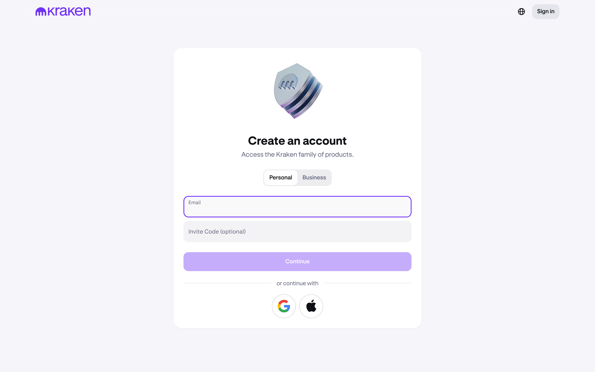
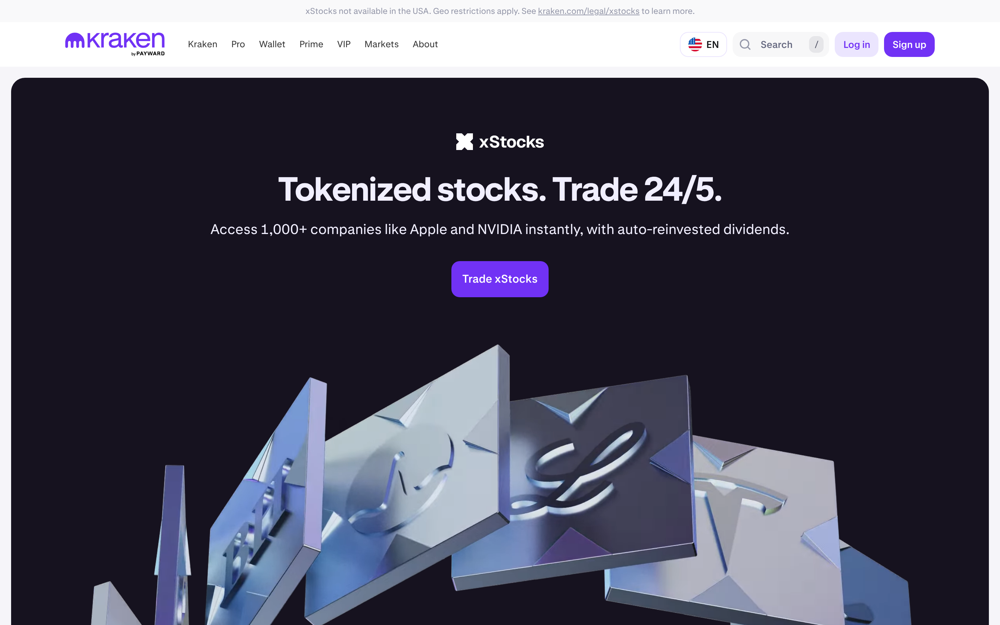
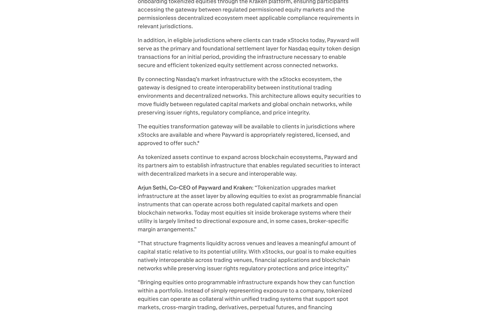
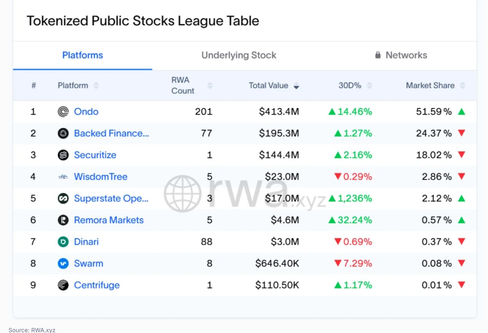
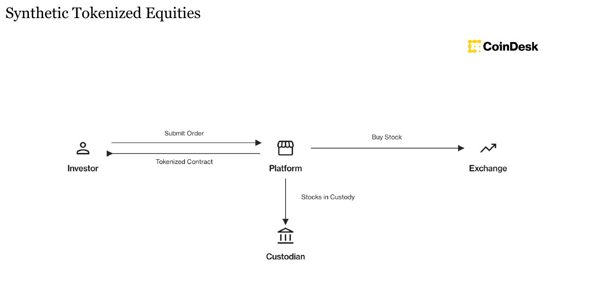
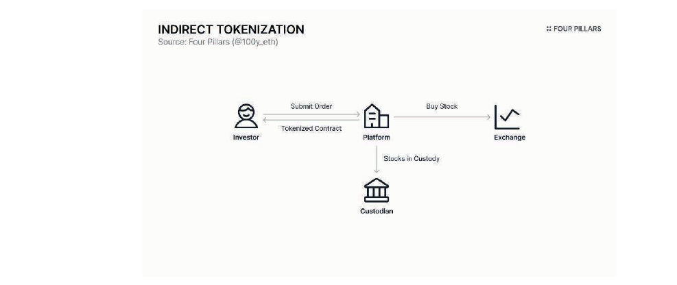
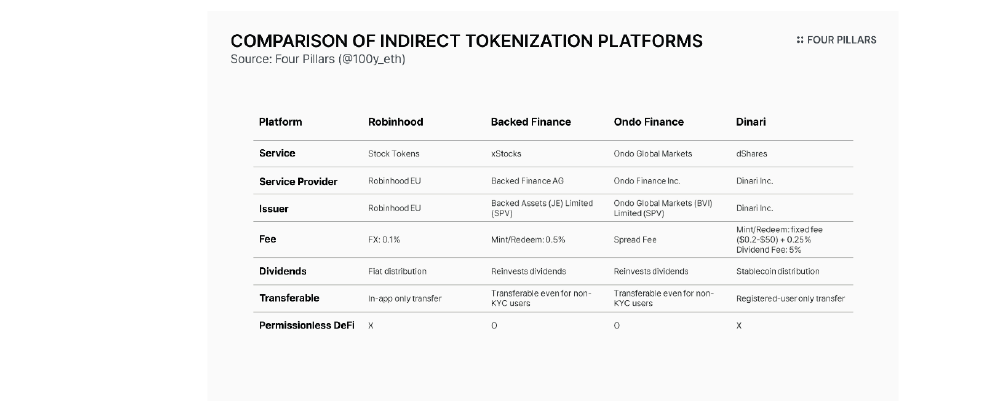
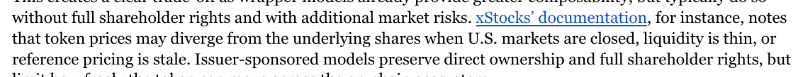

## 정체 카드
● 한 줄 정체 : 가상자산 거래소에서 선물, 주식 토큰, 은행까지 넓히는 회사 [F-1109][F-0176]
  ★ 이름 구분 : Kraken은 거래소와 앱의 이름, 법인과 모회사는 Payward, Inc., 이 문서의 회사 숫자는 대부분 Payward 단위 [F-0176][F-0359][F-0180]
    - 뜻 : Kraken = 소비자가 쓰는 거래소와 앱의 브랜드. Payward, Inc. = 그 브랜드를 가진 미국 회사이자 NinjaTrader, xStocks 등을 함께 보유한 모회사
● 대표 상품 : xStocks = 미국 주식 1대1 담보 토큰, 미국인 판매 불가 [F-0390][F-0395][F-0971]
  - 뜻 : xStocks = 미국 상장 주식이나 ETF 한 주에 대응하는 블록체인 토큰. 기초 주식을 발행사가 1:1로 담보로 보유하지만 투자자가 갖는 것은 주식이 아니라 발행사에 대한 상환 청구권
● 꼭 알아야 할 사실
  ★ 최초, 최대 타이틀 : 발행사 Backed는 저지 최초 토큰화 자산 발행사(로펌 서술) [F-0145]
    - 뜻 : 저지(Jersey) = 영국 해협의 영국 왕실 속령. 영국 본토 법이 아니라 자체 법과 금융감독청(JFSC)을 가진 역외 금융지역
    - 뜻 : Backed = xStocks를 만든 토큰화 증권 발행 회사. 스위스에서 시작해 발행 법인은 저지의 Backed Assets (JE) Limited, 2026-01 Payward 그룹이 100% 소유
    - 왜 저지라는 말이 붙는가 : xStocks를 발행해 투자자에게 상환 의무를 지는 법인이 저지에 등록된 Backed Assets (JE) Limited이기 때문. 투자자가 청구하는 상대의 소재지를 가리키는 말 [F-0935][F-0991]
    - 이력 : 스위스 Backed Assets GmbH 2021-04-20 설립, 저지 법인 2024-01-19 설립, 2024-02-23 스위스 법인이 저지 법인에 합병 [F-0937][F-0935]
    - 중요한 정도 : 최초는 로펌 Walkers의 인수 안내문 서술이라 발행 규모나 시장 지위를 뜻하지 않음. 이 문서에서 저지가 중요한 이유는 채권을 청구하는 상대와 감독 구조가 저지 법인에 걸려 있기 때문 [F-0145][F-0990]
    - 해석 : 저지 발행사는 발행만 맡는 특수목적 법인이고, 인가 받은 판매 법인과 보관 기관이 규제를 맡는 구조. 회사가 저지를 고른 이유를 직접 밝힌 문장은 없음 [F-0990][F-0974]
  ★ 상장 : 비상장, 2025-11-19 SEC에 상장 서류 비공개 제출(회사 블로그) [F-1188]
    - 모회사 Payward, Inc. : 비상장. 상장(IPO)용 Form S-1 초안을 SEC에 비공개 제출, 주식 수와 가격 범위는 미정 [F-1188]
    - 상장 시점 : 2026-09 회사가 2027년 2분기 전에는 상장 계획이 없다고 밝힘(코인데스크 한국어판 보도), 외부 자금 없이 운영 가능하다고 밝힘 [F-1352]
    - 100% 자회사 : Kraken Securities LLC(미국 증권사)는 Payward, Inc.가 유일한 사원, Backed Finance AG는 아일랜드 Payward Europe Limited가 100%이고 그 위에 Payward, Inc.가 100% [F-0242][F-0938]
    - 인수한 회사 : NinjaTrader(2025-05), Small Exchange(2025-10), Bitnomial(2026-05), Reap(2026-07)는 인수 완료를 회사가 밝힘, 인수 뒤 각 회사의 지분 구조와 상장 여부 공시는 못 찾음 [F-0177][F-1116][F-1118][F-1195]
    - 주주로 확인되는 곳 : Citadel Securities 전략 투자 2억 달러(2025-11), Nasdaq Ventures 1억 달러 투자 합의(2026-09), 독일거래소그룹 지분 1.5% 2억 달러(2026-04, 토큰포스트 보도), 지분율 전체 표는 못 찾음 [F-1187][F-1119][F-1357]
  ★ 큰 인수 : NinjaTrader 15억, Small Exchange, Bitnomial, Backed, Reap(금액 출처는 아래 세부) [F-1346][F-1116][F-1345][F-0939][F-1355]
    - NinjaTrader 금액 : 2025-03-20 계약 발표 때 Kraken 블로그가 약 15억 달러(가격 조정 조건)를 직접 밝힘, 코인데스크 한국어판도 같은 금액 보도. 2025-05-01 완료는 언론으로 확인하고 완료 시점 금액 발표는 없음 [F-1117][F-1346][F-0177]
    - Small Exchange : 2025-10-16 발표, IG Group에서 1억 달러, 미국 선물 거래소 인가 확보 [F-1116]
    - Bitnomial : 2026-05-01 완료, 중개, 거래소, 청산소 인가 한 벌, 금액 5.5억 달러는 현금과 주식(코인데스크 한국어판 보도) [F-1118][F-1345]
    - Backed : 2025-12-02 합의, 2026-01 100% 매입, 금액 미공개, xStocks 발행사 [F-0139][F-0939]
    - Reap : 2026-07-01 완료, 금액은 회사 발표에 없고 최대 6억 달러라는 보도가 있음(토큰포스트 보도) [F-1195][F-1355]
    - 합계 : 공개된 인수 금액만 더해 최소 27.5억 달러(토큰포스트 보도, Backed와 Magna는 비공개) [F-1355]
    - 작은 인수 : Breakout(2025-09-04 안내, 프롭 트레이딩 플랫폼) 금액과 이유 문장 못 찾음, Saldo Bank(2026-10 계약, 종결 2027 예상) [F-1252][F-1194]
    - 인수마다 왜, 어떻게, 어디에 썼는지, 계획은 사업 범위 장 {kr-0255}에 따로 정리 [F-1117]
  ★ 계획 : 개별주식 무기한선물 10종, 2026-09 서류 제출 단계(출시 아님) [F-1189]
● 큰 사고와 제재 : 2023-02 SEC 스테이킹 합의 [CASE-003]
  ★ 무슨 일 : 2023-02-09 Kraken 법인 2곳이 SEC와 합의, 스테이킹 프로그램(광고 수익률 최대 연 21%)이 미등록 증권 공모인지가 쟁점 [CASE-003]
    - 뜻 : 스테이킹 = 보유한 가상자산을 네트워크 운영에 맡기고 보상을 받는 서비스
    - 결과 : 인정도 부인도 하지 않고 스테이킹 서비스 중단과 미등록 스테이킹 영구 금지에 동의, 총 3천만 달러 납부 [CASE-003]
  ★ 뒤의 일 : 2023-11-20 SEC가 Payward 등을 별건으로 제소, 2025-03 취하(위키백과 정리) [F-1343]
  ★ 그 밖의 이력(위키백과 정리) : 2015-08 뉴욕 BitLicense 문제로 뉴욕 철수, 2021-09 CFTC 미등록 마진거래 125만 달러, 2022-11 OFAC 이란 제재 위반 36.2만 달러, 2024 호주 ASIC 소송 벌금 800만 호주달러 [F-1343]
  ★ 감원(위키백과 정리) : 2022-11 약 1,100명(약 30%), 2024-10 약 15% [F-1344]
  ★ 해석 : 스테이킹 건은 가상자산 서비스에 관한 것이고 xStocks 사업과 직접 관련은 없음. 스테이킹 재개 여부는 확인 못 함 [CASE-003]
● 숫자
  ★ 순위와 잔액 : 2026-11-16 3위, 6.8억 달러(rwa.xyz 발행 잔액 기준) [F-1023]
    - 무엇의 순위 : rwa.xyz가 집계한 분산형 토큰화 주식 플랫폼 표에서 블록체인에 발행된 토큰화 주식의 달러 가치(발행 잔액) 순서 [F-1023]
    - 1위와 차이 : 1위 Binance 13.6억 달러(점유율 36.62%), Kraken은 1위의 약 절반, 점유율 차이 18.4%p [F-1021][F-1023]
    - 2위와 차이 : 2위 Ondo 9.0억 달러(24.23%), Kraken은 Ondo의 약 75% [F-1022][F-1023]
    - 비교 범위 : 표 전체 37.1억 달러 중 Kraken 18.26%, 이 표는 rwa.xyz가 집계한 플랫폼만이라 시장 전체가 아님 [F-1028][F-1023]
    - 다른 지표와 구분 : 회사가 발표한 운용자산 10억 달러(2026-10-27)는 발행 잔액과 다른 지표라 합치거나 비교하지 않음 [F-0165][F-1023]
    - 전에는 : 2026-01 초 2위 24.37%, 2026-11-16 3위 18.26% [TP-002][F-1023]
  ★ 고객 수 : 자금 계정 710만 개(2026-09-30, 중복 가능, 회사 발표) [F-1192]
    - 자금 계정의 정의 : 기간 마지막 날 잔고가 0보다 크고 거래할 수 있는 고객 계정 수, 한 고객이 여러 개를 가질 수 있어 고유 고객 수가 아님(회사 정의) [F-1248]
    - 증가 : 전 분기 대비 +7%, 전년 동기 대비 +37%, Payward 플랫폼 전체 합산 [F-1192]
    - 날짜가 다른 값 : 약 660만 개는 2026-06-30 기준(회사 블로그)이고 Sethi 인터뷰(2026-09, 코인데스크 한국어판)도 약 660만 개, 710만 개는 2026-09-30 기준이라 서로 다른 날짜의 값 [F-1190][F-1348][F-1192]
    - 과거 : 2024년 말 260만 개(위키백과) [F-1341]
    - 다른 고객 지표 : 청구 가능 계정 150만 개는 트레이더 평가, 구독, 상장, 지수 라이선스 등 이용료를 내는 계정(전년 대비 +74%) [F-1191]
    - xStocks 보유자 : 55만 초과(2026-10, 회사 발표)로 자금 계정과 별개 지표 [F-0166]
  ★ 종목 수 : 100종 돌파(2026-03, 회사 발표) [F-1045]
    - 출시 때 60종(2025-06-30) [F-1249]
  ★ 기업가치 : 200억 달러(2025-11, 시티델 2억 달러 투자 기준, 회사 발표) [F-1187]
    - 다른 시점 값 : 2026-04 독일거래소그룹이 지분 1.5%를 2억 달러에 취득한 거래 기준 약 133억 달러(토큰포스트 보도), 두 값은 날짜와 거래가 달라 직접 비교하지 않음 [F-1357][F-1187]
● 흐름 : 이용자 → Kraken 앱 → Backed(저지 발행사) → InCore, Alpaca(보관) [F-0392][F-0390][F-0964]
  ★ 1단계 판매 : 이용자는 Kraken 앱에서 주문, 판매 법인은 버뮤다 Payward Digital Solutions Ltd와 EU용 키프로스 Payward Europe Digital Solutions (CY) Ltd [F-0392][F-0919][F-0156]
  ★ 2단계 발행 : 저지 Backed Assets (JE) Limited가 토큰을 발행하고 상환 의무를 짐 [F-0390][F-0991]
  ★ 3단계 보관 InCore Bank : 스위스 FINMA 인가 은행, 스위스 쪽 담보 보관과 발행, 상환 대금 계좌, 브로커 역할 [F-0964][F-0967][F-0966]
  ★ 3단계 보관 Alpaca : 미국 쪽 보관기관(Alpaca Crypto LLC)과 미국 브로커(Alpaca Securities LLC, SEC 등록 브로커딜러) [F-0964][F-0966]
  ★ 두 곳인 이유 : 담보의 법구조가 보관기관 소재국에 따라 스위스, 미국, 영국으로 갈려 보관처도 나라별로 나뉨. 회사가 두 곳을 쓰는 이유를 직접 밝힌 문장은 못 찾음 [F-0962]
  ★ 둘과의 관계 : 투자설명서는 둘을 보관기관과 브로커로 기재하고 지분 관계는 적지 않음. Alpaca Securities는 약정이 허용하면 기초주식 대여 상대가 될 수 있고 InCore는 증권 대여가 금지됨 [F-0964][F-0959][F-0960]
    - 뜻 : 보관기관(custodian) = 담보 주식을 대신 맡아 두는 곳. 브로커 = 주식 매매 주문을 넣는 증권사

## 회사 개요와 확장 경로
● 쉽게 말하면 : 거래소로 출발해 선물, 주식 토큰, 은행까지 한 곳에 쌓는 회사 [F-1109][F-0176]
● 주장 : 거래소가 인가와 발행사를 사들여 토큰 공급망 확보 [F-0389][F-0939][F-1118]
● 본업과 규모
  ★ 2026 Q3 총플랫폼마진(TPM) 4.87억 달러 : 전 분기 대비 +12%, 전년 동기 대비 -12%(회사 발표) [F-1245]
    - 뜻 : TPM = 매출에서 거래 비용, 자기 거래 손익, 고객에게 지급한 스테이킹 보상을 뺀 이익 지표(회사가 2026 Q3부터 조정 매출 대신 보고, 비GAAP)
    - 구성 : 거래 기반 2.34억, 자산 기반 1.28억, 접근 기반 1.25억 달러 [F-1245]
    - 뜻 : 거래 기반 = 고객이 거래할 때 거래 금액이나 계약 수로 버는 돈. 자산 기반 = 고객 자산을 맡아 시간이 지나며 버는 돈. 접근 기반 = 거래나 보유가 아니라 상품, 데이터, 서비스 이용료로 버는 돈
    - 접근 기반 : 거래, 구독, 상장, 지수 라이선스 등 이용료를 포함하고 전체의 약 4분의 1 [F-1246]
  ★ 거래량과 이익 : 2026 Q3 플랫폼 거래량 3,530억 달러, 조정 EBITDA 6천만 달러, 자금 계정 710만 개 [F-0180]
  ★ 지난 실적 : 2024년 매출 15억 달러(전년의 두 배, 위키백과), 2025년 조정 매출 22억 달러, 조정 EBITDA 5.31억 달러, 거래량 2조 달러(토큰포스트 보도), 2026 Q2 조정 매출 5.08억 달러(전년 대비 +17%, 코인데스크 한국어판 보도) [F-1341][F-1356][F-1353]
    - 주의 : 2026 Q3부터 지표가 조정 매출에서 TPM으로 바뀌어 Q2 조정 매출과 Q3 TPM을 직접 비교하지 않음 [F-1245][F-1353]
  ★ 주식 토큰의 크기 : xStocks가 TPM에서 차지하는 몫은 회사가 공개하지 않음, 운용자산 10억 달러(2026-10-27)와 누적 거래량 450억 달러는 별도 지표 [F-1246][F-0165][F-0166]
    - 읽는 법 : TPM 4.87억 달러와 xStocks 누적 거래량은 서로 다른 지표라 비교하지 않음 [F-1246]
● 기본정보
  ★ 법인명 : Payward, Inc.(Kraken 거래소 모회사) [F-0359]
    - 관계 : 회사 소개문은 Payward를 Kraken의 모회사이자 NinjaTrader, Breakout, xStocks, CF Benchmarks의 인프라 계층으로 소개 [F-0176]
  ★ 소재지 : 미국 와이오밍주 Cheyenne [F-0360]
  ★ 핵심 상품 : xStocks(미국 주식, ETF 토큰), Kraken 앱 판매 [F-0389]
    - 뜻 : xStocks = 미국 상장 주식과 ETF 한 주를 블록체인 토큰 한 개로 나타낸 상품(법적 성격은 B 장)
    - 상품 이름 : xStocks는 상품 이름이고 앱 이름이 아님. 앱은 Kraken, 발행은 Backed [F-0389][F-0390]
    - 규모 : 2025-06-30 60종으로 시작, 100종(2026-03), 누적 거래량 450억 달러 초과, 보유자 55만 초과(2026-10) [F-1249][F-1045][F-0166]
    - 알려진 이유 : 회사가 인과를 설명한 문장은 없고 숫자로 확인되는 것은 출시 6개월 만의 거래량 100억 달러(2025-12-02), 시가총액 상위 토큰화 주식 15개 중 8개가 xStocks(CoinGecko 인용, 2026-07), 파트너 100곳 이상 연동(회사 주장) [F-0141][F-0161][F-1193]
    - 회사가 내세운 가치 : 지갑에서 보유, 이동, 담보로 쓰는 주식(공동 CEO 발언) [F-1040]
  ★ 설립 : 2011-07, Jesse Powell 공동 설립 [F-1109]
    - 설립일과 창업자 : 2011-07-28 샌프란시스코, Thanh Luu, Michael Gronager, Jesse Powell 3명이 공동 설립, 2013-09 공개 출시(위키백과) [F-1334]
    - 경영진 : 2023-04 Dave Ripley CEO와 Jesse Powell 이사회 의장, 2024-10 Arjun Sethi가 공동 CEO로 선임(위키백과) [F-1344]
● 지배구조
  ★ Payward가 Kraken, NinjaTrader(미국 선물 중개사), xStocks 보유 [F-0176]
    - 관계도 : Payward, Inc.(미국, 비상장)가 Kraken 거래소와 앱, NinjaTrader, Breakout, xStocks, CF Benchmarks를 거느린 모회사 [F-0176]
    - 100% 자회사 1 : Kraken Securities LLC(미국 증권사, 2024-06 SEC 등록)는 Payward, Inc.가 유일한 사원 [F-0242][F-0372]
    - 100% 자회사 2 : 아일랜드 Payward Europe Limited가 2026-01-05경 스위스 Backed Finance AG 주식 100%를 매입했고, Backed Finance AG가 발행사의 유일한 주주 [F-0939][F-0938]
    - 판매 법인 : 버뮤다 Payward Digital Solutions Ltd와 키프로스 Payward Europe Digital Solutions (CY) Ltd는 발행사와 승인 참가자 계약을 맺은 Payward 이름의 그룹 법인 [F-0919][F-0920]
    - 인수 법인 : NinjaTrader(2025-05), Bitnomial(2026-05), Reap(2026-07)은 Payward가 인수 완료, Reap은 독립 브랜드 유지 [F-0177][F-1118][F-1195][F-1256]
    - 언제부터 : 위키백과는 2011-07 공동 설립 서술에서 모회사를 Payward로 적음, 지주회사 구조로 개편한 날짜를 밝힌 자료는 못 찾음 [F-1334]
    - 각자 하는 일 : Kraken = 가상자산 거래소와 앱, NinjaTrader = 미국 선물 중개, Breakout = 프롭 트레이딩 평가 플랫폼(통과하면 최대 20만 달러 운용 자금, 이익 최대 90% 보유), xStocks = 주식 토큰 [F-0176][F-1252]
    - 뜻 : 프롭 트레이딩 = 개인이 아니라 회사 자금으로 거래하는 방식
    - Kraken만 보면 되는가 : 부족함. 분기 숫자(총플랫폼마진, 거래량, 자금 계정)가 Payward 단위로 발표되고 인수한 회사가 모두 Payward 아래에 있음 [F-0180][F-0176]
  ★ Payward 지분 25% 넘게 가진 개인 주주 없음 [F-0938]
    - 뜻 : 투자설명서(2026-05-08)가 어떤 개인 주주도 Payward, Inc. 주식 25%를 넘게 갖지 않는다고 적음, 주주 명단이나 지분율 표가 아님 [F-0938]
    - 해석 : 창업자 같은 한 사람이 단독으로 지배하는 회사가 아님. 법인 주주의 지분은 이 문장으로 알 수 없음 [F-0938]
    - 알려진 법인 투자자 : Citadel Securities, Nasdaq Ventures, 독일거래소그룹 [F-1187][F-1119][F-1357]
    - 해석 : 발행사 존속을 받치는 모회사 지원은 특정 개인이 아니라 Payward 회사의 재무 상태에 달림 [F-0924][F-0938]
  ★ 발행사(xStocks 토큰을 만드는 Backed) 지분은 Payward 그룹이 100% 보유, Kraken 앱과 법인이 다름 [F-0938]
    - 뜻 : 발행사 = 토큰을 만들어 팔고 투자자에게 상환 의무를 지는 법인. xStocks에서는 저지의 Backed Assets (JE) Limited, Kraken 앱은 이를 파는 창구
    - 소유 사슬 : Payward, Inc.(미국) 100% → Payward Europe Limited(아일랜드) 100% → Backed Finance AG(스위스) → 발행사의 유일한 주주 [F-0938]
    - 시점 : 인수 전에는 Backed가 만든 xStocks를 Kraken 앱이 판매, 2025-12 인수 합의, 2026-01 지분 100% [F-1249][F-0139][F-0939]
● 설립 목적과 앞으로의 그림
  ★ 미션 : 금융 자유와 포용을 세계에 가져오는 것 [F-1110]
    - 미션이 넓은 선언이라 CEO가 더 좁게 말하고 실행한 것은 경영진 발언 장에 주제별, 시점 순으로 정리 {kr-0502} [F-1042][F-1040][F-1043]
    - 말하고 이룬 것 : 선물 중개 NinjaTrader(2025-03 발표, 2025-05 완료), xStocks 출시(2025-06), Backed 100%(2026-01) [F-1042][F-0177][F-1249][F-0939]
    - 말하고 진행 중인 것 : Nasdaq과 연결 통로, Saldo Bank(종결 2027 예상), xPO, 개별주식 무기한선물 [F-1044][F-1194][F-0182][F-1189]
  ★ 사업 틀(CEO 인터뷰) : Payward는 지주회사가 아니라 하나의 플랫폼, 하나의 대차대조표, 하나의 규제 체계이고 핵심은 원장 하나(one ledger), 사업 네 기둥은 거래, 은행, 자산관리, 기업용 인프라 Payward Services(코인데스크 한국어판 인터뷰) [F-1347]
    - 제3자 평가 : 긍정. Architect Partners는 Payward가 Coinbase식 단일 브랜드 모든 거래소(Everything Exchange)를 넘어 여러 브랜드와 외부 회사가 쓰는 모든 금융 인프라(Everything Financial Infrastructure) 모델을 정의한다고 평가(코인데스크 한국어판 인용) [F-1351]
  ★ 회사가 밝힌 다음 계획(2026 Q3 보고) : Payward Services에 파생(DCM, DCO, FCM), 파트너 앱 내 임베디드 지갑, 파트너 자체 브랜드 xStocks 추가, 뱅킹은 연준 마스터 계정과 유럽 예금으로 빌린 레일을 소유한 레일로 교체, 자산관리는 xPO [F-1258][F-1259]
  ★ 타깃 수요 : 미국 밖 개인의 주말 포함 미국 주식 매매, 펀드와 은행과 재무부서의 기관 거래, 파트너 기업의 인프라 이용 [F-0392][F-0401][F-0439][F-1257]
  ★ 수익원 : TPM 세 갈래(거래, 자산, 접근), xStocks는 발행과 상환 가산 수수료와 운용보수 [F-1245][F-0979]
● 성장 경로(한 줄기, 인수는 계약 또는 발표 시점 순서)
  ★ 2025-03 NinjaTrader 계약 → 2025-05 완료 [F-1117][F-0177]
  ★ 2025-06 xStocks → 2025-10 Small Exchange [F-1040][F-1116]
  ★ 2025-12 Backed 합의 → 2026-05 Bitnomial [F-0139][F-1118]
  ★ 2026-09 Nasdaq 투자 → 2026-11 영국, EU 200종 [F-1119][F-0174]
● 화면
    

## 사업 범위와 넓힌 순서
● 쉽게 말하면 : 선물 인가와 발행사를 사들였고 xStocks 주식 토큰은 미국 밖 개인에게 판매 [F-1117][F-1118][F-0939]
  ★ 선물 인가의 분류 : 주식 토큰과 별개인 파생상품 축, 아래 자산 항목의 선물 중개, 파생 거래소, 청산소 세 단 [F-1117][F-1116][F-1118]
    - 뜻 : FCM(선물중개업자) = 고객 선물 계좌를 맡아 주문을 넣는 회사. DCM(지정 계약시장) = 선물이 거래되는 거래소. DCO(파생상품 청산기구) = 거래 뒤 결제를 맡는 청산소. 셋 모두 미국 CFTC가 인가
    - 주식 토큰과 만나는 곳 : 2026-09 서류를 낸 개별주식 무기한선물이 이 인가 위에서 계획된 첫 사례이며 xStocks를 기초로 한 선물은 아님 [F-1189]
● 주장 : 선물 인가와 발행사를 사 모은 뒤 주식 토큰은 해외로 [F-1117][F-1118][F-0939]
● 자산(무엇을 어떤 순서로 더했나)
  ★ 2011 가상자산 거래소 : 직접 설립 [F-1109]
    - 시작 : 2011-07 공동 설립, 2013-09 공개 출시(위키백과) [F-1334]
    - 초기 인수(위키백과) : 2016-01 Coinsetter(뉴욕)와 Cavirtex(캐나다), 2016-02 CleverCoin(네덜란드)과 Glidera(지갑), 2017-03 Cryptowatch [F-1335]
    - Payward와의 관계 : 모회사로 표기, 지주회사 구조로 바뀐 날짜는 못 찾음 {kr-0007} [F-0176][F-1334]
    - 지금 각자 하는 사업 : Kraken은 거래소와 앱, 그 밖은 Payward 아래 NinjaTrader, Breakout, xStocks, CF Benchmarks [F-0176]
    - Kraken만 봐도 되는가 : 숫자와 인수가 Payward 단위라 Payward를 함께 봐야 함 [F-0180]
  ★ 2019-02 파생 : Crypto Facilities(영국 파생 거래 회사) 인수, 가상자산 선물 사업의 시작(위키백과) [F-1336]
  ★ 2020-09 은행 인가 : Kraken Financial이 와이오밍 SPDI 인가, 미국에서 은행 인가를 받은 첫 가상자산 거래소(위키백과) [F-1337]
  ★ 2025-05 선물 : NinjaTrader 인수(FCM) [F-1117][F-0177]
    - 왜와 쓴 곳 : 아래 NinjaTrader 인수 묶음 {kr-0255}
    - 한 줄 : 미국 소매 선물 플랫폼과 CFTC 등록 선물 중개 인가를 15억 달러로 한 번에 확보 [F-1117][F-0177]
  ★ 2025-10 파생 거래소 : Small Exchange 인수(DCM) [F-1116]
  ★ 2026-05 청산소 : Bitnomial 인수(DCM, DCO, FCM) [F-1118]
  ★ 이 순서의 이유 : 순서 자체를 설명한 회사 문장은 못 찾음, 회사가 밝힌 목적은 활동을 미국 규제 안으로 가져오는 것과 인가 한 벌 [F-0178][F-1118]
    - 사실 : 선물 중개(2025-05) → 파생 거래소(2025-10) → 청산소 포함 Bitnomial(2026-05), 약 12개월 사이 [F-1117][F-1116][F-1118]
    - 회사 문장 : Bitnomial 인수로 미국 파생상품 전체 구성인 중개, 거래소, 청산소를 모두 보유 [F-1118]
    - 회사 문장 : CFTC 규제 거래소, 청산소, 선물 중개를 통해 활동을 미국 규제 안으로 가져오고 한 벌의 인가가 여러 상품과 파트너를 지원 [F-0178]
    - 인수 기준(Sethi 인터뷰) : 쇼핑 목록 없이 인프라 공백을 메우고 고객이 원하는 역량인지 정량 틀로 판단, 사지 못하는 신뢰와 입지는 Nasdaq, LSE 같은 기존 기관과 제휴(코인데스크 한국어판) [F-1349]
    - NinjaTrader를 산 이유(Sethi) : 미국 선물 중개업체를 처음부터 세우려면 기술과 규제 승인에 비용과 시간이 많이 들어서(코인데스크 한국어판) [F-1346]
    - 해석 : 주문을 받는 중개, 체결하는 거래소, 결제하는 청산소를 앞 단계부터 차례로 확보한 순서 [F-1117][F-1116][F-1118]
● 자산 2(주식 토큰과 그 뒤)
  ★ 2025-06 주식 토큰 : xStocks 출시, Kraken 앱이 직접 판매 [F-1040]
    - 처음 출시 : 2025-06-30 Kraken 앱에 60종 첫 상장, 미국 밖 적격 고객 대상, 첫 체인 Solana [F-1249]
    - 발행은 Backed : 출시 때 Backed가 만든 xStocks를 Kraken 앱이 판매, 2025-12 인수 합의 뒤 발행사까지 그룹 소유 [F-1249][F-0139][F-0939]
    - 간접 판매 : 있음. Kraken 앱 직접 판매 외에 외부 거래소, 지갑, API 파트너, 기관 제휴로도 판매 {kr-0080} [F-1083][F-0450][F-1084]
    - 발행사 경력 : Backed의 토큰화 증권 공모는 2022-05 리히텐슈타인 승인 투자설명서 이후 이어짐 [F-0943]
  ★ 2025-12 발행사 : Backed 인수 합의, 2026-01 지분 100% [F-0139][F-0939]
    - 연결 : CEO 비전, 투자설명서, 숫자를 한 줄기로 정리한 Backed 인수 묶음 {kr-0263}과 발언 장 {kr-0023} [F-1043][F-0923]
  ★ 2026-09 지분 투자 : Nasdaq Ventures 1억 달러 [F-1119]
    - 왜 : 투자는 두 회사가 함께 하는 일의 전략적 성격을 반영(회사 발표) [F-1255]
    - 어떻게 : 2026-09-10 Nasdaq Ventures가 Payward에 1억 달러 투자 합의 발표, 지분율은 확인 못 함 [F-1119]
    - 쓴 곳 : Payward가 Nasdaq 시장감시 기술을 자사 모든 거래장에 도입, Nasdaq Equity Token 보유자의 KYC와 AML 온보딩과 초기 기본 정산 계층을 Payward Services가 맡음 [F-1255][F-0160]
    - 계획 : Nasdaq Equity Tokens는 2027년 2분기 출시 예상 [F-1119]
    - 해석 : 공동 CEO가 말한 허가형 시장과 블록체인의 상호운용을 지분 투자와 시스템 도입으로 묶은 것, 사지 못하는 거래소의 신뢰를 제휴로 얻는 방식 [F-1044][F-1349]
  ★ 계획 : xPO = 비상장 회사가 자기 주식을 xStocks로 온체인에서 처음 파는 공모, 규제 승인 조건 [F-0182]
    - 뜻 : xPO = Payward가 계획한 1차 공모. 비상장 회사가 주식을 xStocks 토큰으로 발행해 자금을 모으고 첫날부터 거래 시장을 가짐
    - 지금과 다른 점 : 현재 xStocks는 이미 상장된 미국 주식과 ETF를 담보로 하고, xPO는 비상장 회사가 새로 발행 [F-0182][F-1258]
● 고객(개인에서 기관으로)
  ★ Kraken 앱의 xStocks : 선택 국가의 미국 밖 개인, 직접 판매 [F-0392]
    - 뜻 : xStocks는 상품 이름이고 앱 이름은 Kraken. 이용자는 Kraken 앱 안에서 xStocks를 매매 [F-0389][F-0392]
  ★ 2025-06 기관 Prime : 펀드, 은행 대상, 직접 [F-1159][F-0439]
  ★ 2026-07 GTN 제휴 : 기관 고객에 xStocks 제공 계획 [F-1084]
● 시장(어느 나라로)
  ★ 2024-06 미국 : Kraken Securities 직접 등록 [F-0242]
  ★ 2025-04 버뮤다 : 직접 인가, xStocks 판매 계약 [F-0919]
    - 뜻 : 버뮤다 = 영국령 북대서양 섬으로 미국 땅이 아님, 금융감독기관 BMA가 디지털자산 사업을 인가
    - 인가 : 버뮤다 법인 Payward Digital Solutions Ltd가 BMA의 Class F 디지털자산 사업 라이선스를 보유, 2025-04-28 발행사와 승인 참가자 계약 [F-0919]
    - 새 인가가 필요한 이유 : 저지 감독청이 발행사에 승인 참가자와 브로커를 규제 받는 금융회사로 한정하라고 요구 [F-0990]
    - 역할 : EEA 밖 대부분 지역에서 24/7 거래를 제공, 그 밖 지역 판매는 이 법인이 맡는 것으로 보이나 회사가 밝힌 문장은 못 찾음 [F-0401][F-0919]
    - 왜 버뮤다 : 회사가 밝힌 이유는 못 찾음 [F-0919]
  ★ 2025-06 EU 아일랜드 : MiCA 직접 인가 [F-0250]
    - 뜻 : MiCA = EU의 가상자산시장 규정. 가상자산 서비스 제공자(CASP)는 인가가 있어야 EU에서 서비스 가능
    - 인가 내용 : 가상자산 거래 플랫폼 운영 등 가상자산 서비스 인가(2025-06) [F-0250][F-0251]
    - 가상자산이면 인가 없이 되는가 : 아님. EU에서 가상자산 거래도 MiCA 인가가 필요, 한편 주식 토큰은 가상자산이 아니라 증권이라 EU 투자설명서 규정과 키프로스 MiFID II 인가를 따로 거침 [F-0250][F-0148][F-0156]
    - 왜 아일랜드 : 회사가 밝힌 이유는 못 찾음 [F-0250]
  ★ 2026-05 EU 키프로스 : MiFID II 직접 인가, AP 계약 [F-0156][F-0920]
    - 뜻 : MiFID II = EU의 투자서비스 규정. 키프로스 투자회사로 인가를 받으면 EU 고객에게 증권 판매 가능
    - 2025-05-20 : 키프로스 인가 취득 뒤 유럽에서 규제 가상자산 파생상품 출시(위키백과) [F-1342]
● 시장 2(제휴로 넓힘)
  ★ 2026-07 홍콩 : GTN 제휴, 홍콩 상장주 우선 [F-1084][F-0170]
    - 발표일 : 2026-07-22 GTN 제휴 발표, 홍콩 상장 주식을 먼저, 이후 영국, 유럽, 한국 순 [F-1361]
    - 시작 시점 : 2026-11-11 발표 기준 홍콩 상장 주식 수백 종목을 수 주 안에 추가 예정이라고 밝혔고 시작일은 미발표 [F-1360][F-1361]
  ★ 2026-11 영국, EU : 상장 200종 이상 xStocks 배포 [F-0174]
    - 2026-11-11 : 영국, EU 주식 200종 이상 추가(독일 DAX 40개 전부 포함), GTN이 체결과 수탁, xStocks 자산 11억 달러 이상(Payward 발표), 영국과 미국 투자자에게는 여전히 미제공 [F-1360]
    - LSE : 영국 대형 상장주 토큰을 2027년 LSE 24에 상장 추진, 규제 승인 조건 [F-1359][F-0173]
  ★ 회사가 말한 순서 : 2026-03-18 xStocks 총괄이 모든 주요 미국 주식 다음에 해외 시장의 주요 주식으로 넓히겠다고 밝힘 [F-1045]
    ① 원문 : "The next step is expanding access to every major U.S. equity and, ultimately, other leading global equities across international markets."
    ② 번역 : 다음 단계는 모든 주요 미국 주식으로, 궁극적으로 해외 시장의 주요 주식으로 접근을 넓히는 것이다.
    ③ 해석 : 큰 곳은 미국 밖 상장주. 그래서 종목 수 확대와 각국 상장주 토큰화 [F-1045][F-0170]
  
● 2025-05 NinjaTrader 인수(15억 달러, 선물 중개) : 미국 선물 고객과 중개 인가를 한 번에 [F-1117][F-0177]
  ★ 왜 : 미국 선물 확대, 선두 소매 선물 플랫폼 인수(회사 발표) [F-1117]
    - 회사 문장 : NinjaTrader를 미국 대표 소매 선물 거래 플랫폼이라 부르며 인수 계약 발표 [F-1117]
    - 공동 CEO Sethi : 전통 시장과 암호화폐가 분리돼 있었다며 이번 인수를 어떤 자산이든 언제든 거래할 수 있는 기관급 플랫폼 구상의 첫 단계라고 밝힘 [F-1042]
    - 직접 세우지 않은 이유 : 미국 선물 중개업체를 처음부터 세우려면 기술과 규제 승인에 비용과 시간이 많이 들어서(Sethi, 코인데스크 한국어판) [F-1346]
    - 이 회사 상황 : 가상자산 선물은 이미 하던 사업이라 인수의 의미는 신규 진입이 아니라 미국 규제 안에서 선물을 제공할 인가와 미국 소매 선물 고객의 확보 [F-1336][F-0178][F-1117]
    - 선물 시작 서술 : 회사 연혁은 2015년 현물과 선물을 한 플랫폼에서 제공이라 쓰고 위키백과는 2019-02 Crypto Facilities 인수를 선물 사업의 시작으로 서술, 두 서술이 달라 함께 적음 [F-1253][F-1336]
  ★ 어떻게 : 2025-03-20 계약 발표, 약 15억 달러(가격 조정 조건), 2025-05-01 완료 [F-1117][F-0177]
  ★ 쓴 곳 : 2026-09 주식 무기한선물 서류에서 고객 계좌 보유 주체 [F-1189]
    - 뜻 : 고객 계좌 보유 = 선물 계좌와 증거금을 맡아 관리하는 중개 역할(FCM). 서류에서는 NinjaTrader Clearing이 이 역할 [F-1189]
    - 같은 역할 : Hyperliquid 온체인 무기한선물에서도 NinjaTrader Clearing이 고객 계좌를 보유할 계획 [F-1190]
  ★ 계획 : 개별주식 무기한선물과 온체인 무기한선물 모두 규제 승인 조건 [F-1189][F-1190]
  ★ 해석 : 선물 인가를 사 모으는 첫 조각, 뒤의 Bitnomial로 이어짐 [F-1117][F-1118][F-1189]
● 2025-10 Small Exchange 인수(미국 선물 거래소, DCM) : 거래소 인가 확보 [F-1116]
  ★ 왜 : 회사는 CFTC 인가 지정 계약시장(DCM)을 인수했다고 발표, 미국 토종 파생상품 시장을 만들 기반 [F-1116]
  ★ 어떻게 : 2025-10-16 발표, IG Group에서 1억 달러 [F-1116]
  ★ 쓴 곳 : Small Exchange로 낸 별도 상품은 못 찾음, Bitnomial 인수 뒤 이 거래소의 쓰임도 회사가 밝히지 않음 [F-1116][F-1118]
  ★ 해석 : 자체 거래소 인가를 확보한 단계, 이후 Bitnomial로 청산소와 중개까지 갖춤 [F-1116][F-1118]
● 2026-05 Bitnomial 인수(거래소, 청산소, 중개) : 미국 파생을 인가 한 벌로 [F-1118]
  ★ 왜 : 미국에서 현물 마진, 무기한선물, 옵션을 CFTC 규제 아래 제공 [F-1118]
    - 뜻 : 무기한선물 = 만기 없이 계속 보유할 수 있는 선물. 현물 마진 = 증거금을 얹어 가상자산 현물을 거래하는 방식
    - 회사 문장 : 인수로 미국 파생상품 전체 구성인 FCM, DCM, DCO를 모두 보유 [F-1118]
    - 회사 문장 : 한 벌의 인가가 여러 상품과 파트너를 지원 [F-0178]
  ★ 어떻게 : 2026-04-17 발표, 2026-05-01 완료, 금액 5.5억 달러는 현금과 주식(코인데스크 한국어판 보도), Bitnomial은 기존 인가와 제3자 청산 구조를 유지한 채 그룹에서 운영 [F-1118][F-1345]
  ★ 쓴 곳 : 2026-09 Bitnomial 거래소에 올리려고 개별주식 무기한선물 10종 서류를 CFTC와 SEC에 제출 [F-1189]
    - 뜻 : 개별주식 무기한선물 = 만기가 없고 가격이 미국 개별 주식(TSLA, NVDA 등)을 따르는 선물. xStocks 토큰을 기초로 한 선물이 아니라 주식 가격을 따르는 선물 [F-1189]
    - 서류 제출의 의미 : 규칙과 상품 조건을 감독기관에 낸 단계(2026-09-18), 승인 전이라 출시가 아님 [F-1189]
    - 역할 분담 : 시장은 Bitnomial 거래소(DCM), 고객 계좌는 NinjaTrader Clearing(FCM) [F-1189]
    - 첫 10종 : TSLA, SPCX, NVDA, AVGO, MU, AAPL, MSFT, AMZN, GOOGL, PLTR, 24/5 거래 목표 [F-1189]
    - 온체인 무기한선물 : Hyperliquid 시장에서 Bitnomial이 시장을 만들고 청산, 2026-09-16 발표 [F-1190]
    - 의미 : 인수한 중개, 거래소, 청산소 인가가 처음으로 한 상품에 같이 쓰이는 계획 [F-1118][F-1189]
  ★ 해석 : 거래소, 청산소, 중개를 갖췄으나 출시는 규제 승인 조건 [F-1118][F-1189][F-1116]
● 2025-12 Backed 인수(xStocks 발행사) : 발행, 체결, 결제를 한 회사 안으로 [F-0139][F-0939]
  ★ 왜 : 발행, 거래, 결제를 한 틀로 묶어 투명하고 접근 가능하게(공동 CEO) [F-1043]
    - 추가 이유 : 전략과 투자 우선순위 정렬(회사 보도자료) [F-0140]
    - 이어지는 계획 : xStocks를 글로벌 머니 앱 Krak에 더 깊이 넣어 토큰 주식을 보유하고 쓰게 함 [F-1251]
    - 인수 전 관계 : xStocks는 Backed가 만든 상품이고 Kraken은 판매처, 2025-06 출시 때 Backed 기반으로 소개 [F-1249]
  ★ 어떻게 : 2025-12-02 인수 합의 발표, 2026-01-05경 Payward Europe Limited가 Backed Finance AG 주식 100% 매입, 금액 미공개 [F-0139][F-0939]
  ★ 쓴 곳 : 2026-01 지분 100%, 기술과 지식재산을 Payward로 이전 [F-0939][F-0923]
    - 이전 내용 : 2026-01-06 Backed Finance AG가 토큰화 주식 사업 관련 소프트웨어, 원장, 블록체인 기술, 특허, 상표 등을 Payward에 양도, 최초 대가 USDC 1,682.3만 개(구매가 배분 확정 때 조정) [F-0923]
    - 같은 날 : 모회사가 대여채권 약 607.5만 달러를 출자해 발행사 차입금을 소멸시키고 발행사는 추가로 1,682.3만 달러를 받음 [F-0922]
    - 왜 Payward로 : 회사가 밝힌 이유는 못 찾음. 해석 : 그룹의 기술과 운영은 Payward가 맡고 발행사는 서비스 계약으로 씀 [F-0969][F-0970]
  ★ 쓴 곳 : 발행사는 자체 직원과 기술 없이 Payward 그룹 인프라에 의존 [F-0970][F-0969]
    - 발행사 : 저지 특수목적 법인, 기술 인프라와 시스템과 운영 인력을 Payward 그룹이 제공, 이사는 관리대행사 Cavendish가 제공 [F-0970]
    - 계약 : Payward, Inc.와 2026-01-05 효력의 토큰화 서비스 계약, 조건이 독립당사자 간 거래가 아니라고 투자설명서가 명시 [F-0969]
    - 뜻 : SPV(특수목적 법인) = 토큰 발행 하나만을 위해 세운 회사. 직원 없이 모회사 서비스로 움직임
    - 의미 : 서류상 채무자(발행사)와 실제 운영자(Payward)가 다름, 위험은 {kr-0127}
  ★ 해석 : 공급망은 한 회사로 모였으나 발행사 존속은 모회사 지원에 달림 [F-0970][F-0924]
    - 인수 전후 거래량 : 출시 뒤 약 5개월 100억 달러 초과, 합의 뒤 약 11개월(2026-10-28까지) 450억 달러 초과로 증가분 약 350억 달러, 월 평균 약 20억에서 약 32억 달러(우리 계산, 원인을 인수로 단정하지 않음) [F-0141][F-0166]
    - 점유율 : 2026-01 24.37%에서 2026-11 18.26%로 하락 [TP-002][F-1023]
● 2026-07 Reap 인수(카드, 스테이블코인 결제) : 거래에서 결제로 기업용 서비스 확대 [F-1195]
  ★ 왜 : 파트너가 카드 발급, 국경 간 결제, 재무관리를 API 하나로 [F-1195]
    - 회사 문장 : Reap으로 파트너가 카드 발급, 국경 간 결제 개시, 온체인 유동성 기반 재무관리를 한 API로 함 [F-1195]
    - 해석 : Payward Services 이용 기업이 이미 거래와 수탁 인프라를 쓰고 있어(OKX, WOO X EU) 카드와 결제를 같은 연동에서 더 얻게 됨 [F-1257][F-1195]
  ★ 어떻게 : 2026-05-07 발표, 2026-07-01 완료, 금액은 회사 발표에 없고 최대 6억 달러라는 보도가 있음(토큰포스트 보도), Reap 브랜드와 경영진 독립 유지 [F-1195][F-1256][F-1355]
  ★ 쓴 곳 : 기업용 Payward Services에 카드 발급과 결제 추가 [F-1195]
    - 뜻 : 스테이블코인 = 달러 같은 법정화폐 가치에 맞춘 가상자산. 카드 발급 = 기업이 자기 고객에게 결제 카드를 내놓게 하는 서비스
    - 2026 Q3 : Reap이 Visa와 100개 이상 시장으로 스테이블코인 카드 프로그램을 넓히는 중 [F-1256]
    - 인가 교차 : Reap의 기존 인가가 Payward의 APAC과 미주 확장을, Payward의 EU와 미국 인가가 Reap의 유럽과 미국 진출을 돕는다고 회사가 밝힘 [F-1256]
  ★ 계획 : Payward Services에 파생, 임베디드 지갑, 파트너 자체 브랜드 xStocks를 추가하고 뱅킹이 뒤를 이음 [F-1258]
  ★ 해석 : 기업용 서비스를 거래에서 결제로 넓힘, 이용 기업 수 공개 없음 [F-1195][F-1193]
    - 결제의 두 트랙 : 결제는 시스템 트랙(API, 장부, 정산망)과 인가 트랙(나라별 결제, 전자화폐, 은행 인가)이 함께 필요해 Reap의 기존 인가를 같이 확보 [F-1256][F-1254]
    - 뜻 : EMI(전자화폐기관) 라이선스 = 전자화폐를 발행하고 결제 서비스를 할 수 있는 인가
    - 가상자산 쪽과 인가 쪽 : 스테이블코인 정산은 인프라만 마련하면 넓힐 수 있으나 카드와 국경 간 송금은 나라별 인가가 따로 붙음 [F-1256]
● 2026-10 Saldo Bank 인수 계약(EU 은행) : 은행 계층까지 쌓는 계약, 종결 전 [F-1194]
  ★ 왜 : 은행이 되려는 것이 아니라 유럽 고객의 주 거래 금융기관 인프라(회사 발표) [F-1194]
    - 이미 쌓은 뱅킹 축 : 미국 연준 제한목적 마스터 계정, 아일랜드 중앙은행 EMI 라이선스, 대출 누적 20억 달러 초과 [F-1254]
    - 은행 인가의 시작 : 2020-09 Kraken Financial이 와이오밍 SPDI 인가(위키백과) [F-1337]
  ★ 어떻게 : 2026-10-14 계약, 대상은 핀란드 지주회사 Saldo Finance Oy와 그 자회사인 리투아니아 인가 디지털 은행 [F-1194][F-1358]
  ★ 쓴 곳 : 종결은 2027 예상, 규제 승인 조건 [F-1194]
  ★ 계획 : 유럽 고객에 예금 이자, 대출, 결제, 카드, 중소기업 대출 제공, 현금과 가상자산과 토큰화 주식과 신용을 한 체계로 묶어 자산을 팔지 않고 담보로 빌리게 함(Sethi) [F-1358]
    - 2026 Q3 보고 : 유럽에서 고객 예금을 자기 대차대조표에 두고 대출을 자체 조달, 미국 달러 송금은 자체 연준 마스터 계정으로 이동 [F-1259]
  ★ 해석 : 자산 보유, 이동, 운용을 한 계정에서 하게 하려는 은행 축 [F-1194][F-1192]
● 기업용 서비스 흐름(Prime, Embed, Payward Services, Reap, 뱅킹) : 개인 앱에서 기관과 파트너로 같은 인프라를 파는 줄기 [F-1339][F-1340][F-1350][F-1195]
  ★ 2024-03 Kraken Institutional : 기관 고객 전담 부문 출범(위키백과) [F-1339]
  ★ 2025-04 Embed : 금융회사용 거래 플랫폼, 첫 이용사는 네덜란드 디지털 은행 bunq(위키백과) [F-1340]
  ★ 2025-06 Prime : 펀드, 은행, 재무부서에 거래, 수탁, 금융을 한 플랫폼으로 제공 [F-1159][F-0439]
    - 뜻 : 프라임 브로커리지 = 기관 투자자에게 거래, 보관, 대출을 묶어 제공하는 서비스
  ★ Payward Services : Kraken용으로 만든 수탁, 유동성, 규제 준수, 위험관리, 결제와 정산을 외부 은행, 핀테크, 중개사, 가상자산 플랫폼에 API로 제공 [F-1350]
    - 이용 기업 수 : 최소 25개 기업이 이 인프라로 상품 개발 중이고 Hyperliquid 포함(Sethi, 코인데스크 한국어판), 이전 본문의 이용 기업 수 공개 없음에 대한 답 [F-1350][F-1193]
    - 사례 : OKX가 xStocks 기반 토큰화 주식 출시, 유럽에서 WOO X EU에 수탁과 인프라 제공 [F-1257]
    - 근사치 : xStocks 연동 파트너 100곳 이상(회사 주장) [F-1193]
  ★ 2026-07 Reap : 카드 발급, 국경 간 결제, 스테이블코인 재무관리 추가 [F-1195]
  ★ 2026-10 Saldo Bank와 뱅킹 축 : 연준 마스터 계정, 아일랜드 EMI 위에 EU 은행 인가 추가 [F-1254][F-1194]
  ★ 다음 : 파생(DCM, DCO, FCM), 임베디드 지갑, 파트너 자체 브랜드 xStocks, 이후 뱅킹 [F-1258]
  ★ 해석 : 개인 앱이 아니라 파트너를 통해 같은 장부와 인가를 재사용하는 구조이며 사업 네 기둥 중 하나로 CEO가 밝힘 [F-1347][F-1350]
● 해석 : 선물 인가를 사 모은 뒤 발행사, 결제, 은행까지 인수로 넓힘 [F-1118][F-0939][F-1194]
  ★ 선물부터 한 이유 : 가상자산 회사가 선물부터 간 것이 아니라 선물은 2019-02 Crypto Facilities 인수로 이미 하던 사업이고, 2025년 인수는 그것을 미국 규제 안으로 옮기는 단계 [F-1336][F-0178][F-1346]
  ★ 확장 논리(회사 문장) : 모든 상품과 시장을 같은 매칭 엔진, 위험 엔진, 정산 핵심 위에 올려 다음 상품을 새로 짓지 않고 낼 수 있게 함 [F-0178][F-1258]
  ★ 단계 : 규제 안 파생 인가 → 발행사 → 결제 → 은행, 마지막은 빌려 쓰는 레일을 소유한 레일로 바꾸는 것 [F-1118][F-0939][F-1195][F-1259]
  ★ 규모 : 공개된 인수 금액만 합쳐 최소 27.5억 달러(토큰포스트 보도) [F-1355]

## 경영진 발언
● 쉽게 말하면 : 경영진은 선물, 주식 토큰, 거래소 연결, 결제, 은행을 차례로 말했고 대부분 인수나 제휴로 실행함 [F-1042][F-1040][F-1043][F-1044][F-1254]
● 주제 1, 선물과 미국 규제 안 거래 : 말한 뒤 인수로 실행 [F-1042][F-0177][F-1118]
  ★ 2025-03-20 발언 : Arjun Sethi(Kraken 공동 CEO), Kraken 블로그 NinjaTrader 인수 발표, https://blog.kraken.com/news/kraken-to-acquire-ninjatrader [F-1042]
    ① 원문 : "This transaction is the first step in our vision of an institutional-grade trading platform where any asset can be traded, anytime."
    ② 번역 : 이번 거래는 어떤 자산이든 언제든 거래할 수 있는 기관급 거래 플랫폼이라는 우리 구상의 첫 단계다.
    ③ 해석 : 큰 곳은 전통 시장과 암호화폐를 합친 기관급 플랫폼. 그래서 선물 중개 NinjaTrader 인수
  
  ★ 이룬 것 : 2025-05-01 NinjaTrader 완료, 2026-05-01 Bitnomial 완료 [F-0177][F-1118]
  ★ 진행 중 : 개별주식 무기한선물 10종(2026-09-18 서류), 온체인 무기한선물(2026-09-16 발표), 모두 규제 승인 조건 [F-1189][F-1190]
● 주제 2, 주식 토큰을 돈처럼 쓰게 하고 발행부터 결제까지 묶기 : 시점 순 [F-1040][F-1043]
  ★ 2025-06-30 발언 : 주식을 지갑에서 돈처럼 쓴다 [F-1040]
  ★ Arjun Sethi(Kraken 공동 CEO), Kraken 블로그 xStocks 출시 발표, 2025-06-30, https://blog.kraken.com/product/xstocks/tokenized-equities-now-available [F-1040]
    ① 원문 : "For the first time, people all over the world can own and use a share of a tokenized stock like they would use money."
    ② 번역 : 세계 어디서나 처음으로 토큰화 주식 한 주를 돈처럼 보유하고 쓸 수 있다.
    ③ 해석 : 큰 곳은 지갑 속 주식의 쓰임. 그래서 xStocks로 보유, 이동, 담보 사용 지원
  
  ★ 이룬 것 : 2025-06-30 60종 출시, 2026-10 누적 거래량 450억 달러 초과, 보유자 55만 초과 [F-1249][F-0166]
  ★ 2025-12-02 발언 : 발행, 거래, 결제를 한 틀로 묶는다 [F-1043]
  ★ Arjun Sethi(Kraken 공동 CEO), Backed 인수 발표, 2025-12-02, https://blog.kraken.com/news/backed-acquisition [F-1043]
    ① 원문 : "Unifying issuance, trading and settlement under one framework ensures the infrastructure for tokenized assets remains transparent, reliable and globally accessible."
    ② 번역 : 발행, 거래, 결제를 한 틀로 묶으면 토큰화 자산 인프라가 투명하고 믿을 만하며 전 세계에서 접근 가능해진다.
    ③ 해석 : 큰 곳은 발행부터 결제까지의 수직 통합. 그래서 xStocks 발행사 Backed 인수
  
  ★ 이룬 것 : 2026-01 Backed 지분 100%와 지식재산 이전 [F-0939][F-0923]
  ★ 진행 중 : xStocks를 Krak 앱에 더 깊이 넣는 계획, xPO, 파트너 자체 브랜드 xStocks [F-1251][F-0182][F-1258]
● 주제 3, 규제 시장과 블록체인 연결 : 시점 순 [F-1044][F-1119]
  ★ 2026-03-09 발언 : 규제 시장과 블록체인을 잇는다 [F-1044]
  ★ Arjun Sethi(Payward, Kraken 공동 CEO), Nasdaq(미국 증권거래소) 제휴 발표, 2026-03-09, https://blog.kraken.com/news/payward-partners-with-nasdaq [F-1044]
    ① 원문 : "With xStocks, our goal is to make equities natively interoperable across trading venues, financial applications and blockchain networks while preserving issuer rights regulatory protections and price integrity."
    ② 번역 : xStocks로 주식을 거래소, 금융 앱, 블록체인 사이에서 기본적으로 상호운용되게 하되 발행자 권리, 규제 보호, 가격 무결성을 지키는 것이 목표다.
    ③ 해석 : 큰 곳은 허가형 시장과 블록체인의 연결. 그래서 Nasdaq과 연결 통로 개발
  
  ★ 이룬 것 : 2026-02 독일거래소 360X에서 거래, 2026-09 Nasdaq Ventures 1억 달러 투자 [F-0175][F-1119]
  ★ 진행 중 : Nasdaq Equity Tokens 2027년 2분기 예상, LSE 24 xStocks 거래 2027년 추진, 모두 규제 승인 조건 [F-1119][F-1359]
● 발언 4 : 다음은 해외 주요 주식이다, 같은 주제 발언과 진행을 시점 순으로 [F-1045][F-0170]
  ★ 2025-06-30 : xStocks 출시 때 140개국 이상 확대 계획 [F-1249]
  ★ 2026-03-18 : xStocks 총괄 Val Gui, 모든 주요 미국 주식 다음은 해외 시장의 주요 주식(원문은 사업 범위 장 시장 2에 둠) {kr-0230} [F-1045]
  ★ 2026-07-22 : GTN 제휴, 홍콩 상장주 우선, 이후 영국, 유럽, 한국 순 [F-1361][F-0170]
  ★ 2026-09 : LSE 상위 100종 xStocks화 합의 [F-0173]
  ★ 2026-11-11 : 영국, EU 200종 이상 추가, 홍콩 수 주 안 예정 [F-1360]
  ★ 한국 : 기한 미공개 [F-0171]
● 주제 4, 결제와 은행 : 시점 순 [F-1195][F-1254]
  ★ 2026-07-01 발언 : Arjun Sethi(Payward, Kraken 공동 CEO), Reap 인수 완료, https://www.payward.com/press-release/payward-reap-close [F-1195]
    ① 원문 : "With Reap, partners can issue cards, originate cross-border payments, and manage treasury against on-chain liquidity that settles in near real time, programmatically, through one API rather than a stack of correspondent banks and regional processors."
    ② 번역 : Reap으로 파트너는 카드 발급, 국경 간 결제, 거의 실시간 정산되는 온체인 유동성 기반 재무관리를 대리은행과 지역 처리업체를 여럿 거치지 않고 API 하나로 할 수 있다.
    ③ 해석 : 큰 곳은 거래에서 결제로. 그래서 Reap 인수와 Payward Services 확장
  ★ 2026-10-14 발언 : Arjun Sethi(Payward 공동 CEO), Saldo Bank 인수 계약, https://www.payward.com/press-release/payward-acquires-saldo-bank [F-1254]
    ① 원문 : "We are starting in the EU, and the ambition is global."
    ② 번역 : 우리는 EU에서 시작하지만 야망은 세계다.
    ③ 해석 : 큰 곳은 은행 축의 확대. 그래서 EU 은행 인가 확보 후 세계로
  ★ 이룬 것 : Reap 2026-07-01 완료, 은행은 2020-09 Kraken Financial SPDI 인가에서 이어짐 [F-1195][F-1337]
  ★ 진행 중 : Saldo Bank 종결 2027 예상, 규제 승인 조건 [F-1194]
● 주제 5, 한 플랫폼 구상(인터뷰) : 2026-09 [F-1347]
  ★ 2026-09-26 보도 : Arjun Sethi 인터뷰, 코인데스크 한국어판, https://www.coindesk.com/ko/business/2026/09/26/kraken-s-parent-payward-is-betting-billion [F-1347]
    ① 원문 : "우리는 지주회사가 아닙니다. 하나의 플랫폼, 하나의 대차대조표, 하나의 규제 체계입니다."
    ② 번역 : 한국어판 기사의 번역문 그대로
    ③ 해석 : 큰 곳은 인수한 회사를 묶는 하나의 원장. 그래서 거래, 은행, 자산관리, Payward Services 네 기둥 [F-1347][F-1349]

## A 출신과 진입(주식 토큰 사업)
● 쉽게 말하면 : 남의 토큰을 앱에서 팔다가 발행사를 통째로 사들임 [F-0390][F-0939]
● 주장 : 남이 발행한 토큰을 앱에서 팔다가 발행사째 인수 [F-0390][F-0139]
● 출신 : 가상자산 거래소, Kraken 앱 안에서 주식 토큰 매매 [F-0389]
  ★ 거래소와 앱 : 2011-07 공동 설립, 2013-09 공개 출시(위키백과) [F-1334]
  ★ 주식 토큰 시작 : 2025-06-30 xStocks 60종을 Kraken 앱에 첫 상장 [F-1249]
  ★ 선물부터 시작했는가 : 선물은 2015년(회사 연혁 서술) 또는 2019-02 Crypto Facilities 인수(위키백과)로 시작, 2025-05 NinjaTrader와 2025-06 xStocks는 한 달 간격 [F-1253][F-1336][F-1117][F-1249]
    - 선물 수익으로 확장했는가 : 그렇다는 회사 문장은 못 찾음, 회사가 밝힌 인수 기준은 인프라 공백과 고객 수요를 정량 틀로 판단하는 것 [F-1349]
  ★ 토큰화 흐름에서 출발 시점 : 남들보다 먼저 시작한 편 [F-0943][F-1249]
    - Backed : 토큰화 증권 공모가 2022-05 승인 투자설명서 이후 이어짐 [F-0943]
    - Binance : 2021-04 주식 토큰을 냈다가 2021-07 신규 구매를 중단, 2026-06-12 bStocks 첫 상장 종목 발표 [F-1124][F-0053]
    - Robinhood : 2025-06 EU 주식 토큰 출시 [F-0221]
    - Kraken : 2025-06-30 xStocks 출시 [F-1249]
    - Dinari 미국판 : 2026-08-04 미국 투자자용 첫 플랫폼이라고 발표(회사 주장) [F-1206]
    - 따라잡았는가 : 따라잡은 것이 아니라 선두권에서 시작, 2026-01 2위(24.37%)에서 2026-11 3위(18.26%)로 내려감 [TP-002][F-1023]
● 진입 방식
  ★ 발행은 Backed 법인, 판매는 Kraken 앱이 분담 [F-0390][F-0389]
    - Backed 누구 : 2021년 시작한 스위스 토큰화 증권 회사(공동창업자 Adam Levi, Roberto Klein), 2022-05 승인 투자설명서 이후 토큰화 증권 공모 계속 [F-1250][F-0145][F-0943]
    - 포지션 : xStocks의 발행사, 스위스 모회사 Backed Finance AG와 저지 발행 법인 구조 [F-0937][F-0935]
    - 가진 뒤 변화 : 소유와 지식재산이 Payward로 모임, 발행사는 직원과 기술이 없어 Payward 서비스에 의존, 새 위험 요인으로 모회사 재정 지원 의존이 투자설명서에 추가 [F-0939][F-0923][F-0970][F-0924]
    - 숫자 변화 : 거래량과 보유자는 사업 범위 장 Backed 인수 묶음 {kr-0263}
  ★ 진출 사유 : 24시간 거래, 전 세계 2차 시장, 지갑 직접 보유 [F-0983]
  ★ Backed의 원장, 특허 등 지식재산 일체를 Payward로 이전 [F-0923]
    - 구조 : 2026-01-05경 Payward Europe Limited가 Backed Finance AG를 100% 매입하고 이튿날 Backed Finance AG가 기술과 지식재산을 Payward, Inc.에 양도 [F-0939][F-0923]
    - 왜 Payward : 회사가 밝힌 이유는 못 찾음, 투자설명서는 발행사가 Payward와 토큰화 서비스 계약으로 운영한다고 적음 [F-0969]

## B 상품 구조
● 쉽게 말하면 : 투자자가 가진 것은 주식이 아니라 발행사에 대한 상환 청구권 [F-0991]
● 주장 : 투자자는 주식이 아니라 저지 발행사에 대한 상환 채권 보유 [F-0991]
● 토큰의 법적 성격(우리 분류)
  ★ 법적 보유 : 저지 발행사에 대한 상환금 채권 [F-0991]
  ★ 기초주식, 담보 자체에 대한 권리 없음 [F-0991]
  ★ 형식 : 스위스법 원장기반증권, 만기 없는 트래커 증서 [F-0945][F-0944]
  ★ 우리 분류 : 1:1 담보부 연계증권(발행사 채무형) [F-0991][F-0944]
● 다른 회사와 유형 비교(원주 1:1 보유 여부)
  ★ Kraken xStocks : 발행사가 기초주식을 담보로 1:1 보유하지만 투자자는 원주가 아니라 발행사 채권을 가짐 [F-0955][F-0991]
  ★ Ondo : 기초 주식을 Alpaca와 BitGo Trust가 담보 계좌에 보관, 우리 분류로 Kraken과 같은 합성형 연계증권 [F-0189]
  ★ Binance bStocks : 규제 대상 수탁기관이 기초 주식 1주를 1:1로 보관, 우리 분류로 보관형 [F-0049][F-0046]
  ★ Coinbase : 기초주식 지분의 수익권을 나타내는 ADGM 증서, 우리 분류로 보관형 [F-0079]
  ★ Dinari 미국판 : 투자자가 증권사 계좌 속 주식 자체를 소유, 미국 밖판은 Dinari에 대한 기초자산 가치 청구권 [F-0996][F-0997]
  ★ Robinhood : 지갑판은 채무증권 형태의 연계증권, EU판 Classic Stock Tokens는 기초증권 보유 의무가 없는 계약 [F-0859][F-0641]
  ★ 비교표 : 가로 비교 탭의 주식 토큰 회사 표에 회사별 보관사와 법적 성격 정리 [F-1023][F-1021][F-1022]
  ★ 해석 : 기초주식 보관 여부보다 투자자가 법적으로 갖는 것(채권, 수익권, 주식 자체)이 유형을 가름 [F-0991][F-0996][F-0079]
● 발행 주체와 보관
  ★ 발행 : Backed 저지 법인, 2024년 설립 [F-0935]
  ★ 토큰 수만큼 기초주식을 담보로 1:1 보유 의무 [F-0955]
  ★ 보관 : InCore Bank(스위스 은행), Alpaca(미국 중개사), GTN Europe(영국 중개사) [F-0964]
    - 역할 구분 : 정체 카드 흐름 {kr-0252}
  ★ 담보대리인이 투자자 직접 대리인으로 질권 보유 [F-0963]
● 투자자 권리
  ★ 배당은 현금 대신 토큰 수량 증가로 재투자 [F-0398]
  ★ 의결권 : 발행사 안내는 의결권 등 주주 권리를 주지 않음, 2026-08부터 보유자가 Broadridge를 통해 의결권 선호를 행사할 수 있다는 보도 [F-0399][F-1362]
  ★ 상환은 현금, 가상자산 정산, 주식 인도 불가 [F-0950]
● 규모(시장 내 위치)
  ★ 2026-11-16 발행 잔액 6.8억 달러, 3위(점유율 18.26%) [F-1023]
    - 기준과 1위와 차이 : 정체 카드 숫자 {kr-0248}
  ★ 1, 2위는 Binance(가상자산 거래소), Ondo(토큰화 자산 회사)(13.6억, 9.0억 달러) [F-1021][F-1022]
  ★ 4위 Securitize(토큰화 플랫폼) 2.7억, 6위 Robinhood(주식 거래 앱) 1.5억 달러 [F-1024][F-1025]
  ★ rwa.xyz 표 전체 37.1억 달러 중 1~3위가 79% [F-1028][F-1021][F-1022][F-1023]
● 규모 과거 대비
  ★ 2026-01 초 1.95억 달러 2위(24.37%) → 11-16 6.77억 3위(18.26%) [TP-002][F-1023]
  ★ 3.5배, 점유율 6.1%p 하락 [TP-002][F-1023]
  
  ★ 그림 해설 : rwa.xyz의 토큰화 상장주식 플랫폼 순위표(2026-01 초), 플랫폼별 발행 잔액과 점유율, 이 회사는 Backed Finance 행(2위, 1.95억 달러, 점유율 24.37%) [TP-002]
● 수수료
  ★ Kraken 앱 1달러부터, USDG, USD 매수 시 거래 수수료 없음 [F-0404]
  ★ 발행, 상환 수수료 상한 5%, 운용보수 연 5% 이내 [F-0977]
    - 상한의 뜻 : 5%는 투자설명서가 허용하는 최대치이고 실제 요율은 상품별 최종 조건이 정함, 발행 때 투자자 수수료는 기초 시장가의 최대 0.5% [F-0977][F-0978][F-0149]
  ★ 운용보수는 토큰 수량 차감으로 반영 [F-0978]
● 평가
  ★ 유동성 분산 : 10개 이상 체인 발행, 체인별로 호가가 나뉠 수 있음 [F-0397]
    - 뜻 : 유동성 = 큰 금액을 사고팔아도 가격이 거의 안 움직이는 정도. 체인이 여러 개면 같은 토큰의 거래가 체인마다 나뉘어 쌓임 [F-0397]
  ★ 블록체인 위 활용 : 지갑 보유, 이동, 담보 사용 지원(공동 CEO 발언) [F-1040]
● 제3자 시각
  ★ 결론 : 긍정(1차 문서와 일치). 스위스 본사와 저지 SPV 구조, 소지인이 청구권을 갖는 토큰이라는 서술이 투자설명서 내용과 같음(포필러스, Securitize 후원, 2026-02 기준) [TP-114][F-0937][F-0945]
    - 뜻 : 무기명 = 토큰 보유자가 곧 권리자인 형태. SPV = 발행만 하는 특수목적 법인
  ★ 발행, 상환 수수료 0.5%, 보수 연 0.25% 도입 가능(포필러스, Securitize 후원, 문서 기재), 상한 5%와 별개인 실제 요율에 가까운 값 [TP-114][F-0977][F-0149]
  
  ★ 그림 해설 : 합성형 구조의 일반 개념도. 투자자가 플랫폼에 주문하면 토큰화 계약을 받고, 플랫폼은 거래소에서 주식을 사 수탁기관에 맡김. 회사 이름이 없는 개념도이며 xStocks에 대응하면 플랫폼은 Backed 발행사와 Kraken 앱, 수탁기관은 InCore와 Alpaca [TP-112][F-0964]
  ★ 이 그림의 회사 칸 : CoinDesk 글은 xStocks와 Ondo를 합성 노출 상품으로 분류하고 Binance는 보관형으로 분류해 Binance는 이 그림에 해당하지 않음 [TP-207][TP-211]
  
  ★ 그림 해설 : 간접 토큰화 구조의 개념도. 투자자가 플랫폼에 주문해 토큰 계약을 받고 플랫폼이 주식을 사 수탁기관에 맡김. 포필러스는 Robinhood, Backed(xStocks), Ondo, Dinari를 이 간접 방식으로 묶음, Kraken은 Backed 열 [TP-114]

## C 최종 투자자
● 쉽게 말하면 : 앱 이용자는 미국 밖 개인, 미국인은 살 수 없음 [F-0392][F-0971]
  ★ 원주 1:1 보유와 다른 유형 : B 장 다른 회사와 유형 비교 {kr-0049} [F-0955][F-0991]
● 주장 : 앱에서는 미국 밖 개인, 발행사 직접 청약은 전문투자자만 [F-0392][F-0975]
  ★ 뜻 : 직접 청약 = 투자자가 판매 창구 없이 발행사 Backed와 직접 신규 발행분을 사는 것. 적격 전문투자자 = 금융상품 취급이 본업인 기관이나 자산과 위험 이해를 확인한 투자자 [F-0975][F-0974]
  ★ 앱 이용자는 직접 청약이 아님 : Kraken 앱 개인은 Kraken 그룹 법인(승인 참가자)을 거쳐 구매 [F-0919][F-0920]
● 대상
  ★ Kraken 앱 : 선택된 국가의 미국 밖 개인 [F-0392]
  ★ 발행사 직접 청약 : 적격 전문투자자만 [F-0975]
  ★ 일반 투자자 : 승인 참가자(AP, 판매 중개 법인) 경유 [F-0975]
    - 뜻 : 승인 참가자(AP) = 발행사가 인가 받은 금융회사 중 골라 계약한 판매 중개 법인 [F-0968]
● 국적 및 지역 제한
  ★ 주식 토큰만 해당, 미국, 캐나다, 영국, 호주 이용 불가 [F-0393]
    - 범위 : 이 제한은 토큰화 주식에 대한 문장이고 가상자산 거래 가능 지역과 별개 [F-0393][F-0157]
    - 미국 고객 : 실물 주식은 Kraken Securities로 이용 [F-0424][F-0422]
  ★ EU는 29개국 감독당국에 투자설명서 통지 [F-0976]
  ★ 스위스는 FinSA상 전문투자자에게만 제공 [F-0973]
    - 스위스와 EU가 자주 나오는 이유 : 이는 앱 판매 지역이 아니라 상품이 속한 법과 승인이 걸린 곳. 상품은 스위스법 증권, EU 공모는 리히텐슈타인 FMA 승인 투자설명서, 저지는 발행사 소재지 [F-0945][F-0942][F-0935]
    - 뜻 : FinSA = 스위스 금융서비스법
● 제3자 시각
  ★ 결론 : 주의. 발행, 상환 단계만 본인확인(KYC)하고 이후 지갑끼리 하는 유통에는 본인확인이 없다는 정리(포필러스, Securitize 후원, 2026-02 기준) [TP-114]
    - 뜻 : KYC = 가입자 신원 확인. 발행, 상환 = 발행사와 직접 사고파는 단계, 유통 = 이미 발행된 토큰을 주고받는 2차 시장
    - 해석 : 이후 유통에서 미국인 금지 같은 제한은 약관의 양수인 자격 조건에 의존 [F-0971]
  ★ 소액 이용자 비중 : 2025-07~10 거래의 78%가 100달러 미만(포필러스, Securitize 후원) [TP-113]
    - 결론 : 소액 개인 수요라는 방향만 참고, Kraken 이용자 비중으로는 읽지 않음 [TP-113]
  ★ 한계 : 위 78%는 Backed와 Ondo 거래 합산이며 Kraken 단독 값이 아님(포필러스, Securitize 후원) [TP-113]

## D 유통과 접점
● 쉽게 말하면 : 자기 앱에 더해 외부 거래소와 API 파트너로도 판매 [F-0919][F-1083][F-0450]
● 주장 : 자체 앱 직접 판매에 외부 거래소, 지갑, API 파트너 유통을 더함 [F-0919][F-1083][F-0450]
  ★ 인수 뒤부터 자기가 발행한 상품을 파는가 : 부분적으로 맞음. 인수 전에도 Kraken 앱이 Backed 상품을 팔았고(2025-06), 인수 후(2026-01)에는 발행사가 같은 그룹이라 자기 그룹 상품을 자기 앱과 외부에 팔게 됨 [F-1249][F-0939]
    - 인수 뒤 새로 생긴 것 : OKX가 xStocks 기반 토큰화 주식 출시, 파트너 자체 브랜드 xStocks 계획 [F-1257][F-1258]
    - 외부 유통 시작 시점 : Bybit, Jupiter 같은 외부 거래소와 앱 유통이 인수 전부터였는지는 확인 못 함 [F-1083]
● 공급 방식(누구에게 서빙하는지)
  ★ Kraken 앱 : 버뮤다, 키프로스 계열 법인(Payward 그룹)이 AP로 개인에 판매 [F-0919][F-0920]
    - 뜻 : 계열 법인 = Payward가 100% 소유하는 같은 그룹 회사. 버뮤다 법인은 BMA 인가, 키프로스 법인은 MiFID II 인가 [F-0919][F-0156]
  ★ Bybit(가상자산 거래소), Jupiter(Solana 거래 앱) 파트너 [F-1083]
  ★ API 파트너 : 거래 앱에 xStocks 연결, 수수료 최대 50% 배분 [F-0450][F-0451]
  ★ GTN(해외주식 중개 인프라) : 인가 취득 후 자사 기관 고객에 제공 [F-1084]
● 거래 장소
  ★ 10개 이상 블록체인 발행, 외부 지갑 출금 가능 [F-0397][F-0402]
  ★ 거래시간 : EEA 평일 24시간, 그 밖 다수 지역 24/7 [F-0400][F-0401]
  ★ 발행사는 거래소, MTF 상장 신청 없음, 2차 시장 재매도 [F-0981]
● 가격과 유동성 장치
  ★ 가격 기준 : 기초주식 가격 1:1 추종, 상환액은 기초 시장가 [F-0954][F-0149]
  ★ 유동성 공급 : 발행사 지정 시장조성자와 승인 참가자 [F-0982][F-0968]
    - 뜻 : 시장조성자 = 사려는 가격과 팔려는 가격을 항상 내 주는 회사. 발행사가 지정할 권리는 있으나 의무는 아니고 지정 결과는 웹사이트에 공지 [F-0982]
    - 뜻 : 승인 참가자 = 발행사와 계약해 토큰을 발행받고 되팔며 호가도 낼 수 있는 인가 금융회사 [F-0968]
  ★ 상환과 수렴 : 매 영업일 상환, 발행사나 승인 참가자에 매도 [F-0982][F-0975]
    - 뜻 : 상환 = 토큰을 발행사나 승인 참가자에게 되팔아 현금이나 가상자산으로 돌려받는 것, 대금은 환매 접수 뒤 최대 5영업일(T+5)까지 지급 [F-0982][F-0950]
    - 해석 : 토큰 가격이 기초주식 가격에서 벌어지면 상환 통로로 되돌릴 수 있어 가격이 원주 가격 근처에 묶이는 장치 [F-0954][F-0975]
● 제3자 시각
  ★ 결론 : 주의. 미국장 휴장 때 토큰 가격이 원주와 벌어질 수 있다고 xStocks 자신의 문서가 밝힘(CoinDesk Research, Bullish 의뢰, 2026-08 기준) [TP-112]
    - 누가 잃을 수 있나 : 휴장 중 24시간 거래로 토큰을 산 투자자가 개장 뒤 원주 가격과의 차이를 손익으로 떠안음 [TP-112][F-0401]
  
  ★ 그림 해설 : 간접 방식 4사(Robinhood, Backed Finance, Ondo, Dinari) 비교표, 서비스, 제공자, 발행사, 수수료, 배당, 이전 가능 여부, 무허가 DeFi 사용 여부 비교 [TP-114]
  ★ 이 회사 칸 : Backed Finance 열이 Kraken, 서비스 xStocks, 발행사 Backed Assets (JE) Limited, 발행과 상환 수수료 0.5%, 배당 재투자, KYC 안 한 사용자 간에도 이전 가능, 무허가 DeFi 사용 가능. Binance는 이 표에 없음 [TP-114]
  ★ 인사이트 : Backed와 Ondo는 무허가 DeFi 사용이 가능하고 Robinhood와 Dinari는 앱 안이나 등록 사용자 간 이전만 가능한 점이 xStocks의 외부 유통 확장성의 근거 [TP-114][F-0402]

## E 인가
● 쉽게 말하면 : 판매 법인은 Payward가 직접 인가를 받았고 미국 파생 인가와 발행사는 회사를 사서 확보 [F-0919][F-1118]
  ★ 계열사를 세운 것인가 인수인가 : 버뮤다, 아일랜드, 키프로스 법인은 Payward 이름의 그룹 법인이 인가를 직접 보유한 것으로 기재, 세웠는지 인수했는지는 회사가 밝힌 문장을 못 찾음 [F-0919][F-0250][F-0156]
    - 인수로 확보한 것 : 미국 선물 중개(NinjaTrader), 선물 거래소(Small Exchange), 거래소와 청산소(Bitnomial), 발행사(Backed) [F-0177][F-1116][F-1118][F-0939]
● 주장 : 발행은 무인가, 판매는 인가 계열사, 미국 파생 인가는 인수 [F-0990][F-0919][F-1118]
● 보유 인가와 법인(미국 밖)
  ★ 버뮤다 PDSL : 직접 인가, 2025-04 xStocks 판매 계약 [F-0919]
  ★ 키프로스 법인 : MiFID II 직접 인가, 2026-05 발행사와 AP 계약 [F-0156][F-0920]
  ★ 아일랜드 법인 : MiCA 직접 인가, 2025-06 [F-0250][F-0251]
  ★ 발행사 Backed : 인수로 확보, 2026-01 지분 100% [F-0939][F-0139]
● 보유 인가와 법인(미국)
  ★ 미국 증권사 : 2024-06 직접 등록 [F-0242]
  ★ 미국 선물 중개 : 2025-05 NinjaTrader 인수로 확보 [F-1117][F-0177]
  ★ 미국 선물 거래소 : 2025-10 Small Exchange 인수 발표 [F-1116]
  ★ 미국 거래소, 청산소 : 2026-05 Bitnomial 인수 완료 [F-1118]
● 제3자 시각
  ★ 결론 : 긍정(1차 문서와 일치). 스위스법 준거, 리히텐슈타인 승인으로 EU 유통(포필러스, Securitize 후원) [TP-115][F-0942]
  ★ 유럽 판매는 키프로스 법인 인가, 그 법인이 직접 상대방(포필러스, Securitize 후원) [TP-115][F-0156]
● 인가 없는 구간을 메우는 방법
  ★ 저지 JFSC가 AP, 브로커를 규제 금융회사로 한정 요구 [F-0990]
  ★ EU 공모는 리히텐슈타인 FMA 승인 투자설명서 [F-0918]
● 미국 미등록의 대가
  ★ 미국 증권법 미등록, 1차, 2차 시장 모두 미국인 판매 금지 [F-0971]
  ★ 미국 고객은 Kraken Securities로 실물 주식 거래 [F-0424][F-0422]
  ★ Kraken Securities는 미국에서만 등록 [F-0373]

## F 관계(해당 시)
● 쉽게 말하면 : 파생 인가는 사들이고 Nasdaq, LSE와는 손잡음 [F-1118][F-1119][F-0173]
● 주장 : 파생 인가는 사들이고, 거래소와 중개 인프라는 손잡는다 [F-1118][F-1119][F-0175]
● 인수(미국 파생)
  ★ NinjaTrader : 2025-03 계약 발표, 약 15억 달러(회사 발표) [F-1117]
  ★ Small Exchange : 2025-10 발표, 1억 달러(회사 발표) [F-1116]
  ★ Bitnomial : 2026-05 완료, FCM, DCM, DCO 보유(회사 발표), 금액 5.5억 달러(코인데스크 한국어판 보도) [F-1118][F-1345]
● 투자, 제휴
  ★ Nasdaq : 2026-09 Nasdaq Ventures 1억 달러 투자 합의 [F-1119]
  ★ Nasdaq : 토큰 주식 연결 통로, Payward가 KYC 담당 [F-0160]
  ★ 독일거래소 : 2026-02부터 360X(DLT 시범제도 거래장)에서 거래 [F-0175]
  ★ LSE(런던증권거래소) : 2026-09 런던 상위 100종 토큰화 합의 [F-0173]
  ★ 자산관리 제휴 : 토큰화 주식 다음 구조화 상품, Bitwise와 기관 상품 제휴(코인데스크 한국어판) [F-1354]

## G 한국 접점(해당 시)
● 쉽게 말하면 : 한국은 계획 단계, 홍콩 다음 확장 대상 [F-0170]
  ★ 홍콩은 언제 : GTN 제휴 2026-07-22 발표, 2026-11-11 홍콩 상장주 수백 종목을 수 주 안에 추가 예정, 시작일은 미발표 [F-1361][F-1360]
  ★ 한국은 언제 : 홍콩, 영국, 유럽 다음 순서이고 기한은 공개되지 않음, 한국 시점은 근거가 없어 예측하지 않음 [F-0170][F-0171]
● 주장 : 한국 상장자산은 GTN 제휴의 확장 대상 [F-0170]
● 한국 주식 취급
  ★ 홍콩 다음 확장 대상에 한국 상장자산 포함(규제 승인 조건) [F-0170]
    - 한국 투자자의 xStocks 이용 가능 여부는 문서에 없음 [F-0171]

## 한국 시장과의 차이
● 쉽게 말하면 : xStocks는 미국 밖 개인에게 미국 등록 없이 팔았고 한국에서 같은 토큰을 권유해 팔면 공모 서류가 필요 [F-0971][KR-자본시장법-119]
● 주장 : 해외 판매는 미국 증권법 적용을 피한 미국 밖 판매 구조로 열렸고 한국은 공모 권유 때 증권신고서 필요 [F-0971][KR-자본시장법-119]
  ★ 뜻 : 역외 = 미국 밖에서만 팔아 미국 증권법 등록 의무가 생기지 않게 한 구조. 공모 = 불특정 다수에게 증권 취득을 권유하는 것
  ★ 한국 쪽 규칙 : 일정 금액 이상 공모는 증권신고서가 수리되기 전에는 못 하고 해외 발행인과 토큰증권도 같음 [KR-자본시장법-119]
● 규제
  ★ 가능했던 이유 : 미국 밖 판매는 미국 등록 없는 역외 구조(등록 규칙이 미국 안 판매에만 적용) [F-0971][US-17CFR-230.901]
  ★ xStocks 판매가 가능했던 이유 2 : EU는 투자설명서 승인 후 29개국 공모 [F-0918][F-0976]
  ★ 한국 차이 : 앱 판매는 선택 국가의 미국 밖 개인만 [F-0392]
● 제3자 시각
  ★ 가능했던 이유 : 여러 관할 결합으로 EU 전역 유통, 스위스법과 리히텐슈타인 승인과 키프로스 인가(포필러스, Securitize 후원) [TP-115][F-0945][F-0942][F-0156]
    - 세 법체계 : 상품은 스위스법, 투자설명서 승인은 리히텐슈타인 FMA, 판매 인가는 키프로스 MiFID II [F-0945][F-0942][F-0156]
● 고객 수요
  ★ xStocks 판매가 가능했던 이유 3 : 미국 밖 개인의 주말 포함 미국 주식 매매 [F-0392][F-0401]
● 규제 건의 포인트 : 발행사 채무형 토큰의 상환권, 보증 없음 고지 기준 [F-0991][F-0924]
  ★ 뜻 : 발행사 채무형 토큰 = 투자자가 주식이 아니라 발행사에 대한 상환 청구권을 갖는 토큰
  ★ 고지가 필요한 이유 : 투자자가 주식을 가진 것으로 오해할 수 있고, 모회사가 발행사 채무를 보증하지 않으므로 이를 판매 때 알리는 기준이 필요 [F-0991][F-0924]

## 성과와 판단
● 쉽게 말하면 : Kraken(Payward)은 사업별로 성과가 다름, xStocks 거래량은 450억 달러 초과이나 전체 총플랫폼마진은 전년 대비 12% 감소 [F-0166][F-1245]
● 주장 : 주식 토큰 거래량 450억 달러, 현물 점유율 상승, 전체 총플랫폼마진 감소 [F-0166][F-1247][F-1245]
● 사업별 성과
  ★ 전체(Payward) : 2026 Q3 총플랫폼마진 4.87억 달러, 전 분기 +12%, 전년 -12%, 조정 EBITDA 6천만 달러(전 분기 2천3백만 달러) [F-1245][F-0180]
    - 구성 : 거래 기반 2.34억(전 분기 +7%), 자산 기반 1.28억(+26%), 접근 기반 1.25억 달러(+7%), 자산과 접근 기반이 52%(2025 Q3 46%) [F-1245]
  ★ 현물 거래 : 업계 현물 거래량이 전 분기 대비 7% 줄 때 Payward 점유율은 2025-09 3.3%에서 2026-09 6.5%로 상승 [F-1247]
  ★ 주식 토큰(xStocks) : 누적 거래량 100억(2025-12), 250억(2026-03), 450억 달러 초과(2026-10)(회사 발표) [F-0141][F-0158][F-0166]
    - 보유자 : 8.5만(2026-03), 20만(2026-07), 55만 초과(2026-10)(회사 발표) [F-0158][F-0162][F-0166]
    - 운용자산 : 10억 달러 돌파(2026-10), 2026-02 약 2.25억 달러의 4배 초과(회사 발표) [F-0165]
    - 시가총액 상위 15개 중 8개 발행(CoinGecko 순위 인용, 2026-07)(회사 발표) [F-0161]
    - 한계 : xStocks의 TPM 몫은 회사가 공개하지 않음 [F-1246]
  ★ 선물과 파생 : 인수 전후 파생 거래량 비교 자료는 못 찾음, 거래 기반 TPM 2.34억 달러가 전체의 약 48% [F-1245]
  ★ 기업용(Payward Services) : 최소 25개 기업이 인프라로 상품 개발 중(Sethi, 코인데스크 한국어판), 올해 출시 예상 [F-1350]
  ★ 주식 토큰 순위(한 줄) : rwa.xyz 발행 잔액 3위 [F-1023]
● 핵심 성공요인(KSF)
  ★ KSF 1 : 토큰화 주식을 남들보다 먼저 시작해 초기 선두권 확보, 단 점유 유지로는 이어지지 않음 [F-0943][F-1249][F-1124][F-0053]
    - 남들은 언제 : Robinhood EU 2025-06, Binance bStocks 첫 상장 2026-06-12, Dinari 미국판 2026-08 발표 [F-0221][F-0053][F-1206]
    - 이 회사는 언제 : 발행사 Backed는 2022-05부터 토큰화 증권 공모, Kraken 앱은 2025-06-30 xStocks 출시 [F-0943][F-1249]
    - 선점한 것 : 출시 6개월 만에 거래량 100억 달러, 2026-01 초 rwa.xyz 2위(점유율 24.37%) [F-0141][TP-002]
    - 전후 결과 : 잔액은 1.95억에서 6.77억 달러로 3.5배 늘었으나 점유율은 24.37%에서 18.26%로 하락, 후발 Binance가 1위(36.62%) [TP-002][F-1023][F-1021]
    - 해석 : 먼저 시작한 이점은 초기 규모 확보까지로만 근거가 있고 점유 유지로 이어졌다고는 쓰지 않음 [TP-002][F-1023]
  ★ KSF 2 : 발행사 통합 뒤 거래량 증가 속도 상승 [F-0141][F-0166]
    - 전 : 출시 뒤 약 5개월에 100억 달러 초과, 월 평균 약 20억 달러 [F-0141]
    - 후 : 합의 뒤 약 11개월에 증가분 약 350억 달러, 월 평균 약 32억 달러(우리 계산) [F-0166][F-0141]
    - 한계 : 같은 기간 Ondo, Binance 등 경쟁과 시장 변화가 함께 있어 원인을 인수로 단정하지 않음 [F-1023]
  ★ KSF 아님 : 미국 밖 개인 24시간 판매, 거래량 450억 달러는 사실 나열이며 Robinhood EU도 24/5 제공이라 차별 요인의 근거가 부족하고 성과 항목에 둠 [F-0401][F-0221][F-0166]
  ★ KSF 보류 : 미국 파생 인가 번들은 인수 전후 파생 거래량 비교가 없어 KSF로 쓰지 않음, 같은 기간 현물 점유율 3.3%에서 6.5%는 인가 때문이라는 증거가 아님 [F-1118][F-1247]
● 제약과 리스크
  ★ 발행사 존속이 Payward 지원에 의존, 채무 보증 없음 [F-0924][F-0986]
    - 구조 : 발행사는 특수목적 법인이고 아직 흑자가 아니라 모회사 자금에 의존 [F-0986]
    - 보증 없음 : Payward와 Payward Europe Limited는 발행사 채무를 보증하지 않고 재무나 유동성 지원 의무도 없다고 명시 [F-0986][F-0924]
    - 누가 무엇을 잃나 : 발행사가 계속 운영을 못 하면 투자자는 투자금 전부 또는 상당 부분을 잃을 수 있음 [F-0924]
    - 담보가 있어도 : 발행사 도산 때 담보 실현 비용, 환율, 시차로 전액을 못 받을 수 있고 보관사가 도산하면 담보 접근이 늦어지거나 불가능할 수 있음 [F-0985]
  ★ 발행사가 투자자 동의 없이 채무자 교체 가능 [F-0989]
    - 뜻 : 채무자 교체 = 토큰 상환 의무를 지는 회사를 다른 회사로 바꾸는 것
    - 왜 리스크 : 투자자는 구매하는 순간 이에 동의한 것으로 간주돼 상환을 청구할 상대가 동의 없이 바뀌고 기존 발행사는 채무에서 면제됨 [F-0989]
    - 누가 잃나 : 투자자가 새 발행사의 신용을 직접 평가하지 못한 채 위험을 떠안음, 새 발행사는 SPV와 동등한 담보 구조 등 조건을 갖춰야 함 [F-0989]
  ★ 발행사가 30영업일 통지로 상품 해지 가능 [F-0949]
    - 왜 리스크 : 발행사가 사유 제시 없이 해지 시점을 고를 수 있어 투자자가 원하지 않는 시점에 보유가 끝남 [F-0949]
    - 완화 : 투자자는 해지일 전에 정상 상환 절차로 환매할 수 있음 [F-0949]
  ★ 미국 등 판매 제한 : 미국, 캐나다, 영국, 호주에서 이용 불가라 시장이 제한됨 [F-0393][F-0971]
  ★ 규제 승인 조건 계획 다수 : 개별주식 무기한선물, xPO, Saldo Bank, LSE 24 거래가 모두 승인 전이라 일정이 늦어질 수 있음 [F-1189][F-0182][F-1194][F-1359]
● 제3자 평가
  ★ 평가 1 : 포필러스, Securitize 후원 보고서의 Jupiter 가격 밀림과 Bybit 누적 거래대금은 Kraken 앱 체결과 관계가 약해 이 문서의 판단에서 뺌 [TP-111][TP-116]
  ★ 평가 2 : 결론 주의, CoinDesk Research(Bullish 의뢰)가 xStocks 문서의 가격 괴리 고지를 인용(위 D 장 제3자 시각) {kr-0183} [TP-112]
    ① 원문 : "xStocks’ documentation, for instance, notes that token prices may diverge from the underlying shares when U.S. markets are closed, liquidity is thin, or reference pricing is stale."
    ② 번역 : 예컨대 xStocks 문서는 미국 시장 휴장, 유동성 부족, 기준 가격 지연 때 토큰 가격이 원주와 벌어질 수 있다고 밝힌다.
    ③ 해석 : 발행사 직접 방식을 미는 의뢰사 글이라 래퍼 방식에 불리하게 쓴 면이 있으나 출처는 xStocks 자체 문서. 한국에서 가격 괴리 고지 기준에 참고
  
  ★ 평가 3 : 소액 비중 78%는 Backed와 Ondo 합산이라 방향만 참고(C 장 제3자 시각) {kr-0179} [TP-113]
● KDX 시사점
  ★ 자산 : 가져올 것은 발행과 판매와 보관을 법인별로 나누고 토큰 수만큼 기초주식 1:1 보유 의무를 둔 구조, 피할 것은 발행사 존속이 모회사 지원에만 달린 구조 [F-0955][F-0964][F-0924][F-0986]
    - 가져올 것 : 발행사, 판매 법인, 보관 기관의 역할 분리 [F-0964][F-0919]
    - 피할 것 : 투자자가 발행사 채권을 갖는다는 점과 모회사 보증이 없다는 점을 알리지 않는 판매 [F-0991][F-0924]
  ★ 고객 : 가져올 것은 개인 앱, 기관 Prime, 파트너 API로 고객 경로를 나눈 것, 피할 것은 자금 계정을 고유 고객 수처럼 인용하는 것 [F-0392][F-1159][F-0450][F-1248]
  ★ 시장 : 확장 축 : 시장(해외), 고객(기관) [F-0174][F-1084][F-0439]
    - 시장 차원 : 판매 법인을 지역별 인가 법인으로 나눔(버뮤다, 아일랜드, 키프로스), EU 투자설명서 한 건으로 29개국 통지 [F-0919][F-0250][F-0156][F-0976]
    - 제휴 차원 : 홍콩, 영국, 유럽, 한국 순서로 GTN 제휴 확장, 영국과 EU 상장 200종 이상 배포 [F-0170][F-0174]
    - 고객 차원 : 기관(펀드, 은행, 재무부서)에 Prime 제공, 파트너 100곳 이상 연동(회사 주장) [F-0439][F-1193]
    - 규모 차원 : 종목 100종(2026-03), 보유자 55만 초과, 누적 거래량 450억 달러 초과(2026-10) [F-1045][F-0166]
  ★ KDX가 가져올 것 : 거래소와 연결 통로 공동 개발, 지분 투자 유치 [F-0160][F-1119]
    - 연결 통로 : Nasdaq과 허가형 시장과 블록체인을 잇는 통로를 개발하고 Payward가 Nasdaq Equity Token 보유자의 KYC와 초기 정산을 맡음, 거래소는 시장 규칙과 감시를 맡는 역할 분담 [F-1044][F-0160]
    - 지분 투자 : Nasdaq Ventures가 2026-09 1억 달러 투자에 합의하고 Payward는 Nasdaq 시장감시 기술을 자사 거래장에 도입, 투자가 협력의 신뢰 장치 [F-1119][F-1255]
    - 좋은 점 : 사지 못하는 신뢰와 입지를 기존 기관과의 제휴로 얻는다는 회사의 인수 기준과 같은 방향 [F-1349]
  ★ KDX가 피할 것 : 발행사 존속이 모회사 지원에만 달린 구조 [F-0924][F-0986]
    - 모회사 의존의 연결 : 발행사 자금은 모회사에 달리고 모회사는 2026 Q3 총플랫폼마진이 전년 대비 12% 감소, 조정 EBITDA 6천만 달러 수준 [F-0986][F-1245][F-0180]
    - 모회사 자금 조달 : 2025-11 8억 달러 조달, 기업가치 200억 달러, 상장 서류 비공개 제출, 2027 2분기 전 상장 계획 없음 [F-1187][F-1188][F-1352]
  ★ 거래 시설 운영 : 가져올 것은 허가형 시장의 시장감시 기술 도입과 24/7 거래 제공, 피할 것은 휴장 중 가격 괴리 고지 없는 24시간 거래 [F-1255][F-0401][TP-112]
● 해외 확장 조건(제공 가치, 제도, 경제성)
  ★ 제공 가치 : 24시간 접근, 지갑 보유 [F-0401][F-0402]
  ★ 제도 : 현지 공모 승인, 인가 법인 판매 [F-0918][F-0919]
    - 왜 공모 얘기가 나오는가 : xStocks는 증권(스위스 채무증서, EU 투자설명서 규정상 토큰화 증권)이라 일반 개인에게 팔려면 판매 지역의 공모 요건인 투자설명서 승인이 필요 [F-0148][F-0944]
    - EU : 리히텐슈타인 FMA 승인 투자설명서를 29개국에 통지 [F-0942][F-0976]
  ★ 경제성 : 운용보수 연 5% 이내 [F-0979]
    - 뜻 : 5%는 약관이 허용하는 상한이고 실제 요율은 상품별 최종 조건이 정함 [F-0977][F-0978]
    - 수익원 : 발행과 상환 가산 수수료와 운용보수, 처음에는 모회사 자금으로 운영하다 이후 수수료로 운영비를 충당한다는 구상(회사 밝힘) [F-0979]
    - 현재 : 발행사는 아직 흑자가 아니라 모회사 자금에 의존 [F-0986]
