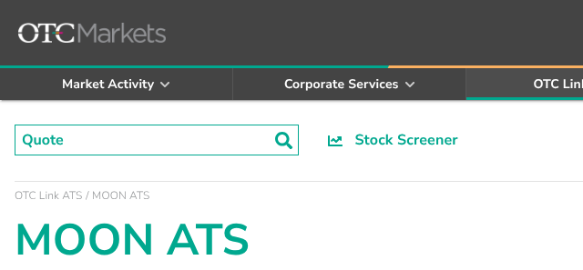
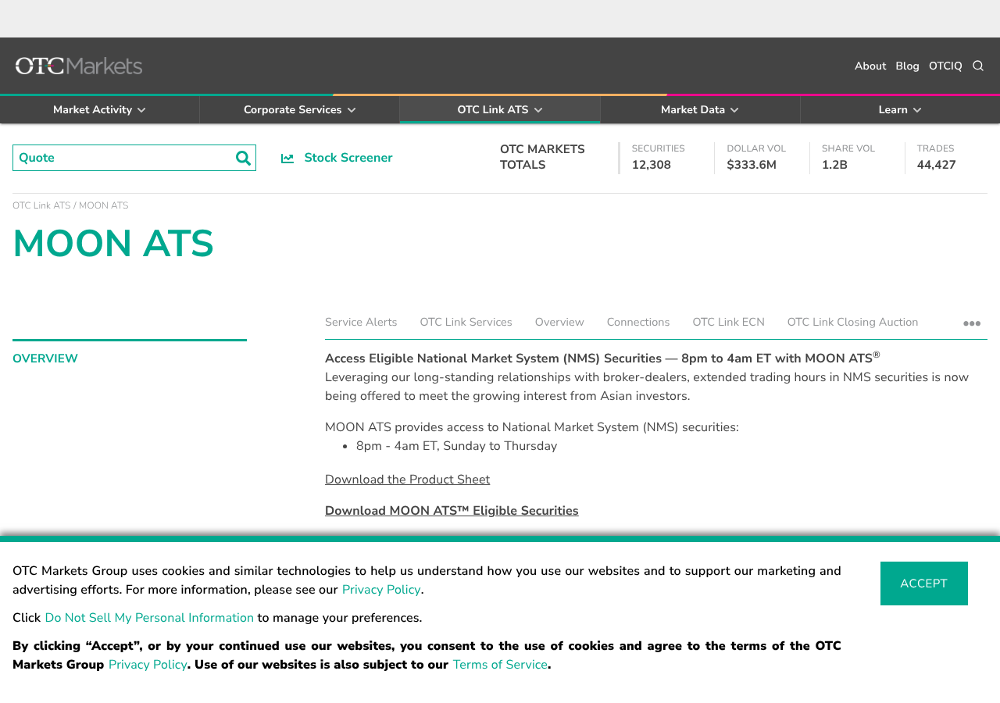
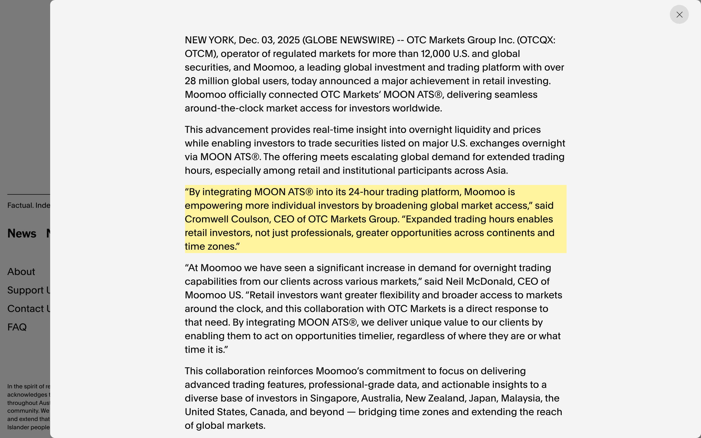
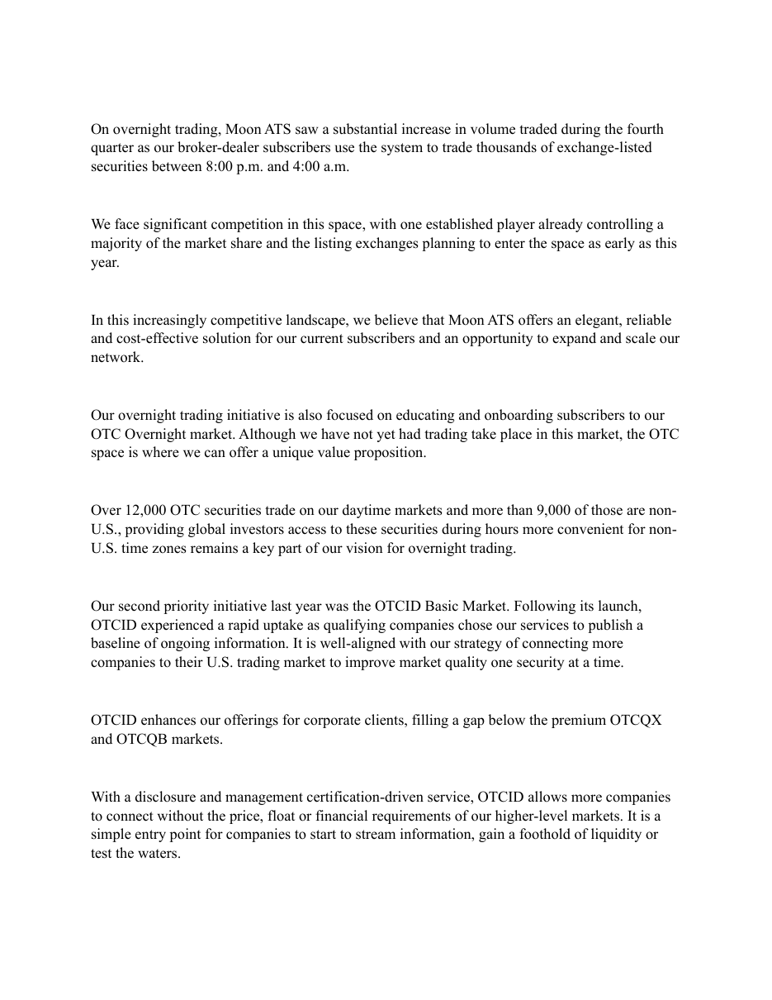
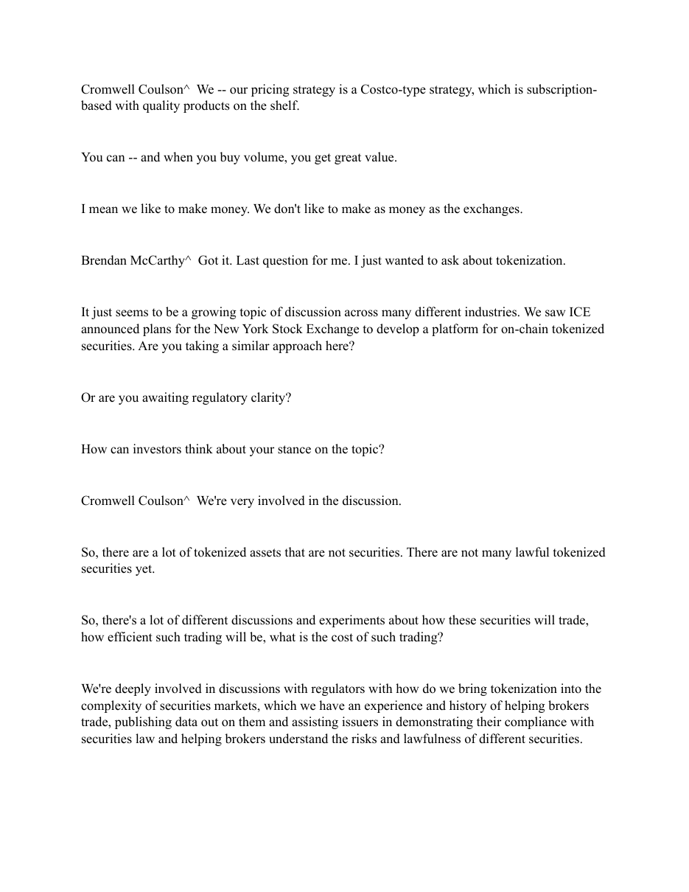

## ATS 개요
● 주장 : 장외주식 시장 운영사가 야간을 더했으나 점유율 2%대 [F-0036][F-0042]
● 운영사
  ★ 운영 : OTC Link LLC(OTC Markets 계열 브로커딜러) [F-0036]
  ★ 2012-03 OTC Link 브로커딜러 등록, FINRA(미국 증권업 자율규제기구) 회원 [F-0249]
  ★ 2024-11 SEC 신고 절차 뒤 MOON ATS 출시 [F-0036]
● 모회사
  ★ OTC Markets Group(미국 장외주식 시장 운영사), OTCQX 상장 [F-0036]
  ★ 2026 Q2 그룹 매출 3,480만 달러, 전년 대비 14% 증가 [F-0043]
● 취급 자산
  ★ 미국 NMS(전국시장체계) 상장 주식 [F-0036]
  ★ 장외주식 야간 거래는 2024-09 OTC Overnight로 별도 [F-0038]
● 대상 고객
  ★ 브로커딜러 구독자 [F-0036]
  ★ 2025-12 Moomoo(아시아 투자 앱)가 24시간 플랫폼에 연결 [F-1080]
● 거래시간
  ★ 일~목 밤 8시~새벽 4시(미국 동부) [F-0037]
● 거래 규모
  ★ 기준 : FINRA 주간 보고 거래대금 13주 합산, 야간 3사 대비 [F-0042]
  ★ 2026 Q3 58.3억 달러, 3사 중 2.0%(Q2 3.8%) [F-0042][F-0041]
  ★ 같은 Q3 Blue Ocean(선발 야간 ATS) 83.0%, Bruce(야간 ATS) 15.0% [F-0015][F-0029]
  ★ 2026 Q2 120.9억 달러에서 Q3 절반 아래로 감소 [F-0040][F-0042]
● 차별화 요소
  ★ 아시아 구간 월~금 오전 8시~오후 4시(UTC+8) 별도 [F-0037]
  ★ 상장주식(MOON)과 장외주식(OTC Overnight) 야간 병행 [F-0038]
● 토큰증권 취급 현황
  ★ 2026-03 실적 발표 기준 취급 전, 아래 발언 3 참조 [F-1082]
● 화면
  

## 경영진 발언
● 주장 : 아시아 개인과 미국 밖 시간대를 보되 토큰은 적법화 뒤 [F-1080][F-1081][F-1082]
● 발언 1 : 거래시간 확대는 개인투자자의 기회 [F-1080]
  ★ Cromwell Coulson(OTC Markets Group CEO), Moomoo 연결 보도자료, 2025-12-03, https://www.aap.com.au/aapreleases/globenewswire9594942/ [F-1080]
    ① 원문 : "By integrating MOON ATS into its 24-hour trading platform, Moomoo is empowering more individual investors by broadening global market access. Expanded trading hours enables retail investors, not just professionals, greater opportunities across continents and time zones."
    ② 번역 : Moomoo가 24시간 거래 플랫폼에 MOON ATS를 통합해 더 많은 개인투자자에게 글로벌 시장 접근을 넓힌다. 거래시간 확대는 전문가만이 아니라 개인투자자에게도 대륙과 시간대를 넘는 기회를 준다.
    ③ 해석 : 큰 곳은 아시아 개인투자자. 그래서 아시아 투자 앱에 연결해 야간 주문 확보
  
● 발언 2 : 미국 밖 시간대에 해외 증권을 연다 [F-1081]
  ★ Cromwell Coulson(사장 겸 CEO), 2025 Q4 실적 발표 녹취, 2026-03-05, https://www.otcmarkets.com/files/030526OTCM.pdf [F-1081]
    ① 원문 : "Over 12,000 OTC securities trade on our daytime markets and more than 9,000 of those are non-U.S., providing global investors access to these securities during hours more convenient for non-U.S. time zones remains a key part of our vision for overnight trading."
    ② 번역 : 주간 시장에서 1만 2천 종 넘는 OTC 증권이 거래되고 그중 9천 종 넘게가 미국 밖 증권이다. 미국 밖 투자자가 편한 시간에 이 증권에 접근하게 하는 것이 야간 거래 비전의 핵심이다.
    ③ 해석 : 큰 곳은 미국 밖 투자자의 해외 증권 수요. 그래서 장외주식 야간 시장을 병행
  
● 발언 3 : 적법한 토큰증권이 나오면 참여 [F-1082]
  ★ Cromwell Coulson(사장 겸 CEO), 2025 Q4 실적 발표 질의응답, 2026-03-05, https://www.otcmarkets.com/files/030526OTCM.pdf [F-1082]
    ① 원문 : "So, there are a lot of tokenized assets that are not securities. There are not many lawful tokenized securities yet. ... We will be there with tokenized securities when they are free trading and lawful."
    ② 번역 : 증권이 아닌 토큰화 자산은 많지만 합법적인 토큰화 증권은 아직 많지 않다. 토큰화 증권이 자유롭게 거래되고 적법해지면 우리도 거기에 있을 것이다.
    ③ 해석 : 큰 곳은 적법해진 뒤의 토큰증권 시장. 그래서 지금은 규제 정리를 기다리며 준비
  

## 국내 연결과 사고 이력
● 주장 : 한국과는 Blue Ocean 사고 뒤 백업 ATS로만 연결 [F-0044][F-0009]
● 국내 증권사 연결
  ★ 2025-11 한국 증권사가 Blue Ocean 외 백업 ATS로 계약 [F-0044]
  ★ 같은 백업 지위를 Bruce와 나눔 [F-0035]

## 한국 시장과의 차이
● 주장 : 미국은 기존 브로커딜러가 시간대를 더하고, 한국 ATS는 전문투자자용 [F-0249][KR-자본시장법시행령-별표1-ATS]
● 규제
  ★ 가능했던 이유 : 브로커딜러 등록과 Reg ATS로 거래소 등록 면제 [F-0249][US-17CFR-240.3a1-1][US-17CFR-242.301-b1]
  ★ 가능했던 이유 : NMS 주식 ATS는 Form ATS-N 효력으로 운영 [F-0036][US-17CFR-242.304]
  ★ 한국에서 막히는 지점 : 다자간매매체결회사(한국 ATS) 인가는 전문투자자 대상만 [KR-자본시장법시행령-별표1-ATS]
  ★ 한국에서 막히는 지점 : 개인의 해외 주식 주문은 해외 중개업자 경유 [KR-금투업규정-5-31]
● 고객 수요
  ★ 가능했던 이유 : 아시아 낮 시간의 미국 증권 매매 수요 [F-0037]
  ★ 한국 차이 : 국내 투자자 미국 주식 보관 1,636억 달러(2025말) [F-1005]
  ★ 한국 차이 : 2025-11 증권사 18곳이 주간거래 재개 [F-1010]

## 성과와 판단
● 주장 : 기존 구독 기반만으로는 선발 시장의 주문을 못 가져옴 [F-0036][F-0042]
● 핵심 성공요인(KSF)
  ★ 2012년부터 운영한 브로커딜러 위에 야간 시장 추가 [F-0249][F-0036]
  ★ 2025-12 Moomoo 연결로 아시아 개인 주문 경로 확보 [F-1080]
● 제약과 리스크
  ★ 2026 점유율 Q2 3.8%에서 Q3 2.0%로 하락 [F-0041][F-0042]
  ★ 한국 연결은 백업 계약에 그침 [F-0044]
● KDX 시사점(스토리라인 명제별)
  ★ 시장 인프라 Unbundling : 체결만 하고 고객 접점은 구독 브로커와 앱 [F-0036][F-1080]
  ★ Borderless Investing : 아시아 시간대 구간을 따로 열어 해외 수요 [F-0037]
  ★ Coopetition : 경쟁 시장 사고 때 백업으로 같은 증권사에 공급 [F-0044]
  ★ 해외 확장 세 질문 : 아시아 낮 체결, 브로커딜러 등록, 앱 연결(제공 가치, 제도, 역할) [F-0037][F-0249][F-1080]
