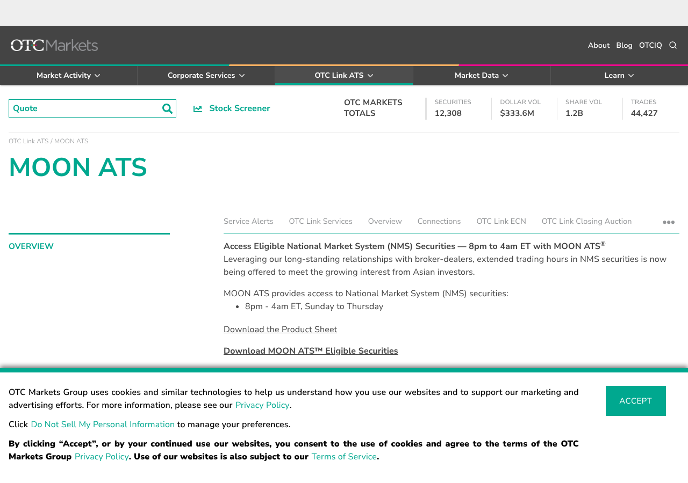
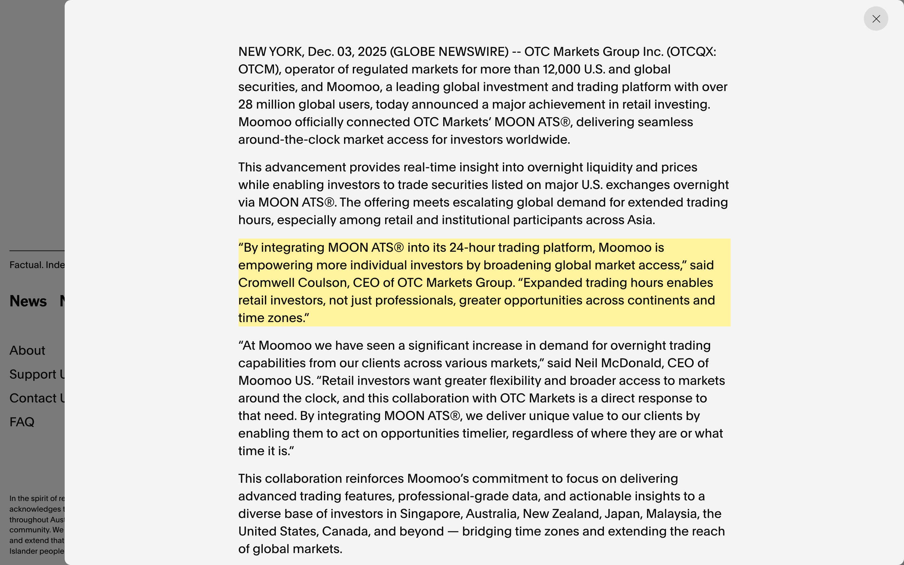
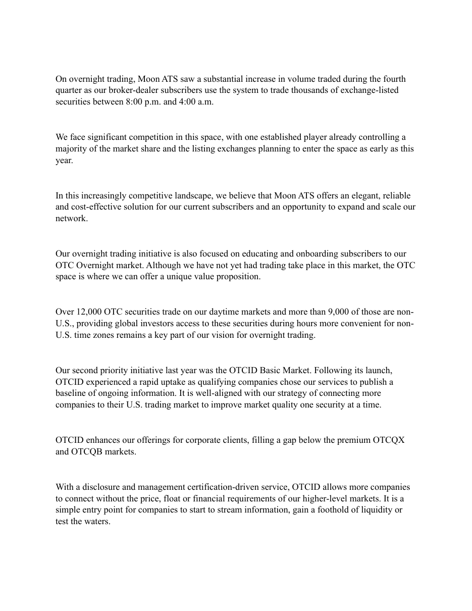
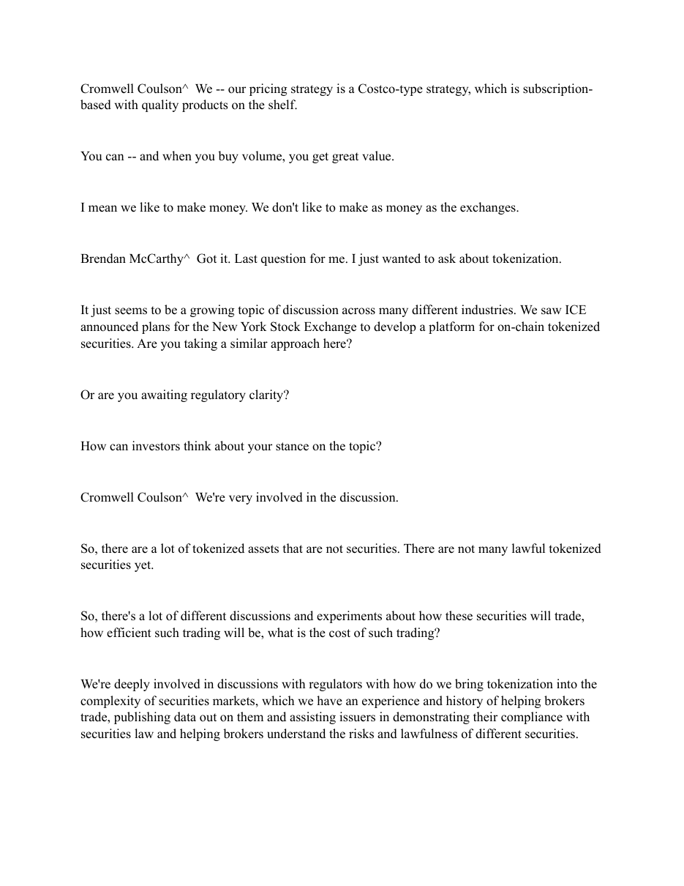

## 정체 카드
● 한 줄 정체 : 미국 장외주식 시장 운영사 OTC Markets Group이 운영하는 야간 시장 MOON ATS, 야간 3사 중 가장 작음 [F-0036][F-0042]
  - 뜻 : ATS(대체거래시스템) = 거래소로 등록하지 않고 브로커딜러가 운영하는 주문 체결 시장. 이 본문의 "야간 3사"는 Blue Ocean, Bruce, MOON 세 ATS
● 대표 상품 : MOON ATS = 상장 주식 야간 거래(OTC Overnight은 장외주식 야간 거래) [F-0036][F-0038]
● 꼭 알아야 할 사실
  ★ MOON ATS는 비상장, 모회사 OTC Markets Group은 OTCQX 시장에 상장 [F-0036]
  ★ 2024-11-21 MOON ATS 출시 [F-0036]
  ★ 2026-09 Blue Ocean 18개 종목 중단 때 한국 지정가 주문 유입 [F-1101][F-0045]
● 숫자
  ★ 점유율 : 야간 3사 거래대금 합계 대비, FINRA 주간 보고 13주 기준 Q2 3.8%, Q3 2.0%(1위 Blue Ocean 83.0%와 81.0%p 차이) [F-0041][F-0042][F-0015]
  ★ 2026 Q3 거래대금 58.3억 달러 [F-0042]
● 흐름 : 아시아 투자자 → Moomoo 앱 → MOON ATS 체결 [F-1080]

## ATS 개요
● 쉽게 말하면 : 장외주식 시장 운영사가 야간 시간대를 더한 시장, 규모는 3사 중 가장 작음 [F-0036][F-0042]
● 주장 : 기존 구독 기반만으로는 야간 주문을 충분히 끌어오지 못함 [F-0036][F-0042]
● 운영사
  ★ 운영 : OTC Link LLC(OTC Markets Group 계열 브로커딜러) [F-0036]
  ★ 2012-03 OTC Link 브로커딜러 등록, FINRA 회원 [F-0249]
  - 뜻 : 브로커딜러 = 미국 SEC에 등록해 증권을 중개, 매매하는 증권사
  - 뜻 : FINRA = 미국 브로커딜러를 감독하는 민간 자율규제기구
  ★ 2024-11 SEC 신고 절차 뒤 MOON ATS 출시 [F-0036]
● 모회사
  ★ OTC Markets Group(미국 장외주식 시장 운영사), OTCQX 상장 [F-0036]
  ★ 2026 Q2 그룹 매출 3,480만 달러, 전년 같은 분기 대비 14% 증가 [F-0043]
● 취급 자산
  ★ 미국 NMS 상장 주식 [F-0036]
  - 뜻 : NMS(전국시장체계) = 미국 증권거래소에 상장된 주식을 하나의 시장처럼 묶는 SEC 규칙 체계
  ★ 장외주식 야간 거래는 2024-09 OTC Overnight으로 별도 [F-0038]
● 대상 고객
  ★ 브로커딜러 구독자 [F-0036]
  ★ 2025-12 Moomoo(아시아 투자 앱)가 24시간 플랫폼에 연결 [F-1080]
● 거래시간
  ★ 일~목 밤 8시~새벽 4시(미국 동부) [F-0037]
● 거래 규모
  ★ 기준 : FINRA 주간 보고 거래대금 13주 합산, 야간 3사 합계 대비 [F-0042]
  ★ 2026 Q3 58.3억 달러, 3사 중 2.0%(Q2 3.8%) [F-0042][F-0041]
  ★ 같은 Q3 Blue Ocean(선발 야간 ATS) 83.0%, Bruce(야간 ATS) 15.0% [F-0015][F-0029]
  ★ 2026 Q2 120.9억 달러에서 Q3 절반 아래로 감소 [F-0040][F-0042]
● 차별화 요소
  ★ 아시아 구간 월~금 오전 8시~오후 4시(UTC+8) 별도 [F-0037]
  ★ 상장주식(MOON)과 장외주식(OTC Overnight) 야간 병행 [F-0038]
● 토큰증권 취급 현황
  ★ 2026-03 실적 발표 기준 취급 전, 아래 발언 3 참조 [F-1082]
● 화면
  

## 거래 시설 운영
● 쉽게 말하면 : 운영은 OTC Markets Group 계열 브로커딜러가 맡고, 한국은 Blue Ocean 장애를 대비한 백업 계약으로만 연결됨 [F-0036][F-0249][F-0044]
● 주장 : 구독 브로커딜러와 아시아 앱 연결로 운영하되, 한국 주문은 선발 시장 장애 때만 들어옴 [F-0036][F-1080][F-0044]
● 참가자 유형
  ★ 구독자 : 브로커딜러(OTC Link LLC가 운영) [F-0036][F-0249]
  ★ 아시아 앱 : Moomoo가 2025-12 자사 24시간 거래 플랫폼에 MOON ATS를 통합 [F-1080]
  ★ 한국 증권사 : Blue Ocean 외 백업 ATS로 계약 [F-0044]
● 주주 구성과 지분
  ★ 모회사 OTC Markets Group은 OTCQX에 상장 [F-0036]
● 장애 대응 체계
  ★ 한국 재개 조건(금융감독원이 금융투자협회와 2025-09-24 발표, 매체 3곳 일치) : 2곳 이상 미국 브로커와 ATS에 주문 회선 연결 [F-1299]
  ★ 한국 재개 조건 : 위험 고지 강화, 사고 시 보상체계, 장애 대응 매뉴얼, 현지 ATS와 비상연락망 [F-1301]
  ★ 해석 : 이 조건이 한국 증권사가 Blue Ocean 외에 MOON을 백업으로 계약한 배경 [F-1299][F-0044]
● 정규 거래소 야간 진입 일정(미국 정규 거래소가 밤 시간대 거래를 열려는 계획)
  - 뜻 : SIP(통합시세 처리 시스템) = 여러 거래소의 호가와 체결가를 하나로 모아 전 시장에 내보내는 시스템. 거래소 야간 세션은 SIP가 야간에도 운영될 수 있을 때 시작하는 조건이 붙음 [F-1172]
  ★ SIP : 2026-12-06부터 연장 시간표 적용, 야간 시작 조건의 기준일 [F-1166][F-1168]
  ★ Nasdaq : 2026-04-10 SEC 신속 승인, 주 5일 23시간 거래, 야간 세션은 SIP 가용 시 시작 [F-1171][F-1172]
  ★ Cboe EDGX : 2026-05-29 SEC 신속 승인, SIP 준비 조건 충족 전에는 야간 세션 시작 안 함 [F-1303]
  ★ NYSE Arca : 2026-05 야간 세션 추가 규칙 제출, 승인 명령이 아니라 제출 즉시 효력 [F-1174]
  ★ MEMX : 승인이 아니라 2026-08-28 규칙 제출, 즉시 효력(관보 2026-09-14), 야간 세션 시작 조건은 EDGX와 같음 [F-1304]
  ★ 24X : 야간 거래는 조건부 면제로 2027-01-24부터, SIP가 2026-12-06까지 준비되지 못할 때만 허용 [F-1165]
  ★ 규모 : MEMX가 SEC 문서에 인용한 자료로 2026-04 야간 거래는 전년 같은 달 대비 305% 증가, 전체 일 거래량의 1% 미만 [F-1305]
  ★ 해석 : 거래소 야간 세션은 SIP 준비 전에는 시작하지 않으므로, MOON과의 직접 경쟁은 2026-12-06 이후에 시작 [F-1303][F-1304][F-1166]

## 경영진 발언
● 쉽게 말하면 : 경영진은 아시아 개인과 미국 밖 시간대를 보되 토큰은 적법화 뒤라고 말함 [F-1080][F-1081][F-1082]
● 주장 : 아시아 개인과 미국 밖 시간대를 보되 토큰은 적법화 뒤 [F-1080][F-1081][F-1082]
● 발언 1 : 거래시간 확대는 개인투자자의 기회 [F-1080]
  ★ Cromwell Coulson(OTC Markets Group CEO), Moomoo 연결 보도자료, 2025-12-03, https://www.aap.com.au/aapreleases/globenewswire9594942/ [F-1080]
    ① 원문 : "By integrating MOON ATS into its 24-hour trading platform, Moomoo is empowering more individual investors by broadening global market access. Expanded trading hours enables retail investors, not just professionals, greater opportunities across continents and time zones."
    ② 번역 : Moomoo가 24시간 거래 플랫폼에 MOON ATS를 통합해 더 많은 개인투자자에게 글로벌 시장 접근을 넓힌다. 거래시간 확대는 전문가만이 아니라 개인투자자에게도 대륙과 시간대를 넘는 기회를 준다.
    ③ 해석 : 큰 곳은 아시아 개인투자자. 그래서 아시아 투자 앱에 연결해 야간 주문 확보
  
● 발언 2 : 미국 밖 시간대에 해외 증권을 연다 [F-1081]
  ★ Cromwell Coulson(사장 겸 CEO), 2025 Q4 실적 발표 녹취, 2026-03-05, https://www.otcmarkets.com/files/030526OTCM.pdf [F-1081]
    ① 원문 : "Over 12,000 OTC securities trade on our daytime markets and more than 9,000 of those are non-U.S., providing global investors access to these securities during hours more convenient for non-U.S. time zones remains a key part of our vision for overnight trading."
    ② 번역 : 주간 시장에서 1만 2천 종 넘는 OTC 증권이 거래되고 그중 9천 종 넘게가 미국 밖 증권이다. 미국 밖 투자자가 편한 시간에 이 증권에 접근하게 하는 것이 야간 거래 비전의 핵심이다.
    ③ 해석 : 큰 곳은 미국 밖 투자자의 해외 증권 수요. 그래서 장외주식 야간 시장을 병행
  
● 발언 3 : 적법한 토큰증권이 나오면 참여 [F-1082]
  ★ Cromwell Coulson(사장 겸 CEO), 2025 Q4 실적 발표 질의응답, 2026-03-05, https://www.otcmarkets.com/files/030526OTCM.pdf [F-1082]
    ① 원문 : "So, there are a lot of tokenized assets that are not securities. There are not many lawful tokenized securities yet. ... We will be there with tokenized securities when they are free trading and lawful."
    ② 번역 : 증권이 아닌 토큰화 자산은 많지만 합법적인 토큰화 증권은 아직 많지 않다. 토큰화 증권이 자유롭게 거래되고 적법해지면 우리도 거기에 있을 것이다.
    ③ 해석 : 큰 곳은 적법해진 뒤의 토큰증권 시장. 그래서 지금은 규제 정리를 기다리며 준비
  

## 국내 연결과 사고 이력
● 쉽게 말하면 : 한국 증권사에는 Blue Ocean이 멈출 때 쓰는 백업 계약일 뿐임 [F-0044][F-1101]
● 주장 : 한국 주문은 Blue Ocean이 멈출 때만 들어오는 백업 [F-0044][F-1101]
● 국내 증권사 연결
  ★ 2025-11 한국 증권사가 Blue Ocean 외 백업 ATS로 계약 [F-0044]
  ★ 같은 백업 지위를 Bruce와 나눔 [F-0035]
● 2026-09 종목 중단 때
  ★ 09-01 Blue Ocean 18종목 중단, 주문 일부가 MOON으로 [F-1099][F-1101]
  ★ 한국 앱엔 시세가 없어 지정가만, 시세 연결은 Bruce가 먼저 [F-1101][F-0032]
  ★ Q3 점유율 2.0%, Q2 3.8%에서 하락 [F-0042][F-0041]

## 한국 시장과의 차이
● 쉽게 말하면 : 미국은 기존 브로커딜러가 신고로 시간대를 더하지만 한국은 인가가 필요함 [F-0249][F-1092]
● 주장 : 미국은 기존 브로커딜러가 신고로 시간대를 더하고, 한국은 인가 [F-0249][F-1092]
● 규제
  ★ 가능했던 이유 : 브로커딜러 등록과 Reg ATS로 거래소 등록 면제 [F-0249][US-17CFR-240.3a1-1][US-17CFR-242.301-b1]
  - 뜻 : Reg ATS = 미국 SEC의 ATS 규정, 브로커딜러가 요건을 지키면 거래소 등록 없이 시장을 운영하게 함
  ★ 가능했던 이유 : NMS 주식 ATS는 Form ATS-N 효력으로 운영 [F-0036][US-17CFR-242.304]
  - 뜻 : Form ATS-N = NMS 주식을 거래하는 ATS가 SEC에 내는 운영 신고서, 효력이 생겨야 운영 가능
  ★ 한국 차이 : 한국 ATS는 금융위 인가, 직접 참가자는 증권사 [F-1092][F-1095][F-1096]
  ★ 한국 차이 : 개인의 해외 주식 주문은 해외 중개업자 경유 [KR-금투업규정-5-31]
● 고객 수요
  ★ 가능했던 이유 : 아시아 낮 시간의 미국 증권 매매 수요 [F-0037]
● 규제 건의 포인트 : 평상시에도 여러 해외 ATS로 나눠 주문하는 최선집행 기준 [F-0044][F-1094]

## 성과와 판단
● 쉽게 말하면 : 백업 지위만으로는 점유율이 늘지 않았고, 거래소 야간 거래가 변수임 [F-0044][F-0042][F-1171]
● 주장 : 백업 지위와 기존 구독만으로는 점유율을 지키지 못함 [F-0044][F-0042]
● 성과
  ★ 거래대금 점유율 : 야간 3사 합계 대비 2026 Q3 2.0%(Q2 3.8%), 거래대금 58.3억 달러 [F-0042][F-0041]
● 핵심 성공요인(KSF)
  ★ 이미 등록된 브로커딜러 위에 야간 시장을 얹어 짧은 기간에 시장 진입 [F-0249][F-0036][F-0041]
  - 남들 : Blue Ocean 2021-10 개장, Bruce 2025-03 개장 [F-1090][F-0020]
  - 이 회사 : OTC Link는 2012-03 등록, MOON ATS는 2024-11 출시 [F-0249][F-0036]
  - 결과 : 출시 1년여 만에 Q2 3.8%, 이어 Q3 2.0% [F-0041][F-0042]
  - 한계 : 점유율이 Q3에 내려가 선점 효과가 이어졌는지는 근거 부족 [F-0041][F-0042]
  ★ 2025-12 Moomoo 연결로 아시아 개인 주문 경로 확보 [F-1080]
● 제약과 리스크
  ★ 2026 점유율 Q2 3.8%에서 Q3 2.0%로 하락 [F-0041][F-0042]
  - 해석 : 거래대금이 120.9억에서 58.3억 달러로 줄면 호가가 얇아져 구독 브로커딜러가 체결 상대를 찾기 어려워짐 [F-0040][F-0042]
  ★ 한국 연결은 백업 계약에 그침 [F-0044]
  - 잃는 쪽 : 한국 주문은 Blue Ocean 장애 때만 들어오고 시세 연결은 Bruce가 먼저 [F-1101][F-0032]
● 거래소 야간 거래가 오면(일정은 위 "거래 시설 운영" 참조)
  ★ 해석 : 존재 이유가 야간 유일 시장에서 아시아 앱 채널과 장외주식 병행으로 바뀜 [F-1080][F-0038][F-1171]
● KDX 시사점
  ★ 자산 : 상장 주식과 장외주식을 야간에 함께 취급 [F-0038][F-0036]
  - 가져올 것 : 기존 시장 운영사가 보유 상품을 야간으로 넓히는 방식 [F-0036][F-0038]
  ★ 고객 : 아시아 투자 앱을 연결 경로로 확보 [F-1080]
  - 피할 것 : 주문 채널 없이 체결 시장만 여는 것 [F-0042]
  ★ 시장 : 기존 인가 위에 시간대만 더하는 확장 [F-0249][F-0036]
  ★ 거래 시설 운영 : 시장 운영사의 기존 브로커딜러 등록을 활용 [F-0249][F-0036]
  - 가져올 것 : 기존 등록과 시장 운영 경험 위에 새 시간대 추가 [F-0249]
● 해외에서 이 사업이 된 조건
  ★ 제공 가치 : 아시아 시간대의 미국 증권 체결 [F-0037]
  ★ 제도 : 기존 브로커딜러 등록, Form ATS-N [F-0249][US-17CFR-242.304]
  ★ 경제성 : 야간 3사 합계 대비 Q3 점유율 2.0%, 그룹 매출은 다른 사업이 버팀 [F-0042][F-0043]
