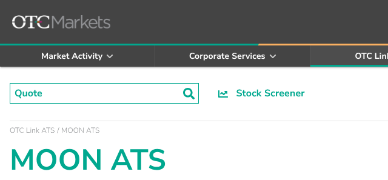

## 정체 카드
● 한 줄 정체 : 거래소에 상장되지 않은 장외주식 시장을 운영하는 OTC Markets Group 계열이 미국 동부 밤 8시~새벽 4시에 여는 야간 시장 MOON ATS. ==야간 3사 중 거래대금이 가장 작음== [F-0036][F-0042][F-0037]
  - 뜻 : 야간 3사 = Blue Ocean, Bruce, MOON 세 야간 ATS
  ★ 유형 안 위치 : 미국 SEC 상장주식 ATS 35곳 → **야간 거래 ATS** 4곳의 하나 → 야간 3사 거래대금 2.0%로 3위(2026 Q3) → 장외주식 시장 운영사 OTC Markets Group 계열이 2024-11 출시 [F-1141][F-1176][F-0042][F-0036]
● 대표 상품 : MOON ATS = 거래소 상장 주식의 야간 거래. 별도로 2024-09 시작한 OTC Overnight은 거래소에 상장되지 않은 장외주식의 야간 거래 [F-0036][F-0038]
● 숫자
  ★ 점유율 : 야간 3사 거래대금 합계 대비, FINRA 주간 보고 13주 기준 Q2 3.8%, Q3 2.0%(1위 Blue Ocean 83.0%와 81.0%p 차이) [F-0041][F-0042][F-0015]
● 흐름 : 아시아 투자자 → Moomoo 앱 → MOON ATS 체결 [F-1080]

## ATS 개요
● 주장 : 기존 구독 브로커딜러 기반만으로는 야간 주문이 충분히 늘지 않아, 2026 Q3 거래대금이 Q2의 절반 아래(120.9억에서 58.3억 달러)로 줄고 점유율도 3.8%에서 2.0%로 내려감 [F-0036][F-0040][F-0042][F-0041]
● 운영사
  ★ 운영 : OTC Link LLC(OTC Markets Group 계열 브로커딜러) [F-0036]
● 인가와 인수로 열린 것
  ★ 상장주식 야간 시장(새로 연 것) : 그 전 OTC Link는 2012-03부터 등록된 계열 브로커딜러 → 계기 새 인가 없이 2024-11 SEC에 Form ATS-N 신고 → 그 뒤 2024-11-21 MOON ATS 출시, 미국 NMS 상장 주식을 일~목 밤 8시~새벽 4시(미국 동부) 거래 [F-0249][F-0036][F-0037][US-17CFR-242.304]
  ★ 한국 낮 시간 주문(인가가 아닌 계약) : 그 전 한국 주간거래는 Blue Ocean 경유였고 2024-08-16 일괄 중단 → 계기 금융감독원이 2025-09-24 재개 조건으로 2곳 이상 미국 브로커와 ATS 연결을 요구, 2025-11 한국 증권사가 MOON을 백업 ATS로 계약 → 그 뒤 2026-09 Blue Ocean 18종목 중단 때 지정가 주문 일부 유입. 평상시 주문 경로는 아님 [F-1103][F-1299][F-0044][F-1101]
● 설립 목적과 타깃 수요
  ★ 왜 만들었나 : 2024-11-21 출시 발표에서 미국 달러 표시 해외 증권과 야간 세션 수요가 늘고 브로커딜러가 미국과 해외 투자자의 거래 경험을 높이려는 시점에 내놓았다고 밝힘(회사 발표) [F-1427]
  ★ 누구의 어떤 수요 : 같은 발표가 꼽은 대상은 현지 낮 시간에 미국 상장 주식을 거래하려는 아시아태평양 투자자와 늦은 저녁, 이른 아침에 거래하려는 미국 투자자. 아시아 구간(UTC+8 오전 8시~오후 4시)을 따로 둠(회사 발표) [F-1427][F-0037]
  ★ 실제 주문을 낸 쪽 : 브로커딜러 구독자와 2025-12 연결한 Moomoo(아시아 투자 앱). 한국 증권사는 Blue Ocean이 멈출 때만 주문을 돌리는 ==백업 계약 단계==이고 2026-09 Blue Ocean 종목 거래 멈춤 때 지정가 주문이 일부 들어옴 {mo-0013}{mo-0014}{mo-0050}{mo-0076}
● 모회사
  ★ OTC Markets Group(미국 장외주식 시장 운영사), OTCQX 상장 [F-0036]
  ★ 2026 Q2 그룹 매출 3,480만 달러, 전년 같은 분기 대비 14% 증가. 이 중 MOON ATS 몫은 공개되지 않음 [F-0043]
● 대상 고객
  ★ 브로커딜러 구독자 [F-0036]
  ★ 2025-12 Moomoo(아시아 투자 앱)가 24시간 플랫폼에 연결 [F-1080]
● 거래 규모
  ★ 2026 Q3 58.3억 달러, 3사 중 2.0%(Q2 3.8%) [F-0042][F-0041]
● 화면
  

## 거래 시설 운영
● 주장 : 구독 브로커딜러와 아시아 앱(Moomoo) 연결로 운영하나, 한국 증권사는 Blue Ocean이 멈출 때만 주문을 돌려 주문 유입이 불규칙함 [F-0036][F-1080][F-0044]
● 요금(2026-11-01 시행 요금표)
  ★ 1달러 이상 종목은 기존 호가를 가져가는 체결에 주당 0.0016달러, 주문을 다른 시장으로 넘겨 체결할 때 주당 0.0025달러. 월 500만 주 이상 호가를 내 체결된 곳은 리베이트, 접속비 없음 [F-1398]
  - 비교 : 같은 기준에서 Blue Ocean과 Bruce는 Form ATS-N상 주당 0~0.002달러(협상 또는 할인 범위). MOON은 고정 요율 [F-1394][F-1396][F-1398]
● 주주 구성과 지분
  ★ 최대주주 : CEO Cromwell Coulson 27.1%, 가족신탁 7.4%(2025 연차보고서, 2025-12-31 기준). MOON ATS를 운영하는 OTC Link LLC는 이 그룹의 계열 브로커딜러 [F-1399][F-0036]
● 정규 거래소 야간 진입 일정(미국 정규 거래소가 밤 시간대 거래를 열려는 계획)
  - 뜻 : SIP(통합시세 처리 시스템) = 여러 거래소의 호가와 체결가를 모아 전 시장에 내보내는 시스템. 거래소 야간 세션은 SIP가 야간에도 운영될 때 시작하는 조건이 붙음 [F-1172]
  ★ SIP : 2026-12-06부터 연장 시간표 적용, 야간 시작 조건의 기준일 [F-1166][F-1168]
  ★ Nasdaq : 2026-04-10 SEC 신속 승인, 주 5일 23시간 거래, 야간 세션은 SIP 가용 시 시작 [F-1171][F-1172]
  ★ Cboe EDGX(2026-05-29 SEC 신속 승인), MEMX(2026-08-28 규칙 제출 즉시 효력), NYSE Arca(2026-05 규칙 제출 즉시 효력)도 야간 세션 규칙을 갖춤. EDGX와 MEMX는 SIP 준비 전에는 시작 안 함 [F-1303][F-1304][F-1174]

## 경영진 발언
● 주장 : 아시아 개인투자자 확보(Moomoo 연결)는 이뤘고, 미국 밖 투자자용 해외 증권 야간 거래는 OTC Overnight으로 진행하며, 토큰증권은 적법해진 뒤로 미룬다고 말함 [F-1080][F-1081][F-1082]
● 말하고 이룬 것(시점 순)
  ★ 2025-12-03 Coulson(CEO) : 거래시간 확대는 개인투자자의 기회 → 같은 날 Moomoo가 24시간 거래 플랫폼에 MOON ATS 통합 [F-1080]
● 말하고 진행 중인 것
  ★ 2026-03-05 Coulson : 미국 밖 시간대에 해외 증권(주간 시장 거래 OTC 증권 1만 2천 종 중 9천 종 넘게가 미국 밖 증권)을 연다 → 2024-09 OTC Overnight 운영 중, 야간 거래 규모는 공개되지 않음 [F-1081][F-0038]
  ★ 2026-03-05 Coulson : 적법한 토큰증권이 나오면 참여 → 현재 취급하지 않음, 2026 전략 과제로 준비(규제 당국과 논의) [F-1082]
● 발언 1 : 거래시간 확대는 개인투자자의 기회 [F-1080]
  ★ Cromwell Coulson(OTC Markets Group CEO), Moomoo 연결 보도자료, 2025-12-03, https://www.aap.com.au/aapreleases/globenewswire9594942/ [F-1080]
    ① 원문 : "By integrating MOON ATS into its 24-hour trading platform, Moomoo is empowering more individual investors by broadening global market access. Expanded trading hours enables retail investors, not just professionals, greater opportunities across continents and time zones."
    ② 번역 : Moomoo가 24시간 거래 플랫폼에 MOON ATS를 통합해 더 많은 개인투자자에게 글로벌 시장 접근을 넓힌다. 거래시간 확대는 전문가만이 아니라 개인투자자에게도 대륙과 시간대를 넘는 기회를 준다.
  
● 발언 2 : 미국 밖 시간대에 해외 증권을 연다 [F-1081]
  ★ Cromwell Coulson(사장 겸 CEO), 2025 Q4 실적 발표 녹취, 2026-03-05, https://www.otcmarkets.com/files/030526OTCM.pdf [F-1081]
    ① 원문 : "Over 12,000 OTC securities trade on our daytime markets and more than 9,000 of those are non-U.S., providing global investors access to these securities during hours more convenient for non-U.S. time zones remains a key part of our vision for overnight trading."
    ② 번역 : 주간 시장에서 1만 2천 종 넘는 OTC 증권이 거래되고 그중 9천 종 넘게가 미국 밖 증권이다. 미국 밖 투자자가 편한 시간에 이 증권에 접근하게 하는 것이 야간 거래 비전의 핵심이다.
  
● 발언 3 : 적법한 토큰증권이 나오면 참여 [F-1082]
  ★ Cromwell Coulson(사장 겸 CEO), 2025 Q4 실적 발표 질의응답, 2026-03-05, https://www.otcmarkets.com/files/030526OTCM.pdf [F-1082]
    ① 원문 : "So, there are a lot of tokenized assets that are not securities. There are not many lawful tokenized securities yet. ... We will be there with tokenized securities when they are free trading and lawful."
    ② 번역 : 증권이 아닌 토큰화 자산은 많지만 합법적인 토큰화 증권은 아직 많지 않다. 토큰화 증권이 자유롭게 거래되고 적법해지면 우리도 거기에 있을 것이다.
  

## 국내 연결과 사고 이력
● 주장 : 한국 주문은 Blue Ocean이 멈출 때만 들어오는 백업 [F-0044][F-1101]
● 국내 증권사 연결
  ★ 2025-11 한국 증권사가 Blue Ocean 외 백업 ATS로 계약 [F-0044]
  - 뜻 : 백업 ATS = 주 시장(Blue Ocean)이 멈출 때 주문을 돌리도록 미리 계약해 둔 예비 시장. 같은 지위를 Bruce와 나눔 [F-0035]
● 2026-09 종목 중단 때
  ★ 09-01 Blue Ocean 18종목 중단, 주문 일부가 MOON으로 [F-1099][F-1101]
  ★ 한국 앱엔 이 시장의 시세(호가)가 없어 가격을 직접 정하는 지정가 주문만 가능했고, 시세 연결은 Bruce가 먼저 [F-1101][F-0032]

## 한국 시장과의 차이
● 주장 : MOON은 2012-03 등록한 OTC Link가 2024-11 Form ATS-N 신고를 거쳐 야간 시장을 연 사례이고, 한국 ATS는 금융위원회 인가가 있어야 해 같은 방식은 불가 [F-0249][F-0036][US-17CFR-242.304][F-1092]
● 규제
  ★ 가능했던 이유 : 브로커딜러 등록과 Reg ATS로 거래소 등록 면제 [F-0249][US-17CFR-240.3a1-1][US-17CFR-242.301-b1]
  - 뜻 : Reg ATS = 미국 SEC의 ATS 규정, 브로커딜러가 요건을 지키면 거래소 등록 없이 시장을 운영하게 함
  ★ 한국 차이 : 한국 ATS는 금융위 인가, 직접 참가자는 증권사 [F-1092][F-1095][F-1096]
  ★ 한국 차이 : 개인의 해외 주식 주문은 해외 중개업자 경유 [KR-금투업규정-5-31]
● 규제 건의 포인트 : 평상시에도 여러 해외 ATS로 나눠 주문하는 최선집행 기준 [F-0044][F-1094]

## 성과와 판단
● 주장 : 백업 지위와 기존 구독만으로는 점유율을 지키지 못함 [F-0044][F-0042]
● 핵심 성공요인(KSF)
  ★ KSF로 볼 만한 근거는 부족함. 이미 등록된 브로커딜러에 야간 시장을 더해 진입은 빨랐으나 점유율이 이어 내려 성공 요인으로 입증되지 않음 [F-0249][F-0036][F-0041][F-0042]
  - 남들 : Blue Ocean 2021-10 개장, Bruce 2025-03 개장 [F-1090][F-0020]
  - 이 회사 : OTC Link는 2012-03 등록, MOON ATS는 2024-11 출시. 출시 1년여 만에 Q2 3.8%, 이어 Q3 2.0% [F-0249][F-0036][F-0041][F-0042]
  ★ 2025-12 Moomoo 연결로 아시아 개인 주문 경로 확보. 효과는 2026 Q3 점유율(2.0%)에 아직 나타나지 않음 [F-1080][F-0042]
● 제약과 리스크
  ★ 한국 연결은 백업 계약에 그침 [F-0044]
  - 잃는 쪽 : 한국 주문은 !!Blue Ocean 장애 때만 들어오고!! 시세 연결은 Bruce가 먼저 [F-1101][F-0032]
● 거래소 야간 거래가 오면(일정은 위 "거래 시설 운영" 참조)
  ★ 해석 : 거래소의 야간 세션(SIP 준비 조건 때문에 빨라도 2026-12-06 이후)이 열리면 야간 시간대 제공만으로는 차별점이 되지 않아, 아시아 앱 채널과 장외주식 야간 거래 병행이 남는 차별 요소 [F-1080][F-0038][F-1171][F-1166]
● KDX 시사점
  ★ 자산 : 상장 주식과 장외주식을 야간에 함께 취급 [F-0038][F-0036]
  - 가져올 것 : 기존 시장 운영사가 보유 상품을 야간으로 넓히는 방식. 다만 점유율 2.0%는 그것만으로 물량이 따라오지 않음을 보임(해석) [F-0036][F-0038][F-0042]
  ★ 고객 : 아시아 투자 앱을 연결 경로로 확보 [F-1080]
  - 피할 것 : ==주문 채널 없이 체결 시장만 여는 것== [F-0042]
  - 이유 : 구독 브로커딜러 기반만으로는 Q3 거래대금이 Q2의 절반 아래로 줄어 호가가 얇아짐 [F-0042][F-0040]
  ★ 시장 : 한국은 백업 계약으로만 연결 [F-0044]
  - 피할 것 : 한국 증권사의 백업 계약에만 기대는 구조. 주 시장이 멈출 때만 주문이 오므로 평상시 물량이 늘지 않음(점유율 2.0%) [F-0044][F-0042]
  ★ 거래 시설 운영 : 시장 운영사의 기존 브로커딜러 등록을 활용 [F-0249][F-0036]
  - 가져올 것 : 이미 받은 증권사 등록을 쓰고 Form ATS-N 신고만 새로 해 시간대를 더함 [F-0249][F-0036]
  - 피할 것 : 등록만 믿고 구독 브로커딜러를 늘릴 수단 없이 개장하는 것. 출시 1년여 만에 Q2 3.8%에서 Q3 2.0%로 하락 [F-0041][F-0042]
