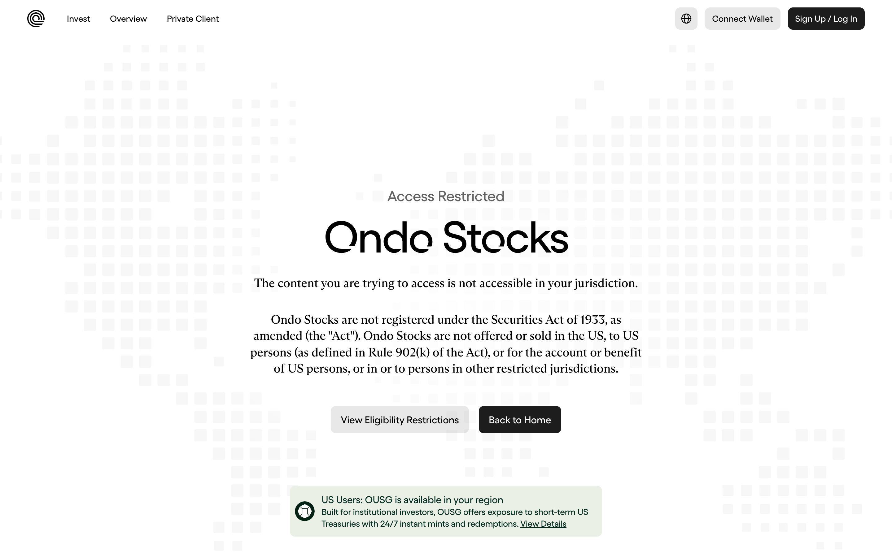
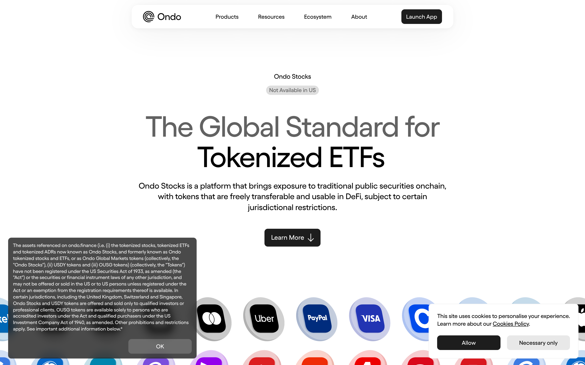
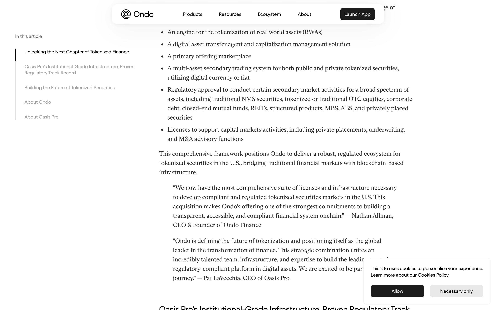
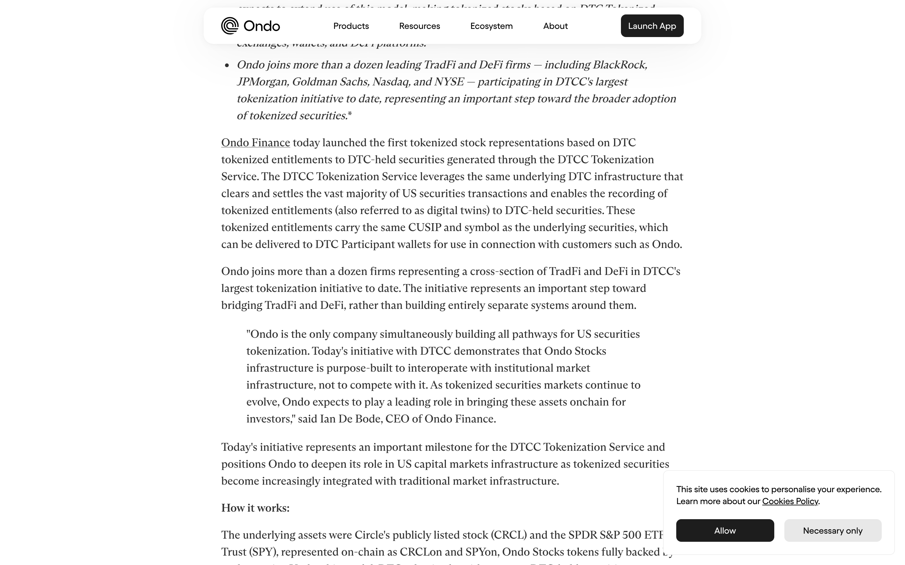
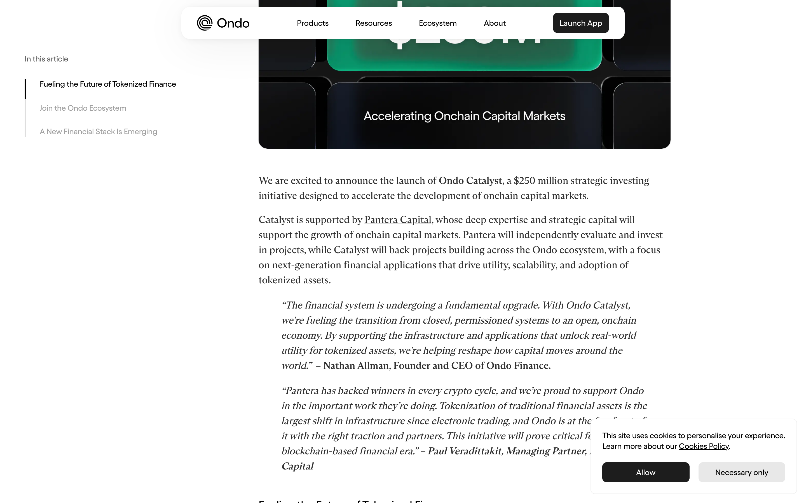

## 회사 개요와 확장 경로
● 주장 : 국채 토큰 회사가 미국 밖 주식 토큰으로 잔액 2위에 오른 경로 [F-0465][F-0197][F-1022]
● 기본정보
  ★ 법인명 : Ondo Finance Inc.(토큰화 기술 회사) [F-0551]
  ★ 발행 법인 : Ondo Global Markets (BVI) Limited [F-0550]
  ★ 창업자 : Nathan Allman, 2026-05 사망 뒤 De Bode가 CEO [F-0207]
  ★ 소재지 : 미국 코네티컷주 그리니치 [F-0193]
● 지배구조
  ★ 발행 법인 지분 : Flux Finance 90.01%, Ondo Finance 9.99% [F-0186]
  ★ Flux Finance는 Ondo Foundation(재단)의 완전 자회사 [F-0562]
  ★ Flux Finance가 토큰 채무의 추가 담보 자금 보증 [F-0580]
● 설립 목적
  ★ Ondo는 세계 금융자산의 공개 블록체인 토큰화를 전망 [F-0496]
● 성장 경로(한 줄기)
  ★ OUSG(단기 국채 토큰), USDY(담보부 노트)로 출발 [F-0465][F-0509]
  ★ 2025-04 BVI 발행 법인 설립 → 2025-07 Oasis Pro(미국 증권사) 인수 발표 [F-0185][F-0194]
  ★ 2025-09 미국 밖 전용 주식 토큰 100종 개시 [F-0197]
  ★ 2025-12 SEC 조사 종결(회사 발표), USDY를 Ondo Stocks로 편입 [F-0198][F-0503]
● 화면
   

## 경영진 발언
● 발언 1 : 미국 규제형 토큰 증권 시장용 인가를 갖췄다 [F-1047]
  ★ Nathan Allman(창업자 겸 CEO), Oasis Pro 인수 완료 발표, 2025-10-07, https://ondo.finance/blog/ondo-acquires-oasis-pro [F-1047]
    ① 원문 : "We now have the most comprehensive suite of licenses and infrastructure necessary to develop compliant and regulated tokenized securities markets in the U.S."
    ② 번역 : 이제 미국에서 규제를 지키는 토큰 증권 시장을 만드는 데 필요한 가장 포괄적인 인가와 인프라를 갖췄다.
    ③ 해석 : 큰 곳은 미국 규제형 토큰 증권 시장. 그래서 증권사, ATS, 명의개서 인가를 인수
  
● 발언 2 : 아시아, 중남미 수백만 이용자에게 미국 주식을 [F-1052]
  ★ Nathan Allman(창업자 겸 CEO), BNB 체인 진출 발표, 2025-10-29, https://ondo.finance/blog/global-markets-live-on-bnb-chain [F-1052]
    ① 원문 : "Expanding Ondo Stocks to BNB Chain allows us to bring tokenized U.S. stocks and ETFs to millions of users across Asia, Latin America, and other geographies, in an environment that is fast, cost-efficient, and highly interoperable."
    ② 번역 : BNB 체인 확장으로 아시아, 중남미 등 수백만 이용자에게 빠르고 저렴하며 연동성 높은 환경에서 토큰 미국 주식과 ETF를 제공한다.
    ③ 해석 : 큰 곳은 아시아, 중남미 개인. 그래서 이용자 많은 BNB 체인에 100종 이상 상장
● 발언 3 : 기존 시장 인프라와 경쟁이 아니라 연동 [F-1049]
  ★ Ian De Bode(CEO), DTCC 협업 발표, 2026-07-15, https://ondo.finance/blog/ondo-and-dtcc-collaborate-on-tokenized-stocks [F-1049]
    ① 원문 : "Today's initiative with DTCC demonstrates that Ondo Stocks infrastructure is purpose-built to interoperate with institutional market infrastructure, not to compete with it."
    ② 번역 : DTCC와의 이번 시도는 Ondo Stocks 인프라가 기관 시장 인프라와 경쟁하지 않고 연동하도록 설계됐음을 보여준다.
    ③ 해석 : 큰 곳은 DTCC(미국 예탁결제기관)와 연결된 토큰 주식. 그래서 DTC 토큰화 권리 기반 주식 토큰 출시
  
● 발언 4 : 닫힌 금융에서 열린 온체인 경제로 [F-1048]
  ★ Nathan Allman(창업자 겸 CEO), Ondo Catalyst 출시 발표, 2025-07-03, https://ondo.finance/blog/introducing-ondo-catalyst [F-1048]
    ① 원문 : "With Ondo Catalyst, we're fueling the transition from closed, permissioned systems to an open, onchain economy."
    ② 번역 : Ondo Catalyst로 닫힌 허가형 시스템에서 열린 온체인 경제로의 전환을 키운다.
    ③ 해석 : 큰 곳은 온체인 경제의 앱과 인프라. 그래서 2.5억 달러 전략 투자로 생태계 후원
  

## A 출신과 진입(주식 토큰 사업)
● 주장 : 국채 토큰 고객 기반 위에 별도 발행 법인으로 진입 [F-0532][F-0505][F-0550]
● 출신 : OUSG는 미국 적격투자자, USDY는 비미국인 대상 [F-0532][F-0505]
● 진입 방식
  ★ 발행은 BVI 법인, Ondo Finance는 토큰화 서비스만 [F-0550][F-0551]
  ★ 진출 사유 : 미국 밖 투자자에게 미국 공개 증권 수천 종 노출 [F-0568]

## B 상품 구조
● 주장 : 주식이 아니라 BVI 발행 법인에 대한 담보부 채권 [F-0998]
● 토큰의 법적 성격(우리 분류)
  ★ 스위스법 채무증서, 기초 종목 1:1 추종 [F-0187][F-0557]
  ★ 기초 주식 인도 청구권, 주주 권리 없음 [F-0188][F-0559]
  ★ 우리 분류 : 연계증권(담보부 제한소구 채권) [F-0998]
● 발행 주체와 보관
  ★ 발행 법인은 독립 이사 둔 SPV, 파산 격리 설계 [F-0576][F-0510]
  ★ Alpaca(미국 청산 증권사), BitGo Trust(수탁 회사) 담보 계좌 1:1 [F-0189][F-0558]
  ★ Ankura Trust(담보 대리인)가 1순위 담보권 보유 [F-0483][F-0573]
● 투자자 권리
  ★ 배당은 자동 재투자되어 토큰 가격에 반영 [F-0542]
  ★ 2026-04 Broadridge(의결 대행사) 연동, 의결 선호 제출 [F-0463][F-0464]
● 규모(시장 내 위치)
  ★ 2026-11-16 발행 잔액 8.99억 달러, 2위(점유율 24.23%) [F-1022]
  ★ 1위 Binance(가상자산 거래소) 13.6억, 3위 Kraken(가상자산 거래소) 6.8억 달러 [F-1021][F-1023]
  ★ 4위 Securitize(토큰화 회사) 2.7억, 6위 Robinhood(주식 거래 앱) 1.5억 달러 [F-1024][F-1025]
  ★ 시장 전체 37.1억 달러(30일 전 대비 +4.33%) [F-1028]
● 수수료
  ★ 발행 수수료 없음, 상환 수수료 0.05% [F-0545]
  ★ 견적가와 기초 매매가 차이는 Ondo Stocks가 보유 [F-0546]

## C 최종 투자자
● 주장 : 미국 밖 개인과 기관이 대상, 미국인은 배제 [F-0566][F-0190]
● 대상
  ★ 지원 관할의 기관과 개인, 2개 고객군 [F-0566]
  ★ Persona(신원 확인 업체)로 KYC, KYB 심사 [F-0567]
● 국적 및 지역 제한
  ★ 미국인, 미국 안에서 주문하는 자 제외 [F-0190][F-0543]
  ★ 스위스는 전문고객만, 개인 판매 없음 [F-0530][F-0544]

## D 유통과 접점
● 주장 : 자체 앱 직접 판매와 거래소, 지갑 공급을 병행 [F-0552][F-0572]
● 공급 방식(누구에게 서빙하는지)
  ★ 자체 앱 : KYC 마친 개인, 기관에 USDon(달러 토큰)으로 판매 [F-0561][F-0552]
  ★ Bitget(가상자산 거래소) : USDT 계정 이용자, 2025-09부터 100종 이상 [F-0202]
  ★ Nest Exchange(Binance 운영 거래소) : UAE에서 디지털 증권으로 거래 [F-0549]
  ★ Trust Wallet, OKX, HTX, 1inch 등 5곳이 출시 파트너 [F-0572]
● 거래 장소
  ★ 사용 블록체인 : Ethereum, BNB Chain, Solana 3개 [F-0574]
  ★ 거래시간 : 일요일 밤 8시~금요일 밤 8시(ET) [F-0564]
  ★ 장외시간 거래 가능 종목 32개 [F-0565]
  ★ ERC20 호환, 외부 지갑으로 자유 이전 [F-0553]

## E 인가
● 주장 : 미국 인가는 인수로 확보, 주식 토큰은 미국 밖 면제로 발행 [F-0246][F-0560]
● 보유 인가와 법인
  ★ Oasis Pro : SEC 브로커딜러, FINRA 회원, 53개 주 [F-0246]
  ★ Oasis Pro : ATS, 명의개서대리인 보유 [F-0194]
  ★ Ondo Capital Management : SEC 등록 투자자문사(OUSG 자문) [F-0535][F-0534]
● 인가 없는 구간을 메우는 방법
  ★ 발행은 1933년 증권법 Regulation S 면제 [F-0560]
  ★ EU는 리히텐슈타인 FMA 승인 투자설명서 [F-0548]
  ★ Ondo Finance는 중개, 청산, 보관 아닌 기술 제공자(약관) [F-0526][F-0525]
● 미국 밖 구조의 대가
  ★ 1933년 증권법, 1940년 투자회사법 모두 미등록 [F-0529][F-0531]
  ★ 발행 법인이 받는 미국 배당에 원천징수 30% [F-0547]
  ★ Ondo는 BVI 금융당국 등록, 인가 없음 [F-0528]
  ★ EU 투자설명서 유효기간 2026-11-11까지 [F-0191]

## F 관계(해당 시)
● 주장 : 은행, 결제망, 자산운용사와 손잡아 상품 범위 확장 [F-0462][F-0461]
● 인수, 투자, 제휴
  ★ 2026-05 Kinexys(JP Morgan 결제망), Mastercard, Ripple과 국채 토큰 상환 시범 [F-0462]
  ★ 2026-09 BlackRock(자산운용사) 전략 기반 포트폴리오 3종 출시 [F-0461]

## G 한국 접점(해당 시)
● 주장 : 한국 주식 해외 유통과 한국 운용사 ETF 토큰화로 협력 [F-0204][F-0205]
● 한국 회사와의 협약
  ★ 2026-09 카카오페이증권과 한국 주식 해외 유통 MOU [F-0204]
  ★ 카카오페이증권이 외국인 통합계좌로 원주 조달 [F-0204]
  ★ 미래에셋자산운용과 Global X ETF 토큰화 MOU [F-0205]

## 한국 시장과의 차이
● 주장 : 미국 밖 면제로 길이 열렸고, 한국 권유는 공모 규제에 걸린다 [F-0560][KR-자본시장법-119]
● 규제
  ★ 가능했던 이유 : 미국 밖 판매는 Regulation S로 공모 등록 불요 [F-0560][US-17CFR-230.903-a]
  ★ 한국에서 막히는 지점 : 해외 발행 토큰도 국내 50인 이상 권유면 증권신고서 [KR-자본시장법-9⑦][KR-자본시장법-119]
  ★ 한국에서 막히는 지점 : 장외거래소 토큰 유통 근거는 2027-02 시행 [KR-자본시장법-166]
● 고객 수요
  ★ 가능했던 이유 : 증권 계좌 없이 지갑으로 미국 주식 노출 수요 [F-0478][F-0553]
  ★ 한국 차이 : 국내 투자자는 이미 증권사로 미국 주식 1,636억 달러 보관(2025말) [F-1005]
  ★ 한국 차이 : 2025-11 증권사 18곳이 미국 주식 주간거래 재개 [F-1010]

## 성과와 판단
● 성과
  ★ 2025-09 출시 뒤 14개월 만에 발행 잔액 2위 [F-0197][F-1022]
● 핵심 성공요인(KSF)
  ★ 기술 회사와 발행 SPV 분리, 거래소와 지갑 5곳 이상에 공급 [F-0551][F-0550][F-0572]
  ★ 국채 토큰 운영을 2025-12 Ondo Stocks 한 우산으로 통합 [F-0465][F-0503]
● 제약과 리스크
  ★ 담보로만 상환, 발행 법인 도산 위험은 투자자 부담 [F-0188]
  ★ 2026-08 창업자 유족이 경영권 소송 제기 [F-0208]
● KDX 시사점(스토리라인 명제별)
  ★ 시장 인프라 Unbundling : 토큰화는 Ondo, 발행은 SPV, 보관은 Alpaca 등 [F-0551][F-0550][F-0189]
  ★ Borderless Investing : 미국 밖 투자자가 지갑으로 미국 주식 노출 [F-0478][F-0553]
  ★ Coopetition : Binance 계열 거래소에 공급하나 Binance가 잔액 1위 경쟁자 [F-0549][F-1021]
  ★ 해외 확장 세 질문 : 한국 주식 해외 유통, 통합계좌 조달, 상환 수수료 0.05%(제공 가치, 제도, 경제성) [F-0204][F-0545]
