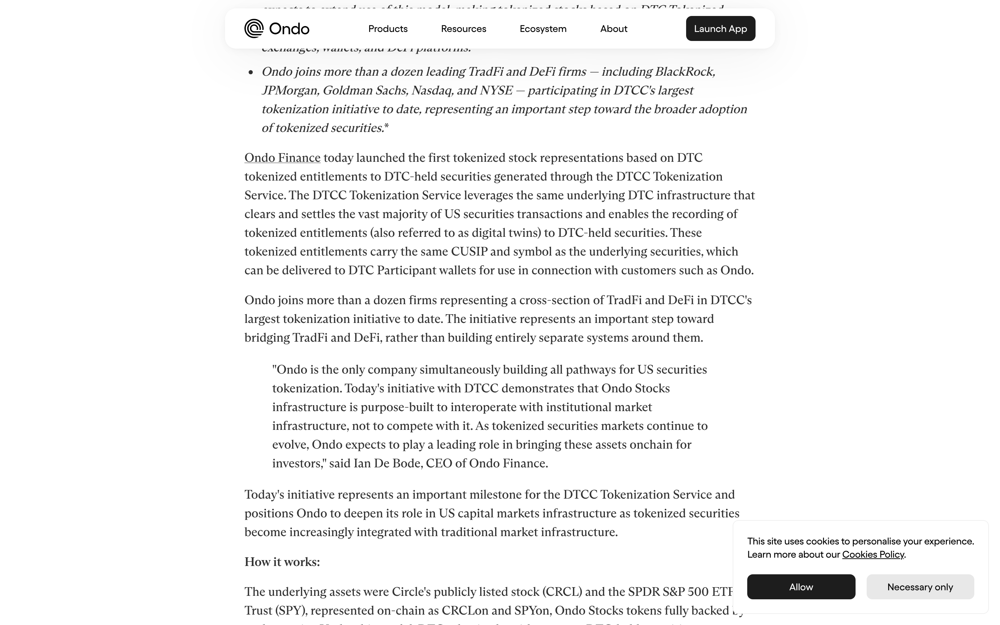
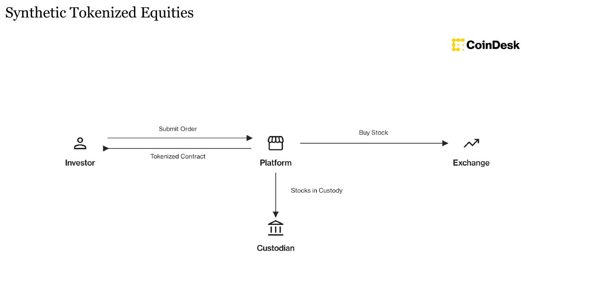
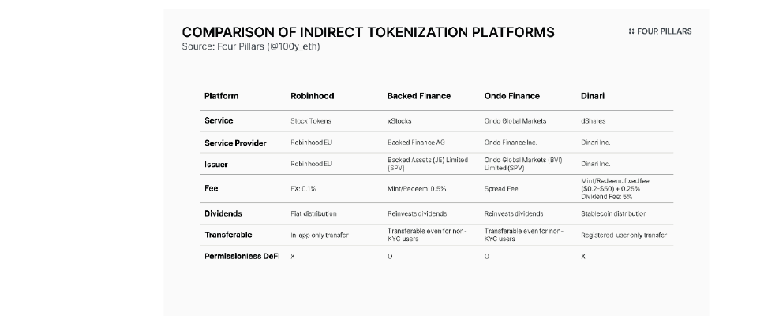

## 정체 카드
● 한 줄 정체 : 국채 토큰으로 시작해 미국 주식 토큰으로 넓힌 토큰화 회사 [F-1215][F-0197]
● 대표 상품 : OUSG = 미국 국채 펀드 4종과 USDC를 담은 사모 펀드 지분 토큰, 적격투자자용 [F-1306][F-1315][F-0532]
  - 뜻 : 적격투자자(accredited investor) = 미국 증권법이 정한 순자산이나 소득 기준을 넘어 사모 상품에 투자할 수 있는 개인, 기관
  - 뜻 : 사모 = 불특정 다수 공모가 아니라 자격 있는 소수 투자자에게만 파는 방식. 토큰이 가리키는 것은 Ondo I LP(Ondo가 운용하는 유한책임조합)의 지분
  ★ OUSG 구성(2026-11-13) : State Street 펀드 48.57%, BlackRock BUIDL 32.69%, Franklin BENJI 10.13%, Fidelity FYOXX 7.56% [F-1315]
  ★ USDY = 국채 담보 노트 토큰, 미국 밖 적격 투자자. 2026-11-13 발행 잔액 19.7억 달러(Ondo 사이트 표시) [F-0509][F-0505][F-1318]
  - 뜻 : 담보부 노트 = 발행사가 국채 등을 담보로 잡고 이자를 얹어 돌려주겠다고 약속한 채무증서(스테이블코인과 다름) [F-0509]
  ★ Ondo Global Markets 토큰(미국 밖판, 현 Ondo Stocks) = 미국 주식 추종 채무증권 [F-0485][F-0187]
● 꼭 알아야 할 사실
  ★ 투자 : 2022-04 Series A 2000만 달러(Founders Fund, Pantera 주도) [F-1207]
  ★ 큰 인수 : 2025-10 Oasis Pro 인수, 금액 비공개 [F-1216][F-0194]
  ★ 자체 체인 : Ondo Chain 철회, 2026-07 Network로 대체 [F-1213][F-1214]
  ★ 제재 : SEC 조사가 기소 없이 종결(2025-12, 회사 발표) [F-0198]
● 숫자
  ★ 주식 토큰 순위와 잔액 : 2026-11-16 발행 잔액 기준 2위, 8.99억 달러(1위 Binance 13.6억 달러, rwa.xyz 토큰화 주식 플랫폼 표) [F-1022][F-1021]
  ★ 국채 토큰 순위와 잔액 : 같은 날 rwa.xyz 국채 토큰 플랫폼 표 2위, 32억 달러(1위 Franklin Benji 33억 달러) [F-1321]
  ★ 종목 수 : 2025-09 출시 때 100종 이상 [F-0197]
● 흐름(주식 토큰) : 이용자(미국 밖) → 앱, Bitget(거래소) → 발행 BVI(SPV) → 보관 Alpaca(BitGo 포함) [F-0552][F-0202][F-0185][F-0189]
  - 뜻 : BVI = 영국령 버진아일랜드, 영국 본토 법이 아닌 자체 회사법으로 법인을 세우는 역외 지역. Ondo가 이곳에 발행 법인을 둔 이유는 회사 자료에서 확인하지 못함
  - 뜻 : SPV = 특정 사업만 하도록 따로 세운 특수목적법인. 토큰 채무가 모회사 파산과 분리되도록 설계 [F-0576][F-0510]
  - 뜻 : Alpaca = 미국 청산 증권사, 기초 주식 보관 [F-0189]. BitGo Trust = 가상자산 수탁 회사 [F-0558]
● 흐름(국채 토큰) : 투자자 → Ondo 웹(USDC, PYUSD 입금) → 펀드 계좌(Coinbase) → 기초 펀드 매입 [F-1312]

## 회사 개요와 확장 경로
● 쉽게 말하면 : 국채 토큰 고객 위에 미국 밖 주식 토큰을 얹은 회사 [F-0465][F-0197]
● 주장 : 국채 토큰 고객 위에 미국 밖 주식 토큰을 얹어 잔액 2위로 [F-0465][F-0197][F-1022]
● 기본정보
  ★ 법인명 : Ondo Finance Inc.(토큰화 기술 회사, 미국 코네티컷주 그리니치) [F-0551][F-0193]
  ★ 발행 법인 : Ondo Global Markets (BVI) Limited [F-0550]
  ★ 2021년 설립, 창업자 Nathan Allman(Founder) [F-1111][F-1112]
● 지배구조(누가 누구를 갖고 있나)
  ★ 발행 법인(Ondo Global Markets (BVI) Limited) 지분 : Flux Finance 90.01%, Ondo Finance Inc. 9.99%(2025-11-11 기준) [F-0186]
  ★ Flux Finance는 Ondo Foundation(재단)의 완전 자회사 [F-0562]
  ★ Flux Finance가 토큰 채무의 추가 담보 자금 보증 [F-0580]
  - 뜻 : Ondo Foundation = ONDO 토큰 거버넌스를 맡는 재단. Ondo Finance Inc.는 토큰화 기술을 제공하는 회사로 재단과 법인이 따로 [F-1209][F-0551]
  ★ OUSG 발행사 Ondo I LP는 Ondo가 운용하는 조합, 자문사 Ondo Capital Management는 SEC 등록 투자자문사(2025-08-06 효력) [F-1306][F-1152]
  ★ 2025-10 Oasis Pro 인수로 미국 증권사, ATS, 명의개서 보유(금액 비공개) [F-1216][F-0194]
  - 뜻 : Oasis Pro = 2019년 설립한 미국 디지털 증권 거래 회사. SEC 등록 증권사, ATS(대체거래시스템, 거래소와 별도의 증권 체결 시설), 명의개서대행(주주 명부 관리) 보유 [F-0194][F-0196]
  ★ 상장 : Ondo Finance Inc.는 비상장. ONDO는 회사 주식이 아니라 거버넌스 토큰(공급 100억 개) [F-1209]
  ★ 경영 : 창업자 Nathan Allman이 2026-05 사망, President였던 Ian De Bode가 CEO 승계. 사망 때 Allman은 CEO, 단독 이사, 다수 주주 [F-0207][F-1112]
● 본업과 규모
  ★ 본업 : 미국 국채 토큰(OUSG, USDY)을 발행해 적격투자자와 미국 밖 투자자에게 판매하고, 미국 주식 토큰(Ondo Stocks)을 미국 밖에 공급 [F-1215][F-0197]
  ★ 국채 토큰 규모 : 2026-11-13 USDY 발행 잔액 19.7억 달러, OUSG 3.13억 달러(Ondo 사이트 표시) [F-1318][F-1315]
  ★ 국채 토큰 시장 내 위치 : 2026-11-16 rwa.xyz 기준 시장 139.2억 달러 중 Ondo 플랫폼 합계 32억 달러로 2위, 1위 Franklin Benji 33억 달러와 약 1억 달러 차이 [F-1320][F-1321]
  ★ 주식 토큰 규모 : 2025년 누적 거래량 20억 달러, 연말 예치 3.7억 달러(회사 발표). 2026-11-16 발행 잔액 8.99억 달러, 2위 [F-1325][F-1022]
  ★ 해석 : 같은 날 같은 사이트(rwa.xyz) 기준 국채 토큰 플랫폼 합계 32억 달러가 주식 토큰 발행 잔액 8.99억 달러의 약 3.6배. 지표 이름(국채는 분산 가치, 주식은 발행 잔액)이 달라 방향만 참고, Ondo의 중심은 아직 국채 토큰 [F-1321][F-1022]
● 설립 목적과 비전
  ★ 문제의식 : 전통 금융의 높은 수수료, 닫힌 구조, 제한된 접근을 블록체인으로 해소 [F-1113]
  ★ 비전 : 세계 금융자산이 공개 블록체인에서 토큰화된다고 전망(회사) [F-0496]
  ★ 해석 : 국채 토큰(2023) → 미국 밖 주식 토큰(2025-09) → 비상장사 토큰(2026-10 Private Markets) 순으로 같은 전망 아래 자산 종류를 넓혀 옴 [F-1150][F-0197][F-1153]
● 앞으로의 그림(회사가 밝힌 계획)
  ★ 향후 수개월 내 수천 개 공개 거래 자산 토큰화 계획(회사 주장) [F-0537]
  ★ 2026-07 Ondo Network 발표, 첫 응용은 Ondo Perps [F-1214]
  ★ 2026-07 DTCC와 기관 시장 인프라 연동 시도 [F-1049]
● 타깃 수요
  ★ 국채 토큰 : 달러 국채 수익을 온체인으로 24시간 받으려는 적격투자자(OUSG)와 미국 밖 투자자(USDY) [F-0465][F-0532][F-0505]
  ★ 주식 토큰 : 증권 계좌 없이 지갑으로 미국 주식에 접근하려는 미국 밖 개인과 기관, 아시아와 중남미 [F-0478][F-0553][F-1052]
● 수익원
  ★ OUSG 운용보수 연 0.15%, 2027-01-01까지 면제 [F-1313]
  ★ 주식 토큰 발행 수수료 없음, 상환 0.05%, 견적가와 기초 매매가 차이는 Ondo Stocks가 보유 [F-0545][F-0546]
  ★ 해석 : 현재 보수가 면제인 국채 토큰은 2027-01-01 이후 보수 수입이 생기는 구조이고, 주식 토큰은 상환 수수료와 견적 차이가 수입 [F-1313][F-0545][F-0546]
● 성장 경로(한 줄기)
  ★ 2021 설립 → OUSG(단기 국채 토큰), USDY(담보부 노트)로 출발 [F-1111][F-0465][F-0509]
  ★ 2025-04 발행 법인 설립 → 2025-10 Oasis Pro(미국 증권사) 인수 [F-0185][F-1047]
  ★ 2025-09 Ondo Global Markets 토큰(미국 밖판) 100종 개시 [F-0197]
  ★ 2025-12 SEC 조사 종결(회사 발표), USDY를 Ondo Stocks로 편입 [F-0198][F-0503]
● 화면
   
  ★ 그림 해설 : 왼쪽은 Ondo 웹의 가입 화면, 오른쪽은 상품 소개 화면. 국채 토큰과 주식 토큰이 같은 웹에서 시작 [F-0552][F-1312]

## 사업 범위와 넓힌 순서
● 쉽게 말하면 : 국채로 시작해 인수로 인가를 사고 자체 체인은 접음 [F-1047][F-1214]
● 주장 : 국채 토큰으로 시작해 인수로 인가를 사고 주식 토큰은 미국 밖부터 [F-0509][F-1047][F-0197]
● 자산(무엇을 어떤 순서로 더했나)
  ★ 2023-01 OUSG, 2023-08 USDY : 국채 토큰 직접 발행 [F-1150][F-1151][F-0465]
  ★ 2025-09 Ondo Global Markets 토큰(미국 밖판) : BVI 직접 발행 [F-0185][F-0197]
  ★ 2025-10 미국 증권사, ATS, 명의개서 : Oasis Pro 인수 [F-1047]
  ★ 2026-07 미국용 보관형 : Oasis Pro 명의개서 활용 [F-1128]
● 자산 2(자문, 제휴 상품)
  ★ 2025-08 OUSG 자문사 : SEC 직접 등록 [F-1152][F-0535]
  ★ 2026-10 비상장사 토큰 : Private Markets 직접 [F-1153]
  ★ 2026-09 BlackRock 전략 포트폴리오 3종 : 제휴 [F-0461]
● 고객(개인과 기관)
  ★ OUSG : 미국 적격투자자 대상, 직접 [F-0532]
  ★ USDY : 적격 비미국인 개인과 기관, 직접 [F-0505]
  ★ 2025-09 Ondo Global Markets 토큰 : 미국 밖 개인과 기관 [F-0566][F-0197]
● 시장(어느 나라로)
  ★ 2025-09 미국 밖 : BVI 발행, Regulation S 직접 [F-0197][F-0560]
  ★ 2025-10 아시아, 중남미 : BNB 체인 확장(직접) [F-1052]
  ★ 2025-11 EU : FMA 승인 투자설명서(직접) [F-0191]
  ★ 2026-09 한국 : 카카오페이증권, 미래에셋 MOU(제휴) [F-0204][F-0205]
● 2022-04 Series A와 ONDO 토큰 예고 : 자금과 토큰으로 DeFi 생태계부터 [F-1207][F-1208]
  ★ 왜 : 곧 ONDO 토큰을 내고 DAO 거버넌스를 붙이겠다고 예고 [F-1208]
  ★ 쓴 곳 : 2024-01-18 ONDO 전송 제한 해제, 공급 100억 개 [F-1210][F-1209]
  ★ 쓴 곳 : 누적 지분 조달 2400만 달러, 투자자 각 7% 미만 [F-1212][F-1211]
  ★ 해석 : 토큰과 DAO로 생태계를 짜던 시기이고, 지금 사업 중심은 규제형 토큰증권으로 이동 [F-1209][F-1128]
● 2023 OUSG와 USDY 국채 토큰 : 국채 자산부터 신뢰와 규모를 쌓음 [F-1150][F-1151]
  ★ 왜 : OUSG 출시가 온체인에서 미국 국채에 노출되는 첫 사례였다고 회사가 설명(회사 주장) [F-1317]
  ★ 쓴 곳 : OUSG 2023-01, USDY 2023-08 출시 [F-1150][F-1151]
  ★ 쓴 곳 : 2024-08 OUSG 기초자산을 BlackRock과 Securitize의 BUIDL로 옮겨 24시간 즉시 발행과 상환 제공. 2026-11-13 OUSG 3.13억 달러 [F-1317][F-1315]
  ★ 계획 : 2026-09 BlackRock이 만든 전략 기반 포트폴리오 3종 출시. 자세한 내용은 아래 국채 토큰 사업 대분류 [F-1324]
  ★ 해석 : 국채 자산 축을 먼저 확보해 신뢰와 규모를 쌓은 뒤 주식으로 확장 [F-1215][F-0465]
● 2025-09 Ondo Global Markets 토큰(미국 밖판) : 미국 밖 고객으로 확장 [F-0197]
  ★ 쓴 곳 : 2025-09 100종 이상 개시, 2025-10 BNB 체인 확장 [F-0197][F-1052]
  ★ 쓴 곳 : 2025-11 EU 투자설명서 승인 [F-0191]
  ★ 계획 : 향후 수개월 내 수천 개 공개 거래 자산 토큰화 [F-0537]
  ★ 해석 : 미국 밖 개인과 기관으로 넓히는 시장 축이고, 미국 투자자는 제외 [F-0197][F-0537]
● 2025-10 Oasis Pro 인수 : 미국 증권사, ATS, 명의개서 인가를 한 번에 [F-1216][F-0194]
  ★ 왜 : 미국에서 규제형 토큰증권 시장을 만드는 데 필요한 인가와 인프라 [F-1216][F-1047]
  ★ 쓴 곳 : 2026-07 미국 보관형 토큰증권 첫 가동(회사 주장), IVV와 MU [F-1128]
  ★ 해석 : 미국 진입을 인가 인수로 풀고, BVI 합성형과 미국 보관형 두 모델을 병행 [F-1047][F-1128][F-0464]
● 2025-02 Ondo Chain 발표 후 철회, 2026-07 Ondo Network로 대체 : 자체 L1 계획을 접고 실행 계층으로 [F-1213][F-1214]
  ★ 왜 : 오늘의 공개 블록체인에는 기관급 RWA용 기능이 없다고 봄 [F-1213]
  ★ 쓴 곳 : 메인넷은 출시되지 않았고 2026-07 Network로 방향 변경 [F-0536][F-1214]
  ★ 쓴 곳 : 체인은 검증과 정산만, 첫 응용은 Ondo Perps [F-1214]
  ★ 해석 : 회사는 "It isn't a blockchain today; it doesn't need to be."라고 씀. 자체 체인 대신 실행 계층에 투자하는 쪽으로 방향 전환 [F-1214]
● 해석 : 국채 토큰에서 시작해 인수로 미국 인가를 사고, 주식 토큰은 미국 밖부터 넓혔으며 자체 체인은 접었다 [F-1215][F-1216][F-0197][F-1214]

## 경영진 발언
● 쉽게 말하면 : 미국 규제 시장, 아시아 개인, 기존 인프라 연동을 말하고, 이 중 일부는 이미 이룸 [F-1047][F-1052][F-1049]
● 말하고 이룬 것(시점 순)
  ★ 2022-04 Series A 글 : 곧 ONDO 토큰을 내고 DAO 거버넌스를 붙이겠다고 예고 → 2024-01-18 ONDO 전송 제한 해제 [F-1208][F-1210]
  ★ 2025-10-07 Allman(당시 창업자 겸 CEO) : 미국 규제형 토큰 증권 시장용 인가를 갖췄다 → 2026-07 Oasis Pro 명의개서로 미국 보관형 토큰 IVV, MU 첫 가동(회사 주장) [F-1047][F-1128]
  ★ 2025-10-29 Allman : BNB 체인 확장으로 아시아, 중남미 수백만 이용자에게 → 2025-10 BNB 체인 확장, 100종 이상 [F-1052][F-0197]
● 말하고 접은 것
  ★ 2025-02 자체 L1 Ondo Chain 발표 → 메인넷 출시 없이 2026-07 Ondo Network(검증과 정산만 맡는 실행 계층)로 방향 변경 [F-1213][F-1214]
● 말하고 진행 중인 것
  ★ 2025-07-03 Allman : Catalyst로 닫힌 시스템에서 열린 온체인 경제로 전환을 키운다(2.5억 달러 전략 투자 이니셔티브) [F-1048]
  ★ 2026-07-15 De Bode : DTCC와 경쟁이 아니라 연동 [F-1049]
  ★ 향후 수개월 내 수천 개 공개 거래 자산 토큰화 [F-0537]
● 발언 1 : 닫힌 금융에서 열린 온체인 경제로 [F-1048]
  ★ Nathan Allman(창업자 겸 CEO), Ondo Catalyst 출시 발표, 2025-07-03, https://ondo.finance/blog/introducing-ondo-catalyst [F-1048]
    ① 원문 : "With Ondo Catalyst, we're fueling the transition from closed, permissioned systems to an open, onchain economy."
    ② 번역 : Ondo Catalyst로 닫힌 허가형 시스템에서 열린 온체인 경제로의 전환을 키운다.
    ③ 해석 : 큰 곳은 온체인 경제의 앱과 인프라. 그래서 2.5억 달러 전략 투자로 생태계 후원
  
● 발언 2 : 미국 규제형 토큰 증권 시장용 인가를 갖췄다 [F-1047]
  ★ Nathan Allman(창업자 겸 CEO), Oasis Pro 인수 완료 발표, 2025-10-07, https://ondo.finance/blog/ondo-acquires-oasis-pro [F-1047]
    ① 원문 : "We now have the most comprehensive suite of licenses and infrastructure necessary to develop compliant and regulated tokenized securities markets in the U.S."
    ② 번역 : 이제 미국에서 규제를 지키는 토큰 증권 시장을 만드는 데 필요한 가장 포괄적인 인가와 인프라를 갖췄다.
    ③ 해석 : 큰 곳은 미국 규제형 토큰 증권 시장. 그래서 증권사, ATS, 명의개서 인가를 인수
  
● 발언 3 : 아시아, 중남미 수백만 이용자에게 미국 주식을 [F-1052]
  ★ Nathan Allman(창업자 겸 CEO), BNB 체인 진출 발표, 2025-10-29, https://ondo.finance/blog/global-markets-live-on-bnb-chain [F-1052]
    ① 원문 : "Expanding Ondo Stocks to BNB Chain allows us to bring tokenized U.S. stocks and ETFs to millions of users across Asia, Latin America, and other geographies, in an environment that is fast, cost-efficient, and highly interoperable."
    ② 번역 : BNB 체인 확장으로 아시아, 중남미 등 수백만 이용자에게 빠르고 저렴하며 연동성 높은 환경에서 토큰 미국 주식과 ETF를 제공한다.
    ③ 해석 : 큰 곳은 아시아, 중남미 개인. 그래서 이용자 많은 BNB 체인에 100종 이상 상장
● 발언 4 : 기존 시장 인프라와 경쟁이 아니라 연동 [F-1049]
  ★ Ian De Bode(CEO), DTCC 협업 발표, 2026-07-15, https://ondo.finance/blog/ondo-and-dtcc-collaborate-on-tokenized-stocks [F-1049]
    ① 원문 : "Today's initiative with DTCC demonstrates that Ondo Stocks infrastructure is purpose-built to interoperate with institutional market infrastructure, not to compete with it."
    ② 번역 : DTCC와의 이번 시도는 Ondo Stocks 인프라가 기관 시장 인프라와 경쟁하지 않고 연동하도록 설계됐음을 보여준다.
    ③ 해석 : 큰 곳은 DTCC(미국 예탁결제기관)와 연결된 토큰 주식. 그래서 DTC 토큰화 권리 기반 주식 토큰 출시
  

## A 출신과 진입(주식 토큰 사업)
● 쉽게 말하면 : 국채 토큰 고객 위에 별도 발행 법인으로 진입 [F-0532][F-0550]
● 주장 : 국채 토큰 고객 기반 위에 별도 발행 법인으로 진입 [F-0532][F-0505][F-0550]
● 출신 : OUSG는 미국 적격투자자, USDY는 비미국인 대상 [F-0532][F-0505]
● 진입 방식
  ★ 발행은 BVI 법인, Ondo Finance는 토큰화 서비스만 [F-0550][F-0551]
  ★ 진출 사유 : 미국 밖 투자자에게 미국 공개 증권 수천 종 노출 [F-0568]

## B 상품 구조
● 쉽게 말하면 : 토큰은 주식이 아니라 BVI 법인의 담보부 채권 [F-0998][F-0187]
● 주장 : 주식이 아니라 BVI 발행 법인에 대한 담보부 채권 [F-0998]
● 토큰의 법적 성격(우리 분류)
  ★ 스위스법 채무증서, 기초 종목 1:1 추종 [F-0187][F-0557]
  ★ 기초 주식 인도 청구권, 주주 권리 없음 [F-0188][F-0559]
  ★ 우리 분류 : 연계증권(담보부 제한소구 채권) [F-0998]
● 발행 주체와 보관
  ★ 발행 법인은 독립 이사 둔 SPV, 파산 격리 설계 [F-0576][F-0510]
  ★ Alpaca(미국 청산 증권사), BitGo Trust(수탁 회사) 담보 계좌 1:1 [F-0189][F-0558]
  ★ Ankura Trust(담보 대리인)가 1순위 담보권 보유 [F-0483][F-0573]
  
  ★ 그림 해설 : 간접 방식 = 발행 법인(SPV)이 토큰을 내고 보관 증권사가 기초 주식을 따로 보유하며 상장사는 관여하지 않는 구조의 흐름도. 이 회사는 BVI 발행 법인과 Alpaca, BitGo 보관이 이 도식의 해당 칸 [TP-203][F-0185][F-0189]
● 투자자 권리
  ★ 배당은 자동 재투자되어 토큰 가격에 반영 [F-0542]
  ★ 2026-04 Broadridge(의결 대행사) 연동, 의결 선호 제출 [F-0463][F-0464]
  
  ★ 그림 해설 : 합성형 = 주식 자체가 아니라 주식 가격에 연동한 권리를 주는 방식의 흐름도. 같은 보고서의 Robinhood EU판, Kraken, Binance 일부도 이 부류이며 이 회사는 Ondo 열(발행 SPV 채무, 의결은 Broadridge 대행) [TP-204][F-0463]
● 규모(시장 내 위치)
  ★ 2026-11-16 발행 잔액 8.99억 달러, 2위(점유율 24.23%) [F-1022]
  ★ 1위 Binance(가상자산 거래소) 13.6억, 3위 Kraken(가상자산 거래소) 6.8억 달러 [F-1021][F-1023]
  ★ 4위 Securitize(토큰화 회사) 2.7억, 6위 Robinhood(주식 거래 앱) 1.5억 달러 [F-1024][F-1025]
  ★ 시장 전체 37.1억 달러(30일 전 대비 +4.33%) [F-1028]
● 규모의 과거 대비(2026-01 초 기준)
  ★ 2026-01 초 4.13억 달러 1위(51.59%) → 11-16 8.99억 2위(24.23%) [TP-001][F-1022]
  ★ 2.2배, 점유율 27.4%p 하락 [TP-001][F-1022]
  ★ 2026-03 Ondo 약 53%(Foresight Ventures 집계, 기준 달라 참고만) [TP-009]
  
  ★ 그림 해설 : 2026-01 초 rwa.xyz 토큰화 주식 플랫폼 순위표(잔액과 점유율). 이 회사는 1위 줄, 잔액 4.13억 달러, 점유율 51.59%. Binance, Robinhood, Coinbase는 이 표에 없음 [TP-001][TP-005]
● 수수료
  ★ 발행 수수료 없음, 상환 수수료 0.05% [F-0545]
  ★ 견적가와 기초 매매가 차이는 Ondo Stocks가 보유 [F-0546]
  
  ★ 그림 해설 : 간접 방식을 쓰는 4개 플랫폼의 수수료, 거래 방식 비교표. 이 회사는 Ondo 열이며 발행 수수료 없음, 견적 차이가 수입이라는 설명과 연결 [TP-202][F-0545][F-0546]
● 평가
  ★ 유동성 분산 : 주의, 같은 종목도 플랫폼 간 비호환이고 3개 체인에 흩어짐(포필러스, Securitize 후원) [TP-203][F-0574]
  ★ 블록체인 위 활용 : ERC20 이전 허용, LayerZero 브리지로 DeFi 연동 추진 [F-0553][F-1051]
  ★ 제3자 위험 : 주의, 발행사(Tesla 등 상장사) 동의 없이 만든 래퍼(토큰이 주식을 감싼 껍데기), 장부는 SPV가 보유(CoinDesk Research, Bullish 의뢰), 담보 대리인 Ankura [TP-204][F-0573]
● 미국용 보관형(2026-07, 별도 상품)
  ★ Oasis Pro 명의개서대리인이 IVV, MU 2종 토큰 발행 [F-1128]
  ★ 우리 분류 : 보관형. 매수 대상 범위는 발표에 없음 [F-1128][F-1129]
  ★ 위 BVI 상품은 여전히 미국인, 미국 내 주문 금지 [F-1129]

## C 최종 투자자
● 쉽게 말하면 : 미국 밖 개인과 기관이 대상, 미국인은 제외 [F-0566][F-0190]
● 주장 : 미국 밖 개인과 기관이 대상, 미국인은 배제 [F-0566][F-0190]
● 대상
  ★ 지원 관할의 기관과 개인, 2개 고객군 [F-0566]
  ★ Persona(신원 확인 업체)로 KYC, KYB 심사 [F-0567]
● 국적 및 지역 제한
  ★ 미국인, 미국 안에서 주문하는 자 제외 [F-0190][F-0543]
  ★ 스위스는 전문고객만, 개인 판매 없음 [F-0530][F-0544]
● 제3자 시각(이용자)
  ★ 주의 : KYC(신원 확인) 없는 이용자도 블록체인 위에서는 토큰에 접근 가능(포필러스, Securitize 후원) [TP-206]

## D 유통과 접점
● 쉽게 말하면 : 자체 앱, 거래소, 지갑을 함께 써서 판매 [F-0552][F-0572]
● 주장 : 자체 앱 직접 판매와 거래소, 지갑 공급을 병행 [F-0552][F-0572]
● 공급 방식(누구에게 서빙하는지)
  ★ 자체 앱 : KYC 마친 개인, 기관에 USDon(달러 토큰)으로 판매 [F-0561][F-0552]
  ★ Bitget(가상자산 거래소) : USDT 계정 이용자, 2025-09부터 100종 이상 [F-0202]
  ★ Nest Exchange(Binance 운영 거래소) : UAE에서 디지털 증권으로 거래 [F-0549]
  ★ Trust Wallet(지갑), OKX, HTX, 1inch도 출시 파트너 [F-0572]
● 거래 장소
  ★ 사용 블록체인 : Ethereum, BNB Chain, Solana 3개 [F-0574]
  ★ 거래시간 : 일요일 밤 8시~금요일 밤 8시(ET) [F-0564]
  ★ 장외시간 거래 가능 종목 32개 [F-0565]
  ★ ERC20 호환, 외부 지갑으로 자유 이전 [F-0553]
● 가격과 유동성 장치
  ★ 가격 기준 : 기초 주식 매매가, 견적 차이는 Ondo가 보유 [F-0546]
  ★ 유동성 공급 : 전통 시장 유동성 승계, 즉시 민트와 소각 [F-0541][F-0570]
  ★ 상환과 수렴 : 현금 가치로 스테이블코인 상환, 수수료 0.05% [F-0481][F-0545]
● 제3자 시각(유통)
  ★ 긍정과 주의 : DeFi 연동이 가장 깊은 편이나 직접 소유가 아닌 합성 노출(CoinDesk Research, Bullish 의뢰) [TP-207]

## E 인가
● 쉽게 말하면 : 미국 인가는 인수로 사고 발행은 미국 밖 면제로 [F-0246][F-0560]
● 주장 : 미국 인가는 인수로 사고, 주식 토큰은 미국 밖 면제로 발행 [F-0246][F-0560]
● 보유 인가와 법인(확보 방식과 시점)
  ★ 미국 증권사 : Oasis Pro 인수(2025-07 발표, 2025-10 완료) [F-0246][F-0194][F-1047]
  ★ 미국 ATS, 명의개서 : Oasis Pro 인수분에 포함 [F-0194]
  ★ 2025-08 투자자문 : Ondo Capital Mgmt SEC 직접 등록 [F-1152][F-0535]
  ★ 발행 법인 : BVI 법인 2025-04 직접 설립 [F-0185]
● 인가 없는 구간을 메우는 방법
  ★ 발행은 1933년 증권법 Regulation S 면제 [F-0560]
  ★ EU는 FMA 승인 기본 투자설명서(2025-11-11, 유효 2026-11-11, 보충서 2회) [F-1240][F-0548]
  ★ Ondo Finance는 중개, 청산, 보관 아닌 기술 제공자(약관) [F-0526][F-0525]
● 미국 밖 구조의 대가
  ★ 1933년 증권법, 1940년 투자회사법 모두 미등록 [F-0529][F-0531]
  ★ 발행 법인이 받는 미국 배당에 원천징수 30% [F-0547]
  ★ Ondo는 BVI 금융당국 등록, 인가 없음 [F-0528]
● 미국 유통 현황
  ★ 미국 유통 : 2026-07 Oasis Pro 명의개서로 미국 보관형 2종 가동, 2026-02 보고서는 준비 중으로 서술(포필러스, Securitize 후원) [F-1128][TP-205]

## F 관계(해당 시)
● 쉽게 말하면 : 은행, 결제망, 운용사와 손잡고 상품을 넓힘 [F-0462][F-0461]
● 주장 : 은행, 결제망, 자산운용사와 손잡아 상품 범위 확장 [F-0462][F-0461]
● 인수, 투자, 제휴
  ★ 2026-05 Kinexys(JP Morgan 결제망) 등 3곳(Mastercard, Ripple 포함)과 국채 토큰 국경간 상환 [F-0462]
  ★ 2026-09 BlackRock(자산운용사) 전략 기반 포트폴리오 3종 출시 [F-0461]

## G 한국 접점(해당 시)
● 쉽게 말하면 : 한국 주식 해외 유통과 ETF 토큰화로 협력 [F-0204][F-0205]
● 주장 : 한국 주식 해외 유통과 한국 운용사 ETF 토큰화로 협력 [F-0204][F-0205]
● 한국 회사와의 협약
  ★ 2026-09 카카오페이증권과 한국 주식 해외 유통 MOU [F-0204]
  ★ 카카오페이증권이 외국인 통합계좌로 원주 조달 [F-0204]
  ★ 미래에셋자산운용과 Global X ETF 토큰화 MOU [F-0205]

## 국채 토큰 사업(OUSG, USDY)
● 쉽게 말하면 : 미국 국채에 투자하는 펀드를 토큰으로 만들어 24시간 사고파는 사업이고, Ondo 잔액의 큰 쪽 [F-1306][F-1315][F-1321][F-1022]
● 주장 : 국채 토큰 시장 2위 사업자이며 BlackRock 제휴 상품까지 넓힘 [F-1321][F-1324]
● 상품 구조
  ★ OUSG : Ondo I LP(발행사)가 내는 유한책임조합 지분을 토큰으로 만든 것. 공모 등록은 Rule 506(c) 면제, 펀드는 투자회사법 3(c)(7) 등록 면제 [F-1306][F-1307]
  - 뜻 : Rule 506(c) = 미국 증권법상 공모 등록 없이 자격 확인을 거친 적격투자자에게만 파는 사모 면제 규정
  - 뜻 : 투자회사법 3(c)(7) = 적격구매자(아래 투자자 자격 참조)만 받는 펀드에 투자회사 등록 의무를 면제하는 규정
  ★ USDY : Ondo USDY LLC가 발행한 토큰화 담보부 노트. 2025-12-15부터 Ondo Stocks 우산(Ondo Global Markets (BVI) Limited) 아래로 편입 [F-0504][F-0509][F-0503]
  ★ USDY 가격 : 2026-11-01부터 하루 단위가 아니라 연속 상승 [F-0520]
  ★ 상품 유형 비교 : OUSG는 운용사 펀드의 지분을 다시 담은 조합 지분이고, 주식 토큰(Ondo Stocks)은 BVI 법인이 발행하는 채무증서라 법적 성격이 다름 [F-1306][F-0187]
● 기초자산과 운용사
  ★ OUSG(2026-11-13 종가, 총 3.13억 달러) : State Street Galaxy Onchain Liquidity Sweep Fund 48.57%, BlackRock BUIDL 32.69%, Franklin BENJI 10.13%, Fidelity FYOXX 7.56%, USDC 0.99% [F-1315]
  - 뜻 : BUIDL, BENJI, FYOXX, SWEEP = 각각 BlackRock, Franklin Templeton, Fidelity, State Street(Galaxy와 공동)가 미국 국채 등에 투자하는 펀드를 온체인으로 내놓은 상품 [F-1315]
  ★ 2024-08 BUIDL로 이전한 경위 : 24시간 즉시 발행과 상환을 위해 기초자산을 BlackRock과 Securitize의 BUIDL로 옮기고 Circle의 USDC 즉시 유동성을 이용 [F-1317]
  ★ 해석 : OUSG는 국채를 직접 사지 않고 운용사 펀드를 다시 담는 얇은 층이고, 2026-11-13 기준 가장 큰 펀드가 48.57% [F-1315][F-1317]
  ★ USDY(2026-11-13) : 발행 잔액 19.7억 달러, 기초자산 24.2억 달러, 미국 국채 82.73%, iShares 0-1년 국채 ETF의 Ondo 토큰(SHVon) 17.24% [F-1318]
● 발행 잔액과 시장 내 위치
  ★ 2026-11-13 Ondo 사이트 표시 : OUSG 3.13억 달러, USDY 19.7억 달러 [F-1315][F-1318]
  ★ 2026-11-16 rwa.xyz 국채 토큰 시장 : 분산 가치 139.2억 달러(30일 전 대비 5.45% 감소), 자산 123개, 보유자 86,310 [F-1320]
  - 뜻 : 분산 가치(Distributed Value) = rwa.xyz가 시장 규모 기준으로 쓰는 값. 같은 화면에 대표 가치(Represented Value 8,639만 달러)가 따로 표시 [F-1320]
  ★ 플랫폼 순위(분산 가치) : 1위 Franklin Benji 33억, 2위 Ondo 32억(자산 11종), 3위 Circle 20억, 4위 Securitize 18억 달러. Ondo는 시장의 약 23%, 1위와 약 1억 달러 차이 [F-1321]
  ★ 자산별 : USDY 23.95억, BUIDL 16.54억, BENJI 12.80억, OUSG 3.13억 달러. USDY가 국채 토큰 자산 중 가장 큼 [F-1322]
  ★ USDY 값이 둘인 점 : Ondo 사이트 표시 발행 잔액 19.7억(11-13)과 rwa.xyz 자산별 23.95억(11-16)은 다른 값이며 원인은 확인하지 못함. 같은 줄에서 비교하지 않음 [F-1318][F-1322]
  ★ 같은 날 주식 토큰 시장 : rwa.xyz 37.1억 달러(30일 전 대비 +4.33%) [F-1028]
  ★ 해석 : 같은 날 같은 사이트 기준 국채 토큰 시장 139.2억 달러는 주식 토큰 시장의 약 3.8배. 지표 이름이 달라(분산 가치, 발행 잔액) 대략의 비교 [F-1320][F-1028]
● 투자자 자격과 최소 금액
  ★ OUSG 자격 : accredited investor(적격투자자)이면서 qualified purchaser(적격구매자). 개인 순자산 500만 달러 초과, 기관 자산 2,500만 달러 초과가 가장 흔한 기준 [F-1308]
  ★ accredited 기준 흔한 선택 : 개인은 주택 제외 순자산 100만 달러 초과 또는 연소득 20만 달러 초과(부부 합산 30만), 증빙 필요. qualified purchaser는 자기 증명 [F-1309]
  ★ USDY 자격 : 적격 비미국인 개인과 기관. 미국 안에서 매수 주문하는 자와 Regulation S상 미국인은 청약, 상환 금지 [F-0505][F-0514]
  ★ 최소 금액 : OUSG 즉시 투자와 상환 5,000달러, 즉시 아닌 방식은 투자 10만, 상환 5만 달러. USDY 주력 체인 외는 5,000달러 [F-1310][F-1319]
  ★ 즉시 발행, 상환 한도 : 전체 합산 24시간 5,000만 달러, 투자자 1인당 24시간 2,500만 달러. 상환은 Circle의 USDC 지원 여부에도 제한 [F-1311]
● 유통 경로
  ★ OUSG : 회사 웹(Ondo)에서 USDC 또는 PYUSD로 직접 즉시 발행해 같은 지갑으로 수령. 입금 USDC는 펀드의 Coinbase 계좌로 보내져 기초자산 매입에 쓰임 [F-1312]
  ★ USDY : 가격은 이더리움, BNB 체인, Mantle, Tempo 네 곳에서 계산하고 다른 체인은 이 네 곳에서 브리지. Sui, Aptos 등 발행과 상환은 문의 방식 [F-1319]
  ★ 국경 간 상환 : 2026-05 Kinexys by J.P. Morgan, Mastercard, Ripple과 토큰화 국채 펀드의 첫 국경 간, 은행 간 상환 완료 [F-0462]
● 수수료와 가격 산정
  ★ OUSG 운용보수 0.15%, 2027-01-01까지 면제. 펀드 비용 상한 연 0.15%. 즉시 발행, 상환에는 추가 수수료가 있을 수 있음 [F-1313]
  ★ 세금 : 조합 지분이라 파트너십 과세, K-1(미국 파트너십 소득 신고서) 발급 [F-1313]
  ★ NAV(순자산가치) : 펀드 관리자 NAV Consulting이 매일 독립 계산, 재무제표 매일 게시(온체인 가격은 최대 3일 늦을 수 있음), 연 1회 감사 [F-1314]
● 인가와 SEC 조사
  ★ 자문사 Ondo Capital Management : SEC 등록 투자자문사, 효력 2025-08-06 [F-1152][F-0535]
  ★ SEC 조사 종결 : 증권법 준수와 ONDO 토큰의 증권성을 살핀 수년간의 비공개 조사가 기소 없이 종결(회사 블로그 2025-12-09). SEC는 확인 요청에 즉시 답하지 않음 [F-0198]
  ★ 해석 : 종결은 회사 발표로만 확인되고 SEC 쪽 확인문은 없음 [F-0198]
● BlackRock 제휴 상품
  ★ 2026-09-24 Ondo Intelligent Portfolios 출시. 첫 3종 BLKHIon(고소득), BLKDIGon(분산 성장), BLKGRWon(고성장)은 BlackRock이 Ondo를 위해 만든 포트폴리오 전략 기반 [F-1324][F-0461]
  ★ 구조 : 기초 포지션은 국채가 아니라 Ondo Stocks(토큰화 주식과 ETF), 구성과 목표 비중은 설정 시점에 정해 일정에 따라 리밸런싱 [F-1324]
  ★ 해석 : OUSG의 기초 운용사(BlackRock)와의 관계를 주식 토큰 쪽 상품으로 넓힌 사례. 국채 토큰 고객 위에 주식 토큰을 얹는 확장 경로와 같은 방향 [F-1324][F-0465]

## 한국 시장과의 차이
● 쉽게 말하면 : 미국 밖 면제로 열렸지만 한국은 채무증서도 증권 [F-0560][F-0187]
● 주장 : 미국 밖 면제로 열렸고, 채무증서형 토큰도 한국에선 증권 [F-0560][F-0187]
● 규제
  ★ 가능했던 이유 : 미국 밖 판매는 Regulation S로 공모 등록 불요 [F-0560][US-17CFR-230.903-a]
  ★ 한국 차이 : 스위스법 채무증서도 외국인 발행 증권으로 봄 [F-0187][KR-자본시장법-4①본문]
● 고객 수요
  ★ 가능했던 이유 : 증권 계좌 없이 지갑으로 미국 주식 노출 수요 [F-0478][F-0553]
● 규제 건의 포인트 : 외국인 통합계좌로 원주를 조달하는 해외 발행 허용 범위 [F-0204][KR-자본시장법-168]

## 성과와 판단
● 쉽게 말하면 : 국채 토큰 시장 2위, 주식 토큰은 출시 14개월 만에 2위 [F-1321][F-0197][F-1022]
● 주장 : 국채 토큰이라는 본업 위에 주식 토큰을 얹어 두 영역 모두 상위권 [F-1321][F-1022]
● 사업별 성과
  ★ 국채 토큰(OUSG, USDY) : 2026-11-16 rwa.xyz 국채 토큰 플랫폼 2위, 32억 달러, 시장 139.2억 달러의 약 23%, 1위 Franklin Benji와 약 1억 달러 차이 [F-1321][F-1320]
    - 세부 : 2026-11-13 USDY 발행 잔액 19.7억, OUSG 3.13억 달러(Ondo 사이트 표시) [F-1318][F-1315]
    - 세부 : 2026-05 국경 간 상환 첫 완료, 2026-09 BlackRock 전략 3종 출시 [F-0462][F-1324]
  ★ 주식 토큰 : 2026-11-16 발행 잔액 8.99억 달러, 점유율 24.23%, 2위 [F-1022]
  ★ 미국 인가 사업 : 2025-10 Oasis Pro 인수, 2026-07 미국 보관형 토큰증권 IVV, MU 첫 가동(회사 주장) [F-1216][F-1128]
  ★ 비상장사 토큰 : 2026-10-05 Ondo Private Markets 발표, 첫 대상은 비상장 AI 기업 [F-1153]
  ★ 자체 체인 : 2025-02 발표한 Ondo Chain은 메인넷 없이 접고 2026-07 Network로 대체 [F-1213][F-1214]
● 핵심 성공요인(KSF)
  ★ 주식 토큰 후발 진입 뒤 빠른 추격 : 같은 사업을 Kraken, Robinhood는 2025-06에 시작했고 Ondo는 2025-09 출시, 2026-01 초 rwa.xyz 표 1위(4.13억 달러, 점유율 51.59%), 2026-11-16 8.99억 달러로 2.2배 [F-1040][F-0221][F-0197][TP-001][F-1022]
    - 선점한 것 : 출시 약 4개월 만에 잔액 1위. 같은 표에 Binance, Robinhood, Coinbase는 아직 없었음 [TP-001][TP-005]
    - 해석 : 국채 토큰 고객과 자체 웹, 거래소(Bitget) 유통으로 출시 직후부터 공급 경로가 있었던 점이 배경 [F-0465][F-0552][F-0202]
    - 한계 : 점유율은 51.59%에서 24.23%로 낮아졌고 2026-11-16 1위는 Binance 13.6억 달러 [TP-001][F-1022][F-1021]
● 제약과 리스크
  ★ 주식 토큰은 담보로만 상환 [F-0188]
    - 왜 : 발행 BVI 법인이 도산하면 토큰 보유자는 담보 처분금 범위에서만 돌려받고 모자란 부분은 투자자가 잃음 [F-0188][F-0576]
  ★ 창업자 사망과 경영권 소송 : 2026-05 사망, 2026-08 유족이 델라웨어 법원에 경영권과 De Bode 해임을 요구, 결과는 확인하지 못함 [F-0207][F-0208]
    - 왜 : Allman이 단독 이사이자 다수 주주였고 이사석 1개가 공석이라 최종 결정권자가 법원 판단에 걸림. 파트너, 규제기관과 계약하는 쪽이 불확실해질 수 있음(해석) [F-0207][F-0208]
  ★ EU 판매 근거 만료 : 투자설명서 유효기간이 2026-11-11에 끝났고 갱신은 확인하지 못함 [F-1240]
    - 왜 : 유효기간이 지난 투자설명서로는 EU 투자자에게 새로 판매하기 어려워 갱신 전까지 EU 판매가 멈출 수 있음(해석) [F-1240]
  ★ SEC 조사 종결은 회사 발표뿐 : SEC 쪽 확인문 없음 [F-0198]
    - 왜 : 규제 위험이 풀렸다는 근거가 회사 설명에 한정되어 투자자가 독립적으로 확인하기 어려움 [F-0198]
  ★ 국채 토큰 쏠림 : OUSG의 48.57%가 펀드 한 곳(State Street Galaxy SWEEP) [F-1315]
    - 왜 : 해당 펀드에 운용이나 상환 문제가 생기면 OUSG 보유자 가치가 직접 영향받음(해석) [F-1315]
  ★ 즉시 상환 한도 : 24시간 합산 5,000만 달러, Circle USDC 지원 여부에 연동 [F-1311]
    - 왜 : 한도가 찬 날이나 USDC 지원이 멈춘 날에는 즉시 현금화가 안 될 수 있어 투자자가 상환 시점을 정하지 못함(해석) [F-1311]
● 제3자 평가
  ★ 평가 1(주의, 탈중앙 거래소 풀에서 단일 사례 약 9.3% 비싸게 체결) : 오버달(SEC 제출 의견서, 필자가 Citadel Securities 재정 지원을 밝힘), Tokenized U.S. Equities, DeFi Trading, and the SEC's Exemptive Authority, 2026-01-22, 25쪽, https://www.sec.gov/files/ctf-written-james-overdahl-tokenized-us-equities-01-22-2026.pdf [TP-201]
    ① 원문 : "This suggests that the user paid about 9.3% more for the tokenized NVDA stock compared to what they would have paid if they instead had executed a trade for NVDA on a regulated exchange."
    ② 번역 : 이용자가 규제 거래소에서 샀을 때보다 토큰화 NVDA를 약 9.3% 비싸게 샀다는 뜻이다.
    ③ 해석 : 2026-01-14 Ondo 토큰(NVDAon)을 DEX 풀에서 산 단일 사례. 그래서 KDX는 거래 장소별 체결 비용을 볼 것
  
  ★ 평가 2(주의, 수수료가 없어도 견적 차이가 수입) : 포필러스(Securitize 후원 보고서), 2026: The Year of Tokenized Stocks, 2026-02-23, 38쪽, https://4pillars.io/en/reports/2026-the-year-of-tokenized-stocks [TP-202]
    ① 원문 : "Similar to the PFOF structure between Robinhood and Citadel, Ondo Finance can earn spread revenue while processing users' stock orders."
    ② 번역 : Robinhood와 Citadel의 PFOF 구조처럼 Ondo는 주문 처리 중 스프레드 수익을 얻을 수 있다.
    ③ 해석 : 수수료 0이어도 견적 차이가 수익. 그래서 KDX는 수수료에 스프레드를 합쳐 비교
  
  ★ 평가 3(주의, 같은 종목도 플랫폼마다 유동성이 갈림) : 포필러스(Securitize 후원 보고서), 2026: The Year of Tokenized Stocks, 2026-02-23, 27쪽, https://4pillars.io/en/reports/2026-the-year-of-tokenized-stocks [TP-203]
    ① 원문 : "Liquidity fragmentation: Even for the same stock, liquidity is not interoperable across different indirect tokenization platforms."
    ② 번역 : 유동성 분산: 같은 종목도 간접 방식 플랫폼 사이에 유동성이 호환되지 않는다.
    ③ 해석 : Backed xTSLA와 Ondo TSLAon이 갈린다는 예. 직접 방식 후원사의 평가, 그래서 KDX는 유동성 한곳 집중 설계를 볼 것
  
● KDX 시사점(채권형 토큰 확장 중심)
  ★ 자산 : 국채 토큰 구성과 운용 방식 [F-1315][F-1317]
    - 가져올 것 : 국채를 직접 사지 않고 운용사 펀드 지분을 다시 담는 구조. 운용은 BlackRock, Franklin Templeton, Fidelity, State Street에 맡기고 토큰 층만 직접 운영 [F-1315][F-1306]
    - 가져올 것 : NAV를 외부 관리자가 매일 독립 계산, 연 1회 감사 [F-1314]
    - 피할 것 : 구성이 바뀌어도 안내가 늦는 상태. 2024-08 BUIDL로 옮긴 뒤 2026-11-13 최대 비중은 SWEEP 48.57%로 바뀌었으므로 구성 공시 주기를 정해야 함 [F-1317][F-1315]
  ★ 고객 : 자격과 최소 금액의 구분 [F-1308][F-1310]
    - 가져올 것 : 상품별로 자격과 최소 금액 분리(OUSG 적격투자자 5,000달러부터, USDY 적격 비미국인) [F-1310][F-0505]
    - 피할 것 : 순자산 500만 달러와 증빙을 요구하는 높은 진입 장벽. 판매 대상이 좁아져 개인 확대에 한계 [F-1308][F-1309]
  ★ 시장 : 여러 체인과 결제망 연동 [F-1319][F-0462]
    - 가져올 것 : 가격 계산은 네 체인에서만 하고 나머지는 브리지하는 방식, 은행 결제망 3곳과 국경 간 상환 시험 [F-1319][F-0462]
    - 피할 것 : USDY의 미국 내 주문자 금지처럼 지역 제한을 상품마다 따로 관리해야 하는 부담 [F-0514][F-0505]
  ★ 거래 시설 운영 : 발행, 상환 한도와 상환 통화 [F-1311]
    - 가져올 것 : 24시간 합산 한도와 1인 한도를 정해 한 투자자의 쏠림 방지 [F-1311]
    - 피할 것 : 상환이 외부 스테이블코인(Circle USDC) 지원에 묶이는 구조. 상환 통화를 한 사업자에 의존 [F-1311][F-1317]
  ★ 확장 축 : 자산(채권), 시장(해외) [F-0465][F-0197]
● 해외에서 이 사업이 된 조건(제공 가치, 제도, 경제성)
  ★ 제공 가치 : 국채 24시간 접근, 한국 주식의 해외 유통 [F-0465][F-0204]
  ★ 제도 : 국채는 Rule 506(c) 사모와 3(c)(7) 면제, 한국 주식은 카카오페이증권이 외국인 통합계좌로 원주 조달 [F-1307][F-0204]
  ★ 경제성 : OUSG 운용보수 0.15%(2027-01-01까지 면제), 주식 토큰 발행 수수료 없음, 상환 0.05% [F-1313][F-0545]
