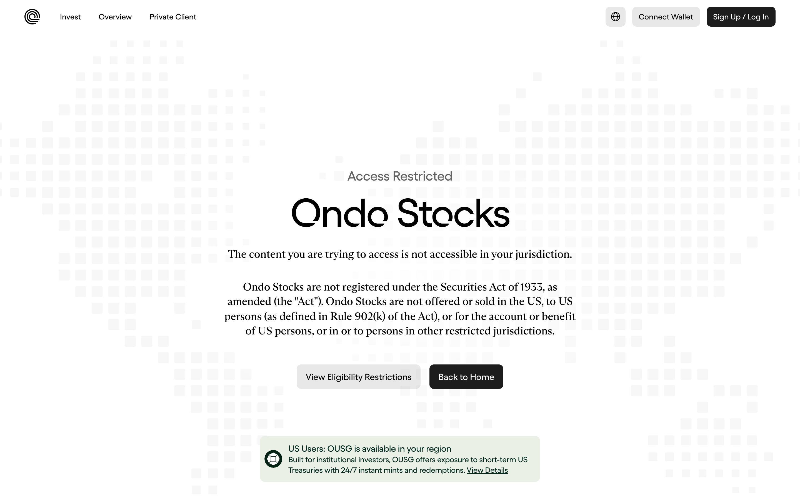
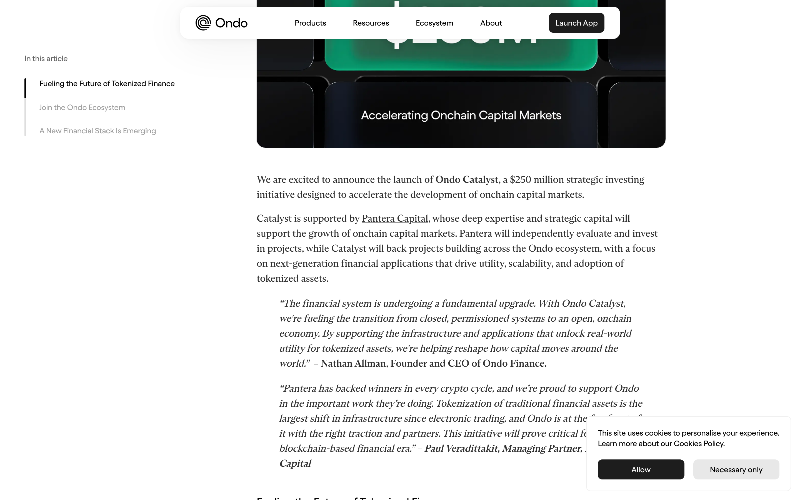
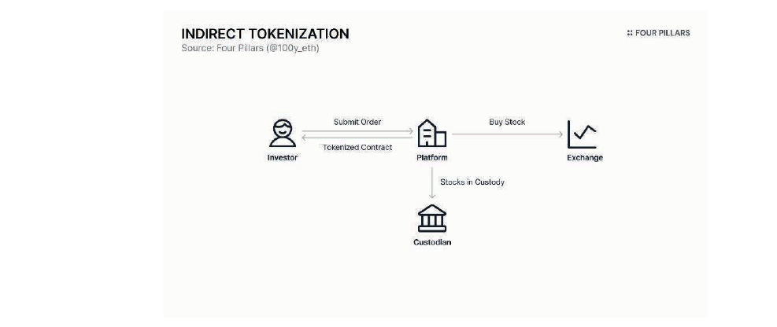
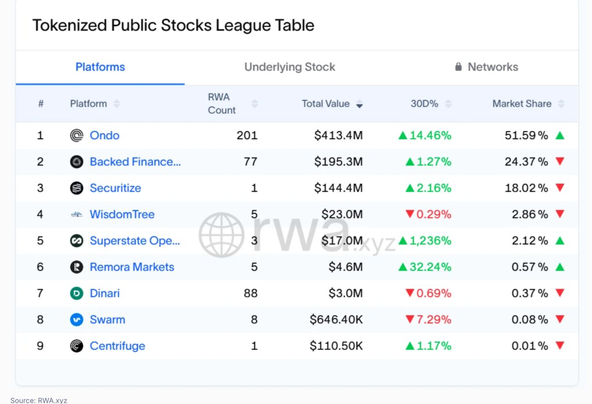
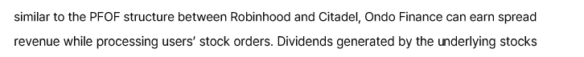

## 회사 개요와 확장 경로
● 주장 : 국채 토큰 고객 위에 미국 밖 주식 토큰을 얹어 잔액 2위로 [F-0465][F-0197][F-1022]
● 기본정보
  ★ 법인명 : Ondo Finance Inc.(토큰화 기술 회사, 미국 코네티컷주 그리니치) [F-0551][F-0193]
  ★ 발행 법인 : Ondo Global Markets (BVI) Limited [F-0550]
  ★ 2021년 설립, 창업자 Nathan Allman(Founder) [F-1111][F-1112]
  ★ 경영 : Ian De Bode(Acting CEO and President) [F-1112]
● 지배구조
  ★ 발행 법인 지분 : Flux Finance 90.01%, Ondo Finance 9.99% [F-0186]
  ★ Flux Finance는 Ondo Foundation(재단)의 완전 자회사 [F-0562]
  ★ Flux Finance가 토큰 채무의 추가 담보 자금 보증 [F-0580]
● 설립 목적
  ★ Ondo가 믿는 것 : 블록체인으로 높은 수수료, 닫힌 구조, 제한된 접근 해소 [F-1113]
  ★ 금융시장을 온체인으로 옮기는 기관급 플랫폼, 자산, 인프라 설계 [F-1113]
  ★ Ondo는 세계 금융자산의 공개 블록체인 토큰화를 전망 [F-0496]
● 성장 경로(한 줄기)
  ★ 2021 설립 → OUSG(단기 국채 토큰), USDY(담보부 노트)로 출발 [F-1111][F-0465][F-0509]
  ★ 2025-04 발행 법인 설립 → 2025-10 Oasis Pro(미국 증권사) 인수 [F-0185][F-1047]
  ★ 2025-09 미국 밖 전용 주식 토큰 100종 개시 [F-0197]
  ★ 2025-12 SEC 조사 종결(회사 발표), USDY를 Ondo Stocks로 편입 [F-0198][F-0503]
● 화면
   

## 사업 범위와 넓힌 순서
● 주장 : 국채 토큰으로 시작해 인수로 인가를 사고 주식 토큰은 미국 밖부터 [F-0509][F-1047][F-0197]
● 자산(무엇을 어떤 순서로 더했나)
  ★ 국채 토큰 : OUSG, USDY 직접 발행 [F-0465][F-0509][F-0524]
  ★ 2025-09 주식 토큰 : BVI 법인으로 직접 발행 [F-0185][F-0197]
  ★ 2025-10 미국 증권사, ATS, 명의개서 : Oasis Pro 인수 [F-1047]
  ★ 2026-07 미국용 보관형 : Oasis Pro 명의개서 활용 [F-1128]
● 자산 2(자문, 제휴 상품)
  ★ OUSG 자문 : Ondo Capital Management, SEC 등록 [F-0535][F-0534]
  ★ 2026-09 BlackRock 전략 포트폴리오 3종 : 제휴 [F-0461]
● 고객(개인과 기관)
  ★ OUSG : 미국 적격투자자 대상, 직접 [F-0532]
  ★ USDY : 적격 비미국인 개인과 기관, 직접 [F-0505]
  ★ 2025-09 주식 토큰 : 미국 밖 개인과 기관, 직접 [F-0566][F-0197]
● 시장(어느 나라로)
  ★ 2025-09 미국 밖 : BVI 발행, Regulation S 직접 [F-0197][F-0560]
  ★ 2025-10 아시아, 중남미 : BNB 체인 확장(직접) [F-1052]
  ★ 2025-11 EU : FMA 승인 투자설명서(직접) [F-0191]
  ★ 2026-09 한국 : 카카오페이증권, 미래에셋 MOU(제휴) [F-0204][F-0205]

## 경영진 발언
● 발언 1 : 미국 규제형 토큰 증권 시장용 인가를 갖췄다 [F-1047]
  ★ Nathan Allman(창업자 겸 CEO), Oasis Pro 인수 완료 발표, 2025-10-07, https://ondo.finance/blog/ondo-acquires-oasis-pro [F-1047]
    ① 원문 : "We now have the most comprehensive suite of licenses and infrastructure necessary to develop compliant and regulated tokenized securities markets in the U.S."
    ② 번역 : 이제 미국에서 규제를 지키는 토큰 증권 시장을 만드는 데 필요한 가장 포괄적인 인가와 인프라를 갖췄다.
    ③ 해석 : 큰 곳은 미국 규제형 토큰 증권 시장. 그래서 증권사, ATS, 명의개서 인가를 인수
  
● 발언 2 : 아시아, 중남미 수백만 이용자에게 미국 주식을 [F-1052]
  ★ Nathan Allman(창업자 겸 CEO), BNB 체인 진출 발표, 2025-10-29, https://ondo.finance/blog/global-markets-live-on-bnb-chain [F-1052]
    ① 원문 : "Expanding Ondo Stocks to BNB Chain allows us to bring tokenized U.S. stocks and ETFs to millions of users across Asia, Latin America, and other geographies, in an environment that is fast, cost-efficient, and highly interoperable."
    ② 번역 : BNB 체인 확장으로 아시아, 중남미 등 수백만 이용자에게 빠르고 저렴하며 연동성 높은 환경에서 토큰 미국 주식과 ETF를 제공한다.
    ③ 해석 : 큰 곳은 아시아, 중남미 개인. 그래서 이용자 많은 BNB 체인에 100종 이상 상장
● 발언 3 : 기존 시장 인프라와 경쟁이 아니라 연동 [F-1049]
  ★ Ian De Bode(CEO), DTCC 협업 발표, 2026-07-15, https://ondo.finance/blog/ondo-and-dtcc-collaborate-on-tokenized-stocks [F-1049]
    ① 원문 : "Today's initiative with DTCC demonstrates that Ondo Stocks infrastructure is purpose-built to interoperate with institutional market infrastructure, not to compete with it."
    ② 번역 : DTCC와의 이번 시도는 Ondo Stocks 인프라가 기관 시장 인프라와 경쟁하지 않고 연동하도록 설계됐음을 보여준다.
    ③ 해석 : 큰 곳은 DTCC(미국 예탁결제기관)와 연결된 토큰 주식. 그래서 DTC 토큰화 권리 기반 주식 토큰 출시
  
● 발언 4 : 닫힌 금융에서 열린 온체인 경제로 [F-1048]
  ★ Nathan Allman(창업자 겸 CEO), Ondo Catalyst 출시 발표, 2025-07-03, https://ondo.finance/blog/introducing-ondo-catalyst [F-1048]
    ① 원문 : "With Ondo Catalyst, we're fueling the transition from closed, permissioned systems to an open, onchain economy."
    ② 번역 : Ondo Catalyst로 닫힌 허가형 시스템에서 열린 온체인 경제로의 전환을 키운다.
    ③ 해석 : 큰 곳은 온체인 경제의 앱과 인프라. 그래서 2.5억 달러 전략 투자로 생태계 후원
  

## A 출신과 진입(주식 토큰 사업)
● 주장 : 국채 토큰 고객 기반 위에 별도 발행 법인으로 진입 [F-0532][F-0505][F-0550]
● 출신 : OUSG는 미국 적격투자자, USDY는 비미국인 대상 [F-0532][F-0505]
● 진입 방식
  ★ 발행은 BVI 법인, Ondo Finance는 토큰화 서비스만 [F-0550][F-0551]
  ★ 진출 사유 : 미국 밖 투자자에게 미국 공개 증권 수천 종 노출 [F-0568]

## B 상품 구조
● 주장 : 주식이 아니라 BVI 발행 법인에 대한 담보부 채권 [F-0998]
● 토큰의 법적 성격(우리 분류)
  ★ 스위스법 채무증서, 기초 종목 1:1 추종 [F-0187][F-0557]
  ★ 기초 주식 인도 청구권, 주주 권리 없음 [F-0188][F-0559]
  ★ 우리 분류 : 연계증권(담보부 제한소구 채권) [F-0998]
● 발행 주체와 보관
  ★ 발행 법인은 독립 이사 둔 SPV, 파산 격리 설계 [F-0576][F-0510]
  ★ Alpaca(미국 청산 증권사), BitGo Trust(수탁 회사) 담보 계좌 1:1 [F-0189][F-0558]
  ★ Ankura Trust(담보 대리인)가 1순위 담보권 보유 [F-0483][F-0573]
  
● 투자자 권리
  ★ 배당은 자동 재투자되어 토큰 가격에 반영 [F-0542]
  ★ 2026-04 Broadridge(의결 대행사) 연동, 의결 선호 제출 [F-0463][F-0464]
  
● 규모(시장 내 위치)
  ★ 2026-11-16 발행 잔액 8.99억 달러, 2위(점유율 24.23%) [F-1022]
  ★ 1위 Binance(가상자산 거래소) 13.6억, 3위 Kraken(가상자산 거래소) 6.8억 달러 [F-1021][F-1023]
  ★ 4위 Securitize(토큰화 회사) 2.7억, 6위 Robinhood(주식 거래 앱) 1.5억 달러 [F-1024][F-1025]
  ★ 시장 전체 37.1억 달러(30일 전 대비 +4.33%) [F-1028]
● 규모의 과거 대비(2026-01 초 기준)
  ★ 2026-01 초 4.13억 달러 1위(51.59%) → 11-16 8.99억 2위(24.23%) [TP-001][F-1022]
  ★ 2.2배, 점유율 27.4%p 하락 [TP-001][F-1022]
  ★ 2026-03 Ondo 약 53%(Foresight Ventures 집계, 기준 달라 참고만) [TP-009]
  
● 수수료
  ★ 발행 수수료 없음, 상환 수수료 0.05% [F-0545]
  ★ 견적가와 기초 매매가 차이는 Ondo Stocks가 보유 [F-0546]
  
● 평가
  ★ 유동성 분산 : 같은 종목도 플랫폼 간 비호환, 3개 체인(포필러스, Securitize 후원) [TP-203][F-0574]
  ★ 블록체인 위 활용 : ERC20 이전 허용, LayerZero 브리지로 DeFi 연동 추진 [F-0553][F-1051]
  ★ 제3자 위험 : 발행사 동의 없는 래퍼, 장부는 SPV(CoinDesk Research, Bullish 의뢰), 담보 대리인 Ankura [TP-204][F-0573]
● 미국용 보관형(2026-07, 별도 상품)
  ★ Oasis Pro 명의개서대리인이 IVV, MU 2종 토큰 발행 [F-1128]
  ★ 우리 분류 : 보관형. 매수 대상 범위는 발표에 없음 [F-1128][F-1129]
  ★ 위 BVI 상품은 여전히 미국인, 미국 내 주문 금지 [F-1129]

## C 최종 투자자
● 주장 : 미국 밖 개인과 기관이 대상, 미국인은 배제 [F-0566][F-0190]
● 대상
  ★ 지원 관할의 기관과 개인, 2개 고객군 [F-0566]
  ★ Persona(신원 확인 업체)로 KYC, KYB 심사 [F-0567]
● 국적 및 지역 제한
  ★ 미국인, 미국 안에서 주문하는 자 제외 [F-0190][F-0543]
  ★ 스위스는 전문고객만, 개인 판매 없음 [F-0530][F-0544]
● 제3자 시각(이용자)
  ★ KYC 없는 이용자도 온체인 접근 가능 (포필러스, Securitize 후원) [TP-206]

## D 유통과 접점
● 주장 : 자체 앱 직접 판매와 거래소, 지갑 공급을 병행 [F-0552][F-0572]
● 공급 방식(누구에게 서빙하는지)
  ★ 자체 앱 : KYC 마친 개인, 기관에 USDon(달러 토큰)으로 판매 [F-0561][F-0552]
  ★ Bitget(가상자산 거래소) : USDT 계정 이용자, 2025-09부터 100종 이상 [F-0202]
  ★ Nest Exchange(Binance 운영 거래소) : UAE에서 디지털 증권으로 거래 [F-0549]
  ★ Trust Wallet(지갑), OKX, HTX, 1inch도 출시 파트너 [F-0572]
● 거래 장소
  ★ 사용 블록체인 : Ethereum, BNB Chain, Solana 3개 [F-0574]
  ★ 거래시간 : 일요일 밤 8시~금요일 밤 8시(ET) [F-0564]
  ★ 장외시간 거래 가능 종목 32개 [F-0565]
  ★ ERC20 호환, 외부 지갑으로 자유 이전 [F-0553]
● 가격과 유동성 장치
  ★ 가격 기준 : 기초 주식 매매가, 견적 차이는 Ondo가 보유 [F-0546]
  ★ 유동성 공급 : 전통 시장 유동성 승계, 즉시 민트와 소각 [F-0541][F-0570]
  ★ 상환과 수렴 : 현금 가치로 스테이블코인 상환, 수수료 0.05% [F-0481][F-0545]
● 제3자 시각(유통)
  ★ DeFi 연동 가장 깊은 편, 합성 노출 (CoinDesk Research, Bullish 의뢰) [TP-207]

## E 인가
● 주장 : 미국 인가는 인수로 사고, 주식 토큰은 미국 밖 면제로 발행 [F-0246][F-0560]
● 보유 인가와 법인(확보 방식과 시점)
  ★ 미국 증권사 : Oasis Pro 인수(2025-07 발표, 2025-10 완료) [F-0246][F-0194][F-1047]
  ★ 미국 ATS, 명의개서 : Oasis Pro 인수분에 포함 [F-0194]
  ★ 투자자문 : Ondo Capital Management, SEC 등록(OUSG 자문) [F-0535][F-0534]
  ★ 발행 법인 : BVI 법인 2025-04 직접 설립 [F-0185]
● 인가 없는 구간을 메우는 방법
  ★ 발행은 1933년 증권법 Regulation S 면제 [F-0560]
  ★ EU는 FMA 승인 기본 투자설명서(2025-11-11) [F-0548][F-0191]
  ★ Ondo Finance는 중개, 청산, 보관 아닌 기술 제공자(약관) [F-0526][F-0525]
● 미국 밖 구조의 대가
  ★ 1933년 증권법, 1940년 투자회사법 모두 미등록 [F-0529][F-0531]
  ★ 발행 법인이 받는 미국 배당에 원천징수 30% [F-0547]
  ★ Ondo는 BVI 금융당국 등록, 인가 없음 [F-0528]
● 제3자 시각(인가)
  ★ 미국 유통은 Oasis Pro 인가 활용 준비 중, 2026-02 기준 (포필러스, Securitize 후원) [TP-205]
  ★ 1차 확인 : 2026-07 Oasis Pro 명의개서로 미국 보관형 2종 가동 [F-1128]

## F 관계(해당 시)
● 주장 : 은행, 결제망, 자산운용사와 손잡아 상품 범위 확장 [F-0462][F-0461]
● 인수, 투자, 제휴
  ★ 2026-05 Kinexys(JP Morgan 결제망) 등 3곳(Mastercard, Ripple 포함)과 국채 토큰 국경간 상환 [F-0462]
  ★ 2026-09 BlackRock(자산운용사) 전략 기반 포트폴리오 3종 출시 [F-0461]

## G 한국 접점(해당 시)
● 주장 : 한국 주식 해외 유통과 한국 운용사 ETF 토큰화로 협력 [F-0204][F-0205]
● 한국 회사와의 협약
  ★ 2026-09 카카오페이증권과 한국 주식 해외 유통 MOU [F-0204]
  ★ 카카오페이증권이 외국인 통합계좌로 원주 조달 [F-0204]
  ★ 미래에셋자산운용과 Global X ETF 토큰화 MOU [F-0205]

## 한국 시장과의 차이
● 주장 : 미국 밖 면제로 열렸고, 채무증서형 토큰도 한국에선 증권 [F-0560][F-0187]
● 규제
  ★ 가능했던 이유 : 미국 밖 판매는 Regulation S로 공모 등록 불요 [F-0560][US-17CFR-230.903-a]
  ★ 한국 차이 : 스위스법 채무증서도 외국인 발행 증권으로 봄 [F-0187][KR-자본시장법-4①본문]
● 고객 수요
  ★ 가능했던 이유 : 증권 계좌 없이 지갑으로 미국 주식 노출 수요 [F-0478][F-0553]
● 규제 건의 포인트 : 외국인 통합계좌로 원주를 조달하는 해외 발행 허용 범위 [F-0204][KR-자본시장법-168]

## 성과와 판단
● 성과
  ★ 2025-09 출시 뒤 14개월 만에 발행 잔액 2위 [F-0197][F-1022]
  ★ 2026-11-16 잔액 8.99억 달러, 점유율 24.23% [F-1022]
● 핵심 성공요인(KSF)
  ★ 발행 SPV 분리, 파트너 5곳, 잔액 8.99억 달러 2위 [F-0551][F-0572][F-1022]
  ★ 2025-12 Ondo Stocks 통합, 점유율 24.23% [F-0503][F-1022]
● 제약과 리스크
  ★ 담보로만 상환, 발행 법인 도산 위험은 투자자 부담 [F-0188]
  ★ 2026-08 창업자 유족이 경영권 소송 제기 [F-0208]
  ★ DEX 풀 단건 매수가 같은 시각 주가보다 약 9.3% 높음(Citadel 지원 필자, 단일 사례) [TP-201]
● 제3자 평가
  ★ 평가 1 : 오버달(SEC 제출 의견서, 필자가 Citadel Securities 재정 지원을 밝힘), Tokenized U.S. Equities, DeFi Trading, and the SEC's Exemptive Authority, 2026-01-22, 25쪽, https://www.sec.gov/files/ctf-written-james-overdahl-tokenized-us-equities-01-22-2026.pdf [TP-201]
    ① 원문 : "This suggests that the user paid about 9.3% more for the tokenized NVDA stock compared to what they would have paid if they instead had executed a trade for NVDA on a regulated exchange."
    ② 번역 : 이용자가 규제 거래소에서 샀을 때보다 토큰화 NVDA를 약 9.3% 비싸게 샀다는 뜻이다.
    ③ 해석 : 2026-01-14 Ondo 토큰(NVDAon)을 DEX 풀에서 산 단일 사례. 그래서 KDX는 거래 장소별 체결 비용을 볼 것
  
  ★ 평가 2 : 포필러스(Securitize 후원 보고서), 2026: The Year of Tokenized Stocks, 2026-02-23, 38쪽, https://4pillars.io/en/reports/2026-the-year-of-tokenized-stocks [TP-202]
    ① 원문 : "Similar to the PFOF structure between Robinhood and Citadel, Ondo Finance can earn spread revenue while processing users' stock orders."
    ② 번역 : Robinhood와 Citadel의 PFOF 구조처럼 Ondo는 주문 처리 중 스프레드 수익을 얻을 수 있다.
    ③ 해석 : 수수료 0이어도 견적 차이가 수익. 그래서 KDX는 수수료에 스프레드를 합쳐 비교
  
  ★ 평가 3 : 포필러스(Securitize 후원 보고서), 2026: The Year of Tokenized Stocks, 2026-02-23, 27쪽, https://4pillars.io/en/reports/2026-the-year-of-tokenized-stocks [TP-203]
    ① 원문 : "Liquidity fragmentation: Even for the same stock, liquidity is not interoperable across different indirect tokenization platforms."
    ② 번역 : 유동성 분산: 같은 종목도 간접 방식 플랫폼 사이에 유동성이 호환되지 않는다.
    ③ 해석 : Backed xTSLA와 Ondo TSLAon이 갈린다는 예. 직접 방식 후원사의 평가, 그래서 KDX는 유동성 한곳 집중 설계를 볼 것
  
● KDX 시사점
  ★ 확장 축 : 자산(채권), 시장(해외) [F-0465][F-0197]
  ★ KDX가 가져올 것 : 국채 토큰 고객 위에 해외 거래소, 지갑, DTCC 공급 [F-0572][F-1049]
  ★ KDX가 피할 것 : 1위 경쟁자 Binance 의존, 담보 채권 도산 위험 전가 [F-0549][F-0188]
● 해외 확장 세 질문
  ★ 제공 가치 : 한국 주식의 해외 유통 [F-0204]
  ★ 제도 : 카카오페이증권이 외국인 통합계좌로 원주 조달 [F-0204]
  ★ 경제성 : 발행 수수료 없음, 상환 수수료 0.05% [F-0545]
