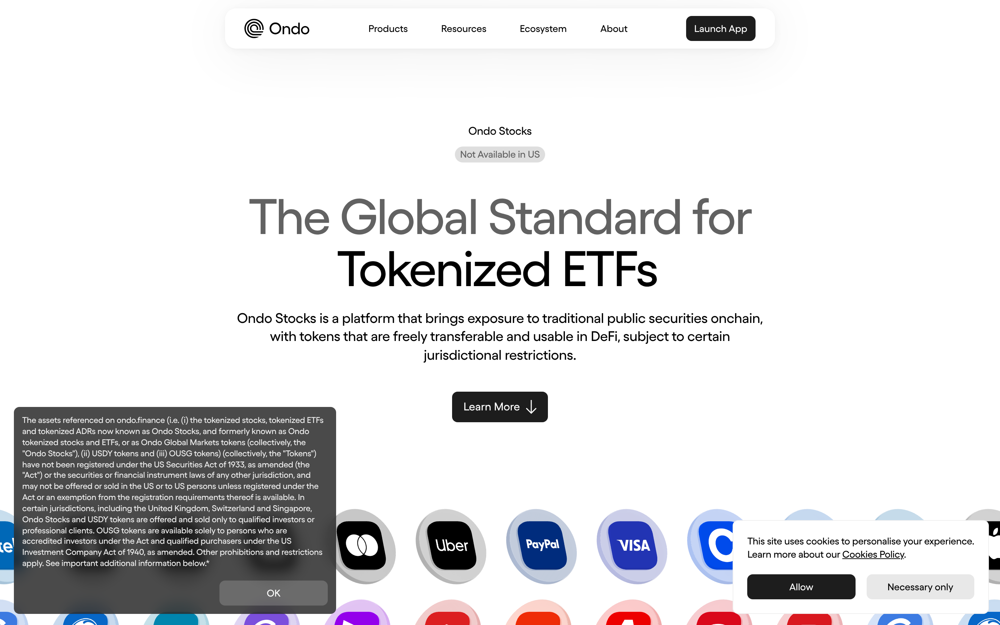
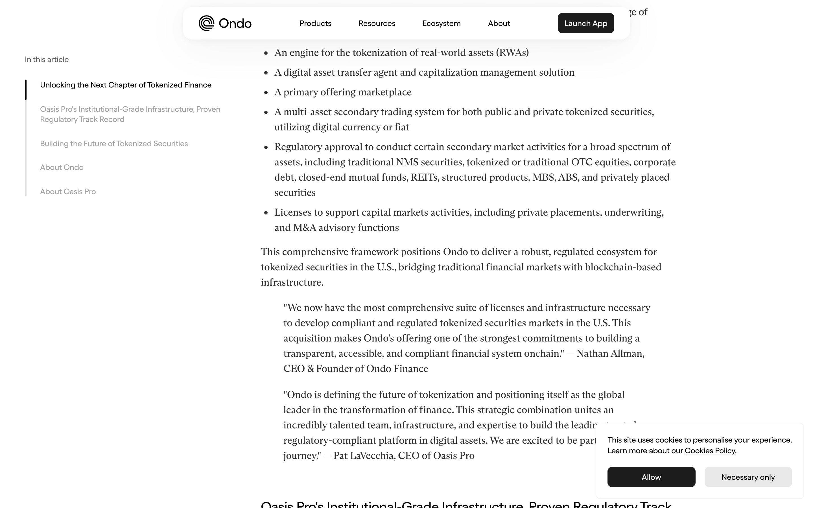
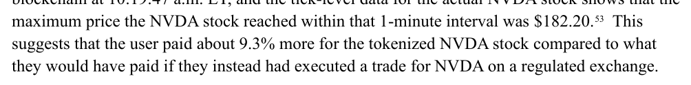
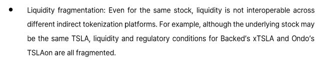

## 정체 카드
● 한 줄 정체 : 국채 토큰으로 시작해 ==미국 주식 토큰으로 넓힌== 토큰화 회사 [F-1215][F-0197]
  ★ 유형 안 위치 : 미국 SEC 등록 명의개서대리인 273곳 → 2025-10 Oasis Pro 인수로 명의개서대리인, ATS, 증권사 **세 자격을 한 그룹에** 둔 토큰화 회사(주식 토큰 발행 법인은 BVI) → 공식 순위 없음 → 2021년 설립, 국채 토큰에서 출발 [F-1145][F-1216][F-0185][F-1111][F-1215]
● 대표 상품 : OUSG = 미국 국채 펀드 4종과 USDC를 담은 사모 펀드 지분 토큰, 적격투자자용 [F-1306][F-1315][F-0532]
  ★ USDY = Ondo가 발행하는 국채 담보 노트 토큰(OUSG와 달리 펀드 지분이 아니라 발행사 채무증서), 적격 비미국인 대상. 2026-11-13 발행 잔액 19.7억 달러(Ondo 사이트 표시) [F-0509][F-0505][F-1318]
  ★ Ondo Stocks(2025-09 출시, 이전 이름 Ondo Global Markets) = 미국 상장 주식, ETF의 가격을 1:1로 따라가는 채무증권 토큰, 미국 밖 개인과 기관 대상 [F-0485][F-0187][F-0197]
  - 뜻 : 이름이 둘인 이유 = 이전 이름이 Ondo Global Markets이고 발행 법인명 Ondo Global Markets (BVI) Limited에 옛 이름이 남음 [F-0485][F-0550]
● 꼭 알아야 할 사실
  ★ 자체 체인 : 2025-02 발표한 자체 블록체인 Ondo Chain은 철회, 2026-07 Ondo Network(검증과 정산만 맡는 실행 계층)로 대체 [F-1213][F-1214]
  ★ 제재 : SEC(미국 증권거래위원회)의 수년간 비공개 조사(토큰화 방식과 ONDO 토큰의 증권성)가 기소 없이 종결됐다고 회사가 발표(2025-12). SEC 확인문은 없음 [F-1323][F-0198]
● 숫자
  ★ 주식 토큰 순위와 잔액 : 2026-11-16 rwa.xyz 토큰화 주식 플랫폼 표에서 발행 잔액 2위, 8.99억 달러로 시장 37.1억 달러의 24.23%. 1위 Binance 13.6억 달러와 4.6억 달러 차이 [F-1022][F-1021][F-1028]
  ★ 국채 토큰 순위와 잔액 : 같은 날 rwa.xyz 국채 토큰 플랫폼 표 2위, Ondo 상품 합계 32억 달러(시장 139.2억 달러의 약 23%). 1위 Franklin Benji 33억 달러와 약 1억 달러 차이 [F-1321][F-1320]
  ★ 종목 수 : 2025-09 출시 때 100종 이상, 2026-11-16 Ondo 사이트 소개문에 450개 이상(토큰화 주식과 ETF, 회사 표기) [F-0197][F-0477]
  ★ 보유자 수 : 2026-08-15 Ondo 전체 상품 보유자 200,645명, 그중 Ondo Stocks 186,636명(회사 보도자료) [F-1390]
● 흐름(주식 토큰) : 이용자(미국 밖) → 앱, Bitget(거래소) → 발행 BVI(SPV) → 보관 Alpaca(BitGo 포함) [F-0552][F-0202][F-0185][F-0189]
  - 뜻 : BVI = 영국령 버진아일랜드, 영국 본토 법이 아닌 자체 회사법으로 법인을 세우는 역외 지역
  - 뜻 : Alpaca = 미국 청산 증권사, 기초 주식 보관 [F-0189]. BitGo Trust = 가상자산 수탁 회사 [F-0558]
● 흐름(국채 토큰) : 투자자 → Ondo 웹(USDC, PYUSD 입금) → 펀드가 Coinbase에 둔 계좌로 입금액 이동 → 기초 국채 펀드 매입 [F-1312]

## 회사 개요와 확장 경로
● 주장 : 후발인데도 출시 14개월 만에 주식 토큰 발행 잔액 2위(8.99억 달러)에 오른 배경은 국채 토큰 사업으로 쌓은 고객과 판매 경로 [F-0465][F-0197][F-1022]
● 기본정보
  ★ 법인명 : Ondo Finance Inc.(토큰화 기술 회사, 미국 코네티컷주 그리니치) [F-0551][F-0193]
  ★ 2021년 설립, 창업자 Nathan Allman(Founder). 이전에 Goldman Sachs 디지털자산 팀에서 일함(Ondo 사이트 소개) [F-1111][F-1112][F-0497]
● 지배구조(누가 누구를 갖고 있나)
  ★ 발행 법인(Ondo Global Markets (BVI) Limited) 지분 : Flux Finance 90.01%, Ondo Finance Inc. 9.99%(2025-11-11 기준) [F-0186]
  ★ Flux Finance는 Ondo Foundation(재단)의 완전 자회사. 즉 발행 법인의 다수 지분은 Ondo Finance Inc.가 아니라 재단 쪽이 보유 [F-0562][F-0186]
  ★ Flux Finance가 토큰 채무의 추가 담보 자금 보증 [F-0580]
  - 뜻 : Ondo Foundation = ONDO 토큰 거버넌스를 맡는 재단. Ondo Finance Inc.는 토큰화 기술을 제공하는 회사로 재단과 법인이 따로 [F-1209][F-0551]
  ★ OUSG 발행사 Ondo I LP는 Ondo가 운용하는 조합, 자문사 Ondo Capital Management는 SEC 등록 투자자문사(투자 자문과 자산 운용 업무를 하도록 SEC에 등록한 업자, 2025-08-06 효력) [F-1306][F-1152]
  ★ 상장 : Ondo Finance Inc.는 비상장. ONDO는 회사 주식이 아니라 거버넌스 토큰(공급 100억 개) [F-1209]
  ★ 경영 : 창업자 Nathan Allman이 2026-05 사망, President였던 Ian De Bode가 CEO 승계(회사 팀 페이지 직함은 Acting CEO and President, 전 McKinsey 디지털자산 업무 총괄). 사망 때 Allman은 CEO, 단독 이사, 다수 주주였고 이후 경영권 소송이 있음(아래 제약과 리스크) [F-0207][F-1112][F-0498]
● 본업과 규모
  ★ 본업 : 미국 국채 토큰(OUSG, USDY)을 발행해 적격투자자와 미국 밖 투자자에게 판매하고, 미국 주식 토큰(Ondo Stocks)을 미국 밖에 공급 [F-1215][F-0197]
  ★ 해석 : 같은 날 rwa.xyz 국채 토큰 플랫폼 표 32억 달러가 토큰화 주식 플랫폼 표 8.99억 달러의 약 3.6배로, Ondo의 중심은 아직 국채 토큰 [F-1321][F-1022]
● 설립 목적과 비전
  ★ 문제의식 : 전통 금융의 높은 수수료, 닫힌 구조, 제한된 접근을 블록체인으로 해소 [F-1113]
● 타깃 수요
  ★ 국채 토큰 : 달러 국채 수익을 온체인으로 24시간 받으려는 적격투자자(OUSG)와 미국 밖 투자자(USDY) [F-0465][F-0532][F-0505]
  ★ 주식 토큰 : 증권 계좌 없이 지갑으로 미국 주식에 접근하려는 미국 밖 개인과 기관, 아시아와 중남미 [F-0478][F-0553][F-1052]
● 수익원
  ★ 주식 토큰 발행 수수료 없음, 상환 0.05%, 견적가와 기초 매매가 차이는 Ondo Stocks가 보유 [F-0545][F-0546]
  - 뜻 : 견적가 = Ondo가 이용자에게 제시하는 매매 가격. 실제로 기초 주식을 사고파는 가격과 차이가 나면 그 차이(스프레드)가 Ondo 수입이 됨 [F-0546]
● 화면
   
  ★ 그림 해설 : 왼쪽은 Ondo 웹의 가입 화면, 오른쪽은 상품 소개 화면. 국채 토큰과 주식 토큰이 같은 웹에서 시작 [F-0552][F-1312]

## 사업 범위와 넓힌 순서
● 주장 : 인가가 필요한 미국 사업은 인수로, 인가가 필요 없는 주식 토큰은 미국 밖 판매부터 시작하는 순서로 확장 [F-0509][F-1047][F-0197]
● 자산(무엇을 어떤 순서로 더했나)
  - 뜻 : 줄 끝의 직접 = 회사가 스스로 출시, 등록, 설립, 인수 = 기존 회사를 사서 확보, 제휴 = 다른 회사와 협력, 계획 = 발표만 된 것 [F-0197][F-1047][F-0461]
  ★ 2023-01 OUSG, 2023-08 USDY : 국채 토큰 직접 발행 [F-1150][F-1151][F-0465]
  ★ 2025-09 Ondo Global Markets 토큰(미국 밖판) : BVI 직접 발행 [F-0185][F-0197]
  ★ 2025-10 미국 증권사, ATS, 명의개서 : Oasis Pro 인수 [F-1047]
  ★ 2026-07 미국용 보관형 : Oasis Pro 명의개서 활용 [F-1128]
● 자산 보충(자문, 제휴 상품)
  ★ 2025-08 OUSG 자문사 : SEC 직접 등록 [F-1152][F-0535]
  ★ 2026-10 비상장사 토큰 : Private Markets 직접 [F-1153]
  ★ 2026-09 BlackRock 전략 포트폴리오 3종 : 제휴 [F-0461]
● 고객(개인과 기관)
  ★ OUSG : 미국 적격투자자 대상, 직접 [F-0532]
  ★ USDY : 적격 비미국인 개인과 기관, 직접 [F-0505]
  ★ 2025-09 Ondo Global Markets 토큰 : 미국 밖 개인과 기관 [F-0566][F-0197]
● 시장(어느 나라로)
  ★ 2025-09 미국 밖 : BVI 발행, Regulation S 직접 [F-0197][F-0560]
  ★ 2025-10 아시아, 중남미 : BNB 체인 확장(직접) [F-1052]
  - 뜻 : BNB 체인 = Binance 계열에서 출발한 공개 블록체인. 이 체인의 지갑 이용자가 Ondo 주식 토큰을 살 수 있게 됨 [F-1052]
  ★ 2025-11 EU : FMA 승인 투자설명서(직접) [F-0191]
  ★ 2026-09 한국 : 카카오페이증권, 미래에셋 MOU(제휴) [F-0204][F-0205]
● 2023 OUSG와 USDY 국채 토큰 : 국채 자산부터 신뢰와 규모를 쌓음 [F-1150][F-1151]
● 2025-09 Ondo Global Markets 토큰(미국 밖판) : 미국 밖 고객으로 확장 [F-0197]
● 2025-10 Oasis Pro 인수 : 미국 증권사, ATS, 명의개서 인가를 한 번에 [F-1216][F-0194]
  - 뜻 : IVV = iShares S&P 500 ETF, MU = Micron Technology 주식. 보관형 = 증권사 계좌에 실제 주식을 두고 토큰은 그 기록으로 쓰는 방식, 합성형 = 주식 가격에 연동한 발행사 채무를 파는 방식(BVI 상품) [F-1128][F-0187]
● 2025-02 Ondo Chain 발표 후 철회, 2026-07 Ondo Network로 대체 : 자체 블록체인(L1) 계획을 접고 검증과 정산만 맡는 실행 계층으로 [F-1213][F-1214]
  ★ 왜 : 오늘의 공개 블록체인에는 기관급 RWA용 기능이 없다고 봄 [F-1213]

## 경영진 발언
● 말하고 이룬 것(시점 순)
  ★ 2025-10-07 Allman(당시 창업자 겸 CEO) : 미국 규제형 토큰 증권 시장용 인가를 갖췄다 → 2026-07 Oasis Pro 명의개서로 미국 보관형 토큰 IVV, MU 첫 가동(회사 주장) [F-1047][F-1128]
  ★ 2025-10-29 Allman : BNB 체인 확장으로 아시아, 중남미 수백만 이용자에게 → 같은 달 BNB 체인 확장, 100종 이상 제공(실제 이용자 수는 공개 없음) [F-1052][F-0197]
● 말하고 접은 것
  ★ 2025-02 자체 L1 Ondo Chain 발표 → 메인넷 출시 없이 2026-07 Ondo Network(검증과 정산만 맡는 실행 계층)로 방향 변경 [F-1213][F-1214]
● 말하고 진행 중인 것
  ★ 2025-07-03 Allman : Catalyst(앱, 인프라 기업에 투자하는 2.5억 달러 전략 투자 이니셔티브)로 닫힌 시스템에서 열린 온체인 경제로 전환을 키운다 [F-1048]
  ★ 2026-07-15 De Bode : DTCC와 경쟁이 아니라 연동 [F-1049]
  ★ Ondo 문서 : 향후 수개월 내 수천 개 공개 거래 자산 토큰화 → 2026-11-16 사이트 소개문 450개 이상(토큰화 주식과 ETF) [F-0537][F-0477]
● 발언 1 : 닫힌 금융에서 열린 온체인 경제로 [F-1048]
  ★ Nathan Allman(창업자 겸 CEO), Ondo Catalyst 출시 발표, 2025-07-03, https://ondo.finance/blog/introducing-ondo-catalyst [F-1048]
    ① 원문 : "With Ondo Catalyst, we're fueling the transition from closed, permissioned systems to an open, onchain economy."
    ② 번역 : Ondo Catalyst로 닫힌 허가형 시스템에서 열린 온체인 경제로의 전환을 키운다.
  
● 발언 2 : 미국 규제형 토큰 증권 시장용 인가를 갖췄다 [F-1047]
  ★ Nathan Allman(창업자 겸 CEO), Oasis Pro 인수 완료 발표, 2025-10-07, https://ondo.finance/blog/ondo-acquires-oasis-pro [F-1047]
    ① 원문 : "We now have the most comprehensive suite of licenses and infrastructure necessary to develop compliant and regulated tokenized securities markets in the U.S."
    ② 번역 : 이제 미국에서 규제를 지키는 토큰 증권 시장을 만드는 데 필요한 가장 포괄적인 인가와 인프라를 갖췄다.
  
● 발언 3 : 아시아, 중남미 수백만 이용자에게 미국 주식을 [F-1052]
  ★ Nathan Allman(창업자 겸 CEO), BNB 체인 진출 발표, 2025-10-29, https://ondo.finance/blog/global-markets-live-on-bnb-chain [F-1052]
    ① 원문 : "Expanding Ondo Stocks to BNB Chain allows us to bring tokenized U.S. stocks and ETFs to millions of users across Asia, Latin America, and other geographies, in an environment that is fast, cost-efficient, and highly interoperable."
    ② 번역 : BNB 체인 확장으로 아시아, 중남미 등 수백만 이용자에게 빠르고 저렴하며 연동성 높은 환경에서 토큰 미국 주식과 ETF를 제공한다.
● 발언 4 : 기존 시장 인프라와 경쟁이 아니라 연동 [F-1049]
  ★ Ian De Bode(CEO), DTCC 협업 발표, 2026-07-15, https://ondo.finance/blog/ondo-and-dtcc-collaborate-on-tokenized-stocks [F-1049]
    ① 원문 : "Today's initiative with DTCC demonstrates that Ondo Stocks infrastructure is purpose-built to interoperate with institutional market infrastructure, not to compete with it."
    ② 번역 : DTCC와의 이번 시도는 Ondo Stocks 인프라가 기관 시장 인프라와 경쟁하지 않고 연동하도록 설계됐음을 보여준다.
  

## A 출신과 진입(주식 토큰 사업)
● 주장 : 새 고객을 처음부터 모으지 않고, 국채 토큰 고객과 같은 웹을 쓰되 규제가 다른 주식 토큰은 별도 발행 법인으로 분리해 진입 [F-0532][F-0505][F-0550][F-0552]
● 출신 : 원래 사업은 국채 토큰이며 OUSG는 미국 적격투자자, USDY는 적격 비미국인 대상 [F-0532][F-0505]
● 진입 방식
  ★ 발행은 BVI 법인, Ondo Finance는 토큰화 서비스만 [F-0550][F-0551]

## B 상품 구조
● 주장 : 투자자는 주식이 아니라 발행 법인에 대한 채권을 갖고, 담보가 있어 발행 법인이 도산해도 담보 범위에서는 상환받음 [F-0998][F-0188][F-0576]
● 토큰의 법적 성격(우리 분류)
  ★ 스위스법을 적용한 채무증서이고 가격은 기초 종목을 1:1로 따라감 [F-0187][F-0557]
  ★ 토큰을 돌려주고 기초 주식 자체를 달라고 청구할 수 없고(현금 가치만 상환), 주주 의결권과 정보권도 없음 [F-0188][F-0559]
  ★ 우리 분류 : 연계증권(기초 주식 가격에 연동해 가치가 정해지는 발행사 채무) [F-0998]
● 발행 주체와 보관
  ★ 발행 법인은 독립 이사를 둔 SPV로, 모회사가 파산해도 토큰 채무가 영향받지 않도록 설계 [F-0576][F-0510]
  ★ 토큰과 같은 수량의 기초 주식을 Alpaca(미국 청산 증권사)와 BitGo Trust(수탁 회사)의 담보 계좌에 보관 [F-0189][F-0558]
  ★ Ankura Trust(담보 대리인)가 1순위 담보권 보유 [F-0483][F-0573]
● 투자자 권리
  ★ 배당은 자동 재투자되어 토큰 가격에 반영 [F-0542]
  ★ 2026-04 Broadridge(주주 의결권 행사를 중개하는 미국 회사) 연동으로 토큰 보유자가 기초 주식에 대한 찬반 의향(의결 선호)을 제출 [F-0463][F-0464]
  
  ★ 그림 해설 : 합성형 = 주식 자체가 아니라 주식 가격에 연동한 권리를 주는 방식의 흐름도. 같은 보고서의 Robinhood EU판, Kraken, Binance 일부도 이 부류이며 이 회사는 Ondo 열(발행 SPV 채무, 의결은 Broadridge 대행) [TP-204][F-0463]
● 규모의 과거 대비(2026-01 초 기준)
  ★ 2026-01 초 4.13억 달러 1위(51.59%) → 11-16 8.99억 2위(24.23%) [TP-001][F-1022]
  
  ★ 그림 해설 : 2026-01 초 rwa.xyz 토큰화 주식 플랫폼 순위표(잔액과 점유율). 이 회사는 1위 줄, 잔액 4.13억 달러, 점유율 51.59%. Binance, Robinhood, Coinbase는 이 표에 없음 [TP-001][TP-005]
● 평가
  ★ 블록체인 위 활용 : 이용자가 외부 지갑으로 토큰을 옮길 수 있고, 체인 간 이동 통로(LayerZero 브리지)로 DeFi 서비스 연동을 추진 [F-0553][F-1051]
  ★ 제3자 위험 : 주의. 주식 발행 기업(Tesla 등)의 동의 없이 제3자가 만든 토큰이어서 기업과 보유자 사이 권리 관계가 없고, 토큰 보유 기록은 발행 SPV가 관리하며 담보는 Ankura가 대리 보유(CoinDesk Research, Bullish 의뢰) [TP-204][F-0573]

## C 최종 투자자
● 주장 : 신원 확인과 지역 제한 두 단계로 고객을 거르며, 스위스는 개인 판매 없이 전문고객에게만 판매 [F-0567][F-0190][F-0530]
● 대상
  ★ Persona(신원 확인 업체)로 KYC, KYB 심사 [F-0567]
● 국적 및 지역 제한
  ★ 미국인, 미국 안에서 주문하는 자 제외 [F-0190][F-0543]
  ★ 스위스는 전문고객(금융 규제상 자격을 인정받은 기관 등)에게만 판매하고 개인 판매는 없음 [F-0530][F-0544]
● 제3자 시각(이용자)
  ★ 주의 : 한번 발행된 토큰은 외부 지갑으로 옮길 수 있어, Ondo 신원 확인(KYC)을 거치지 않은 사람도 블록체인 위에서 토큰을 받아 보유할 수 있음(포필러스, Securitize 후원 보고서) [TP-206]

## D 유통과 접점
● 주장 : 판매를 자체 앱 한 곳에 묶지 않고 거래소(Bitget, Nest Exchange), 지갑(Trust Wallet)과 블록체인 3개로 나눠 공급 [F-0552][F-0572][F-0574]
● 공급 방식(누구에게 서빙하는지)
  ★ 자체 앱 : KYC 마친 개인, 기관에 USDon(달러 토큰)으로 판매 [F-0561][F-0552]
  ★ Bitget(가상자산 거래소) : USDT(스테이블코인) 계정 이용자에게 2025-09부터 100종 이상 제공 [F-0202]
  ★ Nest Exchange(Binance 운영 거래소) : UAE에서 디지털 증권으로 거래 [F-0549]
  ★ Trust Wallet(지갑 앱), OKX, HTX(가상자산 거래소), 1inch(탈중앙 거래소 모음 서비스)도 출시 파트너 [F-0572]
● 거래 장소
  ★ 사용 블록체인 : Ethereum, BNB Chain, Solana 3개 [F-0574]
  ★ 거래시간 : 일요일 밤 8시~금요일 밤 8시(ET) [F-0564]
  ★ 미국 정규장(현지 오전 9시 30분~오후 4시) 밖 시간에도 거래할 수 있는 종목은 32개 [F-0565]
● 가격과 유동성 장치
  ★ 유동성 공급 : 가격은 미국 시장의 기초 주식 거래를 따르고, 이용자가 사면 토큰을 즉시 새로 발행(민트)하고 팔면 즉시 소각해 수량을 맞춤. 한 건의 거래로 토큰 또는 스테이블코인을 받음 [F-0541][F-0570]
  ★ 상환과 수렴 : 보유자가 토큰을 Ondo에 돌려주면 기초 주식의 현금 가치만큼 스테이블코인으로 받고 수수료는 0.05%. 이 상환 통로가 있어 토큰 가격이 기초 주식 가격에서 크게 벌어지기 어려움(해석) [F-0481][F-0545]
● 제3자 시각(유통)
  ★ 긍정과 주의 : DeFi 연동이 가장 깊은 편이나 보유자는 주식을 소유하는 것이 아니라 가격만 따라가는 권리를 가짐(CoinDesk Research, Bullish 의뢰) [TP-207]

## E 인가
● 주장 : 미국 안에서 필요한 증권사, ATS, 명의개서는 Oasis Pro 인수로 확보했으나, 현재 주식 토큰 판매 자체는 미국 인가 없이 미국 밖 면제에 의존 [F-0194][F-0560][F-0529]
● 보유 인가와 법인(확보 방식과 시점)
  ★ 미국 증권사, ATS, 명의개서대리인 : Oasis Pro 인수(2025-07 발표, 2025-10 완료) [F-0246][F-0194][F-1047]
  ★ 2025-08 투자자문 : Ondo Capital Mgmt SEC 직접 등록 [F-1152][F-0535]
  ★ 발행 법인 : BVI 법인 2025-04 직접 설립 [F-0185]
● 인가와 인수로 열린 것
  ★ 미국 밖 주식 토큰(인가가 계기가 아님) : 2025-04 BVI 발행 법인 설립, Regulation S 면제로 2025-09 Ondo Global Markets(현 Ondo Stocks) 100종 이상 출시. BVI 감독기관 인가도 받지 않았고 미국인과 미국 안 주문은 제외 [F-0185][F-0560][F-0197][F-0528][F-0190]
  ★ 미국 안 판매(새로 연 것) : 그 전 Ondo Stocks는 미국인과 미국 안 주문을 받지 못함 → 계기 2025-10-07 Oasis Pro 인수 완료(2009 등록 증권사, ATS, 명의개서대리인 일괄, 금액 비공개) → 그 뒤 2026-07 Oasis Pro 명의개서대리인이 미국 보관형 IVV, MU 토큰을 첫 가동(회사 주장), 2026-09 Oasis Pro Markets가 DTCC Fund/SERV 처리망 합류(The Defiant 보도). 미국 보관형의 매수 대상 범위는 발표에 없음 [F-1129][F-1216][F-0246][F-0194][F-1128][F-0495]
  ★ EEA 판매(새로 연 것) : 그 전 Regulation S 면제로 미국 밖 판매만 → 계기 2025-11-11 리히텐슈타인 FMA가 기본 투자설명서 승인, EEA 29개국 통지 → 그 뒤 첫 상품 QQQon(발행 한도 5억 달러). 유효기간이 2026-11-11에 끝났고 갱신은 확인하지 못함 [F-0560][F-1240][F-0191]
  ★ OUSG 투자자문(이미 하던 영업을 규제에 맞춘 것) : 2023-01 OUSG 출시 때부터 자문 업무를 했고 SEC 면제보고자문사였음 → 2025-06-30 면제 신고 철회, 2025-08-06 SEC 투자자문사 등록 효력 [F-1152][F-1150]
● 인가 없는 구간을 메우는 방법
  ★ Ondo Finance는 중개, 청산, 보관 아닌 기술 제공자(약관) [F-0526][F-0525]
● 미국 밖 구조의 대가
  ★ 미국 증권법(1933) 공모 등록과 투자회사법(1940) 펀드 등록을 모두 하지 않아, 미국 투자자 보호 장치(공시, 펀드 규제) 밖에서 팔리는 상품 [F-0529][F-0531]
  ★ 발행 법인이 받는 미국 기업 배당에는 미국이 30%를 원천징수(미리 떼어 납부) [F-0547]
  ★ Ondo는 BVI 금융서비스위원회에 등록도, 인가도 받지 않았다고 명시. 발행 법인이 BVI 감독기관의 인가 감독 아래 있지 않다는 뜻 [F-0528]

## F 관계(해당 시)
● 주장 : 상품 범위를 은행 결제망, BlackRock 같은 대형 운용사와의 협력으로 넓힘. 협력 사례는 모두 2026-05 이후 [F-0462][F-0461]
● 인수, 투자, 제휴
  ★ 2026-05 Kinexys by J.P. Morgan(은행 결제망), Mastercard, Ripple 3곳과 토큰화 국채 펀드의 첫 국경 간, 은행 간 상환 시험 완료 [F-0462]
  ★ 2026-07 SBI Holdings(일본 금융그룹)와 일본 주식을 온체인으로 가져오는 파트너십 발표(The Block 보도) [F-0487]

## G 한국 접점(해당 시)
● 주장 : 한국 두 곳과 협약을 맺었으나 상용화는 한국과 해외 규제, 기술 검토 결과에 달려 있고, 한국은 Ondo 주식 토큰 활성 거래자 수 1위(회사 아시아 담당 주장) [F-0204][F-0205][F-0206]
● 한국 회사와의 협약
  ★ 2026-09 카카오페이증권과 한국 주식 해외 유통 MOU [F-0204]
  ★ 카카오페이증권이 외국인 통합계좌(해외 투자자 여럿의 한국 주식을 증권사 한 계좌에 모아 보유하는 방식)로 기초 한국 주식 원주를 조달 [F-0204]
  ★ 카카오페이증권은 전날 같은 취지의 협약을 Dinari와도 맺어 복수의 토큰화 회사와 병행 협력(한국 언론 교차 확인) [F-0136]
  ★ 한국은 Ondo Stocks 활성 거래자 수 세계 1위라고 Ondo 아시아 담당이 인터뷰에서 말함(2026-11-05, Bloomingbit 보도, 회사 주장, 독립 검증 없음) [F-0206]
  ★ 미래에셋자산운용과 Global X ETF 토큰화 MOU [F-0205]

## 국채 토큰 사업(OUSG, USDY)
● 주장 : 국채 토큰 시장 2위 사업자이며 BlackRock 제휴 상품까지 넓힘 [F-1321][F-1324]
● 상품 구조
  ★ OUSG : Ondo I LP(발행사)가 내는 유한책임조합 지분을 토큰으로 만든 것. 공모 등록은 Rule 506(c) 면제, 펀드는 투자회사법 3(c)(7) 등록 면제 [F-1306][F-1307]
  - 뜻 : Rule 506(c) = 미국 증권법상 공모 등록 없이 자격 확인을 거친 적격투자자에게만 파는 사모 면제 규정
  - 뜻 : 투자회사법 3(c)(7) = 적격구매자(아래 투자자 자격 참조)만 받는 펀드에 투자회사 등록 의무를 면제하는 규정
  ★ USDY : Ondo USDY LLC가 발행한 토큰화 담보부 노트. 2025-12-15부터 Ondo Stocks 발행 법인(Ondo Global Markets (BVI) Limited) 산하로 옮겨 관리 [F-0504][F-0509][F-0503]
● 기초자산과 운용사
  ★ OUSG(2026-11-13 종가, 총 3.13억 달러) : State Street Galaxy Onchain Liquidity Sweep Fund 48.57%, BlackRock BUIDL 32.69%, Franklin BENJI 10.13%, Fidelity FYOXX 7.56%, USDC 0.99% [F-1315]
  - 뜻 : BUIDL, BENJI, FYOXX, SWEEP = 각각 BlackRock, Franklin Templeton, Fidelity, State Street(Galaxy와 공동)가 미국 국채 등에 투자하는 펀드를 온체인으로 내놓은 상품 [F-1315]
  ★ 2024-08 BUIDL로 이전한 경위 : 24시간 즉시 발행과 상환을 위해 기초자산을 BlackRock과 Securitize의 BUIDL로 옮기고 Circle의 USDC 즉시 유동성을 이용 [F-1317]
  ★ USDY(2026-11-13) : 발행 잔액 19.7억 달러, 기초자산 24.2억 달러, 미국 국채 82.73%, iShares 0-1년 국채 ETF를 Ondo가 토큰으로 만든 SHVon 17.24%(Ondo Stocks 종목을 기초자산으로 다시 담은 것) [F-1318]
● 발행 잔액과 시장 내 위치
  ★ 2026-11-16 rwa.xyz 국채 토큰 시장 : 분산 가치 139.2억 달러(30일 전 대비 5.45% 감소), 자산 123개, 보유자 86,310 [F-1320]
  ★ 시장 규모 추이(시점 순, rwa.xyz 집계) : 2025-01 약 39.5억 달러 → 2026-01 88.6억 달러(CryptoSlate 보도, RWA.xyz 인용) → 2026-11-16 139.2억 달러(rwa.xyz 화면). 약 22개월에 3.5배. [F-1391][F-1320]
  ★ 자산별 : USDY 23.95억, BUIDL 16.54억, BENJI 12.80억, OUSG 3.13억 달러. USDY가 국채 토큰 자산 중 가장 큼 [F-1322]
  ★ USDY 값이 둘 : Ondo 상품 페이지 발행 잔액 19.7억(11-13)과 rwa.xyz 자산별 23.95억(11-16)은 서로 다르며 하나로 고르지 않음 [F-1318][F-1322]
● 투자자 자격과 최소 금액
  ★ OUSG 자격 : accredited investor(적격투자자)이면서 qualified purchaser(적격구매자). 개인 순자산 500만 달러 초과, 기관 자산 2,500만 달러 초과가 가장 흔한 기준 [F-1308]
  ★ USDY 자격 : 적격 비미국인 개인과 기관. 미국 안에서 매수 주문하는 자와 Regulation S상 미국인은 청약, 상환 금지 [F-0505][F-0514]
  ★ 최소 금액 : OUSG 즉시 투자와 상환 5,000달러, 즉시 아닌 방식은 투자 10만, 상환 5만 달러. USDY 주력 체인 외는 5,000달러 [F-1310][F-1319]
  ★ 즉시 발행, 상환 한도 : 전체 합산 24시간 5,000만 달러, 투자자 1인당 24시간 2,500만 달러. 상환은 Circle의 USDC 지원 여부에도 제한 [F-1311]
● 유통 경로
  ★ USDY : 가격 산정은 이더리움, BNB 체인, Mantle, Tempo 4개 체인에서만 하고 다른 체인의 USDY는 이 네 체인에서 브리지(체인 간 이동 통로)로 옮겨 쓰며, Sui, Aptos 등의 발행과 상환은 Ondo에 문의하는 방식 [F-1319]
● 수수료와 가격 산정
  ★ OUSG 운용보수 0.15%, 2027-01-01까지 면제. 펀드 비용 상한 연 0.15%. 즉시 발행, 상환에는 추가 수수료가 있을 수 있음 [F-1313]
  ★ NAV(순자산가치) : 펀드 관리자 NAV Consulting이 매일 독립 계산, 재무제표 매일 게시(온체인 가격은 최대 3일 늦을 수 있음), 연 1회 감사 [F-1314]
● BlackRock 제휴 상품
  ★ 2026-09-24 Ondo Intelligent Portfolios 출시. 첫 3종 BLKHIon(고소득), BLKDIGon(분산 성장), BLKGRWon(고성장)은 BlackRock이 Ondo를 위해 만든 포트폴리오 전략 기반 [F-1324][F-0461]
  ★ 구조 : 기초 포지션은 국채가 아니라 Ondo Stocks(토큰화 주식과 ETF), 구성과 목표 비중은 설정 시점에 정해 일정에 따라 리밸런싱 [F-1324]

## 한국 시장과의 차이
● 주장 : 같은 토큰이 미국 밖에서는 Regulation S로 팔리나, 한국법으로는 외국 발행 증권이라 한국 개인에게 권유해 팔려면 공모 서류가 필요 [F-0560][F-0187][KR-자본시장법-4①본문][KR-자본시장법-119]
● 규제
  ★ 가능했던 이유 : 미국 밖 판매는 Regulation S로 공모 등록 불요 [F-0560][US-17CFR-230.903-a]
  ★ 한국 차이 : 스위스법 채무증서도 외국인 발행 증권으로 봄 [F-0187][KR-자본시장법-4①본문]
  - 결과 : 한국에서 불특정 다수에게 취득을 권유해 팔려면 증권신고서(공모 서류)를 금융당국에 내야 하므로, 미국 밖 면제만으로 한국 개인에게 열 수 없음 [KR-자본시장법-119][KR-자본시장법-9⑦]
  ★ 국채 토큰 OUSG의 한국 제외 : Ondo 자격 문서가 한국 거주 개인과 한국 법인을 관할 제한 목록에 명시. 주식 토큰과 달리 회사 문서에서 한국 제외가 확인되는 상품 [F-1404]
● 규제 건의 포인트 : 한국 상장주를 외국인 통합계좌로 사서 해외에서 토큰으로 파는 방식을 어디까지 허용할지 기준 정리 [F-0204][KR-자본시장법-168]

## 성과와 판단
● 주장 : 국채 토큰이라는 본업 위에 주식 토큰을 얹어 두 영역 모두 상위권 [F-1321][F-1022]
● 사업별 성과
  ★ 비상장사 토큰 : 2026-10-05 Ondo Private Markets 발표. 비상장사 주당 가치에 연동한 토큰화 노트로, 첫 대상은 비상장 AI 기업 [F-1153]
● 핵심 성공요인(KSF)
  ★ 주식 토큰 후발 진입 뒤 빠른 추격 : 같은 사업을 Dinari는 2023-08, Kraken, Robinhood는 2025-06에 시작했고 Ondo는 2025-09 출시, 2026-01 초 rwa.xyz 표 1위(4.13억 달러, 점유율 51.59%), 2026-11-16 8.99억 달러로 2.2배 [F-0273][F-1040][F-0221][F-0197][TP-001][F-1022]
    - 선점한 것 : 출시 약 4개월 만에 잔액 1위. 같은 표에 Binance, Robinhood, Coinbase는 아직 없었음 [TP-001][TP-005]
    - 해석 : 국채 토큰 고객과 자체 웹, 거래소(Bitget) 유통으로 출시 직후부터 공급 경로가 있었던 점이 배경 [F-0465][F-0552][F-0202]
    - 한계 : 점유율은 51.59%에서 24.23%로 낮아졌고 2026-11-16 1위는 Binance 13.6억 달러 [TP-001][F-1022][F-1021]
● 제약과 리스크
  ★ 주식 토큰은 !!담보로만 상환!! [F-0188]
    - 왜 : 발행 BVI 법인이 도산하면 토큰 보유자는 담보 처분금 범위에서만 돌려받고 모자란 부분은 투자자가 잃음 [F-0188][F-0576]
  ★ 창업자 사망과 경영권 소송 : 2026-05 사망, 2026-08 유족이 델라웨어 법원에 경영권과 De Bode 해임을 요구, 결과는 확인하지 못함 [F-0207][F-0208]
    - 왜 : Allman이 단독 이사이자 다수 주주였고 이사석 1개가 공석이라 최종 결정권자가 법원 판단에 걸림. 파트너, 규제기관과 계약하는 쪽이 불확실해질 수 있음(해석) [F-0207][F-0208]
  ★ EU 판매 근거 만료 : 투자설명서 유효기간이 2026-11-11에 끝났고 갱신은 확인하지 못함 [F-1240]
    - 왜 : 유효기간이 지난 투자설명서로는 EU 투자자에게 새로 판매하기 어려워 갱신 전까지 EU 판매가 멈출 수 있음(해석) [F-1240]
  ★ SEC 조사 종결은 회사 발표뿐 : SEC 쪽 확인문 없음 [F-1323][F-0198]
  ★ 국채 토큰 쏠림 : OUSG의 48.57%가 펀드 한 곳(State Street Galaxy SWEEP) [F-1315]
    - 왜 : 해당 펀드에 운용이나 상환 문제가 생기면 OUSG 보유자 가치가 직접 영향받음(해석) [F-1315]
  ★ 즉시 상환 한도 : 24시간 합산 5,000만 달러, Circle USDC 지원 여부에 연동 [F-1311]
    - 왜 : 한도가 찬 날이나 USDC 지원이 멈춘 날에는 즉시 현금화가 안 될 수 있어 투자자가 상환 시점을 정하지 못함(해석) [F-1311]
● 제3자 평가
  ★ 평가 1(주의, 탈중앙 거래소 풀에서 단일 사례 약 9.3% 비싸게 체결) : 오버달(SEC 제출 의견서, 필자가 Citadel Securities 재정 지원을 밝힘), Tokenized U.S. Equities, DeFi Trading, and the SEC's Exemptive Authority, 2026-01-22, 25쪽, https://www.sec.gov/files/ctf-written-james-overdahl-tokenized-us-equities-01-22-2026.pdf [TP-201]
    ① 원문 : "This suggests that the user paid about 9.3% more for the tokenized NVDA stock compared to what they would have paid if they instead had executed a trade for NVDA on a regulated exchange."
    ② 번역 : 이용자가 규제 거래소에서 샀을 때보다 토큰화 NVDA를 약 9.3% 비싸게 샀다는 뜻이다.
  
  ★ 평가 2(주의, 수수료가 없어도 견적 차이가 수입) : 포필러스(Securitize 후원 보고서), 2026: The Year of Tokenized Stocks, 2026-02-23, 38쪽, https://4pillars.io/en/reports/2026-the-year-of-tokenized-stocks [TP-202]
    ① 원문 : "Similar to the PFOF structure between Robinhood and Citadel, Ondo Finance can earn spread revenue while processing users' stock orders."
    ② 번역 : Robinhood와 Citadel의 PFOF 구조처럼 Ondo는 주문 처리 중 스프레드 수익을 얻을 수 있다.
  
  ★ 평가 3(주의, 같은 종목도 플랫폼마다 유동성이 갈림) : 포필러스(Securitize 후원 보고서), 2026: The Year of Tokenized Stocks, 2026-02-23, 27쪽, https://4pillars.io/en/reports/2026-the-year-of-tokenized-stocks [TP-203]
    ① 원문 : "Liquidity fragmentation: Even for the same stock, liquidity is not interoperable across different indirect tokenization platforms."
    ② 번역 : 유동성 분산: 같은 종목도 간접 방식 플랫폼 사이에 유동성이 호환되지 않는다.
  
● KDX 시사점(채권형 토큰 확장 중심)
  ★ 자산 : 국채 토큰 구성과 운용 방식 [F-1315][F-1317]
    - 가져올 것 : 국채를 직접 사지 않고 ==운용사 펀드 지분을 다시 담는 구조==. 운용은 BlackRock, Franklin Templeton, Fidelity, State Street에 맡기고 토큰 층만 직접 운영 [F-1315][F-1306]
    - 가져올 것 : NAV를 외부 관리자가 매일 독립 계산, 연 1회 감사 [F-1314]
    - 피할 것 : 구성이 바뀌어도 안내가 늦는 상태. 2024-08 BUIDL로 옮긴 뒤 2026-11-13 최대 비중은 SWEEP 48.57%로 바뀌었으므로 구성 공시 주기를 정해야 함 [F-1317][F-1315]
  ★ 고객 : 자격과 최소 금액의 구분 [F-1308][F-1310]
    - 가져올 것 : 상품별로 자격과 최소 금액 분리(OUSG 적격투자자 5,000달러부터, USDY 적격 비미국인) [F-1310][F-0505]
    - 피할 것 : 순자산 500만 달러와 증빙을 요구하는 높은 진입 장벽. 판매 대상이 좁아져 개인 확대에 한계 [F-1308][F-1309]
    - 이유 : 진입 조건이 높으면 규제는 지키지만 고객이 넓어지지 않아 거래 규모가 커지기 어려움. OUSG 잔액 3.13억 달러가 USDY 19.7억 달러의 약 16% 수준(해석) [F-1308][F-1315][F-1318]
  ★ 시장 : 여러 체인과 결제망 연동 [F-1319][F-0462]
    - 가져올 것 : 가격 계산은 네 체인에서만 하고 나머지는 브리지하는 방식, 은행 결제망 3곳과 국경 간 상환 시험 [F-1319][F-0462]
    - 피할 것 : USDY의 미국 내 주문자 금지처럼 지역 제한을 상품마다 따로 관리해야 하는 부담 [F-0514][F-0505]
  ★ 거래 시설 운영 : 발행, 상환 한도와 상환 통화 [F-1311]
    - 가져올 것 : 24시간 합산 한도와 1인 한도를 정해 한 투자자의 쏠림 방지 [F-1311]
    - 피할 것 : 상환이 외부 스테이블코인(Circle USDC) 지원에 묶이는 구조. 상환 통화를 한 사업자에 의존 [F-1311][F-1317]
