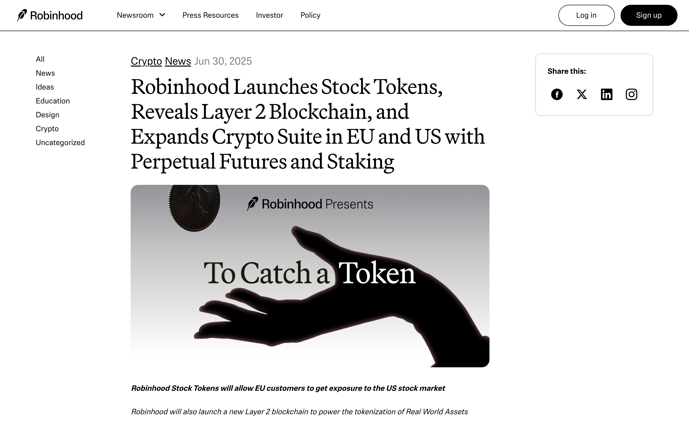
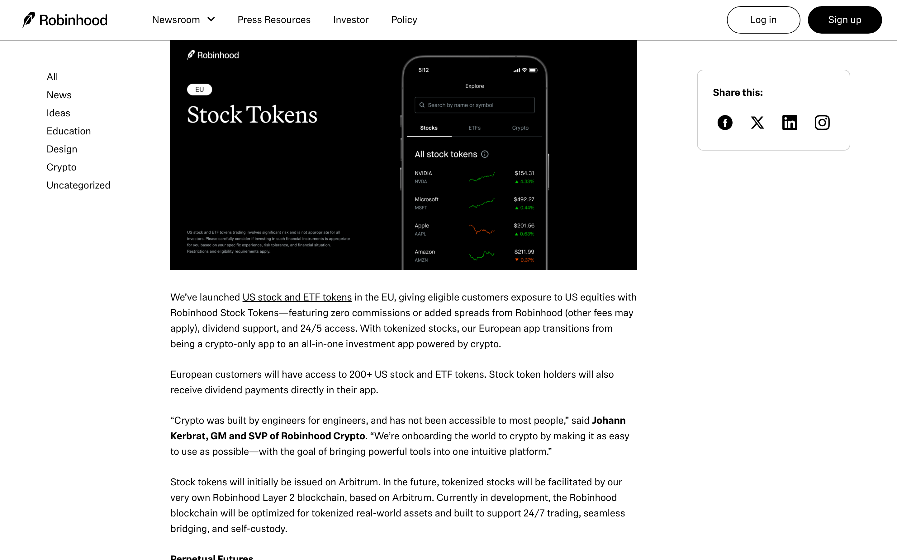
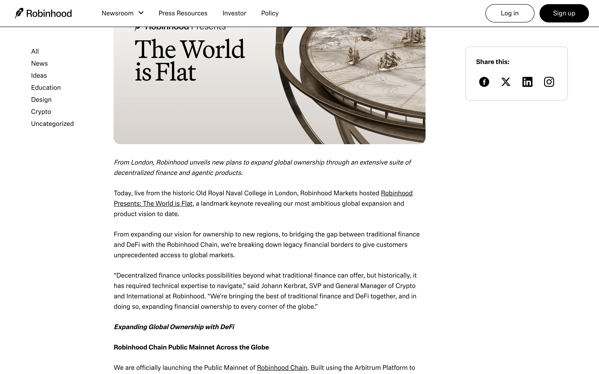

## 회사 개요와 확장 경로
● 주장 : 미국 주식 앱이 거래소 인수와 자체 체인으로 해외 토큰 판매 [F-0605][F-0666][F-0637]
● 기본정보
  ★ 법인명 : Robinhood Markets, Inc.(미국 주식 거래 앱 운영사) [F-0584]
  ★ 발행 법인 : Robinhood Assets (Jersey) Limited(RHJ, 지갑판 발행사) [F-0852]
  ★ 설립 : 2013년, 창업자 Vlad Tenev, Baiju Bhatt [F-0581][F-0601]
  ★ 소재지와 상장 : 미국 캘리포니아 멘로파크, Nasdaq(HOOD) [F-0582][F-0583]
● 지배구조
  ★ Tenev가 이사회 의장 겸 CEO [F-0600]
  ★ RHF(중개 증권사), RHS(청산 증권사), EU 법인은 완전 자회사 [F-0585][F-0586]
  ★ RHJ 단독 주주는 Robinhood International [F-0857]
● 설립 목적
  ★ 2013년 설립, 사명은 금융 민주화(회사 공시) [F-0581]
● 성장 경로(한 줄기)
  ★ 2013 미국 주식 앱 출발 → 2025-06 Bitstamp(가상자산 거래소) 인수 [F-0581][F-0605]
  ★ 2025-06 EU 인가 → EU판 Stock Tokens(미국 주식 연동 토큰) 200종 [F-0213][F-0214][F-0221]
  ★ 2026-06 WonderFi(캐나다 가상자산 기업) 인수 → 2026-07 자체 체인 출범 [F-0608][F-0666]
  ★ 2026-07 지갑판(Robinhood Wallet 판매 토큰) 출시 → 2026-10 EU판 Classic 개칭 [F-0637][F-0239]

## 경영진 발언
● 발언 1 : 크립토가 글로벌 금융의 중추가 된다 [F-1063]
  ★ Vlad Tenev(의장 겸 CEO), To Catch a Token 행사(칸), 2025-06-30, https://robinhood.com/newsroom/robinhood-launches-stock-tokens-reveals-layer-2-blockchain-and-expands-crypto-suite-in-eu-and-us-with-perpetual-futures-and-staking/ [F-1063]
    ① 원문 : "Our latest offerings lay the groundwork for crypto to become the backbone of the global financial system."
    ② 번역 : 우리의 최신 상품은 크립토가 글로벌 금융 시스템의 중추가 되기 위한 토대를 놓는다.
    ③ 해석 : 큰 곳은 크립토 기반 글로벌 금융. 그래서 EU에 주식 토큰 200종 출시와 자체 체인 예고
  
● 발언 2 : 크립토를 쉽게 만들어 세계를 끌어들인다 [F-1064]
  ★ Johann Kerbrat(당시 Robinhood Crypto 총괄 SVP), To Catch a Token 행사(칸), 2025-06-30, https://robinhood.com/newsroom/robinhood-launches-stock-tokens-reveals-layer-2-blockchain-and-expands-crypto-suite-in-eu-and-us-with-perpetual-futures-and-staking/ [F-1064]
    ① 원문 : "Crypto was built by engineers for engineers, and has not been accessible to most people. We're onboarding the world to crypto by making it as easy to use as possible."
    ② 번역 : 크립토는 엔지니어가 엔지니어를 위해 만들었고 대부분의 사람은 쓰기 어려웠다. 최대한 쉽게 만들어 세계를 크립토로 끌어들인다.
    ③ 해석 : 큰 곳은 크립토를 못 쓰던 다수 개인. 그래서 EU 앱 하나에 주식 토큰과 가상자산 결합
  
● 발언 3 : 전통 금융과 DeFi를 합쳐 소유를 전 세계로 [F-1065]
  ★ Johann Kerbrat(가상자산, 국제사업 총괄 SVP), The World is Flat 행사(런던), 2026-07-01, https://robinhood.com/newsroom/robinhood-accelerates-global-expansion-robinhood-chain-mainnet-stock-tokens-agentic-trading/ [F-1065]
    ① 원문 : "We're bringing the best of traditional finance and DeFi together, and in doing so, expanding financial ownership to every corner of the globe."
    ② 번역 : 전통 금융과 DeFi의 장점을 합쳐 금융 소유를 전 세계 구석구석으로 넓힌다.
    ③ 해석 : 큰 곳은 전 세계 온체인 주식. 그래서 자체 체인 메인넷과 120개국 지갑판 출시
  
● 발언 4 : 모두를 주주로 만드는 것이 비전 [F-1067]
  ★ Vlad Tenev(의장 겸 CEO), 2026년 3분기 실적 보도자료, 2026-10-27, https://investors.robinhood.com/news-releases/news-release-details/robinhood-reports-third-quarter-2026-results [F-1067]
    ① 원문 : "Our vision is to make everyone an owner, because broad ownership is essential to a free, stable, and prosperous society."
    ② 번역 : 우리의 비전은 모두를 주주로 만드는 것이다. 폭넓은 소유는 자유롭고 안정적이며 번영하는 사회에 필수적이기 때문이다.
    ③ 해석 : 큰 곳은 소유의 대중화와 해외 고객. 그래서 같은 분기 영국 가상자산 거래 출시

## A 출신과 진입(주식 토큰 사업)
● 주장 : 남의 상품 판매가 아니라 자체 발행으로 진입 [F-0640][F-0630]
● 출신 : 미국 개인 대상 주식, 옵션, 가상자산 거래 앱 [F-0612]
● 진입 방식
  ★ EU판은 EU 법인이 고객과 맺는 자체 파생계약 [F-0640][F-0644]
  ★ 출발 사업 연계 : 앱의 미국 주식을 EU 고객에게 토큰으로 [F-0221]
  ★ 진출 사유 : Bitstamp 인수로 EU, 영국, 아시아 확장 가속 [F-0607]

## B 상품 구조
● 주장 : 지갑판은 RHJ 채무증권, EU판은 회사와 맺은 파생계약 [F-0992][F-0993]
● 토큰의 법적 성격(우리 분류)
  ★ 지갑판 : RHJ에 대한 담보부 상환금 채권, 주식 소유 없음 [F-0992]
  ★ EU판 : EU 법인과 맺은 파생계약상 권리, 주식 소유 없음 [F-0993]
  ★ 우리 분류 : 지갑판 연계증권, EU판 증권기반 스왑형 [F-0992][F-0993]
● 발행 주체와 보관
  ★ 지갑판 발행사 RHJ는 저지 비규제 법인 [F-0630][F-0854]
  ★ 지갑판 기초주는 Alpaca(미국 청산 증권사)가 보관 [F-0869]
  ★ 지갑판 담보는 가치 기준, 현금과 대여 허용 [F-0863][F-0864][F-0865]
  ★ EU판은 기초주 보유 의무 없이 헤지용 매수 [F-0641]
● 투자자 권리
  ★ 의결권 등 주주 권리 없음, 상환은 USD 현금만 [F-0875][F-0860]
  ★ 배당 : 지갑판 승수로 재투자, EU판 현금 상당액 [F-0877][F-0650]
● 규모(시장 내 위치)
  ★ 2026-11-16 지갑판 발행 잔액 1.49억 달러, 6위(점유율 4.01%) [F-1025]
  ★ 1~3위는 Binance, Ondo, Kraken(13.6억, 9.0억, 6.8억 달러) [F-1021][F-1022][F-1023]
  ★ 4위 Securitize(토큰화 발행사) 2.7억, 8위 Coinbase(가상자산 거래소) 0.47억 달러 [F-1024][F-1026]
  ★ 종목 : 지갑판 Final Terms 212건, EU판 2,000종 이상 [F-0663][F-0653]
● 수수료
  ★ 지갑판 청약 0%, 발행 90일 이후 상환 0.05% [F-0886]
  ★ EU판 주문마다 환전 수수료 0.1%, 그 밖은 무료 [F-0651]

## C 최종 투자자
● 주장 : 미국 밖 개인에게 소액부터 직접 판매 [F-0637][F-0654]
● 대상
  ★ 지갑판 : 120개국 이상 적격 이용자 [F-0637]
  ★ EU판 : EEA 적격 개인, 1유로부터 [F-0640][F-0654]
● 국적 및 지역 제한
  ★ 캐나다, 영국, 스위스 제한, 한국은 목록에 없음 [F-0880]
  ★ 북한, 이란 등 11개 관할 투자 금지 [F-0881]

## D 유통과 접점
● 주장 : 파트너 도매가 아니라 자체 앱과 자체 지갑으로 공급 [F-0592][F-0638]
● 공급 방식(누구에게 서빙하는지)
  ★ EU판 : 자체 앱이 EU 자기주도 개인에 직접 판매 [F-0592][F-0993]
  ★ 지갑판 : 자체 Wallet(비수탁 지갑, 150개국 이상) 이용자 [F-0615][F-0638]
  ★ 1차 공급 : 자회사 Bitstamp Global만 발행사에 직접 청약 [F-0871][F-0616][F-0872]
  ★ 2차 시장 : 일반 투자자는 Uniswap(탈중앙 거래소) 등에서 매매 [F-0227][F-0872]
● 거래 장소
  ★ 사용 블록체인 : Robinhood Chain(자체 이더리움 L2), Arbitrum에서 이전 [F-0225][F-0884]
  ★ 거래시간 : 지갑판 24/7, EU판 월 02시~토 02시(CET) [F-0227][F-0648]
  ★ EU판은 외부 지갑으로 이전 불가 [F-0649]

## E 인가
● 주장 : EU 판매는 직접 인가, 지갑판 발행은 비규제 저지 법인 [F-0214][F-0854]
● 보유 인가와 법인
  ★ 미국 : RHF, RHS 브로커딜러 등록(SEC, FINRA) [F-0243][F-0244]
  ★ EU : 리투아니아 MiFID 중개, MiCA 가상자산 인가 [F-0214][F-0213]
  ★ 저지 : RHJ는 차입 동의만 받은 비규제 발행사 [F-0855][F-0634]
  ★ 투자설명서 : EU 규정에 따라 리히텐슈타인 FMA 승인 [F-0856]
● 인가 없는 구간을 메우는 방법
  ★ 결제 계좌는 JPMorgan 런던 지점 [F-0873]
  ★ 독립 검증 대리인이 시리즈별 100% 담보 확인 [F-0874]
● 미국 미등록의 대가
  ★ 미국 증권법 미등록, 미국인 판매 불가 [F-0636][F-0890]
  ★ 2026-09 SEC 토큰화 주식 면제 대상 아님 [F-0642]

## F 관계(해당 시)
● 주장 : 인수로 해외 인가와 거래 인프라를 사서 들임 [F-0606][F-0609]
● 인수, 투자, 제휴
  ★ Bitstamp 지분 100%, 현금 2.24억 달러 [F-0606]
  ★ WonderFi 지분 100%, 현금 1.78억 달러 [F-0609]
  ★ Rothera(SIG와 합작법인)로 MIAXdx(파생상품 거래소) 지분 90% [F-0610]

## 한국 시장과의 차이
● 주장 : 해외는 역외 발행과 EU 인가로 열렸고 한국은 판매 근거 없음 [F-0636][F-0213][KR-자본시장법-119]
● 규제
  ★ 가능했던 이유 : 미국 밖 판매는 Regulation S 구조 [F-0636][US-17CFR-230.903-a]
  ★ 가능했던 이유 : EU 인가와 투자설명서 승인으로 EEA 판매 [F-0214][F-0856]
  ★ 한국에서 막히는 지점 : 해외 발행 토큰은 국내 권유 시 증권신고서 [KR-자본시장법-119]
  ★ 한국에서 막히는 지점 : 장외거래소 토큰 유통 근거는 2027-02 시행 [KR-자본시장법-166]
● 고객 수요
  ★ 가능했던 이유 : 증권 계좌 없이 1유로, 지갑으로 미국 주식 [F-0654][F-0637]
  ★ 한국 차이 : 국내 투자자는 이미 증권사로 미국 주식 1,636억 달러 보관(2025말) [F-1005]
  ★ 한국 차이 : 2025-11 증권사 18곳이 미국 주식 주간거래 재개 [F-1010]

## 성과와 판단
● 성과
  ★ 2026-09 지갑판 토큰 의무 공정가치 1.85억 달러 [F-0639]
  ★ 2026 Q3 순매출 14.2억 달러, 전년 대비 12% 증가 [F-0621]
  ★ 2026 Q3 체인 매출이 가상자산 매출 감소 일부 상쇄 [F-0671]
● 핵심 성공요인(KSF)
  ★ 고객 2,870만 명 앱에 자체 토큰 결합 [F-0622][F-0612]
  ★ 거래소 인수로 EU 인가와 1차 공급 법인 확보 [F-0605][F-0253][F-0616][F-0871]
  ★ 자체 체인 시퀀서 수익 50~85%를 회사 몫으로 [F-0670]
● 제약과 리스크
  ★ 2025년 OpenAI 토큰에 회사 측 반박, 감독기관 설명 요구 [F-0222]
  ★ EU판은 회사 파산 시 원금 전액 손실 가능 [F-0652]
  ★ 2026-11 보충서로 기발행 상품 약관 개정 [F-0889]
  ★ 2024년 미인가 영업으로 2개 주 제재 [F-0598]
● KDX 시사점(스토리라인 명제별)
  ★ 시장 인프라 Unbundling : 발행은 저지 법인, 보관은 Alpaca, 청약은 자회사 [F-0630][F-0869][F-0871]
  ★ Borderless Investing : 증권 계좌 없이 지갑으로 120개국에 미국 주식 [F-0637][F-0615]
  ★ Coopetition : 경쟁사도 쓰는 Alpaca 보관, 외부 DEX에 유통 개방 [F-0869][F-0994][F-0995][F-0227]
  ★ 해외 확장 세 질문 : 24/7 노출, 저지 발행과 EU 승인, 체인 수수료(제공 가치, 제도, 경제성) [F-0227][F-0856][F-0670]
