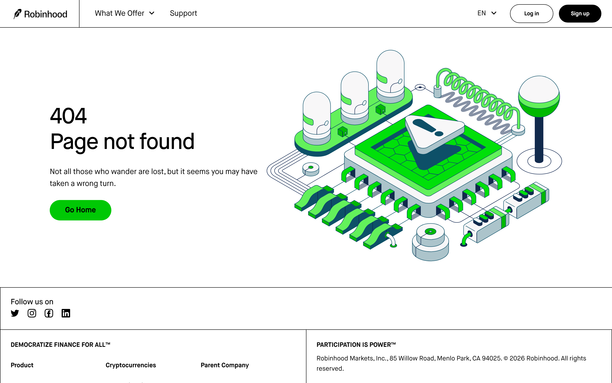
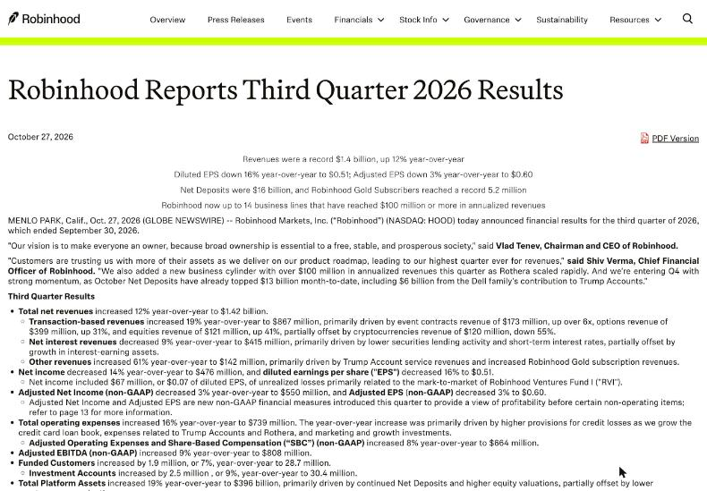

## 정체 카드
● 한 줄 정체 : 미국 주식 거래 앱에서 ==가상자산, 선물, 토큰 주식으로 넓힌== 상장사 [F-0612][F-0583]
  ★ 유형 안 위치 : 미국 FINRA 등록 증권사 3,184곳(2025년 말) → 고객 돈과 증권을 맡아 청산까지 하는 **청산, 보관형 증권사**(SEC 집계 158곳) 유형, 자회사 Robinhood Securities가 자사 앱 계좌의 청산을 맡음 → 공식 순위 없음 → 2013년 주식 거래 앱 출신 [F-1405][F-1144][F-0588][F-0581]
    - 보조 모집단 : 뉴욕주 NYDFS 가상자산 인가 39곳 중 BitLicense 26곳에 Robinhood Crypto(2019-01)가 있음. EU MiCA 가상자산사업자 404곳에 Robinhood Europe UAB(리투아니아)가 있으나 거래 플랫폼 운영 코드는 없음 [F-1411][F-1412][F-1413][F-1414]
● 대표 상품 : 24 Hour Market = 주 5일 24시간 미국 주식 거래(2023-05, 첫 43종) [F-1196]
● 대표 상품(토큰) : Stock Tokens(지갑판) = 발행사 채무증권, 주식 소유권 아님 [F-0630][F-0992]
● 꼭 알아야 할 사실
  ★ 상장 : Nasdaq 상장사(티커 HOOD), 2021-07-29 IPO(TechCrunch 보도) [F-0583][F-1380]
  ★ 큰 인수 : Bitstamp 2.24억 달러(2025-06), WonderFi 1.78억 달러(2026-06) [F-0606][F-0609]
  ★ 큰 제재 : 2025-01 SEC 합의 명령(총 4,500만 달러 과징금), 2025-03 FINRA 합의(벌금 2,600만 달러, 고객 환급 375만 달러) [CASE-005][CASE-006]
● 숫자
  ★ 주식 토큰 순위와 잔액 : 2026-11-16 지갑판 발행 잔액 6위, 1.5억 달러(1위 Binance 13.6억 달러의 약 11%, rwa.xyz 토큰화 주식 플랫폼 표) [F-1025][F-1021]
  ★ 본업 규모 : 2026 Q3 순매출 14.2억 달러, 총 플랫폼 자산 3,960억 달러, 주식 토큰 의무 1.85억 달러는 총 플랫폼 자산의 약 0.05% [F-1276][F-0623][F-1279]
● 흐름(지갑판) : 이용자 → 지갑(Robinhood Wallet) → 발행사(Robinhood Assets, 저지) → Alpaca(보관) [F-0615][F-0630][F-0869]
  - 뜻 : 지갑판 = 2026-07 출시한 Stock Tokens. 자체 체인과 지갑에서 120개국 이상 적격 이용자에게 판매 [F-0637][F-0630][F-1385]
  - 뜻 : 저지(Jersey) = 영국 해협의 자치령. 영국 본토 법이 아닌 자체 법으로 회사를 세우는 역외 지역 [F-0852]
  - 뜻 : Alpaca = 미국 청산 증권사. 지갑판 기초 주식을 보관 [F-0869]
● 흐름(EU판) : 이용자 → Robinhood 앱 → EU 법인(파생계약) → 헤지용 주식(매수) [F-0592][F-0640][F-0641]
  - 뜻 : EU판 = 2025-06 EU 고객에게 출시한 Classic Stock Tokens. 주식이 아니라 Robinhood Europe, UAB와 맺은 파생계약상 권리 [F-0993]
  - 뜻 : 헤지용 매수 = 고객에게 지급할 금액에 맞춰 회사가 기초 주식을 사 두는 위험 상쇄 거래. 토큰 보유자의 담보가 아님 [F-0641]

## 회사 개요와 확장 경로
● 주장 : 미국 앱이 거래소 인수로 인가를 사고 자체 체인으로 판매 [F-0605][F-0666][F-0637]
● 지배구조(누가 누구를 갖고 있나)
  ★ Robinhood Markets, Inc.가 모회사(상장사 HOOD). Tenev가 이사회 의장 겸 CEO [F-0584][F-0600]
  ★ 완전 자회사(100%, 별도 상장 없음) : Robinhood Financial(RHF, 중개 증권사), Robinhood Securities(RHS, 청산 증권사), Robinhood Europe, UAB(EU 법인) [F-0585][F-0586]
  ★ 발행 법인 RHJ(지갑판 발행사)는 Robinhood International이 단독 주주 [F-0857]
● 본업과 규모(2026 Q3, 회사 발표)
  ★ 순매출 14.2억 달러(전년 대비 12% 증가) : 거래 기반 8.67억(옵션 3.99억, 이벤트 계약 1.73억, 주식 1.21억, 암호화폐 1.20억), 순이자 4.15억, 기타 1.42억 달러 [F-1276][F-0234]
  ★ 고객 : 펀디드 2,870만, 투자 계좌 3,040만, Gold 구독 520만, 고객당 평균 매출 200달러. 총 플랫폼 자산 3,960억 달러 [F-1277][F-0622][F-0627][F-0623]
  - 뜻 : 이벤트 계약 = 사건의 결과(경기, 선거 등)가 맞는지에 걸어 사고파는 계약으로 앱의 예측시장 상품. Gold = 유료 구독 서비스 [F-1276][F-1156]
  - 뜻 : 주식 토큰 의무 = 토큰 보유자에게 줘야 할 금액의 공정가치로 재무제표 기타 유동부채에 들어 있고 같은 가치의 기초 증권을 보유함 [F-1279]
● 설립 목적과 비전
  ★ 미션 : 모두를 위해 금융을 민주화한다. 2013년 설립, 미국 개인 중개사 중 처음으로 무수수료 주식 거래를 했다고 서술(회사 주장) [F-1282][F-0581]
● 앞으로의 그림(IR과 공시에서 밝힌 계획)
  ★ Robinhood Chain 시퀀서 수익 배분 : 출범 파트너와 나누고 회사 몫은 누적 약 5,000만 달러까지 50%, 약 1.5억 달러까지 70%, 이후 85% [F-0670]
● 타깃 수요
  ★ 주식 토큰 : 증권 계좌 없이 1유로부터 미국 주식에 접근하려는 미국 밖 개인(EU판 200종 이상, 지갑판 120개국 이상) [F-0221][F-0654][F-0637]
● 수익원
  ★ 본업 : 주식과 옵션 주문을 시장조성자에 보내고 받는 대가(PFOF), 암호화폐 거래 리베이트, 순이자, Gold 구독 [F-1281][F-1276]
  - 뜻 : PFOF(주문 흐름 대가) = 고객 주문을 특정 도매 업자에 보내고 그쪽에서 받는 수수료. 고객 수수료가 0이어도 회사 수입이 생기는 이유 [F-1281]
  ★ 주식 토큰 : EU판은 회사 부과 수수료와 스프레드 무료, 환전 수수료 0.1%. 토큰 자체 수익 수치는 공개되지 않음 [F-0221][F-0651]
  ★ 체인 : 시퀀서 수익 분배와 체인 수수료. 2026 Q3 체인 매출이 가상자산 매출 감소 일부를 상쇄 [F-0670][F-0671]
● 화면
    
  ★ 그림 해설 : 가입 화면, EU 투자 화면(주식 토큰 종목이 한 목록에 있음), 종목 화면(주문창은 로그인 뒤라 가려짐). 별도 앱이 아니라 기존 투자 앱 안의 한 메뉴 [F-0592][F-0221]

## 사업 범위와 넓힌 순서
● 주장 : 주식 앱에 가상자산, 선물, 해외를 인가와 인수로 쌓은 뒤 토큰을 얹음 [F-0243][F-0605][F-0610]
● 인가와 인수로 열린 것
  - 뜻 : 줄마다 그 전(못 하던 것) → 계기(인가나 인수, 시점) → 그 뒤(열린 것과 첫 상품). 새로 연 것은 못 하던 사업을 연 경우, 규제에 맞춘 것은 하던 영업을 새 제도의 인가로 옮긴 경우 [F-1440]
  ★ EU 가상자산(규제에 맞춘 것) : 그 전 2023 리투아니아 VASP 국가 등록으로 EU 앱은 가상자산 전용(ECOVIS 로펌 블로그) → 계기 2025-06 리투아니아 중앙은행 MiCA 가상자산서비스 인가 → 그 뒤 같은 인가로 EEA 여러 나라 영업(프랑스 AMF 등록부 2025-06-16 패스포트) [F-0212][F-0221][F-0213][F-0215]
    - 제도 : MiCA는 2024-12-30 발효, 국가별 등록으로 영업하던 사업자는 2026-07-01부터 MiCA 인가가 없으면 EU 영업 중단(벨기에 감독청 FSMA) [F-1440]
  ★ EU 주식 토큰(새로 연 것) : 그 전 EU 앱은 가상자산 전용 → 계기 2025-06 리투아니아 MiFID A등급 중개 인가 → 그 뒤 2025-06 Stock Tokens 200종 이상, EU 앱이 종합 투자 앱으로 [F-0221][F-0214]
  ★ 미국 밖 거래소와 기관 고객(새로 연 것) : 계기 2025-06-02 Bitstamp 지분 100% 인수(2.24억 달러) → 그 뒤 EU 가상자산 무기한선물 주문을 Bitstamp 거래소로 연결, 지갑판 1차 청약 창구는 Bitstamp Global 한 곳, 2026 Q3 Bitstamp 암호화폐 거래액 290억 달러 [F-0605][F-0606][F-0224][F-0871][F-0237]
    - 왜 : 미국 밖 확장과 신뢰받는 기관 사업 확보(인수 발표문). Bitstamp Europe은 룩셈부르크 MiCA 인가에 거래 플랫폼 운영이 들어 있음(Robinhood Europe 인가에는 없음) [F-1197][F-0253][F-1414]
    - 규모 : 인수 직전 12개월(2025-04-30 종료) 매출 9,500만 달러, 기관 고객 5,000곳 이상(코인텔레그래프 보도), 인수 대가 2.24억 달러는 이 매출의 약 2.4배(우리 계산) [F-0218][F-0606]
  ★ 예측시장, 선물 거래소와 청산소(새로 연 것) : 그 전 2024-10 선물과 2025-03 예측시장은 중개(FCM)만, 예측시장 계약은 외부 거래소 Kalshi 경유 → 계기 2026-01-20 합작법인 Rothera가 MIAXdx 지분 90% 인수(DCM, DCO, SEF) → 그 뒤 Rothera 첫 완전 분기 연환산 매출 1억 달러 초과, 출범 이후 계약 64억 건 [F-1154][F-1156][F-1157][F-0610][F-0628]
    - 왜 : 예측시장이 매출 기준 가장 빨리 크는 상품군이 되어 거래소와 청산소를 직접 보유(2025-11-25 회사 뉴스룸) [F-1383]
    - 역할 : Robinhood가 지배 파트너, Susquehanna가 유동성 공급, MIAX는 지분 10% 유지 [F-1383]
  ★ 미국 선물 중개 : 계기 기존 FCM 법인(옛 Marex North America, 2010 등록)을 넘겨받아 Robinhood Derivatives로 → 그 뒤 2024-10 앱 선물 출시 [F-1236][F-1155][F-1154]
  ★ 캐나다 가상자산(새로 연 것) : 계기 2026-06-01 WonderFi 지분 100% 인수(1.78억 달러, 캐나다 거래소 Bitbuy와 Coinsquare 보유) → 그 뒤 완전 자회사 CCML로 캐나다 가상자산 거래, WonderFi 고객을 펀디드 고객에 포함 [F-0608][F-0609][F-1382][F-0614][F-0220]
  ★ 인가만 받고 아직 열지 않은 곳 : 2026-07-01 싱가포르 통화청(MAS) 자본시장서비스 면허(중개는 장래 계획), 2026-10 두바이 금융서비스청(DFSA) 인가(제품 출시 2027년 시작) [F-0617][F-1284]
● 자산(무엇을 어떤 순서로 더했나)
  ★ 2013 미국 주식 : 직접 등록(RHF) [F-0243]
  ★ 2019-01 가상자산 : 뉴욕주 직접 등록 [F-0257]
  ★ 2025-06 가상자산 거래소 : Bitstamp 인수 [F-0605]
  ★ 2026-01 선물, 예측시장 거래소 : MIAXdx 90% 인수 [F-0610]
● 자산 2
  ★ 2024-10 선물 : 앱 출시, 직접(Derivatives, FCM) [F-1154][F-1155]
  ★ 2025-06 EU 주식 토큰, OpenAI 등 비상장 토큰 : 직접 [F-0221][F-0222]
  ★ EU 머니마켓펀드 접근 : J.P. Morgan 제휴 [F-0660]
  ★ 2026-07 자체 체인, 지갑판 토큰 : 직접 [F-0666][F-0630]
● 고객(개인에서 기관으로)
  ★ 2013 개인 앱 : 직접, 2026 Q3 고객 2,870만 명(회사 발표) [F-0581][F-0622]
  ★ 2025-02 RIA용 수탁 플랫폼 : TradePMR 인수 [F-0603]
  - 뜻 : RIA = 등록투자자문사(고객 자산을 맡아 운용하는 자문업자). TradePMR = RIA에게 수탁과 포트폴리오 운용 플랫폼을 제공하는 회사 [F-0603]
  - 왜 : 고객 자산이 커지며 포트폴리오를 어떻게 짜고 관리할지 자문을 원하게 됨, 투자자문사(RIA) 시장 7조 달러(회사 뉴스룸) [F-1381]
  ★ 2025-03 관리계좌 개인 : Strategies 직접 출시 [F-0604][F-0593]
● 시장(어느 나라로)
  ★ 2025-06 EU : 리투아니아 직접 인가, Bitstamp 인수 [F-0213][F-0605]
  ★ 2026-06 캐나다 : WonderFi 인수 [F-0608][F-0614]
  ★ 2026-07 120개국 지갑판 : 직접 [F-0637]
  ★ 2026 영국 가상자산 : 직접 출시 [F-0620]
● 2023-05 24 Hour Market 출시(야간 거래, 첫 43종) : 주 5일 24시간 미국 주식 거래 [F-1196]
  ★ 쓴 곳 : 종목을 Blue Ocean 야간 주문량 기준으로 선정, 첫 43종 [F-1196]
  ★ 쓴 곳 : 2025-06 야간 시장 Bruce Markets 투자 라운드에 참여 [F-0023]
● 2026-07 Robinhood Chain 출시(Stock Tokens 지갑판 동반) : 토큰을 자체 체인 위에 [F-0666][F-0630]
  ★ 왜 : 금융과 토큰화 실물자산용 이더리움 호환 레이어 2(10-Q 설명) [F-0666]
  ★ 쓴 곳 : 지갑으로 120개국 이상에 판매, 체인 위 자산 약 1,280만 달러 [F-0637][F-0230]

## 경영진 발언
● 말하고 이룬 것(시점 순)
  ★ 2024-02-13 Tenev(당시 CEO 겸 공동 창업자) : 제품 속도, 거래 점유율, 해외 확장이 이어진 해라고 말함 → 2025-06 리투아니아 MiCA 인가와 Bitstamp 인수, 같은 달 EU 주식 토큰 200종 출시 [F-1286][F-0213][F-0605][F-0221]
  ★ 2025-06-30 Tenev(To Catch a Token 행사) : 크립토가 글로벌 금융 시스템의 중추가 되는 토대를 놓는다며 레이어 2 체인 공개 → 2026-07 Robinhood Chain 출시, 지갑판 Stock Tokens 동반 [F-1063][F-0666][F-0630]
  ★ 2026-07-29 Tenev : Robinhood Chain, Ventures 등 어느 쪽이든 제품 속도는 모두를 주주로 만든다는 한 목표 → Ventures는 2026-11 RVI, RVII 두 펀드로 거래 중 [F-1066][F-1330]
● 말하고 진행 중인 것
  ★ 2026-10-27 Tenev : 모두를 주주로 만드는 것이 비전 [F-1067]
    - 진행 : 미국 무기한선물 계획, 에이전트 거래 계좌 약 20만 개 [F-1285]
● 발언 1 : 크립토가 글로벌 금융의 중추가 된다 [F-1063]
  ★ Vlad Tenev(의장 겸 CEO), To Catch a Token 행사(칸), 2025-06-30, https://robinhood.com/newsroom/robinhood-launches-stock-tokens-reveals-layer-2-blockchain-and-expands-crypto-suite-in-eu-and-us-with-perpetual-futures-and-staking/ [F-1063]
    ① 원문 : "Our latest offerings lay the groundwork for crypto to become the backbone of the global financial system."
    ② 번역 : 우리의 최신 상품은 크립토가 글로벌 금융 시스템의 중추가 되기 위한 토대를 놓는다.
    ③ 해석 : 핵심은 크립토 기반 글로벌 금융. 그래서 EU에 주식 토큰 200종 출시와 자체 체인 예고
  
● 발언 2 : 모두를 주주로 만드는 것이 비전 [F-1067]
  ★ Vlad Tenev(의장 겸 CEO), 2026년 3분기 실적 보도자료, 2026-10-27, https://investors.robinhood.com/news-releases/news-release-details/robinhood-reports-third-quarter-2026-results [F-1067]
    ① 원문 : "Our vision is to make everyone an owner, because broad ownership is essential to a free, stable, and prosperous society."
    ② 번역 : 우리의 비전은 모두를 주주로 만드는 것이다. 폭넓은 소유는 자유롭고 안정적이며 번영하는 사회에 필수적이기 때문이다.
    ③ 해석 : 핵심은 소유의 대중화와 해외 고객. 그래서 같은 분기 영국 가상자산 거래 출시
  

## A 출신과 진입(주식 토큰 사업)
● 주장 : 남의 상품 판매가 아니라 자체 발행으로 진입 [F-0640][F-0630]
● 출신 : 미국 개인 대상 주식, 옵션, 가상자산 거래 앱 [F-0612]
● 진입 방식
  ★ EU판은 EU 법인이 고객과 맺는 자체 파생계약 [F-0640][F-0644]
  ★ 진출 사유 : Bitstamp 인수로 EU, 영국, 아시아 확장 가속 [F-0607]

## B 상품 구조
● 주장 : 지갑판은 RHJ 채무증권, EU판은 회사와 맺은 파생계약 [F-0992][F-0993]
● 토큰의 법적 성격과 분류
  ★ 지갑판 : RHJ에 대한 담보부 상환금 채권, 주식 소유 없음 [F-0992]
  ★ EU판 : EU 법인과 맺은 파생계약상 권리, 주식 소유 없음 [F-0993]
  ★ 분류 : 지갑판 연계증권, EU판 증권기반 스왑형 [F-0992][F-0993]
  - 뜻 : 연계증권 = 가치가 주식 가격에 연동되는 발행사의 채무증권. 증권기반 스왑형 = 기초 주식 가격에 따라 돈을 주고받기로 회사와 맺은 파생계약 [F-0992][F-0993]
● 발행 주체와 보관
  ★ 지갑판 발행사 RHJ는 저지 비규제 법인 [F-0630][F-0854]
  ★ 지갑판 담보는 가치 기준, 현금과 대여 허용 [F-0863][F-0864][F-0865]
  - 뜻 : 담보를 주식 수량이 아니라 토큰 상환금액 이상의 가치로 맞추고, 담보는 기초주나 현금 등으로 구성될 수 있으며 발행사가 기초주를 빌려줘도 됨(의무 아님) [F-0863][F-0864][F-0865]
  ★ EU판은 기초주 보유 의무 없이 헤지용 매수 [F-0641]
● 투자자 권리
  ★ 의결권 등 주주 권리 없음, 상환은 USD 현금만 [F-0875][F-0860]
  ★ 배당 : 지갑판 승수로 재투자, EU판 현금 상당액 [F-0877][F-0650]
● 규모(시장 내 위치)
  ★ 2026-11-16 지갑판 발행 잔액 1.49억 달러, 6위(점유율 4.01%) [F-1025]
● 수수료
  ★ 지갑판 청약 0%, 발행 90일 이후 상환 0.05% [F-0886]
● 평가
  ★ 유동성 분산 : 지갑판과 EU판이 따로, EU판은 이전 불가 [F-0992][F-0993][F-0649]
  ★ 블록체인 위 활용 : 지갑판은 체인에서 담보 사용 가능 [F-0227]
  ★ 제3자 위험 : 1차 청약은 Bitstamp Global 한 곳 [F-0871]
  - 뜻 : 1차 청약 = 새 토큰을 발행사에서 직접 받는 것. 직접 받을 수 있는 곳은 승인 참가자뿐이고 그 한 곳이 자회사 Bitstamp Global Ltd(영국령 버진아일랜드) [F-0871]
  - 해석 : 발행 통로가 한 곳이라 그 회사에 문제가 생기면 새 토큰 공급이 멈출 수 있음 [F-0871]

## C 최종 투자자
● 주장 : 미국 밖 개인에게 소액부터 직접 판매 [F-0637][F-0654]
● 대상
  ★ 지갑판 : 120개국 이상 적격 이용자 [F-0637]
  ★ EU판 : EEA 적격 개인, 1유로부터 [F-0640][F-0654]
● 국적 및 지역 제한
  ★ 지갑판 판매 제한 지역은 캐나다, 영국, 스위스 등 [F-0880]

## D 유통과 접점
● 주장 : 파트너 도매가 아니라 자체 앱과 자체 지갑으로 공급 [F-0592][F-0638]
● 공급 방식(누구에게 서빙하는지)
  ★ EU판 : 자체 앱이 EU 자기주도 개인에 직접 판매 [F-0592][F-0993]
  ★ 지갑판 : 자체 Wallet(비수탁 지갑, 150개국 이상) 이용자 [F-0615][F-0638]
  ★ 2차 시장 : 일반 투자자는 Uniswap(탈중앙 거래소) 등에서 매매 [F-0227][F-0872]
● 거래 장소
  ★ 사용 블록체인 : Robinhood Chain(자체 이더리움 L2), Arbitrum에서 이전 [F-0225][F-0884]
  ★ 거래시간 : 지갑판 24/7, EU판 월 02시~토 02시(CET) [F-0227][F-0648]
● 가격과 유동성 장치
  ★ 상환과 수렴 : 토큰 가격이 기초주 가격과 5% 이상 7영업일 연속 벌어지면 사이트에 공시 [F-0891]

## E 인가
● 주장 : EU 인가는 직접과 인수로, 미국 파생은 인수로 확보 [F-0214][F-0605][F-0610]
● 보유 인가와 법인(미국 밖)
  ★ EU 인가와 미국 파생 거래소, 청산소 : 계기와 열린 것은 사업 범위 장 {rh-0442}
  ★ 저지 : RHJ는 차입 동의만 받은 비규제 발행사 [F-0855][F-0634]
  - 뜻 : 차입 동의(COBO Consent) = 저지 등기소가 증권 발행에 동의한 것일 뿐 건전성 감독이나 상품 보증이 아님 [F-0855][F-0634]
● 보유 인가와 법인(미국)
  ★ 미국 증권사 : RHF 2013-10 직접 등록 [F-0243]
  ★ 미국 청산 증권사 : RHS 2017-10 직접 등록 [F-0244]
● 미국 미등록의 대가
  ★ 미국 증권법 미등록, 미국인 판매 불가 [F-0636][F-0890]
  ★ 2026-09 SEC 토큰화 주식 면제 대상 아님 [F-0642]

## F 관계(해당 시)
● 주장 : 인수로 해외 인가와 거래 인프라를 사서 들임 [F-0606][F-0609]
● 인수, 투자, 제휴
  ★ 인수 셋(Bitstamp, MIAXdx, WonderFi)의 계기와 열린 것 : 사업 범위 장 {rh-0442}

## 비상장 회사 토큰과 사모 접근
● 주장 : 비상장 토큰은 대상 회사의 부인과 감독기관의 해명 요구를 받았고, 이후 같은 수요를 상장 펀드 형태로 제공 [F-1327][F-1329][F-1330]
● 권리와 상환 구조(비상장 토큰)
  ★ 판매 : 2025-06 EU Stock Tokens 출시 때 OpenAI, SpaceX 비상장사 토큰도 제공 [F-0222]
  - 뜻 : SPV = 특정 투자만 담도록 따로 세운 특수목적법인. 토큰이 가리키는 것은 OpenAI 주식이 아니라 이 법인이 가진 지분 [F-1328]
  ★ 투자자가 갖는 권리 : 개별 약관(OpenAI, SpaceX 시리즈)은 확인하지 못함. 같은 EU판 구조를 따랐다면 회사와 맺은 파생계약상 권리이고 주식 소유는 없음 [F-0993][F-0640]
● OpenAI 반박과 리투아니아 중앙은행 대응
  ★ 2025-07 OpenAI가 X에서 "OpenAI 토큰은 OpenAI 지분이 아니다", Robinhood와 제휴하지 않았고 관여하지 않으며 보증하지 않는다고 밝힘. 지분 이전을 승인한 적도 없음 [F-1327]
  ★ 2025-07-07 리투아니아 중앙은행이 OpenAI, SpaceX 토큰 구조에 대한 해명을 요청, 답을 기다린다고 밝힘(CNBC 보도) [F-1329][F-0222][F-1384]
● 이후 변화
  ★ 감독 결과 : 리투아니아 중앙은행 요청 이후의 종결, 제재, 중단 여부는 공개 자료에서 확인되지 않음 [F-1329][F-1384]
● Robinhood Ventures Fund I, II
  - 뜻 : RVI(Fund I), RVII(Fund II) = Robinhood가 만든 펀드. 비상장 회사 지분을 사서 보유하고 펀드 자체는 NYSE에서 거래. 운용은 투자자문사 Robinhood Ventures DE, LLC [F-1330]
  ★ RVI 규모와 보수 : 2026-03-05 주당 25달러로 상장, 회계연도 말(2026-03-31) 펀드 규모 6.553억 달러, 운용보수 연 2%(상장 후 6개월은 1%), 성과보수 없음(RVI 연차보고서) [F-1386]

## 한국 시장과의 차이
● 주장 : 해외는 역외 발행과 EU 인가로 열렸고 한국은 판매 대상으로 확인되지 않음 [F-0636][F-0213][F-0880]
● 규제
  ★ 가능했던 이유 : 미국 밖 판매는 Regulation S 구조 [F-0636][US-17CFR-230.903-a]
  ★ 가능했던 이유 : EU 인가와 투자설명서 승인으로 EEA 판매 [F-0214][F-0856]
  ★ EU판의 법적 분류 : EU 사이트가 Classic Stock Tokens를 MiFID II 하의 파생상품으로 제공한다고 명시, 투자자와 Robinhood 사이의 파생계약 [F-0646][F-0644]
  ★ 한국 차이 : 한국은 지갑판 제한 지역 목록에 없음 [F-0880]
  - 풀이 : 제한 지역 목록에 한국 이름이 없다는 것이 한국 판매 가능을 뜻하지는 않음 [F-0880][F-0883]
● 규제 건의 포인트 : 해외 파생계약형 토큰의 원금 손실 고지 기준 [F-0993][F-0652]

## 성과와 판단
● 주장 : 고객 2,870만 명 앱 위에 해외, 파생, 체인 사업을 얹어 매출이 늘었으나 토큰 사업 자체는 크기가 작음 [F-0622][F-1279]
● 사업별 성과
  ★ 주식, 옵션, 이벤트 계약 거래 : 2026 Q3 순매출 14.2억 달러(전년 대비 12% 증가), 주식 거래대금 9,920억 달러(53% 증가, 사상 최고), 이벤트 계약 164억 건(7배 이상) [F-0234][F-0625][F-1278]
  ★ 암호화폐 : 2026 Q3 거래대금 500억 달러로 전년 대비 38% 감소, 체인 매출이 감소 일부 상쇄 [F-0626][F-0671]
  ★ 주식 토큰 : 2026-09-30 의무 1.85억 달러(총 플랫폼 자산의 약 0.05%), 2026-11-16 지갑판 발행 잔액 6위(1.49억 달러) [F-1279][F-1025]
● 핵심 성공요인(KSF)
  ★ KSF 후보(경쟁사 시점 비교 자료 없음) : 앱 고객 기반 위에 예측시장을 얹어 새 수익원 형성 : 2025-03 예측시장 허브(Kalshi 제휴) 출시 후 2026 Q3 이벤트 계약이 164억 건(7배 이상)에 매출 1.73억 달러로 암호화폐 매출 1.20억 달러를 넘음. 경쟁사가 시작한 시점과의 비교는 자료 없음 [F-1156][F-1278][F-1276]
    - 왜 가능했나 : 2,870만 펀디드 고객과 선물 중개(FCM) 등록 회사를 이미 보유 [F-0622][F-1155]
    - 이후 : 2026-01 MIAXdx 인수로 외부 의존(Kalshi)에서 자체 거래소로 이동 [F-0610][F-1156][F-1383]
  ★ KSF 보류(동시기 진입) : 인수와 인가로 EU 사업 기반 확보 : 2025-06-02 Bitstamp 인수와 2025-06 MiCA 인가를 동시에 갖추고 같은 달 EU 주식 토큰 200종 출시. 같은 달 Kraken도 xStocks 출시, Ondo는 2025-09 [F-0605][F-0213][F-0221][F-1040][F-0197]
    - 전후 : 출시 때 200종 이상에서 2026-11 Classic Stock Tokens 2,000개 이상 연동(회사 홍보) [F-0221][F-0653]
    - 한계 : 같은 시기 시작한 Kraken, Ondo에 비해 지갑판 발행 잔액은 6위(1위 Binance 13.6억 달러) [F-1025][F-1021]
● 제약과 리스크
  ★ 지갑판 발행사 RHJ는 !!규제 대상 아닌 저지 법인!! [F-0854]
    - 왜 : 저지에서 차입 동의만 받았고 건전성 감독이 없어 투자자는 시리즈별 담보 처분금에 대해서만 청구권을 가짐 [F-0855][F-0867]
  ★ EU판은 회사 파산 시 원금 전액 손실 가능 [F-0652]
    - 왜 : 회사가 기초 주식 보유 의무 없이 헤지용으로만 사 두고 투자자는 EU 법인 상대 계약상 권리를 가져, 회사가 무너지면 담보 주식이 없음 [F-0641][F-0993]
  ★ 비상장 토큰 : 2025-07 OpenAI가 지분이 아니라고 반박, 리투아니아 중앙은행이 해명 요구 [F-1327][F-1329]
    - 왜 : 대상 회사가 부인해 토큰 가치가 실제 회사 주식과 연결된다는 보장이 없고, 인가 감독기관의 판단에 따라 판매가 제한될 수 있음(해석) [F-1327][F-1329]
  ★ 2026-11 보충서로 기발행 상품 약관 개정 [F-0889]
    - 왜 : 기초자산 관련 비용을 투자자에게 전가해 토큰 수가 비례해 줄 수 있고 배당 선지급 시 하향 조정 허용. 이미 가진 투자자의 권리가 바뀜 [F-0889]
  ★ 2024-12 미인가 영업으로 2개 주 벌금과 동의명령 [F-0598]
    - 왜 : 인가 확인 없이 영업한 전례. 새 나라, 새 상품 진입이 잦아 같은 문제가 재발하면 영업 제한과 벌금이 사업 계획에 직접 영향(해석) [F-0598][F-1284]
  ★ RVI 평가손실 : 2026 Q3 순이익에 미실현 손실 6,700만 달러 [F-1332]
    - 왜 : 비상장 펀드 평가액이 분기 이익에 직접 반영되어 실적 변동이 커짐 [F-1332]
● KDX 시사점
  ★ 자산 : 비상장 토큰과 파생 [F-0222][F-1330]
    - 가져올 것 : 같은 수요를 NYSE 상장 펀드(RVI, RVII)로 제공해 ==거래 시설 안에서 거래 가능하게 함== [F-1330]
    - 피할 것 : 대상 회사 동의 없이 낸 비상장 토큰. OpenAI의 공개 반박과 감독기관의 해명 요구 [F-1327][F-1329]
  ★ 고객 : 앱 고객 위에 신상품을 얹는 방식 [F-0622][F-0654]
    - 가져올 것 : 1유로부터 증권 계좌 없이 미국 주식 접근(미국 밖 개인) [F-0654][F-0637]
    - 피할 것 : 고객 수 대비 작은 토큰 수요. 2,870만 고객에도 토큰 의무가 총 플랫폼 자산의 약 0.05% [F-0622][F-1279]
  ★ 시장 : 인가와 인수로 해외 진입 [F-0213][F-0605]
    - 가져올 것 : 한 나라 인가로 EEA 여러 나라 판매(MiCA 패스포트), 거래소 인수로 기관 고객 확보 [F-0213][F-1197]
    - 피할 것 : 한국은 지갑판 제한 지역 목록에도 판매 대상으로도 명시되지 않아 한국 판매 여부가 불명확, 해외 상품을 국내 투자자에게 열 때 대상 지역을 명확히 공시해야 하는 부담 [F-0880][F-0883]
  ★ 거래 시설 운영 : 파생 거래소와 체인 직접 운영 [F-0610][F-0666]
    - 가져올 것 : 중개로 시작해 거래소와 청산소를 인수해 직접 운영으로 이동, 체인 시퀀서 수익 분배 [F-0610][F-0670]
    - 피할 것 : 회사가 상대방을 겸하는 구조의 이해상충 고지 소홀, 파산 시 원금 전액 손실 구조 [TP-102][F-0652]
