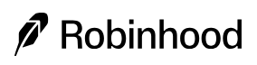

## 회사 개요와 확장 경로
● 주장 : 미국 앱이 거래소 인수로 인가를 사고 자체 체인으로 판매 [F-0605][F-0666][F-0637]
● 기본정보
  ★ 법인명 : Robinhood Markets, Inc.(미국 주식 거래 앱 운영사) [F-0584]
  ★ 발행 법인 : Robinhood Assets (Jersey) Limited(RHJ, 지갑판 발행사) [F-0852]
  ★ 설립 : 2013년, 창업자 Vlad Tenev, Baiju Bhatt [F-0581][F-0601]
  ★ 소재지와 상장 : 미국 캘리포니아 멘로파크, Nasdaq(HOOD) [F-0582][F-0583]
● 지배구조
  ★ Tenev가 이사회 의장 겸 CEO [F-0600]
  ★ RHF(중개 증권사), RHS(청산 증권사), EU 법인은 완전 자회사 [F-0585][F-0586]
  ★ RHJ 단독 주주는 Robinhood International [F-0857]
● 설립 목적
  ★ 2013년 설립, 사명은 금융 민주화(회사 공시) [F-0581]
● 성장 경로(한 줄기)
  ★ 2013 미국 주식 앱 → 2017-10 자체 청산 증권사 [F-0581][F-0244]
  ★ 2025-06 Bitstamp 인수 → EU판 토큰 200종 [F-0605][F-0213][F-0221]
  ★ 2026-01 MIAXdx 90% → 2026-06 WonderFi 인수 [F-0610][F-0608]
  ★ 2026-07 자체 체인, 지갑판 → 2026-10 EU판 Classic [F-0666][F-0637][F-0239]
● 출발 사업 수익 구조
  ★ 고객 주문을 Citadel로 보내고 PFOF를 받음(포필러스, Securitize 후원, 2026-02) [TP-110]
  ★ 필자는 무수수료를 착시로 서술(포필러스) [TP-110]
● 화면
  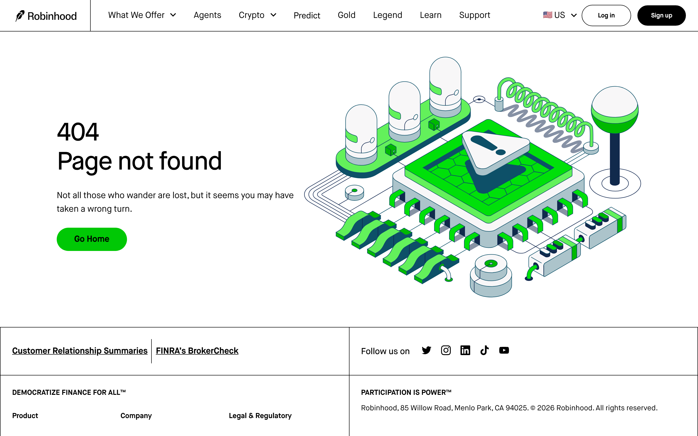  

## 경영진 발언
● 발언 1 : 크립토가 글로벌 금융의 중추가 된다 [F-1063]
  ★ Vlad Tenev(의장 겸 CEO), To Catch a Token 행사(칸), 2025-06-30, https://robinhood.com/newsroom/robinhood-launches-stock-tokens-reveals-layer-2-blockchain-and-expands-crypto-suite-in-eu-and-us-with-perpetual-futures-and-staking/ [F-1063]
    ① 원문 : "Our latest offerings lay the groundwork for crypto to become the backbone of the global financial system."
    ② 번역 : 우리의 최신 상품은 크립토가 글로벌 금융 시스템의 중추가 되기 위한 토대를 놓는다.
    ③ 해석 : 큰 곳은 크립토 기반 글로벌 금융. 그래서 EU에 주식 토큰 200종 출시와 자체 체인 예고
  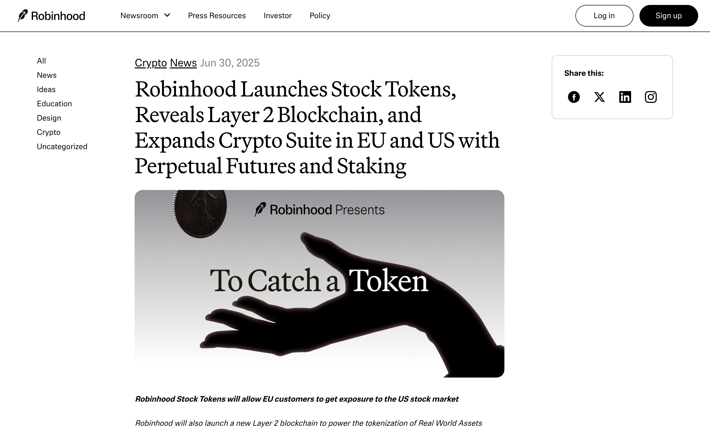
● 발언 2 : 크립토를 쉽게 만들어 세계를 끌어들인다 [F-1064]
  ★ Johann Kerbrat(당시 Robinhood Crypto 총괄 SVP), To Catch a Token 행사(칸), 2025-06-30, https://robinhood.com/newsroom/robinhood-launches-stock-tokens-reveals-layer-2-blockchain-and-expands-crypto-suite-in-eu-and-us-with-perpetual-futures-and-staking/ [F-1064]
    ① 원문 : "Crypto was built by engineers for engineers, and has not been accessible to most people. We're onboarding the world to crypto by making it as easy to use as possible."
    ② 번역 : 크립토는 엔지니어가 엔지니어를 위해 만들었고 대부분의 사람은 쓰기 어려웠다. 최대한 쉽게 만들어 세계를 크립토로 끌어들인다.
    ③ 해석 : 큰 곳은 크립토를 못 쓰던 다수 개인. 그래서 EU 앱 하나에 주식 토큰과 가상자산 결합
  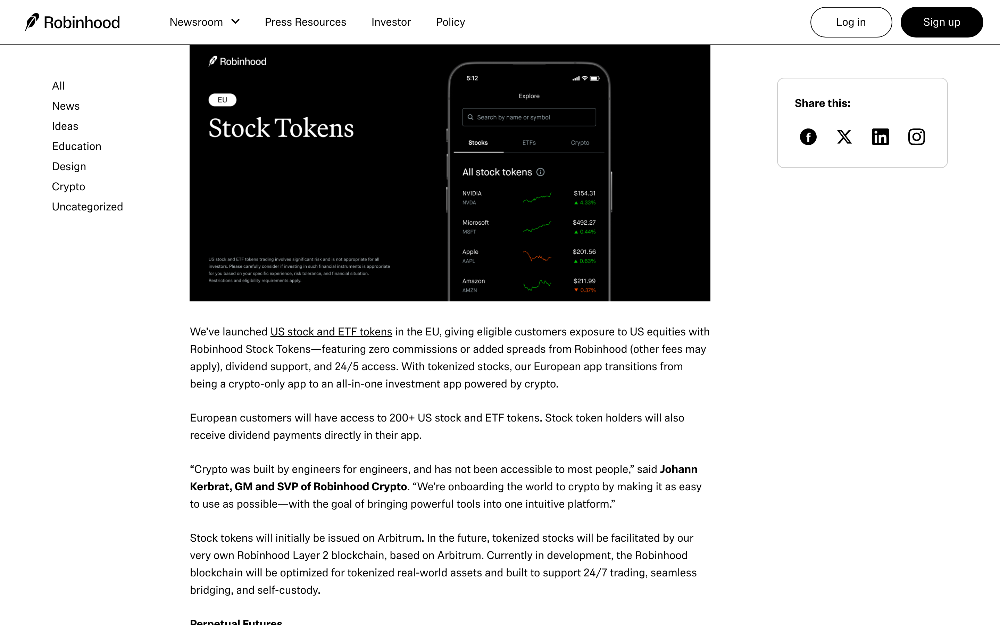
● 발언 3 : 전통 금융과 DeFi를 합쳐 소유를 전 세계로 [F-1065]
  ★ Johann Kerbrat(가상자산, 국제사업 총괄 SVP), The World is Flat 행사(런던), 2026-07-01, https://robinhood.com/newsroom/robinhood-accelerates-global-expansion-robinhood-chain-mainnet-stock-tokens-agentic-trading/ [F-1065]
    ① 원문 : "We're bringing the best of traditional finance and DeFi together, and in doing so, expanding financial ownership to every corner of the globe."
    ② 번역 : 전통 금융과 DeFi의 장점을 합쳐 금융 소유를 전 세계 구석구석으로 넓힌다.
    ③ 해석 : 큰 곳은 전 세계 온체인 주식. 그래서 자체 체인 메인넷과 120개국 지갑판 출시
  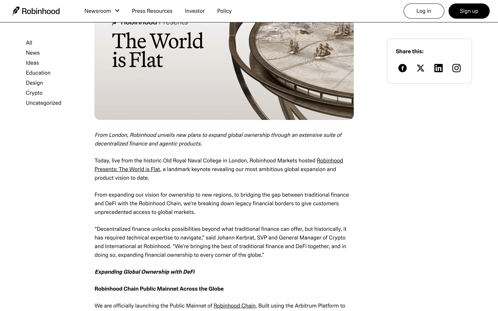
● 발언 4 : 모두를 주주로 만드는 것이 비전 [F-1067]
  ★ Vlad Tenev(의장 겸 CEO), 2026년 3분기 실적 보도자료, 2026-10-27, https://investors.robinhood.com/news-releases/news-release-details/robinhood-reports-third-quarter-2026-results [F-1067]
    ① 원문 : "Our vision is to make everyone an owner, because broad ownership is essential to a free, stable, and prosperous society."
    ② 번역 : 우리의 비전은 모두를 주주로 만드는 것이다. 폭넓은 소유는 자유롭고 안정적이며 번영하는 사회에 필수적이기 때문이다.
    ③ 해석 : 큰 곳은 소유의 대중화와 해외 고객. 그래서 같은 분기 영국 가상자산 거래 출시
  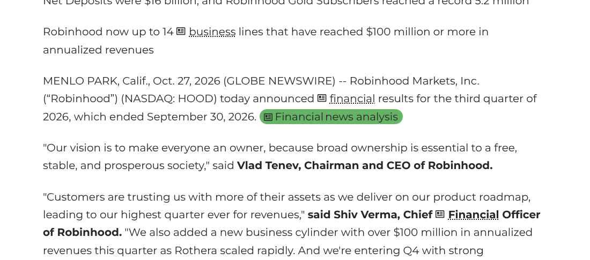

## A 출신과 진입(주식 토큰 사업)
● 주장 : 남의 상품 판매가 아니라 자체 발행으로 진입 [F-0640][F-0630]
● 출신 : 미국 개인 대상 주식, 옵션, 가상자산 거래 앱 [F-0612]
● 진입 방식
  ★ EU판은 EU 법인이 고객과 맺는 자체 파생계약 [F-0640][F-0644]
  ★ 출발 사업 연계 : 앱의 미국 주식을 EU 고객에게 토큰으로 [F-0221]
  ★ 진출 사유 : Bitstamp 인수로 EU, 영국, 아시아 확장 가속 [F-0607]

## B 상품 구조
● 주장 : 지갑판은 RHJ 채무증권, EU판은 회사와 맺은 파생계약 [F-0992][F-0993]
● 토큰의 법적 성격(우리 분류)
  ★ 지갑판 : RHJ에 대한 담보부 상환금 채권, 주식 소유 없음 [F-0992]
  ★ EU판 : EU 법인과 맺은 파생계약상 권리, 주식 소유 없음 [F-0993]
  ★ 우리 분류 : 지갑판 연계증권, EU판 증권기반 스왑형 [F-0992][F-0993]
● 발행 주체와 보관
  ★ 지갑판 발행사 RHJ는 저지 비규제 법인 [F-0630][F-0854]
  ★ 지갑판 기초주는 Alpaca(미국 청산 증권사)가 보관 [F-0869]
  ★ 지갑판 담보는 가치 기준, 현금과 대여 허용 [F-0863][F-0864][F-0865]
  ★ EU판은 기초주 보유 의무 없이 헤지용 매수 [F-0641]
● 투자자 권리
  ★ 의결권 등 주주 권리 없음, 상환은 USD 현금만 [F-0875][F-0860]
  ★ 배당 : 지갑판 승수로 재투자, EU판 현금 상당액 [F-0877][F-0650]
● 규모(시장 내 위치)
  ★ 2026-11-16 지갑판 발행 잔액 1.49억 달러, 6위(점유율 4.01%) [F-1025]
  ★ 1~3위는 Binance, Ondo, Kraken(13.6억, 9.0억, 6.8억 달러) [F-1021][F-1022][F-1023]
  ★ 4위 Securitize(토큰화 발행사) 2.7억, 8위 Coinbase(가상자산 거래소) 0.47억 달러 [F-1024][F-1026]
  ★ 종목 : 지갑판 Final Terms 212건, EU판 2,000종 이상 [F-0663][F-0653]
● 규모 과거 대비
  ★ 2026-01 초 rwa.xyz 표에는 없음(집계 전) [TP-005]
● 수수료
  ★ 지갑판 청약 0%, 발행 90일 이후 상환 0.05% [F-0886]
  ★ EU판 주문마다 환전 수수료 0.1%, 그 밖은 무료 [F-0651]
● 제3자 시각
  ★ EU 법인이 원주 사고 파생계약 토큰 지급(포필러스, Securitize 후원, 2026-02 기준이라 지갑판 이전) [TP-104]
  ★ 투자자는 EU 법인 상대 계약상 청구권 보유(포필러스, Securitize 후원) [TP-104]
  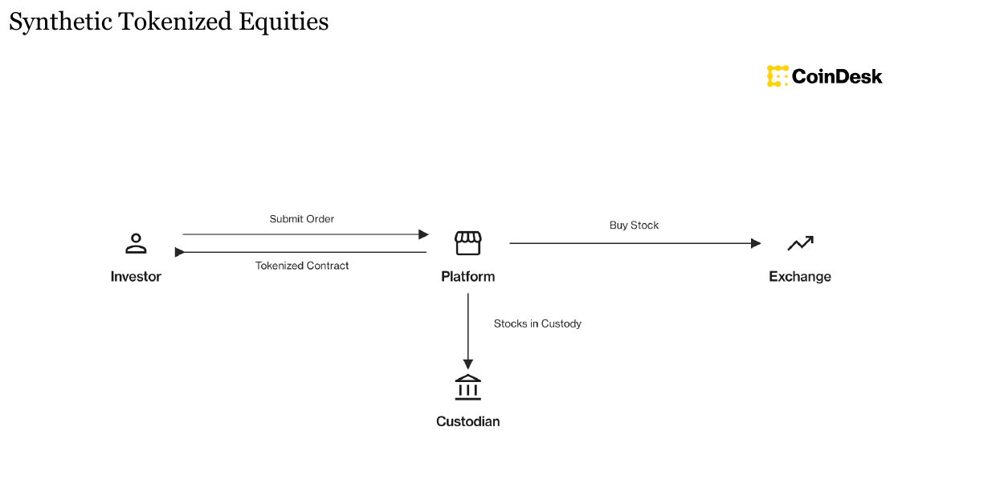
  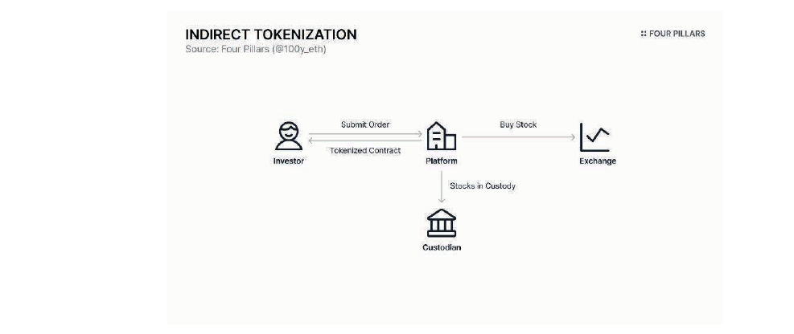

## C 최종 투자자
● 주장 : 미국 밖 개인에게 소액부터 직접 판매 [F-0637][F-0654]
● 대상
  ★ 지갑판 : 120개국 이상 적격 이용자 [F-0637]
  ★ EU판 : EEA 적격 개인, 1유로부터 [F-0640][F-0654]
● 국적 및 지역 제한
  ★ 캐나다, 영국, 스위스 제한 [F-0880]
  ★ 북한, 이란 등 11개 관할 투자 금지 [F-0881]

## D 유통과 접점
● 주장 : 파트너 도매가 아니라 자체 앱과 자체 지갑으로 공급 [F-0592][F-0638]
● 공급 방식(누구에게 서빙하는지)
  ★ EU판 : 자체 앱이 EU 자기주도 개인에 직접 판매 [F-0592][F-0993]
  ★ 지갑판 : 자체 Wallet(비수탁 지갑, 150개국 이상) 이용자 [F-0615][F-0638]
  ★ 1차 공급 : 자회사 Bitstamp Global만 발행사에 직접 청약 [F-0871][F-0616][F-0872]
  ★ 2차 시장 : 일반 투자자는 Uniswap(탈중앙 거래소) 등에서 매매 [F-0227][F-0872]
● 거래 장소
  ★ 사용 블록체인 : Robinhood Chain(자체 이더리움 L2), Arbitrum에서 이전 [F-0225][F-0884]
  ★ 거래시간 : 지갑판 24/7, EU판 월 02시~토 02시(CET) [F-0227][F-0648]
  ★ EU판은 외부 지갑으로 이전 불가 [F-0649]
● 제3자 시각
  ★ 담보 서비스 없음, 원주 상환 불가(포필러스, Securitize 후원, 2026-02 기준) [TP-106]
  ★ 앱 안에서만 거래, 회사가 상대방 겸 유동성 공급자(포필러스, Securitize 후원) [TP-102]
  ★ 출금 제한으로 자산이 자체 플랫폼에 머문다는 보도, 지갑판 출시 전 상태(Finance Magnates, 2026-03) [TP-107]
  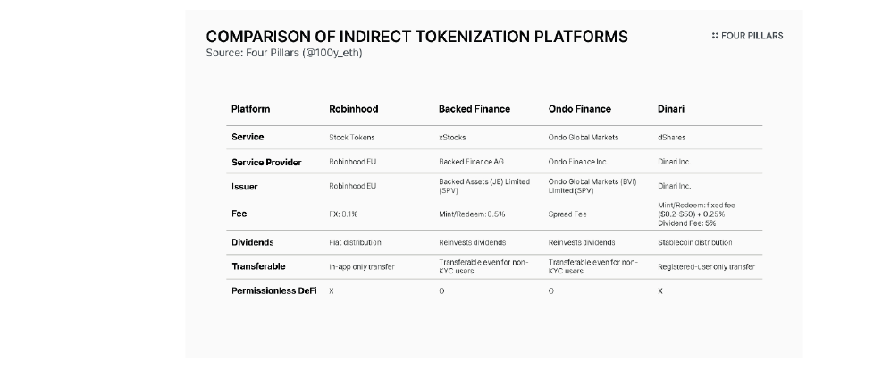

## E 인가
● 주장 : EU 인가는 직접과 인수로, 미국 파생은 인수로 확보 [F-0214][F-0605][F-0610]
● 보유 인가와 법인(미국 밖)
  ★ 리투아니아 : MiFID 중개, MiCA 직접 인가, 2025-06 [F-0214][F-0213]
  ★ 룩셈부르크 : Bitstamp 인수로 MiCA 확보, 2025-06 [F-0253][F-0605]
  ★ 저지 : RHJ는 차입 동의만 받은 비규제 발행사 [F-0855][F-0634]
  ★ 투자설명서 : EU 규정에 따라 리히텐슈타인 FMA 승인 [F-0856]
● 보유 인가와 법인(미국)
  ★ 미국 증권사 : RHF 2013-10 직접 등록 [F-0243]
  ★ 미국 청산 증권사 : RHS 2017-10 직접 등록 [F-0244]
  ★ 미국 파생 거래소, 청산소 : 2026-01 MIAXdx 90% 인수로 확보 [F-0610]
● 제3자 시각
  ★ 리투아니아 인가로 EEA 30여 개국 판매(포필러스, Securitize 후원, 2026-02 기준) [TP-105]
  ★ MiFID II 장외 파생이라 회사가 직접 상대방(포필러스, Securitize 후원) [TP-105]
  ★ 장부 기록 의무가 없어 분산원장 사용 가능(포필러스, Securitize 후원 설명) [TP-105]
  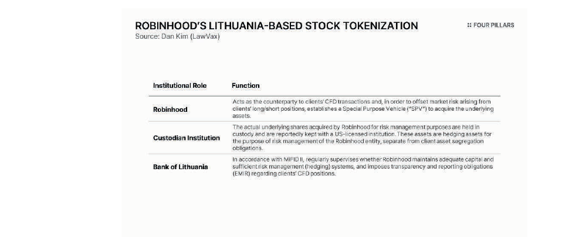
● 인가 없는 구간을 메우는 방법
  ★ 결제 계좌는 JPMorgan 런던 지점 [F-0873]
  ★ 독립 검증 대리인이 시리즈별 100% 담보 확인 [F-0874]
● 미국 미등록의 대가
  ★ 미국 증권법 미등록, 미국인 판매 불가 [F-0636][F-0890]
  ★ 2026-09 SEC 토큰화 주식 면제 대상 아님 [F-0642]

## F 관계(해당 시)
● 주장 : 인수로 해외 인가와 거래 인프라를 사서 들임 [F-0606][F-0609]
● 인수, 투자, 제휴
  ★ Bitstamp 지분 100%, 현금 2.24억 달러 [F-0606]
  ★ WonderFi 지분 100%, 현금 1.78억 달러 [F-0609]
  ★ Rothera(SIG와 합작법인)로 MIAXdx(파생상품 거래소) 지분 90% [F-0610]

## 한국 시장과의 차이
● 주장 : 해외는 역외 발행과 EU 인가로 열렸고 한국은 판매 국가 밖 [F-0636][F-0213][F-0880]
● 규제
  ★ 가능했던 이유 : 미국 밖 판매는 Regulation S 구조 [F-0636][US-17CFR-230.903-a]
  ★ 가능했던 이유 : EU 인가와 투자설명서 승인으로 EEA 판매 [F-0214][F-0856]
  ★ 한국 차이 : 한국은 지갑판 판매 국가 목록에 없음 [F-0880]
● 제3자 시각
  ★ 가능했던 이유 : 장외 파생이라 시범제도 면제 불필요(포필러스, Securitize 후원) [TP-105]
● 고객 수요
  ★ 가능했던 이유 : 증권 계좌 없이 1유로, 지갑으로 미국 주식 [F-0654][F-0637]
● 규제 건의 포인트 : 해외 파생계약형 토큰의 원금 손실 고지 기준 [F-0993][F-0652]

## 성과와 판단
● 주장 : 고객 2,870만 명 앱에 토큰을 얹었으나 지갑판 잔액은 6위 [F-0622][F-1025]
● 성과
  ★ 2026-09 지갑판 토큰 의무 공정가치 1.85억 달러 [F-0639]
  ★ 2026 Q3 순매출 14.2억 달러, 전년 대비 12% 증가(회사 발표) [F-0621]
  ★ 2026 Q3 체인 매출이 가상자산 매출 감소 일부 상쇄 [F-0671]
● 핵심 성공요인(KSF)
  ★ 고객 2,870만 명 앱에 자체 토큰 결합, 잔액 1.49억 달러 6위 [F-0622][F-0612][F-1025]
  ★ 거래소 인수로 EU 인가와 1차 공급 법인, EU판 2,000종 이상 [F-0605][F-0253][F-0871][F-0653]
  ★ 자체 체인 시퀀서 수익 50~85%를 회사 몫으로 [F-0670]
● 제약과 리스크
  ★ 2025년 OpenAI 토큰에 회사 측 반박, 감독기관 설명 요구 [F-0222]
  ★ EU판은 회사 파산 시 원금 전액 손실 가능 [F-0652]
  ★ 2026-11 보충서로 기발행 상품 약관 개정 [F-0889]
  ★ 2024년 미인가 영업으로 2개 주 제재 [F-0598]
● 제약과 리스크 대조(제3자)
  ★ 비상장 토큰은 소유권과 상환 없음, OpenAI 승인 부인(포필러스, Securitize 후원) [TP-108]
  ★ IOSCO 각주가 Robinhood 비상장 토큰 보도를 사례로 듦(IOSCO, 감독기구) [TP-109]
● 제3자 평가
  ★ 평가 1 : 포필러스(Securitize 후원), 주식 토큰화 보고서, 2026-02-23, 29쪽, https://4pillars.io/en/reports/2026-the-year-of-tokenized-stocks [TP-101]
    ① 원문 : "From a personal perspective, I also view indirect tokenization as a transitional approach."
    ② 번역 : 개인적으로 나는 간접 토큰화를 과도기 방식으로 본다.
    ③ 해석 : 직접 방식을 쓰는 후원사 쪽 보고서의 견해. 인가 없이 낸 간접 방식이 규제 명확화 뒤에도 남을지가 KDX가 볼 점
  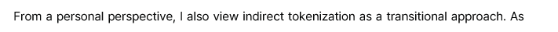
  ★ 평가 2 : 포필러스(Securitize 후원), 주식 토큰화 보고서, 2026-02-23, 69쪽, https://4pillars.io/en/reports/2026-the-year-of-tokenized-stocks [TP-102]
    ① 원문 : "Robinhood acts as both counterparty and liquidity provider, internalizing user order flow within its platform."
    ② 번역 : Robinhood은 상대방이자 유동성 공급자로서 이용자 주문을 자기 플랫폼 안에서 내부 처리한다.
    ③ 해석 : 2026-02 기준이라 자체 체인과 지갑판 이전 설명. 회사가 상대방을 겸하는 구조의 이해상충 고지가 KDX가 볼 점
  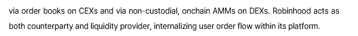
  ★ 평가 3 : CoinDesk Research(Bullish 의뢰), 발행사 안내서 비교표, 2026-09-29(2026-08 기준), 10쪽, https://www.coindesk.com/research/the-future-of-equity-ownership-an-issuer-s-guide-to-tokenized-equities [TP-103]
    ① 원문 : 표 칸 "Synthetic tokenized equities", "Derivative", "Debt / no rights", "Shadow / no consent"(Robinhood 열)
    ② 번역 : 합성형 토큰 주식, 파생, 채무이고 주주권 없음, 발행사 동의 없는 구조.
    ③ 해석 : 발행사 직접 방식에 유리한 의뢰사 표라 낮게 매긴 면이 있음. 지갑판 반영 표라 EU판과 구분해 읽어야 함. 표 원문은 이미지 아닌 칸 글자라 캡처 없음
● KDX 시사점
  ★ 받치는 명제 : Borderless Investing [F-0637][F-0615]
  ★ KDX가 가져올 것 : 증권 계좌 없이 지갑, 앱으로 미국 주식 접근 [F-0654][F-0637]
  ★ KDX가 피할 것 : 회사 파산 시 원금 전액 손실 구조 [F-0652]
● 해외 확장 세 질문
  ★ 제공 가치 : 24/7 미국 주식 노출 [F-0227]
  ★ 제도 : 저지 발행과 EU 투자설명서 승인 [F-0630][F-0856]
  ★ 경제성 : 체인 시퀀서 수익 50~85% [F-0670]
