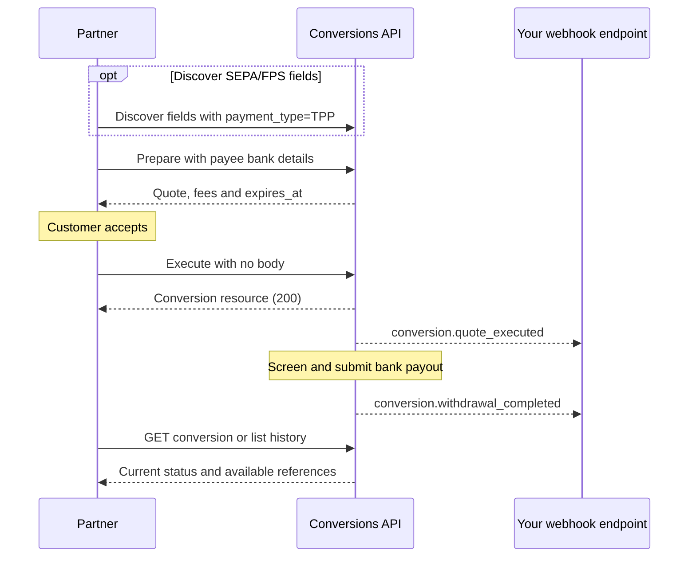

> ## Documentation Index
> Fetch the complete documentation index at: https://docs.services.payward.com/llms.txt
> Use this file to discover all available pages before exploring further.

# Conversions

> The conversions API supports reusable conversion rules and one-off on-demand conversions for fiat ↔ crypto flows.

The conversions API supports two patterns: reusable conversion rules that react to matching deposits, and one-off on-demand conversions. It is designed for partners building wallet-native or payments products who want to offer their users a seamless on- and off-ramp experience without relying on card widgets or assembling multiple providers for KYC, rails, conversion, and settlement.

The core primitive is a **conversion rule**: a persistent per-account configuration that provisions a dedicated inbound endpoint (a named virtual bank account for fiat deposits, or a deposit address for crypto deposits) and automatically converts and settles any matching deposit to the destination you have defined. Each time a matching deposit lands, the rule fires and produces a **conversion transaction**.

> [!NOTE]
>
> **Not what you're looking for?** Conversion rules handle asset exchange with automatic fund movement across rails. If
> you need to move funds between accounts in the same asset without conversion, see
> [Transfers](https://docs.services.payward.com/tabs/developer-documentation/payments/transfers.md). To execute an institutional FX-style trade against a
> locked quote, see [Swap](https://docs.services.payward.com/tabs/developer-documentation/trade/swap.md). For fiat-to-crypto purchases via a hosted checkout
> UI, see [Ramp](https://docs.services.payward.com/tabs/developer-documentation/payments/ramp.md).

## How it works

A conversion rule is a persistent `from` → `to` configuration scoped to the selected account identified by the path's `{account_id}`. When you create a rule, PWS provisions a dedicated inbound endpoint (a virtual IBAN for fiat, or a deposit address for crypto) and returns it on the rule's `from` side. You share those payment instructions with your end customer. Every matching credit to that endpoint automatically triggers a conversion and settles the converted asset to the rule's `to` destination.

Rules remain active and reusable as long as the account's KYC profile is valid. For a single on-demand conversion, use the on-demand conversions API instead of creating a rule.

## On-demand conversions

An on-demand conversion executes once for the selected account using the source and destination in the request. It does not create a reusable conversion rule. The conversion is processed asynchronously, so the execution response returns its initial status. Use [Get on-demand conversion](https://docs.services.payward.com/api-reference/on-demand-conversions/get-on-demand-conversion.md) (`GET /v1/accounts/{account_id}/on-demand-conversions/{on_demand_conversion_id}`) or [List on-demand conversions](https://docs.services.payward.com/api-reference/on-demand-conversions/list-on-demand-conversions.md) (`GET /v1/accounts/{account_id}/on-demand-conversions`) to monitor it until it completes or fails.

`{account_id}` is the identifier of the selected account that owns the conversion. It is not the user identifier.

### Upcoming: third-party payouts

> [!NOTE]
>
> **Upcoming TPP payouts.** This Sandbox contract is for integration planning. TPP payouts are not yet available.

Convert an eligible account balance and pay fiat to a bank account. The Sandbox reference provides typed fields and named **Upcoming** examples. Supply inline recipient and bank details; no saved recipient or separate withdrawal request is needed.

For an individual, supply both given names and family names in `to.bank_account.recipient`:

```json theme={null}
{ "type": "individual", "first_name": "Ana María", "last_name": "Silva López" }
```

For a business, supply its registered account-holder name:

```json theme={null}
{ "type": "business", "name": "Example Trading GmbH" }
```

| Rail / payout currency | Recipient | Additional recipient fields |
| - | - | - |
| SEPA / EUR | Individual or business | None |
| FPS / GBP | Individual or business | None |
| PIX / BRL | Individual | `tax_id` |
| SPEI / MXN | Individual | None; `tax_id` and `document_type` are rejected |
| Argentine bank transfer / ARS | Individual | `tax_id` and `document_type` (`cuil` or `cuit`) |

An individual's `first_name` and `last_name` must each contain a non-whitespace character. PIX, SPEI, and Argentine bank transfer limit each name field to 50 characters. These three rails reject business recipients with `400` at `to.bank_account.recipient.type`. PIX also rejects `document_type`. Required tax and document fields depend on the selected method; Prepare reports missing or invalid values.

On SEPA and FPS, supplying `recipient` requests a third-party payout. Omit it to retain first-party behavior. Both rails support fixing either `from.amount` or `to.amount`; PIX, SPEI, and Argentine bank transfer require `from.amount`. Account, asset, and method eligibility still apply.



1. For SEPA or FPS, optionally [discover fields](https://docs.services.payward.com/api-reference/sandbox/funding/list-withdrawal-methods.md#upcoming-third-party-payout-fields) with `asset_symbol` and `payment_type=TPP`. Follow pagination and the returned field requirements. A Funding `name_on_account` requirement is supplied through the typed recipient above, rather than a public Conversions `name_on_account` field.
2. [Prepare the payout](https://docs.services.payward.com/api-reference/sandbox/conversions/prepare-on-demand-conversion.md#upcoming-third-party-payouts) with the rail-specific `to.bank_account` fields and `recipient`. Review the quote, fees and `expires_at`. Preparation checks eligibility and does not reserve funds.
3. [Execute the prepared payout](https://docs.services.payward.com/api-reference/sandbox/conversions/execute-prepared-on-demand-conversion.md#upcoming-third-party-payouts) before expiry with the returned conversion ID, the same selected account, a separate UUIDv4 idempotency key, and no body. Execution uses the saved recipient, bank details, and quote. Estimate and immediate Execute do not support TPP.
4. [Retrieve the conversion](https://docs.services.payward.com/api-reference/sandbox/conversions/get-on-demand-conversion.md#upcoming-third-party-payouts) or [list history](https://docs.services.payward.com/api-reference/sandbox/conversions/list-on-demand-conversions.md#upcoming-third-party-payouts). SEPA/FPS responses include the rail-specific bank details and omit recipient details. PIX, SPEI, and Argentine bank transfer responses include only `via` in `to.bank_account`. All retain state, amounts, fees and available references.

A repeated idempotency key returns `409` with `error.code: on_demand_conversion_idempotency_key_already_used` and the original top-level `on_demand_conversion_id`. Retrieve that operation with GET to recover its result.

Track `conversion.quote_executed`, `conversion.withdrawal_completed`, `conversion.quote_execution_failed`, `conversion.withdrawal_failed`, and [`conversion.canceled`](https://docs.services.payward.com/api-reference/sandbox/webhooks/conversion-canceled). A successful trade does not prove payout completion. Screening occurs during execution before bank submission. Reconcile notifications with GET; delivery order is not a state sequence.

If paid-out funds are actually returned and credited, [`funds.deposit_credited`](https://docs.services.payward.com/api-reference/sandbox/webhooks/deposit-credited#upcoming-third-party-payouts) reports a new deposit ID. A payout that fails before funds are sent does not create a returned deposit.

### Execute an on-demand conversion

Provide a balance source and either a wallet or bank destination. The example below uses a wallet destination. Set exactly one amount:

* `from.amount` fixes the amount debited from the account balance. The API calculates the amount delivered to the destination.
* `to.amount` fixes the amount delivered to the destination. The API calculates the amount debited from the account balance.

Amounts are decimal strings. Requests that provide both amounts or neither amount are rejected.

The `curl` examples read these environment variables:

* `PWS_BASE_URL`: the API base URL. Set it to the sandbox or production base URL, listed in
  [Environments](https://docs.services.payward.com/tabs/developer-documentation/testing/overview.md#environments).
* `PWS_API_KEY`: your API key.
* `PWS_API_TIMESTAMP` and `PWS_API_SIGN`: the timestamp and signature of each request. To compute them, see
  [Authentication](https://docs.services.payward.com/tabs/developer-documentation/get-started/authentication.md).
* Compute `PWS_API_SIGN` over the exact `-d` string, including its line breaks and indentation, and over the exact path
  and query in the URL. Each request needs a new `PWS_API_TIMESTAMP` and `PWS_API_SIGN`.

```bash theme={null}
curl -X POST "$PWS_BASE_URL/v1/accounts/WVSD33HRMGSZUBM7/on-demand-conversions" \
  -H "API-Key: $PWS_API_KEY" \
  -H "API-Timestamp: $PWS_API_TIMESTAMP" \
  -H "API-Sign: $PWS_API_SIGN" \
  -H "Idempotency-Key: 550e8400-e29b-41d4-a716-446655440000" \
  -H "Content-Type: application/json" \
  -d '{
    "from": {
      "symbol": "USD",
      "type": "balance",
      "amount": "1000.00"
    },
    "to": {
      "symbol": "ETH",
      "type": "wallet",
      "wallet": {
        "via": "ethereum",
        "address": "0xabcdef1234567890abcdef1234567890abcdef12",
        "memo": "destination-memo",
        "tag": "destination-tag"
      }
    }
  }'
```

#### Balance-to-bank destinations

A balance source can also deliver a fiat asset to a bank account. Each bank rail supports a specific payout currency and requires specific bank details:

| Rail | Payout currency | Required `bank_account` fields |
| - | - | - |
| `ach` | `USD` | `account_link_id` |
| `rtp` | `USD` | `account_link_id` |
| `sepa` | `EUR` | `iban`; `bic` is optional |
| `fps` | `GBP` | `sort_code`, `account_number` |

ACH and RTP destinations use an `account_link_id` from [Bank links](https://docs.services.payward.com/tabs/developer-documentation/payments/bank-links.md). SEPA and FPS destinations use their rail-specific routing fields. Do not combine linked-account and raw routing fields.

For example, this request fixes the amount debited from the balance and calculates the EUR amount delivered by SEPA:

```json theme={null}
{
  "from": {
    "symbol": "USD",
    "type": "balance",
    "amount": "1000.00"
  },
  "to": {
    "symbol": "EUR",
    "type": "bank",
    "bank_account": {
      "via": "sepa",
      "iban": "DE89370400440532013000",
      "bic": "COBADEFFXXX"
    }
  }
}
```

The API rejects a bank destination when `to.symbol` does not match its rail, or when a required bank field is missing.

Execute, get, and list responses use the same `from` and `to` fields. Each response includes the amount debited from the balance, the amount delivered to the destination, and the current settlement status for both sides. Wallet destinations may include a saved `memo` or `tag`; when saved, those fields are returned in the execution response and in later get and list responses. Bank destinations return their rail-specific `bank_account` details.

```json theme={null}
{
  "data": {
    "id": "00000000-0000-0000-0000-000000000009",
    "status": "converting",
    "from": {
      "symbol": "USD",
      "amount": "1000.00",
      "type": "balance",
      "status": "pending"
    },
    "to": {
      "symbol": "ETH",
      "amount": "0.40000000",
      "type": "wallet",
      "status": "pending",
      "wallet": {
        "via": "ethereum",
        "address": "0xabcdef1234567890abcdef1234567890abcdef12",
        "memo": "destination-memo",
        "tag": "destination-tag"
      }
    },
    "rate": {
      "base": { "symbol": "USD" },
      "quote": { "symbol": "ETH" },
      "price": "0.0004"
    },
    "fees": {
      "from": { "symbol": "EUR", "amount": "0.50" },
      "trade": { "symbol": "EUR", "amount": "0.25" },
      "to": { "symbol": "BTC", "amount": "0.00001" }
    },
    "created_at": "2026-07-31T00:00:00Z",
    "updated_at": "2026-07-31T00:00:00Z"
  }
}
```

The required `Idempotency-Key` is a UUID for the execution request. It must be unique. If the key was already used, the API returns a conflict error and does not execute a new conversion.

### Monitor an on-demand conversion

Use [Get on-demand conversion](https://docs.services.payward.com/api-reference/on-demand-conversions/get-on-demand-conversion.md) (`GET /v1/accounts/{account_id}/on-demand-conversions/{on_demand_conversion_id}`) for one conversion, or [List on-demand conversions](https://docs.services.payward.com/api-reference/on-demand-conversions/list-on-demand-conversions.md) (`GET /v1/accounts/{account_id}/on-demand-conversions`) to list conversions. The list is ordered by `created_at` descending. It uses cursor pagination with a default page size of 20 and a maximum page size of 25.

The lifecycle status has these meanings:

| Status | Meaning |
| - | - |
| `converting` | The conversion is in progress. |
| `settling` | The converted asset is being delivered to the destination. |
| `completed` | The conversion completed successfully. |
| `failed` | The conversion could not be completed. |

Execute, get, and list responses use the same conversion details. `from.status` and `to.status` show the current settlement status for each side: `pending` means the side is still processing, `held` means it is waiting for review or release, `settled` means it completed successfully, and `failed` means it will not settle. Wallet destinations include their network and address. Bank destinations include their rail-specific `bank_account` details. Fees are always returned under `fees`; `transaction_references` are included when available. Saved wallet `memo` or `tag` fields are returned when present.

The rate is an exchange rate. `rate.base.symbol` and `rate.quote.symbol` identify the rate pair, and `rate.price` is the price of one unit of the base asset denominated in the quote asset. For example, a price of `0.0004` with USD as the base and ETH as the quote means one USD converts to `0.0004` ETH.

## Creating a rule: fiat on-ramp (EUR → USDC on Polygon)

An end customer sends EUR via SEPA and automatically receives USDC on Polygon at the destination wallet you specify.

On the `from` (source) side you supply only `symbol`, `type`, and the rail (`bank_account.via` / `wallet.via`). The inbound routing is provisioned by PWS and returned on the response: any routing fields you send on `from` are ignored.

```bash theme={null}
curl -X POST "$PWS_BASE_URL/v1/accounts/AA23N84GGQN4WE6I/conversions" \
  -H "API-Key: $PWS_API_KEY" \
  -H "API-Timestamp: $PWS_API_TIMESTAMP" \
  -H "API-Sign: $PWS_API_SIGN" \
  -H "Content-Type: application/json" \
  -d '{
    "name": "EUR autoramp to Polygon vault",
    "from": {
      "symbol": "EUR",
      "type": "bank",
      "bank_account": { "via": "sepa" }
    },
    "to": {
      "symbol": "USDC",
      "type": "wallet",
      "wallet": {
        "via": "polygon",
        "address": "0x1234567890abcdef1234567890abcdef12345678"
      }
    }
  }'
```

The response is the created rule. PWS populates `from.bank_account` with the provisioned virtual IBAN and BIC:

```json theme={null}
{
  "data": {
    "id": "550e8400-e29b-41d4-a716-446655440000",
    "name": "EUR autoramp to Polygon vault",
    "from": {
      "symbol": "EUR",
      "type": "bank",
      "bank_account": {
        "via": "sepa",
        "iban": "DE89370400440532013000",
        "bic": "COBADEFFXXX"
      }
    },
    "to": {
      "symbol": "USDC",
      "type": "wallet",
      "wallet": {
        "via": "polygon",
        "address": "0x1234567890abcdef1234567890abcdef12345678"
      }
    },
    "status": "active",
    "created_at": "2026-05-25T10:30:00Z",
    "updated_at": "2026-05-25T10:30:00Z"
  }
}
```

Share `from.bank_account.iban` and `from.bank_account.bic` with the end customer as their payment instructions. Every SEPA credit to that IBAN fires the rule and produces a new conversion transaction.

> [!NOTE]
>
> **Provisioning:** For some fiat rails the inbound account is provisioned asynchronously. The rule is returned with
> `status: provisioning` and the `from` routing fields are populated once provisioning completes (the rule then moves to
> `active`). Fetch the rule with `GET /v1/accounts/{account_id}/conversions/{conversion_rule_id}` to read the final
> routing.

## Creating a rule: crypto off-ramp (USDC on Ethereum → EUR via SEPA)

An end customer sends USDC on Ethereum and automatically receives EUR via SEPA to the bank account you specify.

```bash theme={null}
curl -X POST "$PWS_BASE_URL/v1/accounts/AA23N84GGQN4WE6I/conversions" \
  -H "API-Key: $PWS_API_KEY" \
  -H "API-Timestamp: $PWS_API_TIMESTAMP" \
  -H "API-Sign: $PWS_API_SIGN" \
  -H "Content-Type: application/json" \
  -d '{
    "name": "USDC off-ramp to SEPA",
    "from": {
      "symbol": "USDC",
      "type": "wallet",
      "wallet": { "via": "ethereum" }
    },
    "to": {
      "symbol": "EUR",
      "type": "bank",
      "bank_account": {
        "via": "sepa",
        "iban": "DE89370400440532013000",
        "bic": "DEUTDEFFXXX",
        "bank": "Deutsche Bank"
      }
    }
  }'
```

On the response, `from.wallet.address` carries the provisioned Ethereum deposit address. Share it with the end customer: any USDC deposit to that address triggers the rule and initiates the SEPA payout.

> [!NOTE]
>
> **Fiat destinations:** The beneficiary on a fiat destination is the account's KYC identity: third-party bank accounts
> are not permitted. The beneficiary is derived from KYC, so there is no beneficiary field on the request.

## Supported rails and networks

Bank destinations specify a `bank_account.via` and the routing fields required by that rail; crypto destinations specify a
`wallet.via` (network) and `address`:

| `via` | `type` | Required destination fields |
| - | - | - |
| `sepa` | `bank` | `iban` (+ optional `bic`, `bank`) |
| `fps` | `bank` | `sort_code`, `account_number` (+ optional `bank`) |
| Any crypto network (`bitcoin`, `ethereum`, `polygon`, `xrp`, …) | `wallet` | `address` (+ optional `tag` / `memo`) |
| `ach`, `rtp` (linked account) | `bank` | `account_link_id` (see below) |

The optional `bank` field on a destination named by routing details is the name of the beneficiary's financial
institution; it is passed through to the underlying provider. A destination naming a linked account ignores it because
the bank is already known from the link.

The conversion rules API supports `sepa` and `fps` for bank destinations named by routing details. An unsupported `via` returns `400`.

> [!NOTE]
>
> **Naming a bank account by its routing details is limited to SEPA and FPS.** Other rails named this way, including
> Fedwire, are rejected with `400`.

### US bank destinations

A US bank account is reached a different way: link it once, then name it by its identifier instead of its routing
details. Send `type: "bank"`, `symbol: "USD"`, the rail in `bank_account.via` (`ach` or `rtp`), and the
`account_link_id` of a linked account inside that same `bank_account` block.

```json theme={null}
"to": {
  "symbol": "USD",
  "type": "bank",
  "bank_account": {
    "via": "ach",
    "account_link_id": "al_7cec1ea9-f52e-4766-b02b-6113eaaa4d4e"
  }
}
```

One link can be eligible for more than one rail, so `via` chooses which one the payout uses. Leaving it out is a
`400`, and any value other than `ach` or `rtp` is rejected.

See [Bank links](https://docs.services.payward.com/tabs/developer-documentation/payments/bank-links.md) for how to link an account and get that identifier.
The two shapes are mutually exclusive: a `bank_account` carries either routing details or an `account_link_id`, never both.

### Crypto destination tags and memos

Networks that need a destination tag or memo to route a deposit accept them as optional fields on the wallet
destination: the XRP destination `tag`, or the `memo` used by chains such as XLM, EOS, and Cosmos:

```json theme={null}
"to": {
  "symbol": "XRP",
  "type": "wallet",
  "wallet": { "via": "xrp", "address": "rXXXXXXXXXXXXXXXXXXXXXXXXXXXXXX", "tag": "1234567" }
}
```

Omit `tag` / `memo` for networks that don't use them.

## Multi-network support

A rule matches a single asset on a single network. Accepting the same asset on multiple networks requires one rule per network. Each rule gets its own provisioned inbound address and can be paused or deleted independently, keeping reconciliation and per-network reporting straightforward.

To accept USDC on Ethereum and Polygon, create two rules identical except for `from.wallet.via`:

```bash theme={null}
# Rule 1: USDC on Ethereum
"from": { "symbol": "USDC", "type": "wallet", "wallet": { "via": "ethereum" } }

# Rule 2: USDC on Polygon
"from": { "symbol": "USDC", "type": "wallet", "wallet": { "via": "polygon" } }
```

## Rule lifecycle

| State | Meaning |
| - | - |
| `provisioning` | Inbound endpoint is being provisioned. Transitions to `active` once routing is ready. |
| `active` | Rule is live. Matching deposits are processed normally. |
| `paused` | Deposits are not processed. Can be reactivated. Provisioned credentials remain valid. |

Deleting a rule is a **soft delete**: after `DELETE /v1/accounts/{account_id}/conversions/{conversion_rule_id}`, the rule no longer fires and a subsequent `GET` returns `404 Not Found`. Deleted rules are never returned by `listConversionRules`.

## Managing a rule

Update a rule's destination, label, or status with `PUT /v1/accounts/{account_id}/conversions/{conversion_rule_id}`. This is a **full-state replacement** of `to`, `name`, and `status`: the source side (`from`) is immutable, so re-create the rule to change input symbol, rail, or source type. `status` must be `active` or `paused`.

```bash theme={null}
# Pause a rule
curl -X PUT "$PWS_BASE_URL/v1/accounts/WVSD33HRMGSZUBM7/conversions/550e8400-e29b-41d4-a716-446655440000" \
  -H "API-Key: $PWS_API_KEY" \
  -H "API-Timestamp: $PWS_API_TIMESTAMP" \
  -H "API-Sign: $PWS_API_SIGN" \
  -H "Content-Type: application/json" \
  -d '{
    "name": "EUR autoramp to Polygon vault",
    "status": "paused",
    "to": {
      "symbol": "USDC",
      "type": "wallet",
      "wallet": {
        "via": "polygon",
        "address": "0x1234567890abcdef1234567890abcdef12345678"
      }
    }
  }'

# Delete (soft delete) a rule
curl -X DELETE "$PWS_BASE_URL/v1/accounts/AA23N84GGQN4WE6I/conversions/550e8400-e29b-41d4-a716-446655440000" \
  -H "API-Key: $PWS_API_KEY" \
  -H "API-Timestamp: $PWS_API_TIMESTAMP" \
  -H "API-Sign: $PWS_API_SIGN"
```

## Monitoring conversions

Each firing of a rule is a **conversion transaction**. List the transactions for a rule with `GET /v1/accounts/{account_id}/conversions/{conversion_rule_id}/transactions`:

```bash theme={null}
curl -X GET "$PWS_BASE_URL/v1/accounts/AA23N84GGQN4WE6I/conversions/550e8400-e29b-41d4-a716-446655440000/transactions" \
  -H "API-Key: $PWS_API_KEY" \
  -H "API-Timestamp: $PWS_API_TIMESTAMP" \
  -H "API-Sign: $PWS_API_SIGN"
```

```json theme={null}
{
  "data": [
    {
      "id": "conv_smoke_001",
      "status": "completed",
      "conversion_rule_id": "550e8400-e29b-41d4-a716-446655440000",
      "from": { "symbol": "EUR", "amount": "100.00", "type": "bank", "via": "sepa", "status": "settled" },
      "to": { "symbol": "USDC", "amount": "108.42", "via": "polygon", "status": "settled" },
      "chain_references": { "deposit_txid": "deposit-eur-001", "withdraw_txid": "withdraw-usdc-001" },
      "created_at": "2026-04-01T12:00:00Z"
    },
    {
      "id": "conv_smoke_002",
      "status": "pending_deposit",
      "conversion_rule_id": "550e8400-e29b-41d4-a716-446655440000",
      "chain_references": {},
      "created_at": "2026-04-02T09:30:00Z"
    }
  ]
}
```

A transaction moves through the following states:

| State | Meaning |
| - | - |
| `pending_deposit` | Awaiting the inbound deposit. |
| `held` | Deposit received but held pending review; conversion has not started. |
| `converting` | Funds received; conversion in progress. |
| `settling` | Conversion complete; outbound settlement in progress. |
| `completed` | Settled to the destination. `chain_references` carry the txids. |
| `failed` | The transaction failed. |

> [!NOTE]
>
> **Webhooks.** Subscribe to conversion webhook events for real-time updates instead of polling: register your endpoint
> with the [Register webhook](https://docs.services.payward.com/api-reference/webhooks/register-webhook.md) API. See [Conversion
> webhooks](#conversion-webhooks).

You can also list an account's rules and filter by lifecycle state:

```bash theme={null}
curl -X GET "$PWS_BASE_URL/v1/accounts/AA23N84GGQN4WE6I/conversions?status=active&page_size=20" \
  -H "API-Key: $PWS_API_KEY" \
  -H "API-Timestamp: $PWS_API_TIMESTAMP" \
  -H "API-Sign: $PWS_API_SIGN"
```

`listConversionRules` supports only `status`, `page_size`, and `page_token` (cursor) parameters. Use the per-rule transactions endpoint above for transaction history.

## Conversion webhooks

Conversion lifecycle webhook payloads include optional enrichment fields. They are omitted when the source event does not carry the corresponding fact.

| Event | Optional enrichment fields |
| - | - |
| `conversion.deposit_completed` | `deposit_amount`, `deposit_currency`, `network`, `deposit_reference` |
| `conversion.deposit_failed` | `error_code`, `deposit_amount`, `deposit_currency` |
| `conversion.deposit_held` | `deposit_amount`, `deposit_currency` |
| `conversion.quote_executed` | `quote_id`, `executed_at`, `source_amount`, `source_currency`, `destination_amount`, `destination_currency`, `rate`, `fees` |
| `conversion.quote_execution_failed` | `error_code`, `source_amount`, `source_currency`, `destination_currency` |
| `conversion.travel_rule_blocked` | `error_code`, `source_amount`, `source_currency`, `destination_currency` |
| `conversion.withdrawal_completed` | `withdrawal_amount`, `withdrawal_currency`, `destination_address`, `network`, `chain_references.blockchain_transaction_id` |
| `conversion.withdrawal_failed` | `error_code`, `withdrawal_amount`, `withdrawal_currency`, `destination_address` |

`error_code`, when present, is one of: `amount_too_small`, `quote_expired`, `destination_rejected`, `wallet_not_whitelisted`, `wallet_verification_method_not_supported`, `travel_rule_data_missing`, `insufficient_funds`, or `unknown`.

If `conversion.withdrawal_failed` has `error_code: unknown`, the payout failed after the trade. Contact PWS support or your Customer Success Manager with the conversion ID to resolve it.

`destination_address` is the crypto destination only. It is never a fiat destination, tag, or memo.

`chain_references.blockchain_transaction_id` is the on-chain transaction id or hash for a completed crypto withdrawal. It is distinct from `withdraw_txid`.

On `conversion.quote_executed`, `fees` holds only the `trade` leg, because the funding and payout fees are not known when the quote executes. The payload can also carry `fee`, which is deprecated. Use `fees` instead.

### Resolving a Travel Rule block

`conversion.travel_rule_blocked` means a pre-trade Travel Rule check stopped the conversion before any quote was executed, because the destination wallet needs address-ownership verification (or the check could not be evaluated). The `error_code` tells you how to resolve it:

* `wallet_not_whitelisted`: the destination address is not yet ownership-verified. Whitelist it with `POST /v1/users/{user_id}/travel-rule/verifications` (hosted declaration or self-attestation); once the address is verified, subsequent conversions to it will proceed.
* `wallet_verification_method_not_supported`: the address requires a verification method other than a hosted declaration or self-attestation. Contact Support to resolve.
* `travel_rule_data_missing`: eligibility could not be evaluated because required account information (for example, the user's country) is missing. Complete the user's profile and retry; contact Support if the block persists.

## Whitelisting external wallets

Before a conversion can pay out to an external crypto address, that address must pass a Travel Rule address-ownership check. Whitelist it with `POST /v1/users/{user_id}/travel-rule/verifications`: use `method: hosted_declaration` when the wallet is held by another custodial service, or `method: self_attestation` (supplying the end user's ownership evidence) when the end user controls the wallet.

```bash theme={null}
curl -X POST "$PWS_BASE_URL/v1/users/AA55N84GQOIRA67A/travel-rule/verifications" \
  -H "API-Key: $PWS_API_KEY" \
  -H "API-Timestamp: $PWS_API_TIMESTAMP" \
  -H "API-Sign: $PWS_API_SIGN" \
  -H "Content-Type: application/json" \
  -d '{
    "address": "0x8ba1f109551bD432803012645Ac136ddd64DBA72",
    "method": "hosted_declaration"
  }'
```

```json theme={null}
{
  "data": {
    "verification_id": "ver_0195e4d2-a4d0-7b12-8f4a-123456789abc",
    "wallet_type": "hosted",
    "method": "hosted_declaration",
    "status": "verified"
  }
}
```

## Error handling

### On-demand conversion validation

The [Execute on-demand conversion](https://docs.services.payward.com/api-reference/on-demand-conversions/execute-on-demand-conversion.md) endpoint (`POST /v1/accounts/{account_id}/on-demand-conversions`) returns `400 Bad Request` with `code: bad_request` when validation fails. This includes invalid or missing amounts, unsupported assets, invalid wallet details, unsupported bank rails, a bank rail and destination-currency mismatch, or missing rail-specific bank fields. The `causes[].field` value identifies the request field to correct.

For prepared payouts, recipient name errors identify `to.bank_account.recipient.first_name`, `to.bank_account.recipient.last_name`, or the business `to.bank_account.recipient.name`. A Prepare validation error may report only some invalid fields. Correct the reported fields and retry.

For example, a SEPA request without an IBAN identifies `to.bank_account.iban`:

```json theme={null}
{
  "error": {
    "type": "conversions_error",
    "status": 400,
    "code": "bad_request",
    "causes": [
      {
        "field": "to.bank_account.iban",
        "message": "'to.bank_account.iban' is required"
      }
    ]
  }
}
```

### Missing or invalid off-ramp bank details

When you create or update an off-ramp rule (crypto → fiat), the `to.bank_account` fields are validated against the chosen rail before the rule goes live. If a field required by the rail is missing or malformed, the request is rejected with `400 Bad Request` and `code: conversion_invalid_withdrawal_address`. Each `causes[]` entry names the offending field with a `to.bank_account.*` path so you know exactly which value to supply.

```json theme={null}
{
  "error": {
    "type": "conversions_error",
    "status": 400,
    "code": "conversion_invalid_withdrawal_address",
    "instance": "req_01H00000000000000000000000",
    "causes": [
      {
        "field": "to.bank_account.bic",
        "message": "bic is required for this withdrawal method"
      }
    ]
  }
}
```

The exact set of required fields depends on the rail and the provider routing the payout. Fields listed as optional in [Supported rails and networks](#supported-rails-and-networks) may still be required for a specific route; for example, some SEPA payout providers require `bic`. Populate every field the rejection names and resubmit.

## API reference

| Method | Endpoint | Description |
| - | - | - |
| POST | [`/v1/accounts/{account_id}/conversions`](https://docs.services.payward.com/api-reference/conversion-rules/create-conversion-rule) | Create a conversion rule with a provisioned inbound endpoint |
| GET | [`/v1/accounts/{account_id}/conversions`](https://docs.services.payward.com/api-reference/conversion-rules/list-conversion-rules) | List an account's conversion rules (filter by `status`) |
| GET | [`/v1/accounts/{account_id}/conversions/{conversion_rule_id}`](https://docs.services.payward.com/api-reference/conversion-rules/get-conversion-rule) | Get a single conversion rule by ID |
| PUT | [`/v1/accounts/{account_id}/conversions/{conversion_rule_id}`](https://docs.services.payward.com/api-reference/conversion-rules/update-conversion-rule) | Update a rule's `to`, `name`, and `status` (full replacement) |
| DELETE | [`/v1/accounts/{account_id}/conversions/{conversion_rule_id}`](https://docs.services.payward.com/api-reference/conversion-rules/delete-conversion-rule) | Soft-delete a conversion rule |
| GET | [`/v1/accounts/{account_id}/conversions/{conversion_rule_id}/transactions`](https://docs.services.payward.com/api-reference/conversion-rules/list-conversion-rule-transactions) | List the transactions produced by a rule |
| POST | [`/v1/accounts/{account_id}/on-demand-conversions`](https://docs.services.payward.com/api-reference/on-demand-conversions/execute-on-demand-conversion) | Execute an on-demand conversion |
| GET | [`/v1/accounts/{account_id}/on-demand-conversions`](https://docs.services.payward.com/api-reference/on-demand-conversions/list-on-demand-conversions) | List on-demand conversions for an account |
| GET | [`/v1/accounts/{account_id}/on-demand-conversions/{on_demand_conversion_id}`](https://docs.services.payward.com/api-reference/on-demand-conversions/get-on-demand-conversion) | Get an on-demand conversion by ID |
| POST | [`/v1/users/{user_id}/travel-rule/verifications`](https://docs.services.payward.com/api-reference/travel-rule-verifications/create-verification) | Whitelist an external wallet address (Travel Rule) |
