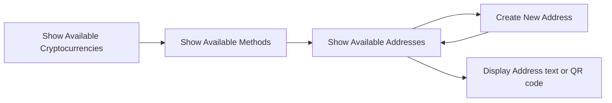

> ## Documentation Index
> Fetch the complete documentation index at: https://docs.services.payward.com/llms.txt
> Use this file to discover all available pages before exploring further.

# Deposits and withdrawals

> This guide covers fiat and cryptocurrency deposits and withdrawals through the Payward Services API.

## Prerequisites

* Payward Services API credentials (see [Authentication Guide](https://docs.services.payward.com/tabs/developer-documentation/get-started/authentication.md))
* A verified user with at least one account

> [!NOTE]
>
> Deposit addresses are issued by Payward and managed under `/v1/accounts/{account_id}/funds/deposits/addresses`.
> Withdrawals use a registered funding address or a supported linked bank account. Manage registered addresses under
> `/v1/accounts/{account_id}/funds/addresses` and select the destination when creating the withdrawal.

## Enrich funding method identifiers

Use [Look up funding method metadata](https://docs.services.payward.com/api-reference/funds/look-up-funding-method-metadata.md) to resolve public names, assets, networks,
payment rails, and reported requirements for the selected account.

Batch method IDs using repeated query parameters. Supply 1–25 entries, counted before duplicate removal:

```http theme={null}
GET /v1/accounts/{account_id}/funds/methods/lookup?method_ids=00e4796b-a142-4589-a7c1-8927933788c9&method_ids=3d9c3f4e-2f2d-4f4e-9c8a-1f6c0b7f4a21&direction=withdrawal
```

Alternatively, pass one `network_id` to resolve its methods. A network can return methods for multiple assets
and directions. Supply either `method_ids` or `network_id`.

```http theme={null}
GET /v1/accounts/{account_id}/funds/methods/lookup?network_id=0d7efc1a-3787-4a29-9b64-8ca937501a50&page_size=20
```

Example crypto metadata:

```json theme={null}
{
  "data": [
    {
      "id": "00e4796b-a142-4589-a7c1-8927933788c9",
      "direction": "withdrawal",
      "asset": {
        "symbol": "USDC",
        "name": "USD Coin",
        "type": "stablecoin"
      },
      "method": "USDC - Arbitrum One",
      "network": {
        "id": "0d7efc1a-3787-4a29-9b64-8ca937501a50",
        "name": "Arbitrum One",
        "explorer": "https://arbiscan.io/tx/{txid}",
        "contract_address": "0xaf88d065e77c8cC2239327C5EDb3A432268e5831"
      },
      "payment_rails": [],
      "requirements": []
    }
  ]
}
```

Network details are optional independently. For example, a token's `contract_address` and
`on_chain_asset_symbol` can be present without an explorer. Confirmations can be a numeric string or a
network-specific description. Explorer strings can contain transaction URL templates.

Fiat metadata can have no `network` and can return `payment_rails: []`, including for SEPA methods.
The following illustrative entries show a reported payment rail and
a bank-link requirement:

```json theme={null}
{
  "data": [
    {
      "id": "3d9c3f4e-2f2d-4f4e-9c8a-1f6c0b7f4a21",
      "direction": "withdrawal",
      "asset": {
        "symbol": "EUR",
        "name": "Euro",
        "type": "fiat"
      },
      "method": "SEPA bank transfer",
      "payment_rails": ["sepa"],
      "requirements": []
    },
    {
      "id": "568f754f-dcc1-43ce-bcf0-fc7262c02a5f",
      "direction": "deposit",
      "asset": {
        "symbol": "USD",
        "name": "US Dollar",
        "type": "fiat"
      },
      "method": "Plaid US",
      "payment_rails": [],
      "requirements": ["bank_link"]
    }
  ]
}
```

See the [API reference](https://docs.services.payward.com/api-reference/funds/look-up-funding-method-metadata.md) for field definitions, filtering, and pagination.

> [!NOTE]
>
> Metadata does not establish transaction availability. Use [List deposit
> methods](https://docs.services.payward.com/api-reference/funds/list-deposit-methods.md) and [List withdrawal
> methods](https://docs.services.payward.com/api-reference/funds/list-withdrawal-methods.md) to discover supported operations, [withdrawal
> limits](https://docs.services.payward.com/api-reference/funds/list-withdrawal-limits.md) for limits, and [Calculate funding
> fees](https://docs.services.payward.com/api-reference/funds/calculate-funding-fees.md) for fee quotes.

## Deposits

### Deposit workflow

**1. List deposit methods**

Query available deposit methods for the receiving account and asset.

`GET /v1/accounts/{account_id}/funds/deposits/methods?asset_symbol={asset_symbol}`

**2. Check deposit limits**

Retrieve the current limits for each available method.

`GET /v1/accounts/{account_id}/funds/deposits/limits/{asset_symbol}`

**3. Prepare the selected method**

Fiat and crypto deposits use different preparation steps.

**1. Fiat deposits**

**Bank transfer:** If `activation_status` is `needed`, [request activation once](#step-3-activate-a-deposit-method-when-required).
If it is `pending`, wait and list the methods again. When it is `completed`, `not_needed`, or omitted,
[retrieve the bank-transfer instructions](#step-4-list-deposit-addresses). Display every returned field so the
user can make the transfer from their bank.

**Linked bank account:** Methods with `bank_link` in `requirements` use a linked account instead of bank-transfer
instructions. [Link the bank account](https://docs.services.payward.com/tabs/developer-documentation/payments/bank-links.md) or reuse an active link,
then [create the deposit](#bank-link-deposit-flow) to request the funds. Linking alone does not move funds.

**2. Crypto deposits**

**Deposit address:** [List existing addresses](#step-4-list-deposit-addresses) and reuse a suitable one.
If none is available, [claim an address](#step-5-claim-a-crypto-deposit-address). Display the address and any
required tag or memo so the user can send the deposit.

**Bitcoin Lightning:** [Create an invoice](#bitcoin-lightning-invoice-flow) for the exact BTC amount instead of
claiming an address. The user must pay it before it expires.

**4. Track the deposit**

Reconcile deposits on the receiving account through
`GET /v1/accounts/{account_id}/portfolio/transactions?types=deposit`.

> [!NOTE]
>
> The examples below use the `signed_headers` (`signedHeaders`) helper from the [Authentication
> Guide](https://docs.services.payward.com/tabs/developer-documentation/get-started/authentication.md). For GET requests, build the path with its query
> string once, then sign it and request it.

> [!WARNING]
>
> Addresses and memos in the examples are illustrative. Do not send funds to them.

### Bank-link deposit flow

Use [Create deposit](https://docs.services.payward.com/api-reference/funds/create-deposit.md) to pull funds from a linked bank account through a supported deposit method.

Currently supported: Plaid US (USD). Discover methods for the receiving account and asset before initiating a deposit.

1. [List deposit methods](https://docs.services.payward.com/api-reference/funds/list-deposit-methods.md) for the receiving account and asset. Select a supported method whose `requirements` contains `bank_link`.
2. [Check the deposit limits](https://docs.services.payward.com/api-reference/funds/list-deposit-limits.md) for the selected method.
3. Complete the [Bank links flow](https://docs.services.payward.com/tabs/developer-documentation/payments/bank-links.md), or reuse an existing link. The account link must have `status: active`, and its bank link must have `status: linked`.
4. Submit the method's `id` and the linked account's `account_link_id` to `POST /v1/accounts/{account_id}/funds/deposits`. Use the same receiving account throughout the flow.

```json theme={null}
{
  "method_id": "568f754f-dcc1-43ce-bcf0-fc7262c02a5f",
  "asset_symbol": "USD",
  "amount": "10.00",
  "source": {
    "type": "account_link",
    "account_link_id": "al_123e4567-e89b-12d3-a456-426614174000"
  }
}
```

Replace the example identifiers with values returned by discovery and Bank Links. Authenticate the request as described in [Authentication](https://docs.services.payward.com/tabs/developer-documentation/get-started/authentication.md).

An accepted request returns HTTP `202`:

```json theme={null}
{
  "data": {
    "reference": "FTZrZD9-miDLDeq3YH1uuy0lTh18Oe"
  }
}
```

Acceptance does not mean settlement. Poll `GET /v1/accounts/{account_id}/portfolio/transactions?types=deposit` and match the returned reference to the transaction's `reference.id`. The Portfolio transaction `id` is a separate identifier. Bank-link deposits return a reference.

> [!WARNING]
>
> [Create deposit](https://docs.services.payward.com/api-reference/funds/create-deposit.md) is not idempotent. Do not automatically retry after a timeout or
> an ambiguous error: the deposit may already have been initiated. Check the account's transactions and contact Payward
> Services support if the outcome remains unclear.

### Step 1: list deposit methods

Query available deposit methods for an asset. Supply `asset_symbol` as a query parameter, and follow `next_page_token` to read every page. Use the method's `id` as `method_id` when listing deposit destinations or claiming a crypto address. Method discovery describes availability and method metadata. Retrieve account-specific rolling limits separately in Step 2.

Check `requirements` on the selected method:

* `[]`: no additional requirements are reported. Follow the applicable activation and deposit-instructions steps.
* `["bank_link"]`: a linked bank account is required. If you do not already have a suitable link, use [Create bank link](https://docs.services.payward.com/api-reference/bank-links/create-bank-link.md) with the returned method `id` as `method_id`, then send the user through the hosted linking flow.

This is a method requirement, not the user's linking status. It remains `bank_link` even when the user already has a linked account. Do not infer the requirement from the method name or `supports_virtual_accounts`.

Example USD method excerpts:

```json theme={null}
[
  { "network": "Cross River Bank (Wire)", "requirements": [] },
  { "network": "Plaid US", "requirements": ["bank_link"] }
]
```

> [!WARNING]
>
> For fiat methods, continue when `activation_status` is `not_needed` or `completed`, or when the field is omitted. When
> it is `needed`, activate the method once in Step 3. When it is `pending`, do not send another activation request; list
> the methods again later or offer another usable method.

> [!NOTE]
>
> Most cryptocurrency deposits are free, with minimum deposit amounts varying by asset. A few cryptocurrencies are
> charged an `address_setup_fee` (a one-time fee on the user's first deposit to a new address) or a per-deposit `fee`.

```python Python theme={null}
def list_deposit_methods(account_id, asset_symbol):
    params = {"asset_symbol": asset_symbol}
    path = f"/v1/accounts/{account_id}/funds/deposits/methods?{urlencode(params)}"

    response = requests.get(
        BASE_URL + path, headers=signed_headers("GET", path), timeout=10
    )
    response.raise_for_status()
    return response.json()


methods = list_deposit_methods(account_id, "BTC")
for m in methods["data"]:
    print(f"{m['network']} (id: {m['id']})")
```

```javascript JavaScript theme={null}
async function listDepositMethods(accountId, assetSymbol) {
  const params = new URLSearchParams({ asset_symbol: assetSymbol });
  const path = `/v1/accounts/${accountId}/funds/deposits/methods?${params}`;

  const response = await fetch(BASE_URL + path, {
    method: 'GET',
    headers: signedHeaders('GET', path),
  });
  if (!response.ok) throw new Error(`HTTP ${response.status}: ${await response.text()}`);
  return response.json();
}

const methods = await listDepositMethods(accountId, 'BTC');
for (const m of methods.data) {
  console.log(`${m.network} (id: ${m.id})`);
}
```

Use `page_token` from `next_page_token` to request the next page. Omit it for the first page.

#### Response example

```json theme={null}
{
  "data": [
    {
      "id": "2fa11f79-eeba-4d4e-afda-029abff6e29e",
      "asset": {
        "symbol": "BTC",
        "name": "Bitcoin",
        "type": "crypto"
      },
      "method": "Bitcoin",
      "network": "Bitcoin",
      "requirements": [],
      "network_info": {
        "explorer": "https://mempool.space/tx/",
        "confirmations": "3",
        "est_confirmation_time": "45"
      },
      "minimum": {
        "symbol": "BTC",
        "name": "Bitcoin",
        "type": "crypto",
        "amount": "0.0001"
      }
    }
  ]
}
```

Every result includes `asset` metadata and the customer-facing `method` display name. Also display `network`, `fee`,
`minimum`, `activation_status`, and `network_info.est_confirmation_time` when present. The optional `maximum` is a method's per-transaction cap, not the account's current deposit allowance. Pass the method's `id`
back as `method_id` when activating a method, listing deposit instructions, or claiming a crypto address. Optional fee,
amount, and network fields are omitted when they do not apply.

> [!NOTE]
>
> For fiat methods, `supports_virtual_accounts: true` means Funding can provide dedicated virtual-account instructions.
> `false` does not identify a particular alternative flow, and omission means Funding did not return deposit metadata
> for the method. Use the deposit-instructions response, not this boolean, to determine which banking fields and payment
> reference are available.

> [!NOTE]
>
> Compatible funding methods can share an address space and its limits, so the same address can be returned for
> different assets or networks. `method_id` selects a context in which the returned address is valid; it does not say
> how the address was originally claimed. List and reuse an existing address before claiming another.

### Step 2: check deposit limits

Retrieve the account-specific limits for the same account and asset. Follow `next_page_token` on both operations before matching a limit's `method_id` to a discovered method's `id`. Ignore limit entries with no matching method. An empty limits `data` array, or no limit entry for a selected method, does not mean deposits are unrestricted.

When present, `maximum_amount` is the largest amount currently permitted after the account's amount-based limits, in the deposit asset. It excludes the method's per-transaction `maximum` and count-based limits, and other controls may still apply. Zero means no amount remains under the aggregate amount limit. `maximum_amount` is omitted when no amount-based limit applies.

Check each `period_limits` entry as well. `amount` limits report a remaining amount and its `asset`; check that asset before comparing amounts because it can differ from the deposit asset. `deposit_attempts` and `successful_deposits` report remaining counts. `daily`, `weekly`, and `monthly` are rolling 24-hour, 7-day, and 30-day windows. `custom` uses `period_seconds`. A negative `remaining` value means a rolling limit is already exceeded. A zero remaining count may prevent another deposit even when `maximum_amount` is positive. Other deposit controls may still apply.

Compare the intended amount with the selected method's `minimum` and per-transaction `maximum`, when present, and with the matching `maximum_amount` and rolling limits. These limits are point-in-time values. Re-check them before initiating a deposit or creating a Lightning invoice when time has passed, the amount has changed, or another deposit may have consumed a limit. If a deposit is rejected for its amount, refresh the limits and let the user adjust the amount or method.

See [List deposit limits](https://docs.services.payward.com/api-reference/funds/list-deposit-limits.md) for the full field reference.

For example, use the same receiving account and asset for both requests:

```http theme={null}
GET /v1/accounts/WVSD33HRMGSZUBM7/funds/deposits/methods?asset_symbol=BTC
GET /v1/accounts/WVSD33HRMGSZUBM7/funds/deposits/limits/BTC
```

The limit entry below matches the Bitcoin method in Step 1 by `method_id`. Its `maximum_amount` is in BTC, but its daily `amount` limit is in USD:

```json theme={null}
{
  "data": [
    {
      "method_id": "2fa11f79-eeba-4d4e-afda-029abff6e29e",
      "maximum_amount": {
        "symbol": "BTC",
        "name": "Bitcoin",
        "type": "crypto",
        "amount": "0.75"
      },
      "period_limits": [
        {
          "type": "amount",
          "period": "daily",
          "period_seconds": 86400,
          "asset": {
            "symbol": "USD",
            "type": "fiat"
          },
          "remaining": "50000",
          "maximum": "100000"
        }
      ]
    }
  ]
}
```

For USD on account `WVSD33HRMGSZUBM7`, the same requests return the ACH method and its matching limit:

```json theme={null}
{
  "data": [
    {
      "id": "5e764f4c-f924-47f0-9fcb-6f98c37d1575",
      "asset": {
        "symbol": "USD",
        "name": "US Dollar",
        "type": "fiat"
      },
      "method": "ACH",
      "requirements": [],
      "network": "ACH",
      "activation_status": "completed",
      "supports_virtual_accounts": true,
      "minimum": {
        "symbol": "USD",
        "name": "US Dollar",
        "type": "fiat",
        "amount": "1.00"
      }
    }
  ]
}
```

```json theme={null}
{
  "data": [
    {
      "method_id": "5e764f4c-f924-47f0-9fcb-6f98c37d1575",
      "maximum_amount": {
        "symbol": "USD",
        "name": "US Dollar",
        "type": "fiat",
        "amount": "50000"
      },
      "period_limits": [
        {
          "type": "amount",
          "period": "daily",
          "period_seconds": 86400,
          "asset": {
            "symbol": "USD",
            "type": "fiat"
          },
          "remaining": "50000",
          "maximum": "100000"
        }
      ]
    }
  ]
}
```

### Step 3: activate a deposit method when required

If the selected method's `activation_status` is `needed`, request activation using its `id` as `method_id`. A `204`
response means Funding accepted the request; it does not mean activation has necessarily completed, and it does not
contain deposit instructions.

```python Python theme={null}
def activate_deposit_method(account_id, method_id):
    path = (
        f"/v1/accounts/{account_id}/funds/deposits/methods/" f"{method_id}/activation"
    )

    response = requests.post(
        BASE_URL + path,
        headers=signed_headers("POST", path),
        timeout=10,
    )
    response.raise_for_status()


activate_deposit_method(
    account_id,
    "5e764f4c-f924-47f0-9fcb-6f98c37d1575",
)
```

```javascript JavaScript theme={null}
async function activateDepositMethod(accountId, methodId) {
  const path = `/v1/accounts/${accountId}/funds/deposits/methods/${methodId}/activation`;

  const response = await fetch(BASE_URL + path, {
    method: 'POST',
    headers: signedHeaders('POST', path),
  });
  if (!response.ok) throw new Error(`HTTP ${response.status}: ${await response.text()}`);
}

await activateDepositMethod(accountId, '5e764f4c-f924-47f0-9fcb-6f98c37d1575');
```

After the request is accepted, list deposit methods again. Continue to Step 4 when the selected method reports
`completed`. If it reports `pending`, wait and list the methods again later.

> [!NOTE]
>
> Activation returns `400 Bad Request` when the selected account is missing verification information or documents
> required by the funding method. The error is associated with `account_id`; when available, its message names the
> missing requirement, such as `address`.

> [!WARNING]
>
> If the activation request times out or its outcome is unclear, list the deposit methods again before taking further
> action. Do not retry if the activation status is `pending` or `completed`.

### Step 4: list deposit addresses

Retrieve the crypto addresses or fiat bank-transfer instructions available for the selected funding method. Reuse a
returned crypto address instead of creating a new one each time.

```python Python theme={null}
def list_deposit_addresses(account_id, method_id, page_token=None):
    params = {
        "method_id": method_id,
    }
    if page_token:
        params["page_token"] = page_token
    path = f"/v1/accounts/{account_id}/funds/deposits/addresses?{urlencode(params)}"

    response = requests.get(
        BASE_URL + path, headers=signed_headers("GET", path), timeout=10
    )
    response.raise_for_status()
    return response.json()


addresses = list_deposit_addresses(account_id, "2fa11f79-eeba-4d4e-afda-029abff6e29e")
for item in addresses["data"]:
    details = item["address_details"]
    if "crypto" in details:
        crypto = details["crypto"]
        print(f"Crypto address: {crypto['address']}")
    else:
        fiat = details["fiat"]
        print(f"Fiat instructions: {fiat}")
```

```javascript JavaScript theme={null}
async function listDepositAddresses(accountId, methodId, pageToken = null) {
  const params = new URLSearchParams({ method_id: methodId });
  if (pageToken) params.set('page_token', pageToken);
  const path = `/v1/accounts/${accountId}/funds/deposits/addresses?${params}`;

  const response = await fetch(BASE_URL + path, {
    method: 'GET',
    headers: signedHeaders('GET', path),
  });
  if (!response.ok) throw new Error(`HTTP ${response.status}: ${await response.text()}`);
  return response.json();
}

const addresses = await listDepositAddresses(accountId, '2fa11f79-eeba-4d4e-afda-029abff6e29e');
for (const item of addresses.data) {
  if (item.address_details.crypto) {
    console.log('Crypto address:', item.address_details.crypto.address);
  } else {
    console.log('Fiat instructions:', item.address_details.fiat);
  }
}
```

#### Response example

```json theme={null}
{
  "data": [
    {
      "address_details": {
        "crypto": {
          "address": "bc1qxy2kgdygjrsqtzq2n0yrf2493p83kkfjhx0wlh"
        }
      },
      "expire_time": "2026-08-11T09:20:00Z"
    },
    {
      "address_details": {
        "fiat": {
          "bank": "Banking Circle",
          "iban": "GB29NWBK60161331926819",
          "bic": "NWBKGB2L",
          "name_on_account": "Payward Ltd",
          "reference": "AA71 N84G 7JER CJPQ"
        }
      }
    }
  ]
}
```

Every item has one `address_details` variant:

* `crypto.address` is required for crypto destinations. `crypto.tag` and `crypto.memo` are present only when the network
  requires them.
* The `fiat` object contains only the banking fields that apply to the selected method. Fields such as `iban`,
  `account_number`, `routing_number`, `sort_code`, `bic`, `swift`, `name_on_account`, and `reference` are optional
  individually. When `reference` is present, include it with the fiat deposit.
* `expire_time` is present only when the destination expires.

Use `page_token` from `next_page_token` to retrieve the next page.

> [!NOTE]
>
> Completed deposits appear in `GET /v1/accounts/{account_id}/portfolio/transactions?types=deposit`. Portfolio
> visibility is asynchronous.

### Step 5: claim a crypto deposit address

If Step 4 returns no suitable crypto address, claim one using the method `id` from Step 1 as `method_id`. Fiat deposit
methods return their instructions from Step 4 and cannot be claimed with this operation.

> [!NOTE]
>
> Compatible methods can share an address limit. List and reuse an existing address before claiming another. If the
> limit is reached and no existing address is eligible to expire, the API returns `409 deposit_address_limit_reached`.

```python Python theme={null}
def claim_deposit_address(account_id, method_id):
    path = f"/v1/accounts/{account_id}/funds/deposits/addresses"
    body = json.dumps({"method_id": method_id})

    response = requests.post(
        BASE_URL + path,
        headers=signed_headers("POST", path, body),
        data=body,
        timeout=10,
    )
    response.raise_for_status()
    return response.json()


address = claim_deposit_address(
    account_id,
    "2fa11f79-eeba-4d4e-afda-029abff6e29e",
)
print(f"Deposit address: {address['data']['address']}")
```

```javascript JavaScript theme={null}
async function claimDepositAddress(accountId, methodId) {
  const path = `/v1/accounts/${accountId}/funds/deposits/addresses`;
  const body = JSON.stringify({ method_id: methodId });

  const response = await fetch(BASE_URL + path, {
    method: 'POST',
    headers: signedHeaders('POST', path, body),
    body,
  });
  if (!response.ok) throw new Error(`HTTP ${response.status}: ${await response.text()}`);
  return response.json();
}

const address = await claimDepositAddress(accountId, '2fa11f79-eeba-4d4e-afda-029abff6e29e');
console.log('Deposit address:', address.data.address);
```

```json theme={null}
{
  "data": {
    "address": "bc1qxy2kgdygjrsqtzq2n0yrf2493p83kkfjhx0wlh"
  }
}
```

> [!WARNING]
>
> Address claims are not idempotent. Do not retry automatically after a timeout or another response with an unknown
> outcome. List the account's addresses before deciding whether to make another claim.

> [!NOTE]
>
> Some networks (e.g., XRP, XLM) require a tag or memo in addition to the address. If `tag` or `memo` is present in the
> response, your UI must display it and instruct the user to include it when sending funds. Deposits sent without the
> required tag/memo may be lost.

### Bitcoin Lightning invoice flow

For the Bitcoin Lightning deposit method, create a BOLT11 invoice for the exact BTC amount the user intends to deposit.
Check the selected method's `minimum` and `maximum`, when present, and the account-specific constraints from the
deposit-limits endpoint before requesting the invoice. The selected `account_id` is the account that receives the
completed deposit.

```python Python theme={null}
def create_lightning_invoice(account_id, amount):
    path = f"/v1/accounts/{account_id}/funds/deposits/lightning-invoices"
    body = json.dumps({"asset_symbol": "BTC", "amount": amount})

    response = requests.post(
        BASE_URL + path,
        headers=signed_headers("POST", path, body),
        data=body,
        timeout=10,
    )
    response.raise_for_status()
    return response.json()


lightning = create_lightning_invoice(account_id, "0.0005")
print(f"Invoice: {lightning['data']['invoice']}")
print(f"Expires at: {lightning['data'].get('expires_at')}")
```

```javascript JavaScript theme={null}
async function createLightningInvoice(accountId, amount) {
  const path = `/v1/accounts/${accountId}/funds/deposits/lightning-invoices`;
  const body = JSON.stringify({ asset_symbol: 'BTC', amount });

  const response = await fetch(BASE_URL + path, {
    method: 'POST',
    headers: signedHeaders('POST', path, body),
    body,
  });
  if (!response.ok) throw new Error(`HTTP ${response.status}: ${await response.text()}`);
  return response.json();
}

const lightning = await createLightningInvoice(accountId, '0.0005');
console.log('Invoice:', lightning.data.invoice);
console.log('Expires at:', lightning.data.expires_at);
```

```json theme={null}
{
  "data": {
    "invoice": "lnbc500u1p3xnhl2pp5jptserfk3zk4qy42tlucycrfwxhydvlemu9pqr93tuzlv9cc7g3sqdqqcqzpgxqyz5vqsp5usyc4lk9chsfp53kvcnvq456ganh60d89reykdngsmtj6yw3nhvq9qyyssqjcewm5cjwz4a6rfjx77c490yced6pemk0upkxhy89cmm7sct66k8gneanwykzgdrwrfje69h9u5u0w57rrcsysas7gadwmzxc8c6t0spjazup6",
    "expires_at": "2026-08-03T12:34:56Z"
  }
}
```

> [!WARNING]
>
> A Lightning invoice is single-use, must be paid in full, and cannot be paid after `expires_at`. Invoice creation is
> not idempotent. If a request has an unknown outcome, create a new invoice; unpaid invoices expire on their own.

### Reusable crypto-address UI flow



### Best practices

1. **Always display tag/memo:** For networks that require a tag or memo (XRP, XLM, etc.), prominently display it alongside the address. Missing tags/memos can result in lost funds.
2. **Set expectations:** Show `minimum` amounts and `network_info.est_confirmation_time` from the methods response so users know what to expect before sending funds.
3. **Use fresh responses:** Available methods, addresses and limits are user-specific and may change based on account standing, remaining limits, or regional regulations. Fetch fresh data before displaying options rather than relying on cached results.

### Deposit webhook events

Register a webhook through `POST /v1/webhooks` and subscribe to the deposit lifecycle events your integration needs:

| Event | Meaning |
| - | - |
| `funds.deposit_received` | The deposit was received and awaits confirmations/checks |
| `funds.deposit_held` | The deposit is held pending review or additional checks |
| `funds.deposit_credited` | The deposit was credited and can now be used |
| `funds.deposit_returned` | The deposit was returned to its source |
| `funds.deposit_failed` | The deposit failed and will not be credited |

All deposit lifecycle events contain `type`, `transaction_id`, `user_id`, and `account_id`. They can also contain
`amount` and `fee`:

```json theme={null}
{
  "amount": {
    "asset": "USD",
    "value": "100.00"
  },
  "fee": {
    "asset": "USD",
    "value": "0"
  }
}
```

`amount` is the total deposit amount, inclusive of the fee. Its `value` can be negative. PWS includes it when both the
source value and its asset can be resolved.

`fee` is optional. PWS includes it only when the source provides both the fee value and its asset and the asset can be
resolved. This includes an explicitly provided zero fee. If the fee or its asset is unavailable, PWS omits `fee` rather
than assuming that it is zero or that it uses the deposit amount's asset.

The availability of `amount` and `fee` is independent of the lifecycle event type. Treat absent fields as unavailable;
PWS does not return them as `null`.

Returned and failed deposits also contain a required `reason` field. PWS normalizes it to one of
`account_details_mismatch`, `limit_exceeded`, `duplicate`, `account_restricted`, or `other`. Other deposit lifecycle
events do not contain `reason`.

A deposit can produce multiple lifecycle events as it progresses. Treat each webhook as a notification and use the
Portfolio Transactions endpoint for reconciliation. Deliveries can be repeated, so use the `svix-id` header as the
deduplication key and return a 2xx response after accepting the event.

These events describe the lifecycle of a deposit. They are distinct from `conversion.deposit_*` events, which describe
the inbound funding leg of a conversion.

#### Negative amounts

The `value` in `amount` and `fee` can carry a leading minus. A negative amount can represent a deposit reversal, not
additional money credited to the customer. Keep the sign and parse `value` as a signed decimal. A negative value is
not an error.

```json theme={null}
{
  "type": "funds.deposit_credited",
  "transaction_id": "7b6a4c52-91e3-4f0a-bd17-3c8e5d2f6a94",
  "user_id": "AA55 N84G QOIR A67A",
  "account_id": "WCQY T95Y CUL2 A7NX",
  "amount": {
    "asset": "USD",
    "value": "-100.00"
  },
  "fee": {
    "asset": "USD",
    "value": "-1.00"
  }
}
```

To reconcile, match the webhook `transaction_id` to `reference.id` on the Portfolio transaction whose `reference.kind`
is `funding`, within the same account.

## Withdrawals

Create a fiat or cryptocurrency withdrawal to a saved funding address, or use a linked bank account for a supported USD method. Funding calculates the fee and validates the method,
network, destination, limits, activation, account state, and Travel Rule requirements. Quote the fee first when you
need to show it to a user before they commit.

### Withdrawal workflow

**1. List withdrawal methods**

Choose a method for the asset and inspect its `requirements` and required `address_fields`.

`GET /v1/accounts/{account_id}/funds/withdrawals/methods?asset_symbol={asset_symbol}`

**2. Check withdrawal limits**

Retrieve the current maximum and rolling limits for each available method.

`GET /v1/accounts/{account_id}/funds/withdrawals/limits/{asset_symbol}`

**3. Select a destination**

Reuse or register a compatible funding address, or follow the [bank-link withdrawal flow](#bank-link-withdrawal-flow)
for a supported linked-bank method.

`GET /v1/accounts/{account_id}/funds/addresses`

`POST /v1/accounts/{account_id}/funds/addresses`

**4. Quote the withdrawal fee before you display it**

Get the fee for a gross `amount`. If the quote includes a short-lived `fee_token`, carry it into the next step.

`POST /v1/accounts/{account_id}/funds/fees`

**5. Create the withdrawal**

Submit the selected scope, `destination`, public asset `symbol`, and gross `amount`.

`POST /v1/accounts/{account_id}/funds/withdrawals`

**6. Handle address-ownership verification**

If the request returns `withdrawal_verification_required`, complete a supported Travel Rule verification method.

**7. Reconcile through Portfolio**

Use the returned `withdrawal_id` as `reference.id` with `reference.kind=funding`.

> [!WARNING]
>
> After an unknown outcome, [reconcile through Portfolio](#reconcile-the-withdrawal) before retrying. Use the original
> idempotency key and unchanged request body for the same account. Account Link eligibility is checked on every attempt;
> a rejected retry does not establish whether the original withdrawal was accepted.

### Bank-link withdrawal flow

Use [Create withdrawal](https://docs.services.payward.com/api-reference/funds/create-withdrawal.md) with a linked bank account for supported USD ACH or RTP methods.

1. [List withdrawal methods](https://docs.services.payward.com/api-reference/funds/list-withdrawal-methods.md) for the sending account and USD. Select a supported method and check its limits.
2. Reuse a suitable Account Link or complete the [Bank links flow](https://docs.services.payward.com/tabs/developer-documentation/payments/bank-links.md). Keep the same PWS account throughout.
3. Submit the selected withdrawal method as `scope.method_id` and the linked account as `destination.account_link_id`.

```json theme={null}
{
  "scope": { "method_id": "d5d39ce4-9218-4ffb-9166-52d41801a58a" },
  "destination": {
    "type": "account_link",
    "account_link_id": "al_550e8400-e29b-41d4-a716-446655440000"
  },
  "symbol": "USD",
  "amount": "10.00"
}
```

Replace the illustrative identifiers with values returned by discovery and Bank Links. A method's `bank_link`
requirement does not establish that the method is supported for withdrawal submission or that the account is eligible.
See the destination field in [Create withdrawal](https://docs.services.payward.com/api-reference/funds/create-withdrawal.md) for eligibility restrictions.

A `201` response means the withdrawal was accepted; it does not confirm that funds reached the bank account.
[Reconcile the returned withdrawal identifier through Portfolio](#reconcile-the-withdrawal).

### Step 1: list withdrawal methods

Supply the asset in the required `asset_symbol` query parameter:

```http theme={null}
GET /v1/accounts/{account_id}/funds/withdrawals/methods?asset_symbol=BTC&page_size=20
```

Follow `next_page_token` until it is absent. Keep the same account and `asset_symbol` on every page request.
The default page size is 20, and the maximum is 25. When you supply `page_token`, the token's page size applies
and `page_size` is ignored. Results are refreshed on each request.

Use each method's `id` as `scope.method_id`, or its `network_id` as `scope.network_id`. Network scope succeeds only when
Funding can resolve exactly one eligible method for the requested asset. Otherwise, retry with a specific method ID.

See [List withdrawal methods](https://docs.services.payward.com/api-reference/funds/list-withdrawal-methods.md) for the field reference. Check account
constraints separately in Step 2.

`requirements: ["bank_link"]` reports that a linked bank account is required, even if you already have one.
An empty array reports no recognized requirement; it does not guarantee eligibility. Use the linked-bank flow only
for a supported method. For a registered address, collect its `address_fields` in Step 3.

`fee` and `fee_percentage` are optional, indicative fee terms. Missing fields do not mean the withdrawal is free.
To get a fee quote for the amount you intend to withdraw, follow Step 4.

```json theme={null}
{
  "data": [
    {
      "id": "2fa11f79-eeba-4d4e-afda-029abff6e29e",
      "asset": {
        "symbol": "BTC",
        "name": "Bitcoin",
        "type": "crypto"
      },
      "method": "Bitcoin",
      "network_id": "6d7f9c7e-588d-4e56-a6f7-f1e9ada7e639",
      "network": "Bitcoin",
      "requirements": [],
      "minimum": {
        "symbol": "BTC",
        "name": "Bitcoin",
        "type": "crypto",
        "amount": "0.00050000"
      },
      "maximum": {
        "symbol": "BTC",
        "name": "Bitcoin",
        "type": "crypto",
        "amount": "0.5"
      },
      "address_fields": [
        {
          "key": "address",
          "required": true,
          "allowed_values": []
        }
      ]
    }
  ]
}
```

### Step 2: check withdrawal limits

Retrieve the account-specific limits for the asset after choosing a method. Use only entries whose `method_id` appears
in the withdrawal-methods response for the same account and asset.

Compare your intended amount against both the method's `maximum`, when provided, and the matching limits entry's
`maximum_amount`. These values describe different constraints: the method value is its per-transaction cap, while the
limits value accounts for available balance and amount-based limits. It does not replace the method cap. For example,
a method cap of 0.5 BTC still applies when `maximum_amount` is 0.75 BTC.

Check `period_limits` too: count-based limits do not reduce `maximum_amount`, so a withdrawal can still be rejected
when both amount bounds look sufficient. All values are point-in-time and can change before submission.

See [List withdrawal limits](https://docs.services.payward.com/api-reference/funds/list-withdrawal-limits.md) for the full field reference.

```json theme={null}
{
  "data": [
    {
      "method_id": "2fa11f79-eeba-4d4e-afda-029abff6e29e",
      "maximum_amount": {
        "symbol": "BTC",
        "name": "Bitcoin",
        "type": "crypto",
        "amount": "0.75"
      },
      "maximum_reason": "limits",
      "period_limits": [
        {
          "type": "withdrawal_attempts",
          "period": "daily",
          "period_seconds": 86400,
          "remaining": "3",
          "maximum": "10"
        }
      ]
    }
  ]
}
```

#### Check funds held from withdrawal

Some deposits, including ACH bank transfers, are credited to the account before you can withdraw the funds.
For example, an ACH deposit can have a seven-day withdrawal hold. The withdrawal limit uses the balance available
for withdrawal, so `maximum_reason: "balance"` can accompany a maximum below the account balance.

Use the withdrawal-holds endpoint in the [API reference](https://docs.services.payward.com/api-reference.md) to see the account's active restrictions.
Select the reference for your environment:

```http theme={null}
GET /v1/accounts/{account_id}/funds/withdrawals/holds
```

```json theme={null}
{
  "data": [
    {
      "asset": { "symbol": "USD", "type": "fiat" },
      "equivalent_amount": {
        "symbol": "USD",
        "name": "US Dollar",
        "type": "fiat",
        "amount": "20.00"
      },
      "release_at": "2026-10-09T14:32:10Z",
      "type": "deposit",
      "deposit_transaction_id": "FTB4EdB-xPnSiIF3gkyExWxxKdzMs3"
    }
  ]
}
```

* `asset` identifies the asset whose balance is held.
* `equivalent_amount` is the held funds' current value in USD, including when `asset` is a cryptocurrency.
  It is not the quantity of the original asset.
* `release_at` is the scheduled end of this restriction. A hold can end earlier, including when a deposit is returned.
  Other restrictions may still prevent withdrawal afterward. Refresh the holds and withdrawal limits before submitting.
* `type` identifies a deposit hold or another kind of restriction. For deposit holds, use `deposit_transaction_id`, when
  present, to match the deposit webhook's `transaction_id`.

Results are ordered by scheduled release time. Follow `next_page_token` to read additional pages.
When continuing with a page token, omit `page_size` or reuse the previous value. A different value returns a `400`
error for `page_size`.
Each page reflects the active holds at request time, so holds that end between requests disappear from the listing.
Holds created or rescheduled to release before the last returned hold are not included in later pages.
Restart the listing to see them.
If the API returns `400` with a `page_token` cause asking you to restart, omit the token and start again.

The `funds.withdrawal_held` webhook describes a submitted withdrawal waiting for review or checks.
Use the holds endpoint for restrictions on the account's funds before creating a withdrawal.

### Step 3: select or create a funding address

List the account's funding addresses and reuse a compatible destination. Register a new address only when no suitable
address exists.

Creating, renaming, or deleting a funding address requires the **Add withdrawal addresses** API key permission.

> [!WARNING]
>
> Funding-address creation is not idempotent. If the request has an unknown outcome, list the account's funding
> addresses before creating another one. Do not automatically retry.

#### List existing funding addresses

The first request can include `page_size` and either `method_id` or `network_id`. To continue, send the returned
`page_token` and the same filter. Omit `page_size`; the token preserves it. The token is bound to the account and filter.

Pass `method_id` when selecting an address for a particular withdrawal method; omitting both filters returns every funding address on the account. Because
scopes nest (method → network → network group), a matching address may be registered more broadly and report a
`network_id` or `network_group_id` in `scope` instead of the `method_id` you filtered on. An empty `method_id` is
rejected as a validation error, not treated as no filter. Alternatively, filter by `network_id` for addresses registered
for that network or its network group. This excludes addresses registered for individual methods. Do not supply both filters.

```python Python theme={null}
def list_funding_addresses(account_id, method_id=None, page_size=20, page_token=None):
    params = {"page_token": page_token} if page_token else {"page_size": page_size}
    if method_id is not None:
        params["method_id"] = method_id
    path = f"/v1/accounts/{account_id}/funds/addresses?{urlencode(params)}"

    response = requests.get(
        BASE_URL + path, headers=signed_headers("GET", path), timeout=10
    )
    response.raise_for_status()
    return response.json()
```

```javascript JavaScript theme={null}
async function listFundingAddresses(accountId, methodId = null, pageSize = 20, pageToken = null) {
  const params = new URLSearchParams(pageToken ? { page_token: pageToken } : { page_size: pageSize });
  if (methodId !== null) params.set('method_id', methodId);
  const path = `/v1/accounts/${accountId}/funds/addresses?${params}`;

  const response = await fetch(BASE_URL + path, { method: 'GET', headers: signedHeaders('GET', path) });
  if (!response.ok) throw new Error(`HTTP ${response.status}: ${await response.text()}`);
  return response.json();
}
```

```json theme={null}
{
  "data": [
    {
      "address_id": "AB12345-6789A-BCDEFG",
      "scope": {
        "method_id": "2fa11f79-eeba-4d4e-afda-029abff6e29e"
      },
      "name": "Primary BTC wallet",
      "address_details": {
        "crypto": {
          "address": "bc1qexampleaddress",
          "tag": "123",
          "memo": "456"
        }
      }
    }
  ],
  "next_page_token": "MjoyRHuBXSgoe0mDHt-iFALROW46EGdvk_trgja31Vwr7H4"
}
```

#### Create a funding address

Set exactly one scope:

* Use `method_id` when the destination should be registered for one withdrawal method.
* Use `network_id` when the destination should be valid for methods on that network.

Funding validates the scope and address fields. Collect the fields identified by `address_fields` in the withdrawal-method
response. Do not add local address-validation rules.

Supply exactly one of `address_details.crypto` or `address_details.fiat`. For fiat addresses, use
`address_details.fiat.account_number` for the `account_number` field and `address_details.fiat.iban` for `iban`.
The account-holder name comes from verified account information.

For example, register a EUR bank destination using the method and routing fields returned by discovery:

```json theme={null}
{
  "scope": { "method_id": "fb3ec7fd-3280-4142-ae14-708b995bedef" },
  "name": "EUR bank account",
  "address_details": {
    "fiat": { "iban": "DE89370400440532013000", "bic": "COBADEFFXXX" }
  }
}
```

If an address field's `allowed_values` is non-empty, select a listed value. For example:

```json theme={null}
{
  "key": "account_type",
  "required": true,
  "allowed_values": ["checking", "saving"]
}
```

Use that choice when registering the bank address:

```json theme={null}
{
  "scope": { "method_id": "c82d46e3-2719-48a2-85fd-a2907a6a8bd4" },
  "name": "My bank account",
  "address_details": {
    "fiat": {
      "account_number": "12345678",
      "routing_number": "021000021",
      "account_type": "checking"
    }
  }
}
```

The identifiers and bank details are illustrative; supply your destination's details.
Funding attempts automatic activation during address registration when the method permits it. If activation remains
required or is denied, the response is `403` with `funding_method_activation_required` or
`funding_method_activation_denied`.
The deposit activation endpoint does not activate withdrawal methods.

The following helpers register a crypto address:

```python Python theme={null}
def create_funding_address(account_id, scope, name, address, tag=None, memo=None):
    path = f"/v1/accounts/{account_id}/funds/addresses"
    crypto = {"address": address}
    if tag:
        crypto["tag"] = tag
    if memo:
        crypto["memo"] = memo

    body = json.dumps(
        {
            "scope": scope,
            "name": name,
            "address_details": {"crypto": crypto},
        }
    )

    response = requests.post(
        BASE_URL + path,
        headers=signed_headers("POST", path, body),
        data=body,
        timeout=10,
    )
    response.raise_for_status()
    return response.json()
```

```javascript JavaScript theme={null}
async function createFundingAddress(accountId, scope, name, address, tag = null, memo = null) {
  const path = `/v1/accounts/${accountId}/funds/addresses`;
  const crypto = { address };
  if (tag) crypto.tag = tag;
  if (memo) crypto.memo = memo;

  const body = JSON.stringify({
    scope,
    name,
    address_details: { crypto },
  });

  const response = await fetch(BASE_URL + path, {
    method: 'POST',
    headers: signedHeaders('POST', path, body),
    body,
  });
  if (!response.ok) throw new Error(`HTTP ${response.status}: ${await response.text()}`);
  return response.json();
}
```

Successful creation returns `200`:

```json theme={null}
{
  "data": {
    "address_id": "AB12345-6789A-BCDEFG"
  }
}
```

The `name` must be unique for the account owner and is limited to 64 characters.
The same crypto destination can be registered under different names. Each registration counts toward the applicable address limit.

A create request can return these `409` codes:

| Code | Meaning |
| - | - |
| `withdrawal_address_limit_reached` | The account reached the address limit for the selected scope. |
| `withdrawal_address_already_exists` | An address with the same name already exists for the account owner. |
| `withdrawal_address_account_settings_locked` | Global Settings Lock temporarily prevents address changes. |

Address limits vary by account and scope. Reuse an existing address or contact support when the limit is reached.

#### Get, rename, or delete a funding address

Use the stable `address_id` in the member path:

* `GET /v1/accounts/{account_id}/funds/addresses/{address_id}` returns the saved scope, name, and address details.
* `PATCH /v1/accounts/{account_id}/funds/addresses/{address_id}` renames the address and returns `204`. If the name is already in use for the account owner, it returns `409 withdrawal_address_already_exists`.
* `DELETE /v1/accounts/{account_id}/funds/addresses/{address_id}` deletes the address and returns `204`.

Get, update, and delete return `404` when the address is absent or unavailable to the selected account. Update can
return `403` when the caller is not allowed to change the address. Always enforce account-to-address ownership in your
integration.

### Step 4: quote the withdrawal fee before you display it

Quote the fee for the gross amount you intend to withdraw. Use a method `id` from Step 1 as `method_id`.
Fiat and crypto quotes may return a `fee_token`; use it when present. Skip this step when you do not need to show
a fee before submitting.

`amount` is the gross amount, inclusive of the fee.

```python Python theme={null}
def calculate_funding_fees(account_id, method_id, amount):
    path = f"/v1/accounts/{account_id}/funds/fees"
    body = json.dumps(
        {
            "method_id": method_id,
            "amount": amount,
        }
    )

    response = requests.post(
        BASE_URL + path,
        headers=signed_headers("POST", path, body),
        data=body,
        timeout=10,
    )
    response.raise_for_status()
    return response.json()


quote = calculate_funding_fees(
    account_id,
    "2fa11f79-eeba-4d4e-afda-029abff6e29e",
    "0.01000000",
)
```

```javascript JavaScript theme={null}
async function calculateFundingFees(accountId, methodId, amount) {
  const path = `/v1/accounts/${accountId}/funds/fees`;
  const body = JSON.stringify({
    method_id: methodId,
    amount,
  });

  const response = await fetch(BASE_URL + path, {
    method: 'POST',
    headers: signedHeaders('POST', path, body),
    body,
  });
  if (!response.ok) throw new Error(`HTTP ${response.status}: ${await response.text()}`);
  return response.json();
}

const quote = await calculateFundingFees(accountId, '2fa11f79-eeba-4d4e-afda-029abff6e29e', '0.01000000');
```

A successful quote returns `201`:

```json theme={null}
{
  "data": {
    "fee": {
      "symbol": "BTC",
      "name": "Bitcoin",
      "type": "crypto",
      "amount": "0.00005000"
    },
    "gross_amount": {
      "symbol": "BTC",
      "name": "Bitcoin",
      "type": "crypto",
      "amount": "0.01000000"
    },
    "net_amount": {
      "symbol": "BTC",
      "name": "Bitcoin",
      "type": "crypto",
      "amount": "0.00995000"
    },
    "fee_token": "eyJ3aXRoZHJhd2FsX2ZlZSI6Ii4uLiJ9"
  }
}
```

`net_amount` is what reaches the destination, and for same-asset fees `net_amount + fee` equals `gross_amount`.
Each request returns a new quote and moves no funds.

When present, pass `fee_token` to Step 5 to reuse this quote's fee terms. Treat the token as opaque and sensitive: do not parse or
modify it, do not log it, and do not reuse it across users or accounts.

The quote checks the method and the amount only. Funding still checks balance, method minimums, address compatibility,
and Travel Rule requirements when you create the withdrawal.

### Step 5: create the withdrawal

`amount` is the gross amount debited from the account, inclusive of the fee. For same-asset fees,
`net_amount + fee` equals `gross_amount`.

To reuse the fee terms from Step 4, send its `fee_token` and set `scope.method_id` to the `id` of the method you quoted.
Fee tokens cannot be used with network scope. Omit `fee_token` to have Funding calculate the fee when the withdrawal is
created.

Funding recalculates the absolute fee from the token's pinned terms and this request's `amount`. Submit the same amount
as the quote to reproduce the fee you displayed.

> [!WARNING]
>
> The token does not pin the amount. Submitting a different amount does not invalidate the token, but Funding then
> recalculates the fee for the amount you submit, so the fee charged differs from the fee you displayed. The request is
> still subject to the usual amount checks. Request a new quote whenever the amount changes.

If the initial request is rejected with `400` on `fee_token`, request a new quote before submitting again. If an earlier
attempt had an unknown outcome, reconcile it first; a later validation error does not establish that earlier outcome.

```python Python theme={null}
def create_withdrawal(
    account_id, scope, destination, symbol, amount, fee_token=None, idempotency_key=None
):
    path = f"/v1/accounts/{account_id}/funds/withdrawals"
    payload = {
        "scope": scope,
        "destination": destination,
        "symbol": symbol,
        "amount": amount,
    }
    if fee_token is not None:
        payload["fee_token"] = fee_token
    body = json.dumps(payload)

    headers = signed_headers("POST", path, body)
    if idempotency_key is not None:
        headers["Idempotency-Key"] = idempotency_key
    response = requests.post(
        BASE_URL + path,
        headers=headers,
        data=body,
        timeout=10,
    )
    response.raise_for_status()
    return response.json()


create_withdrawal(
    account_id,
    {"method_id": "2fa11f79-eeba-4d4e-afda-029abff6e29e"},
    {"type": "funding_address", "address_id": "AB12345-6789A-BCDEFG"},
    "BTC",
    "0.01000000",
    fee_token=quote["data"].get("fee_token"),
    idempotency_key="550e8400-e29b-41d4-a716-446655440000",
)
```

```javascript JavaScript theme={null}
async function createWithdrawal(accountId, scope, destination, symbol, amount, feeToken, idempotencyKey) {
  const path = `/v1/accounts/${accountId}/funds/withdrawals`;
  const body = JSON.stringify({
    scope,
    destination,
    symbol,
    amount,
    ...(feeToken ? { fee_token: feeToken } : {}),
  });

  const response = await fetch(BASE_URL + path, {
    method: 'POST',
    headers: {
      ...signedHeaders('POST', path, body),
      ...(idempotencyKey ? { 'Idempotency-Key': idempotencyKey } : {}),
    },
    body,
  });
  if (!response.ok) throw new Error(`HTTP ${response.status}: ${await response.text()}`);
  return response.json();
}

await createWithdrawal(
  accountId,
  { method_id: '2fa11f79-eeba-4d4e-afda-029abff6e29e' },
  { type: 'funding_address', address_id: 'AB12345-6789A-BCDEFG' },
  'BTC',
  '0.01000000',
  quote.data.fee_token,
  '550e8400-e29b-41d4-a716-446655440000',
);
```

For a registered fiat address, call the same helper with the saved address, its compatible scope, and the fiat asset:

```json theme={null}
{
  "scope": { "method_id": "fb3ec7fd-3280-4142-ae14-708b995bedef" },
  "destination": { "type": "funding_address", "address_id": "AB12345-6789A-BCDEFG" },
  "symbol": "EUR",
  "amount": "10.00"
}
```

Successful withdrawal creation returns `201`. Acceptance does not confirm settlement:

```json theme={null}
{
  "data": {
    "withdrawal_id": "FTSBuuG-9BctU4m3Emt88submmZVKY",
    "net_amount": {
      "symbol": "BTC",
      "name": "Bitcoin",
      "type": "crypto",
      "amount": "0.00995000"
    },
    "gross_amount": {
      "symbol": "BTC",
      "name": "Bitcoin",
      "type": "crypto",
      "amount": "0.01000000"
    },
    "fee": {
      "symbol": "BTC",
      "name": "Bitcoin",
      "type": "crypto",
      "amount": "0.00005000"
    }
  }
}
```

### Address-ownership verification

When the response is `409 withdrawal_verification_required`, read `verification_methods`. Funding can return
`self_attestation`, `satoshi_test`, or `digital_signature`. Complete `self_attestation` through
`POST /v1/users/{user_id}/travel-rule/verifications`, then submit a new withdrawal request. Contact support when the
response does not include a method that the endpoint supports.

### Withdrawal webhook events

Register a webhook through `POST /v1/webhooks` and subscribe to the withdrawal lifecycle events your integration needs:

| Event | Meaning |
| - | - |
| `funds.withdrawal_held` | The withdrawal is held pending review or checks |
| `funds.withdrawal_complete` | The withdrawal completed successfully |
| `funds.withdrawal_failed` | The withdrawal failed and will not complete |

All withdrawal lifecycle events contain `type`, `transaction_id`, `user_id`, and `account_id`. They can also contain
`amount` and `fee`:

```json theme={null}
{
  "amount": {
    "asset": "USD",
    "value": "100.00"
  },
  "fee": {
    "asset": "USD",
    "value": "0"
  }
}
```

For `funds.withdrawal_failed`, `amount` and `fee` are values recorded for the request. They do not confirm that PWS kept
the amount debited or ultimately charged the fee. Failed withdrawals may be reversed. Canceled withdrawals do not emit
this event. Use Portfolio Transactions to reconcile cancellations and the final account state.

Use Portfolio Transactions to reconcile the current state and contact support when you need help with a held or failed withdrawal.

A withdrawal can emit a held event before it completes or fails. Treat each webhook as a notification. Deliveries can be
repeated, so use the `svix-id` header as the deduplication key and return a 2xx response after accepting the event.

These events describe normal funding withdrawals. They are distinct from `conversion.withdrawal_*` events, which
describe the outbound funding leg of a conversion.

### Reconcile the withdrawal

List `GET /v1/accounts/{account_id}/portfolio/transactions?types=withdrawal`. Match the transaction whose
`reference.kind` is `funding` and whose `reference.id` equals the returned `withdrawal_id`.

Portfolio is the canonical status and history surface. Subscribe to `transaction.withdrawal` for change notifications,
then retrieve the transaction from Portfolio. See [Portfolio transaction webhooks](https://docs.services.payward.com/tabs/developer-documentation/accounts/portfolio.md#step-3-subscribe-to-transaction-changes).

If the create response was lost, you may not have a `withdrawal_id` for exact correlation. Inspect the account's recent
withdrawal transactions before retrying. Absence from a single read does not prove the request failed; do not submit
with a new key while the original outcome remains unclear.

### Withdrawal best practices

1. **Reuse saved addresses:** [List funding addresses](https://docs.services.payward.com/api-reference/funds/list-funding-addresses.md) before creating another destination.
2. **Use the exact scope:** Prefer `method_id` when multiple methods exist on the same network.
3. **Quote the fee before you display it:** Method-list fees are estimates. Quote the fee for the amount you intend to
   withdraw, then send that quote's `fee_token` with the same amount.
4. **Reconcile unknown outcomes first:** Generate a UUIDv4 idempotency key before creating a withdrawal and keep it for
   any retry. Check Portfolio first; Account Link eligibility can change between attempts.
5. **Protect routing fields:** Preserve required tags and memos, and do not log complete destination details.

### Common errors

| HTTP status | Cause | Remediation |
| - | - | - |
| `400 Bad Request` | Invalid scope, destination, symbol, amount, insufficient balance, or method limits | Correct the named field in `error.causes`; use a method ID when network scope is ambiguous |
| `400 Bad Request` | Invalid or expired `fee_token`, or a fee token sent with `network_id` scope | Request a new quote; send its token with `scope.method_id` |
| `400 Bad Request` | `method_id` is unknown or does not support fee quotes | Quote with a method `id` from Step 1 |
| `401 Unauthorized` | Missing or invalid API credentials | Verify `API-Key`, `API-Timestamp`, and `API-Sign`. See [Troubleshooting](https://docs.services.payward.com/tabs/developer-documentation/get-started/authentication.md#troubleshooting). |
| `403 Forbidden` | The caller is not allowed, or method activation is required or denied | Check the returned code; PWS exposes no withdrawal-method activation operation |
| `404 Not Found` | The destination was not found for the selected account | Check the destination identifier and account |
| `409 Conflict` | Address ownership verification or Global Settings Lock blocks the withdrawal | Complete self-attestation when returned; otherwise contact support, or wait for the lock |
| `429 Too Many Requests` | Rate limit exceeded | Back off and retry according to the rate-limit headers |
| `500 Internal` | Unexpected or malformed upstream response | Contact support; do not retry automatically |
| `503 Unavailable` | A required service is temporarily unavailable | Treat the outcome as unknown and contact support |
| `504 Deadline Exceeded` | The request deadline elapsed | Treat the outcome as unknown and contact support |

## API reference

| Method | Endpoint | Description |
| - | - | - |
| POST | [`/v1/accounts/{account_id}/funds/deposits`](https://docs.services.payward.com/api-reference/funds/create-deposit) | Create deposit |
| GET | [`/v1/accounts/{account_id}/funds/deposits/methods?asset_symbol={asset_symbol}`](https://docs.services.payward.com/api-reference/funds/list-deposit-methods) | List deposit methods |
| GET | [`/v1/accounts/{account_id}/funds/deposits/limits/{asset_symbol}`](https://docs.services.payward.com/api-reference/funds/list-deposit-limits) | List deposit limits |
| POST | [`/v1/accounts/{account_id}/funds/deposits/methods/{method_id}/activation`](https://docs.services.payward.com/api-reference/funds/activate-deposit-method) | Activate deposit method |
| GET | [`/v1/accounts/{account_id}/funds/deposits/addresses`](https://docs.services.payward.com/api-reference/funds/list-deposit-addresses) | List deposit addresses |
| POST | [`/v1/accounts/{account_id}/funds/deposits/addresses`](https://docs.services.payward.com/api-reference/funds/claim-deposit-address) | Claim deposit address |
| POST | [`/v1/accounts/{account_id}/funds/deposits/lightning-invoices`](https://docs.services.payward.com/api-reference/funds/create-lightning-invoice) | Create Lightning invoice |
| GET | [`/v1/accounts/{account_id}/funds/withdrawals/methods?asset_symbol={asset_symbol}`](https://docs.services.payward.com/api-reference/funds/list-withdrawal-methods) | List withdrawal methods |
| GET | [`/v1/accounts/{account_id}/funds/withdrawals/limits/{asset_symbol}`](https://docs.services.payward.com/api-reference/funds/list-withdrawal-limits) | List withdrawal limits |
| GET | `/v1/accounts/{account_id}/funds/withdrawals/holds` | List withdrawal holds |
| GET | [`/v1/accounts/{account_id}/funds/addresses`](https://docs.services.payward.com/api-reference/funds/list-funding-addresses) | List funding addresses |
| POST | [`/v1/accounts/{account_id}/funds/addresses`](https://docs.services.payward.com/api-reference/funds/create-funding-address) | Create funding address |
| GET | [`/v1/accounts/{account_id}/funds/addresses/{address_id}`](https://docs.services.payward.com/api-reference/funds/get-funding-address) | Get funding address |
| PATCH | [`/v1/accounts/{account_id}/funds/addresses/{address_id}`](https://docs.services.payward.com/api-reference/funds/update-funding-address) | Update funding address |
| DELETE | [`/v1/accounts/{account_id}/funds/addresses/{address_id}`](https://docs.services.payward.com/api-reference/funds/delete-funding-address) | Delete funding address |
| POST | [`/v1/accounts/{account_id}/funds/fees`](https://docs.services.payward.com/api-reference/funds/calculate-funding-fees) | Calculate funding fees |
| POST | [`/v1/accounts/{account_id}/funds/withdrawals`](https://docs.services.payward.com/api-reference/funds/create-withdrawal) | Create withdrawal |
| GET | [`/v1/accounts/{account_id}/portfolio/transactions`](https://docs.services.payward.com/api-reference/portfolio/list-portfolio-transactions) | List Portfolio transactions |
